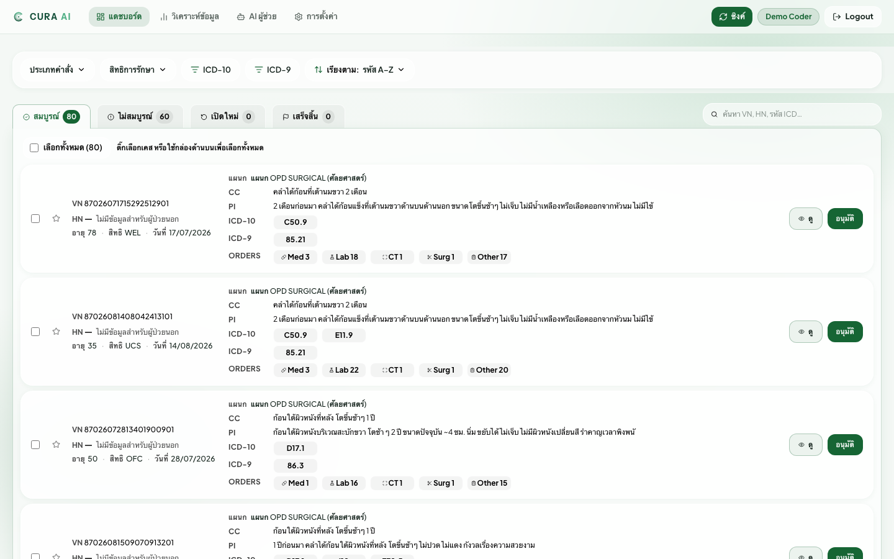
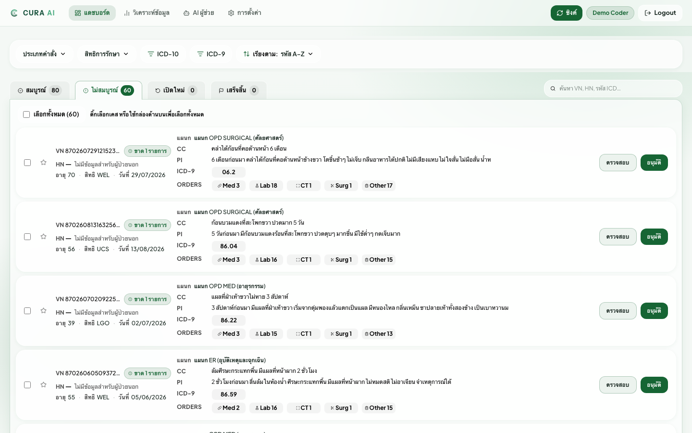
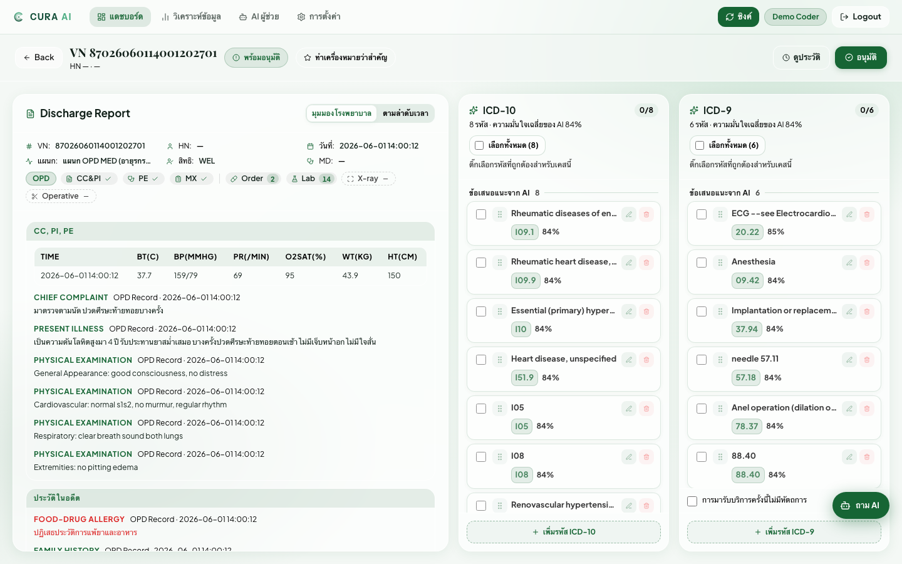
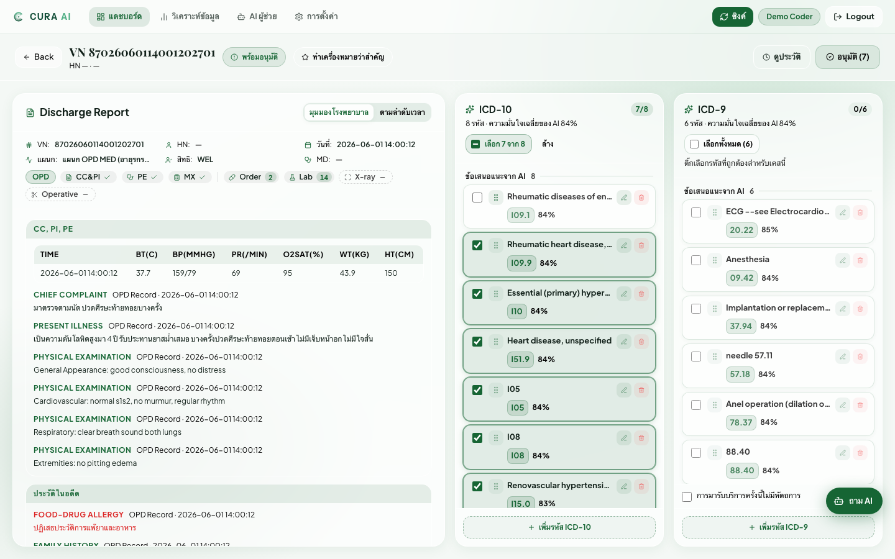
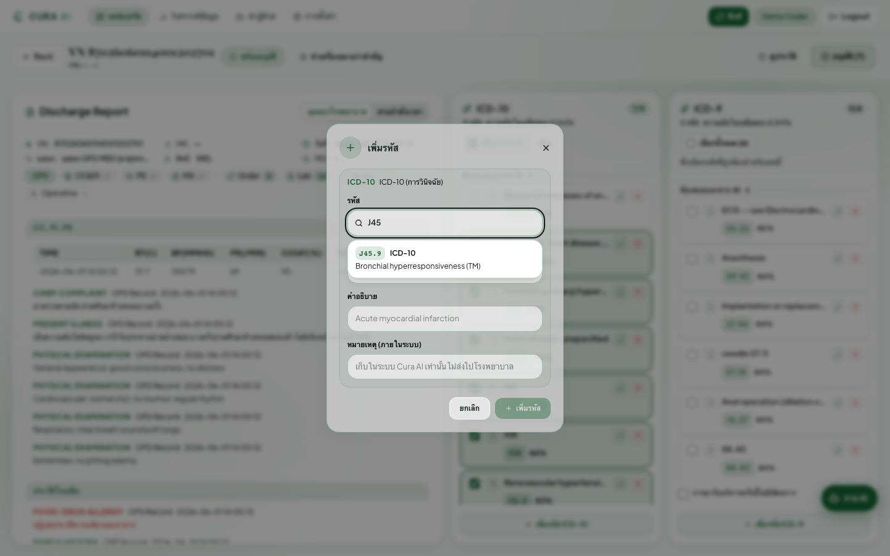
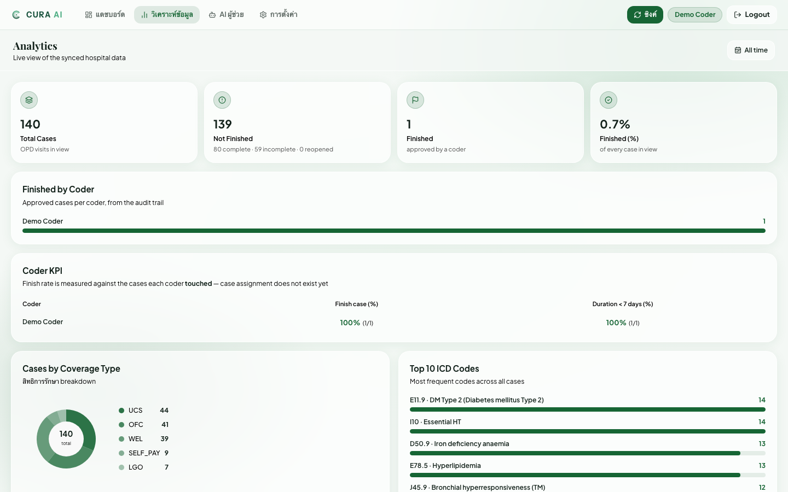
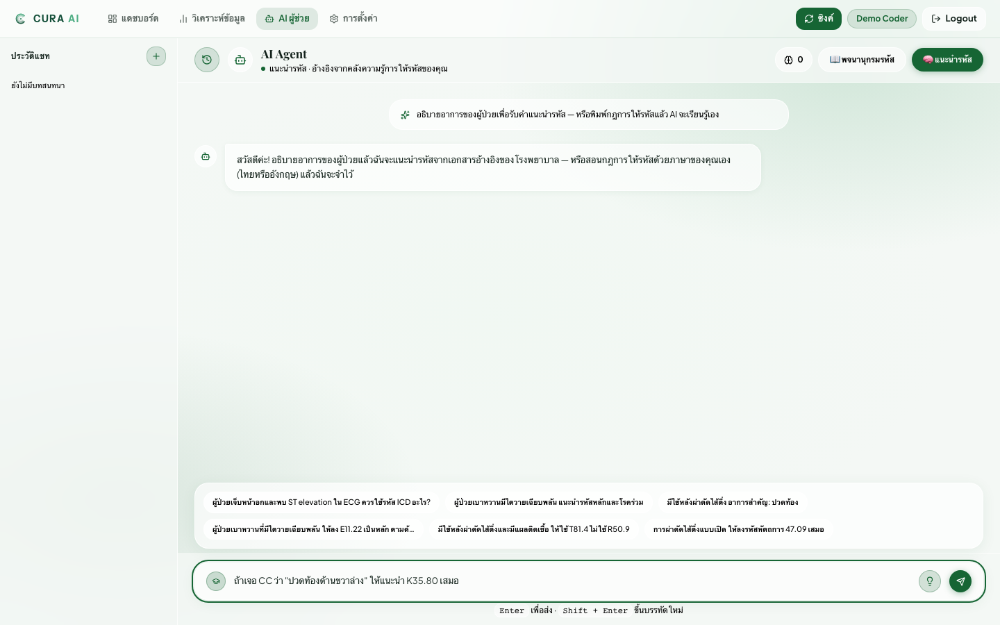
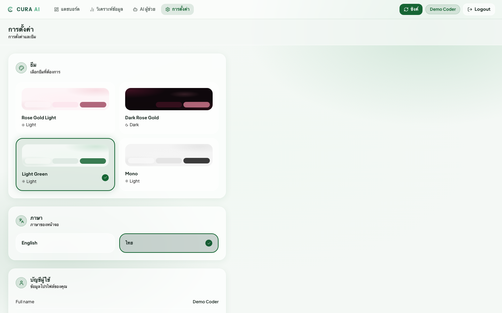

# คู่มือการใช้งานระบบ MedCode AI สำหรับเจ้าหน้าที่ให้รหัสโรค

เอกสารนี้เขียนขึ้นสำหรับ **เจ้าหน้าที่ให้รหัสโรค (Medical Coder)** ของโรงพยาบาล ที่จะใช้งานระบบ
MedCode AI ในการทำงานประจำวัน ไม่ใช่คู่มือสำหรับนักพัฒนาระบบ

> **หมายเหตุสำหรับผู้จัดทำภาพประกอบ**
> ภาพหน้าจอทั้ง 21 ภาพ ถ่ายจริงแล้วเมื่อ 2026-09-21 จากระบบที่รันด้วย `docker compose up`
> พร้อมข้อมูลตัวอย่าง (demo data) สลับเป็นภาษาไทยแล้วตามคำแนะนำเดิม ไฟล์ยังใช้ชื่อ
> `XX-placeholder.png` เหมือนเดิม (ไม่ได้เปลี่ยนชื่อไฟล์) อยู่ในโฟลเดอร์ `docs/screenshots/`

---

## สารบัญ

1. [บทนำ](#1-บทนำ)
2. [การเข้าสู่ระบบ](#2-การเข้าสู่ระบบ)
3. [หน้าจอหลัก / แดชบอร์ด](#3-หน้าจอหลัก--แดชบอร์ด)
4. [การซิงค์ข้อมูลผู้ป่วยจากโรงพยาบาล](#4-การซิงค์ข้อมูลผู้ป่วยจากโรงพยาบาล)
5. [การให้รหัส ICD ด้วยความช่วยเหลือของ AI](#5-การให้รหัส-icd-ด้วยความช่วยเหลือของ-ai)
6. [การตรวจสอบและอนุมัติ](#6-การตรวจสอบและอนุมัติ)
7. [หน้าวิเคราะห์ข้อมูล (Analytics)](#7-หน้าวิเคราะห์ข้อมูล-analytics)
8. [ผู้ช่วย AI แบบเต็มหน้าจอ (AI Agent)](#8-ผู้ช่วย-ai-แบบเต็มหน้าจอ-ai-agent)
9. [คำถามที่พบบ่อย / การแก้ไขปัญหาเบื้องต้น](#9-คำถามที่พบบ่อย--การแก้ไขปัญหาเบื้องต้น)

---

## 1. บทนำ

**MedCode AI** คือระบบสำหรับช่วยเจ้าหน้าที่ให้รหัสโรค (coder) ของโรงพยาบาล ในการ **ลงรหัสการวินิจฉัย
(ICD-10)** และ **รหัสหัตถการ (ICD-9)** ให้กับผู้ป่วยแต่ละราย (visit) โดยมี AI ช่วยเสนอแนะรหัสที่เกี่ยวข้อง
จากเวชระเบียนของผู้ป่วย เพื่อให้ผู้ให้รหัสทำงานได้เร็วขึ้นและไม่พลาดรหัสที่ควรลง

สิ่งที่ควรเข้าใจตั้งแต่แรก:

- **AI เป็นเพียงผู้ช่วยเสนอแนะ ไม่ใช่ผู้ตัดสินใจ** — ทุกรหัสที่ AI แนะนำจะไม่ถูกส่งไปโรงพยาบาลโดยอัตโนมัติ
  ผู้ให้รหัส (ท่าน) ต้องเป็นผู้ตรวจสอบ เลือก แก้ไข หรือเพิ่มรหัสเอง แล้วจึง **อนุมัติ** ด้วยตนเองเสมอ
- ข้อมูลผู้ป่วย/การมารับบริการ (visit) ทั้งหมดมาจากระบบของโรงพยาบาล (เรียกในระบบว่า **iMed**)
  ระบบ MedCode AI ไม่ได้สร้างข้อมูลผู้ป่วยขึ้นเอง แต่ "ดึง" หรือ **ซิงค์ (Sync)** ข้อมูลมาแสดง
- เมื่อท่าน **อนุมัติ** รหัสของเคสใดแล้ว รหัสเหล่านั้นจะถูก **ส่งกลับ (write-back)** ไปบันทึกในระบบของโรงพยาบาลจริง
  ไม่ใช่แค่บันทึกไว้ในหน้าจอนี้เท่านั้น — จึงควรตรวจสอบให้ถูกต้องก่อนกดอนุมัติทุกครั้ง

**ภาพรวมขั้นตอนการทำงาน:**

1. เข้าสู่ระบบด้วยบัญชีผู้ให้รหัสของท่าน
2. กด **ซิงค์ (Sync)** เพื่อดึงรายการผู้ป่วย (visit) ใหม่จากโรงพยาบาล
3. เปิดเคสที่ต้องการให้รหัส ดูคำแนะนำรหัสจาก AI พร้อมเวชระเบียนจริงประกอบการตัดสินใจ
4. ติ๊กเลือก / แก้ไข / เพิ่มรหัส ICD-10 และ ICD-9 ให้ถูกต้องครบถ้วน
5. กด **อนุมัติ (Approve)** — เคสจะย้ายไปคิว "เสร็จสิ้น" และรหัสจะถูกส่งกลับไปยังระบบโรงพยาบาล
6. หากพบว่าลงรหัสผิด สามารถ **เปิดเคสใหม่ (Reopen)** เพื่อแก้ไขแล้วอนุมัติซ้ำได้

---

## 2. การเข้าสู่ระบบ

1. เปิดเว็บเบราว์เซอร์แล้วไปที่ที่อยู่ของระบบที่ทางโรงพยาบาล/ผู้ดูแลระบบแจ้งให้ (ระหว่างพัฒนา/สาธิต
   ระบบมักรันอยู่ที่ `http://localhost:5173` — หากใช้งานจริงในโรงพยาบาล ที่อยู่จะเปลี่ยนไปตามที่ติดตั้ง
   โปรดสอบถามจากฝ่าย IT ของโรงพยาบาล)
2. จะพบหน้า **เข้าสู่ระบบ (Sign in)** ให้กรอก
   - **อีเมล (Email)** — บัญชีที่ผู้ดูแลระบบสร้างให้ท่าน (เช่น ชื่อผู้ใช้@โรงพยาบาล)
   - **รหัสผ่าน (Password)**
3. กดปุ่ม **เข้าสู่ระบบ (Sign in)**

> บัญชีผู้ใช้งาน (ทั้งบัญชีผู้ดูแลระบบและบัญชีผู้ให้รหัสแต่ละคน) จะถูกสร้างไว้ล่วงหน้าโดยผู้ดูแลระบบ
> ผู้ให้รหัสทั่วไป **ไม่สามารถสมัครบัญชีเองได้** หากลืมรหัสผ่านหรือเข้าระบบไม่ได้ ให้ติดต่อผู้ดูแลระบบ

หลังเข้าสู่ระบบสำเร็จ ระบบจะพาไปหน้าที่ต่างกันตามสิทธิ์ของบัญชี:

- บัญชี **ผู้ให้รหัส (coder)** → ไปที่หน้ารายการเคสของตนเอง (ดูหัวข้อที่ 3)
- บัญชี **ผู้ดูแลระบบ (admin)** → ไปที่หน้าจัดการระบบสำหรับผู้ดูแล (นอกเหนือขอบเขตคู่มือฉบับนี้ซึ่งเน้นการใช้งานของผู้ให้รหัส)

**เคล็ดลับ:** ระบบรองรับภาษาไทยในหน้าจอทั้งหมด สามารถเปลี่ยนภาษาได้ภายหลังจากเข้าสู่ระบบแล้ว ที่เมนู
**การตั้งค่า (Settings) → ภาษา (Language) → เลือก "ไทย"** (ดูหัวข้อ 7)

---

## 3. หน้าจอหลัก / แดชบอร์ด

เมื่อเข้าสู่ระบบในฐานะผู้ให้รหัสแล้ว จะเห็นแถบเมนูด้านบนของทุกหน้า ประกอบด้วย

| เมนู | ความหมาย |
|---|---|
| **แดชบอร์ด (Dashboard)** | หน้ารายการเคส/งานที่ต้องให้รหัส — เป็นหน้าหลักที่ใช้งานบ่อยที่สุด |
| **วิเคราะห์ข้อมูล (Analytics)** | สรุปภาพรวมข้อมูลการให้รหัส เช่น สถิติต่าง ๆ (ดูหัวข้อ 7) |
| **AI ผู้ช่วย (AI Agent)** | หน้าแชทถาม-ตอบกับ AI แบบเต็มหน้าจอ แยกจากแผงลอยในหน้าเคส (ดูหัวข้อ 8) |
| **การตั้งค่า (Settings)** | ปรับธีม ภาษา ดูข้อมูลบัญชีของตนเอง |

ที่มุมขวาบนจะมีปุ่ม **ซิงค์ (Sync)** สำหรับดึงข้อมูลจากโรงพยาบาล (หัวข้อ 4), ชื่อบัญชีที่ล็อกอินอยู่,
และปุ่ม **ออกจากระบบ (Logout)**

### หน้าแดชบอร์ด (รายการเคส) และความหมายของแต่ละแท็บ

หน้าแดชบอร์ดจะแบ่งงานออกเป็น **4 แท็บ** โดยแต่ละแท็บจะมีตัวเลขกำกับจำนวนเคสในวงเล็บ/ป้ายกลมข้างชื่อแท็บ:

- **สมบูรณ์ (Complete)** — เคสที่เวชระเบียนของโรงพยาบาล **มีข้อมูลครบถ้วน** (มีอาการสำคัญ, ผลตรวจร่างกาย,
  สรุปการวินิจฉัย ครบ) พร้อมให้ผู้ให้รหัสเปิดมาลงรหัสได้เลย
  > ⚠️ คำว่า "สมบูรณ์" หมายถึง **เอกสารทางการแพทย์ครบถ้วน** เท่านั้น **ไม่ได้แปลว่าให้รหัสแล้ว** —
  > ทุกเคสในแท็บนี้ยังไม่มีรหัส ICD ต้องให้ผู้ให้รหัสเป็นผู้ลงรหัสทั้งหมด
- **ไม่สมบูรณ์ (Incomplete)** — เคสที่เอกสารยังไม่ครบ (เช่น ยังไม่มีบันทึกอาการสำคัญ/ผลตรวจร่างกาย/สรุปวินิจฉัย)
  ระบบจะแสดงป้ายบอกว่าขาดส่วนใดบ้าง (เช่น CC, PE, A/P, Dx) ยังสามารถเปิดดูและลงรหัสเท่าที่ข้อมูลมีได้
- **เปิดใหม่ (Reopened)** — เคสที่เคยอนุมัติไปแล้ว แต่ถูกดึงกลับมาแก้ไขอีกครั้ง (โดยตนเองหรือเพื่อนร่วมงาน)
  จะรออยู่ที่นี่จนกว่าจะอนุมัติซ้ำ
- **เสร็จสิ้น (Finished)** — เคสที่อนุมัติแล้ว และรหัสถูกส่งกลับไปบันทึกในระบบโรงพยาบาลเรียบร้อยแล้ว

ภายในแต่ละแท็บ ยังมี:

- **ช่องค้นหา** ที่มุมขวาบนของรายการ ค้นหาได้จากเลข VN, HN หรือรหัส ICD
- **ตัวกรอง (Filter)** สำหรับกรองตามแผนก สิทธิการรักษา ผู้ให้รหัส หรือรหัส ICD เฉพาะ
- **ปุ่มดาว/ทำเครื่องหมายสำคัญ** ที่แต่ละเคส ใช้ติดดาวเคสที่ต้องการให้เพื่อนร่วมทีมสังเกตเห็นก่อน (เคสที่ติดดาวจะลอยขึ้นบนสุดของแท็บ)
- ปุ่ม **ดู (View)** หรือ **ตรวจสอบ (Review)** ท้ายแต่ละแถว สำหรับเปิดเคสนั้นเข้าไปดูรายละเอียด

ถ้ายังไม่เคยซิงค์ข้อมูล หรือยังไม่มีข้อมูลผู้ป่วยเลย ทุกแท็บจะว่างเปล่าและมีข้อความ/ปุ่มแนะนำให้กด
**"ซิงค์จากโรงพยาบาล"** — ดูหัวข้อถัดไป

---

## 4. การซิงค์ข้อมูลผู้ป่วยจากโรงพยาบาล

ข้อมูลผู้ป่วยไม่ได้เข้ามาในระบบเองอัตโนมัติตลอดเวลา ผู้ให้รหัสต้องกด **ซิงค์ (Sync)** เพื่อดึงรายการ
การมารับบริการ (visit) ล่าสุดจากระบบของโรงพยาบาลเข้ามาที่แดชบอร์ด

**ขั้นตอน:**

1. กดปุ่ม **ซิงค์ (Sync)** ที่มุมขวาบนของหน้าจอ (อยู่ตลอดทุกหน้า ไม่ต้องกลับไปแดชบอร์ดก่อน)
2. เลือก **ช่วงเวลาที่ต้องการซิงค์** จากหน้าต่างที่เปิดขึ้นมา มีให้เลือก 3 แบบ:
   - **ด่วน (Quick)** — ช่วงสำเร็จรูป เช่น วันนี้ / สัปดาห์นี้ / เดือนนี้ / ปีนี้ หรือ "ทั้งหมด"
   - **วันที่ระบุ (Specific date)** — เลือกวันใดวันหนึ่ง
   - **ช่วงวันที่ (Date range)** — ระบุวันที่เริ่มต้นและสิ้นสุดเอง
3. กดยืนยัน — ระบบจะถามยืนยันอีกครั้งว่าต้องการดึงข้อมูลจากโรงพยาบาลจริง (เพราะจะรีเฟรชแดชบอร์ด
   และโหลดเคสที่ยังไม่ได้อนุมัติใหม่จาก iMed) กดปุ่ม **"ซิงค์เลย"** เพื่อยืนยัน

4. ระหว่างซิงค์ ปุ่มจะเปลี่ยนข้อความเป็น **"กำลังซิงค์…"** ให้รอจนกว่าจะเสร็จ (ระยะเวลาขึ้นกับจำนวนเคสและ
   ความเร็วเครือข่าย)
5. เมื่อซิงค์เสร็จ ตัวเลขในแต่ละแท็บของแดชบอร์ดจะปรับตามข้อมูลที่ดึงมาใหม่ (เช่น จำนวนเคสในแท็บ "สมบูรณ์"
   และ "ไม่สมบูรณ์")

> **หมายเหตุ:** การซิงค์จะไม่ไปแตะต้องเคสที่อนุมัติไปแล้ว (แท็บ "เสร็จสิ้น") ข้อมูลเหล่านั้นปลอดภัย
> สามารถซิงค์ซ้ำได้เรื่อย ๆ เพื่อดึงเคสใหม่ที่เข้ามาระหว่างวัน

---

## 5. การให้รหัส ICD ด้วยความช่วยเหลือของ AI

นี่คือขั้นตอนหลักของการทำงานประจำวัน

### 5.1 เปิดเคสที่ต้องการให้รหัส

จากแท็บ **สมบูรณ์** หรือ **ไม่สมบูรณ์** ในหน้าแดชบอร์ด กดปุ่ม **ดู (View)** หรือ **ตรวจสอบ (Review)**
ที่แถวของเคสที่ต้องการ

- ในแท็บ "ไม่สมบูรณ์" จะเห็นป้ายเล็ก ๆ บอกว่าเอกสารส่วนใดยังขาด เช่น **CC** (อาการสำคัญ), **PE**
  (ผลตรวจร่างกาย), **A/P** (การประเมิน/แผนการรักษา), **Dx** (การวินิจฉัยหลัก) — ยังเปิดดูและลงรหัสเท่าที่มีข้อมูลได้

### 5.2 ทำความเข้าใจหน้าจอรายละเอียดเคส

เมื่อเปิดเคสแล้ว หน้าจอจะแบ่งเป็น 3 ส่วนหลัก เรียงจากซ้ายไปขวา:

1. **เวชระเบียน (Discharge Report)** — บันทึกทางการแพทย์จริงของผู้ป่วยที่ดึงมาจากโรงพยาบาล
   **อ่านได้อย่างเดียว แก้ไขไม่ได้** เพราะเป็นบันทึกต้นฉบับของแพทย์ มีสัญญาณชีพ ผลแล็บ ผลเอกซเรย์
   และหมายเหตุความคืบหน้าประกอบ สามารถสลับมุมมองได้ 2 แบบ:
   - **มุมมองโรงพยาบาล (Hospital view)** — จัดกลุ่มเหมือนหน้าจอที่โรงพยาบาลใช้เอง (CC/PI/PE,
     ประวัติในอดีต, แลบ/เอกซเรย์, การวินิจฉัย/หัตถการ, รายการสั่งแพทย์ ฯลฯ)
   - **ตามลำดับเวลา (Chronological)** — เรียงตามเวลาบันทึกจริง
2. **คอลัมน์ ICD-10 (การวินิจฉัย)** — รายการรหัสวินิจฉัยของเคสนี้
3. **คอลัมน์ ICD-9 (หัตถการ)** — รายการรหัสหัตถการ/การผ่าตัดของเคสนี้ (ถ้ามี)

ที่หัวหน้าจอจะเห็นเลข **VN** (เลขที่การมารับบริการ) เลข **HN** (เลขประจำตัวผู้ป่วย) แผนก และสถานะเคส
(เช่น **"รออนุมัติ"**)

### 5.3 อ่านคำแนะนำรหัสจาก AI

ในคอลัมน์ ICD-10 และ ICD-9 รหัสจะถูกจัดกลุ่มตามที่มาเพื่อให้แยกได้ชัดเจนว่ารหัสไหนมาจากไหน:

- **"ผู้ให้รหัสเพิ่มเอง"** — รหัสที่ท่านหรือเพื่อนร่วมทีมพิมพ์เพิ่มเข้าไปเอง
- **"จากเวชระเบียนโรงพยาบาล"** — รหัสที่โรงพยาบาลบันทึกไว้แล้ว (ถือเป็นข้อเท็จจริง ไม่ใช่การเดา)
- **"ข้อเสนอแนะจาก AI"** — รหัสที่ระบบ AI วิเคราะห์จากเนื้อหาเวชระเบียนแล้วเสนอแนะให้

รหัสที่มาจาก AI แต่ละรายการ จะมี **ตัวเลขเปอร์เซ็นต์ (%)** กำกับอยู่ เรียกว่า **"ความมั่นใจของ AI"**
— ยิ่งเปอร์เซ็นต์สูง แปลว่า AI มั่นใจมากว่ารหัสนี้เหมาะกับเวชระเบียนของเคสนี้ แต่ **ตัวเลขนี้ไม่ใช่การรับประกันความถูกต้อง**
ผู้ให้รหัสยังต้องอ่านเวชระเบียนประกอบและตัดสินใจเองเสมอ (รหัสจากโรงพยาบาลหรือที่พิมพ์เพิ่มเองจะไม่มี % กำกับ
เพราะไม่ใช่การคาดเดาของโมเดล)

### 5.4 เลือก แก้ไข และเพิ่มรหัส

**สำคัญ:** เมื่อเปิดเคสขึ้นมา **จะยังไม่มีรหัสใดถูกติ๊กเลือกไว้ล่วงหน้า** (แม้แต่รหัสที่ AI แนะนำมาให้)
ผู้ให้รหัสต้อง **ติ๊กเลือก (✔)** ทีละรหัสที่เห็นว่าถูกต้องและต้องการส่งไปบันทึกกับโรงพยาบาล รหัสที่ไม่ติ๊ก
จะยังค้างอยู่ในเคสให้ดูอ้างอิงได้ แต่จะ**ไม่ถูกส่ง**ไปยังโรงพยาบาลตอนอนุมัติ

การจัดการรหัสอื่น ๆ ที่ทำได้ในหน้านี้:

- **จัดลำดับความสำคัญ** — ลากที่ไอคอนจับ (⋮⋮) ข้างรหัสเพื่อย้ายตำแหน่งขึ้น-ลงภายในคอลัมน์เดียวกัน
  ตำแหน่งบนสุดของ ICD-10 ที่ถูกติ๊กเลือก จะถูกใช้เป็น **การวินิจฉัยหลัก (Primary diagnosis)** ของเคส
- **แก้ไขรหัส** — กดไอคอนดินสอ (แก้ไขรหัส) ที่การ์ดรหัส จะเปิดหน้าต่าง **"แก้ไขรหัส"** ให้เปลี่ยนตัวรหัส
  (ค้นหาจากช่องค้นหารหัส) ประเภทรหัส (เช่น การวินิจฉัยหลัก / โรคร่วม / อื่น ๆ / สาเหตุภายนอกของการบาดเจ็บ
  สำหรับ ICD-10 หรือ การวินิจฉัยหลัก/โรคร่วม สำหรับ ICD-9), คำอธิบาย, และหมายเหตุภายใน (เก็บไว้ในระบบนี้
  เท่านั้น ไม่ถูกส่งไปโรงพยาบาล) — ถ้าเป็นรหัส ICD-9 (หัตถการ) จะมีช่องระบุ **ประเภทหัตถการ** และ
  **เวลาเริ่ม/สิ้นสุดหัตถการ** เพิ่มเติม เนื่องจากหัตถการต้องมีช่วงเวลาระบุเสมอ

- **เพิ่มรหัสใหม่** — หากพบว่าควรมีรหัสที่ AI และโรงพยาบาลไม่ได้ให้มา กดปุ่ม **"+ เพิ่มรหัส ICD-10"**
  หรือ **"+ เพิ่มรหัส ICD-9"** ที่ด้านล่างของคอลัมน์นั้น ๆ แล้วค้นหา/กรอกรหัสใหม่ รหัสที่พิมพ์เพิ่มเองจะถูก
  ติ๊กเลือกให้อัตโนมัติทันที (เพราะการพิมพ์เพิ่มถือเป็นการยืนยันแล้ว)

- **ลบรหัส** — กดไอคอนถังขยะที่การ์ดรหัส แล้วยืนยันการลบ (ทำได้กับรหัสที่ยังไม่ได้อนุมัติเท่านั้น)
- **กรณีไม่มีหัตถการเลย** — หากตรวจสอบแล้วว่าการมารับบริการครั้งนี้ **ไม่มีหัตถการ** ให้ติ๊กช่อง
  **"การมารับบริการครั้งนี้ไม่มีหัตถการ"** ที่ด้านล่างของคอลัมน์ ICD-9 แทนการปล่อยว่างไว้เฉย ๆ
  เพื่อยืนยันว่าตรวจสอบแล้วจริง ๆ ไม่ใช่แค่ลืมกรอก

### 5.5 ถาม AI ผู้ช่วยเพิ่มเติม (ถ้าต้องการ)

ในหน้ารายละเอียดเคส จะมีแผงลอย **"AI ผู้ช่วย"** ให้ถามคำถามเกี่ยวกับเคสที่เปิดอยู่ได้ทันที เช่น
"รหัสนี้เหมาะกับเคสนี้หรือไม่", "การวินิจฉัยใดควรเป็นโรคหลัก", หรือค้นความหมายของรหัส ICD — คำตอบของ
AI ผู้ช่วยเป็น **คำแนะนำเท่านั้น** ผู้ให้รหัสยังคงเป็นผู้อนุมัติขั้นสุดท้ายเสมอ (มีข้อความกำกับในระบบว่า
"เป็นเพียงคำแนะนำ — ผู้ให้รหัสเป็นผู้อนุมัติ")

---

## 6. การตรวจสอบและอนุมัติ

เมื่อตรวจสอบและติ๊กเลือกรหัสครบถ้วนแล้ว ขั้นตอนสุดท้ายคือการอนุมัติ

### 6.1 เงื่อนไขก่อนอนุมัติ

ปุ่ม **อนุมัติ** ที่มุมขวาบนของหน้าเคส จะ**กดไม่ได้ (เป็นสีจาง)** จนกว่าเคสจะมี:

- รหัส ICD-10 (การวินิจฉัย) ที่ถูกติ๊กเลือกไว้ **อย่างน้อย 1 รหัส**
- รหัส ICD-9 (หัตถการ) ที่ถูกติ๊กเลือกไว้ **อย่างน้อย 1 รหัส** หรือ ติ๊กยืนยัน **"ไม่มีหัตถการ"** แทน

ถ้ายังไม่ครบ เมื่อวางเมาส์ที่ปุ่ม (หรือพยายามกด) ระบบจะบอกว่าขาดส่วนใด เช่น "เลือกรหัสวินิจฉัย ICD-10
อย่างน้อย 1 รหัสก่อนอนุมัติ"

### 6.2 กดอนุมัติ

1. เมื่อครบเงื่อนไขแล้ว ปุ่มจะเปลี่ยนเป็น **"อนุมัติ (N)"** โดย N คือจำนวนรหัสที่ติ๊กเลือกไว้ กดปุ่มนี้
2. จะมีหน้าต่างยืนยันสรุปว่ากำลังจะอนุมัติกี่รหัสให้ผู้ป่วยรายใด และถ้ามีรหัสที่แนะนำแต่ไม่ได้ติ๊กเลือก
   ระบบจะบอกด้วยว่ารหัสเหล่านั้นจะยังค้างอยู่ในระบบแต่ **จะไม่ถูกส่งไปโรงพยาบาล**
3. กดยืนยัน **"อนุมัติ"** อีกครั้งเพื่อยืนยันจริง

หลังยืนยัน เคสจะ:

- ย้ายออกจากแท็บ "สมบูรณ์"/"ไม่สมบูรณ์" ไปอยู่ในแท็บ **"เสร็จสิ้น"**
- รหัสที่ติ๊กเลือกไว้จะถูก **ส่งกลับไปบันทึกจริงในระบบของโรงพยาบาล (iMed)** ทันที

**อนุมัติหลายเคสพร้อมกัน:** ในหน้ารายการเคส (แท็บ "สมบูรณ์" หรือ "ไม่สมบูรณ์") สามารถติ๊กเลือกได้หลายแถว
แล้วกดปุ่ม **"อนุมัติที่เลือก (N)"** ที่ปรากฏขึ้น เพื่ออนุมัติหลายเคสพร้อมกันในการยืนยันครั้งเดียว
เหมาะสำหรับเคสที่ตรวจสอบแล้วมั่นใจว่าถูกต้อง

### 6.3 เปิดเคสใหม่ (แก้ไขหลังอนุมัติ)

หากพบว่าลงรหัสผิดหลังจากอนุมัติไปแล้ว สามารถแก้ไขได้โดย:

1. ไปที่แท็บ **"เสร็จสิ้น"** หาเคสที่ต้องการแก้ไข
2. กดปุ่ม **"เปิดใหม่ (Reopen)"** ที่แถวของเคสนั้น (หรือกดปุ่มเดียวกันจากภายในหน้ารายละเอียดเคส)
3. ยืนยันในหน้าต่างที่เปิดขึ้นมา — ระบบจะเตือนว่ารหัสที่เคยส่งไปโรงพยาบาลแล้วจะถูก **เพิกถอน (withdraw)**
   และเคสจะกลับไปให้แก้ไขใหม่

4. เคสจะย้ายไปอยู่ในแท็บ **"เปิดใหม่ (Reopened)"** ให้แก้ไขรหัสแล้วกดอนุมัติซ้ำตามขั้นตอนในหัวข้อ 6.1–6.2

> **ข้อควรทราบ:** ระบบอนุญาตให้ **ผู้ให้รหัสคนใดก็ได้** เปิดเคสของเพื่อนร่วมทีมกลับมาแก้ไข ไม่จำกัดเฉพาะ
> คนที่อนุมัติไว้เดิม และการเปิดเคสในระบบนี้ **ไม่มีผลต่อสถานะทางคลินิก** ของผู้ป่วย (ผลการรักษา/จำหน่าย
> ที่แพทย์บันทึกไว้) — มีผลเฉพาะสถานะการให้รหัสในระบบนี้เท่านั้น

---

## 7. หน้าวิเคราะห์ข้อมูล (Analytics)

หน้านี้เข้าถึงได้จากเมนูด้านบน **"วิเคราะห์ข้อมูล (Analytics)"** ใช้สำหรับดูภาพรวมของงานให้รหัส
ทั้งของตนเองและของทีม ไม่ใช่หน้าสำหรับให้รหัสรายเคส

เนื้อหาหลักในหน้านี้:

- **สรุปภาพรวม** — จำนวนเคสทั้งหมดที่อยู่ในมุมมองปัจจุบัน (Total Cases) และสัดส่วนเคสที่ **เสร็จสิ้นแล้ว**
  เทียบกับ **ยังไม่เสร็จสิ้น** (Finished / Not Finished) แสดงเป็นทั้งจำนวนและเปอร์เซ็นต์
- **ตัวกรองตามช่วงวันที่ (Filter by date)** — ปรับมุมมองข้อมูลย้อนหลังได้ ระบบระบุว่านี่คือ
  **"มุมมองข้อมูลสด ที่ซิงค์มาจากโรงพยาบาลจริง"** ไม่ใช่ข้อมูลจำลอง
- **สรุปผลงานรายบุคคล (Coder KPI)** — ตารางแสดงผลงานของผู้ให้รหัสแต่ละคน เช่น จำนวนเคสที่อนุมัติแล้ว
  ต่อคน เพื่อให้หัวหน้าทีมหรือผู้ดูแลระบบเห็นภาพรวมของทีม
- **สัดส่วนสิทธิการรักษา และการวินิจฉัยหลักที่พบบ่อย** — สรุปให้เห็นแนวโน้มของเคสที่เข้ามาในช่วงเวลานั้น

> หน้านี้เหมาะสำหรับหัวหน้าเจ้าหน้าที่ให้รหัส หรือฝ่ายตรวจสอบคุณภาพ (Medical Audit) ที่ต้องการภาพรวม
> มากกว่ารายเคส — เชื่อมโยงกับแนวคิด "ตรวจสอบคุณภาพและความถูกต้อง" ที่ระบบนี้ถูกออกแบบมาเพื่อรองรับ

---

## 8. ผู้ช่วย AI แบบเต็มหน้าจอ (AI Agent)

นอกจากแผงลอย "AI ผู้ช่วย" ในหน้ารายละเอียดเคส (หัวข้อ 5.5) ระบบยังมี **หน้าผู้ช่วย AI แบบเต็มหน้าจอ**
แยกต่างหาก เข้าถึงได้จากเมนู **"AI ผู้ช่วย (AI Agent)"** ด้านบน ซึ่งมีความสามารถมากกว่าการถามตอบทั่วไป
แบ่งเป็น 2 โหมดหลัก:

### 8.1 📖 พจนานุกรมรหัส (Code Dictionary)

โหมดสำหรับถาม-ตอบทั่วไปเกี่ยวกับรหัส ICD ไม่ผูกกับเคสใดเคสหนึ่ง เช่น ถามความหมายของรหัส ถามว่า
อาการแบบนี้ควรพิจารณารหัสกลุ่มใด เหมาะสำหรับตรวจสอบความรู้ระหว่างทำงาน

### 8.2 🧠 แนะนำรหัส (Suggest & Learn) — สอนกฎการให้รหัสให้ AI

โหมดนี้ให้ผู้ให้รหัสที่มีประสบการณ์ **"สอน"** กฎการให้รหัสที่ทีมใช้จริงให้ระบบ AI จดจำไว้ โดยพิมพ์อธิบาย
กฎเหมือนกำลังสอนเพื่อนร่วมงานใหม่ (เช่น "ถ้าเจอ... ให้ใช้รหัส...") ระบบจะสรุปเป็นกฎที่บันทึกไว้ และ
จะถูกนำไปใช้ประกอบการแนะนำรหัสในเคสอื่น ๆ ที่ตรงเงื่อนไขต่อไป

- กด **"กฎที่สอนไว้" (Learned rules)** เพื่อดูรายการกฎทั้งหมดที่เคยสอนไว้ ลบ/ปิดใช้งานกฎที่ไม่ต้องการได้
- มี **"ประวัติแชท" (Chat history)** เก็บบทสนทนาก่อนหน้า สามารถเปิดดูหรือเริ่มบทสนทนาใหม่ได้

> ⚠️ เช่นเดียวกับคำแนะนำ AI ในหน้าเคส กฎที่สอนไว้เป็น **ตัวช่วย** เท่านั้น ผู้ให้รหัสยังต้องตรวจสอบ
> ความถูกต้องทุกครั้งก่อนอนุมัติ

---

## 9. คำถามที่พบบ่อย / การแก้ไขปัญหาเบื้องต้น

**ถาม: ทำไมไม่มีคำแนะนำรหัสจาก AI ปรากฏในเคสที่เปิด?**
เป็นไปได้ว่าระบบผู้ช่วย AI (ที่วิเคราะห์เวชระเบียนเพื่อเสนอรหัส) ขัดข้องหรือกำลังประมวลผลอยู่ ระบบหลัก
ยังใช้งานได้ตามปกติ เพียงแต่คอลัมน์รหัสจะยังว่างจนกว่า AI จะตอบกลับ — สามารถรอสักครู่แล้วลองเปิดเคสใหม่
อีกครั้ง หรือพิมพ์รหัสเองก่อนได้เลยโดยไม่ต้องรอ

**ถาม: ทำไมปุ่ม "อนุมัติ" กดไม่ได้ (เป็นสีจาง)?**
แปลว่ายังติ๊กเลือกรหัสไม่ครบตามเงื่อนไข (ต้องมี ICD-10 อย่างน้อย 1 รหัส และ ICD-9 อย่างน้อย 1 รหัส
หรือติ๊ก "ไม่มีหัตถการ") ให้สังเกตข้อความเตือนที่ขึ้นเมื่อวางเมาส์บนปุ่ม จะบอกว่าขาดส่วนใด

**ถาม: หาเคสที่คาดว่าต้องมีไม่เจอ?**
ลองตรวจสอบตามลำดับนี้:
1. อยู่ถูกแท็บหรือไม่ (สมบูรณ์ / ไม่สมบูรณ์ / เปิดใหม่ / เสร็จสิ้น)
2. มีตัวกรอง (Filter) หรือคำค้นหาค้างอยู่หรือไม่ — หากผลการค้นหาว่างเปล่าทั้งที่มีเคสอยู่ ระบบจะมีลิงก์
   **"แสดงทั้งหมด"** ให้กดล้างตัวกรอง
3. ลองกด **ซิงค์ (Sync)** ใหม่อีกครั้ง โดยเลือกช่วงเวลาที่กว้างขึ้น หรือเลือก **"ทั้งหมด"**

**ถาม: ระบบแจ้งว่า "เคสนี้กำลังมีผู้ทำงานอยู่" เปิดเคสไม่ได้?**
ระบบอนุญาตให้ **ผู้ให้รหัสทำงานในเคสเดียวกันได้ทีละคนเท่านั้น** เพื่อป้องกันการแก้ไขชนกัน เคสจะปลดล็อก
โดยอัตโนมัติทันทีที่อีกฝ่ายออกจากหน้านั้น รอสักครู่แล้วลองเปิดใหม่อีกครั้ง

**ถาม: ตัวเลขเปอร์เซ็นต์ "ความมั่นใจ AI" ข้างรหัสหมายถึงอะไร?**
เป็นตัวเลขที่บอกว่าโมเดล AI มั่นใจแค่ไหนว่ารหัสนั้นเหมาะกับเวชระเบียนของเคสนี้ **ไม่ใช่การรับประกันความถูกต้อง**
ยังต้องใช้วิจารณญาณของผู้ให้รหัสตรวจสอบกับเวชระเบียนจริงก่อนติ๊กเลือกเสมอ รหัสที่มาจากโรงพยาบาลหรือพิมพ์
เพิ่มเอง จะไม่มีตัวเลขนี้กำกับ เพราะไม่ใช่การคาดเดาของโมเดล

**ถาม: ออกจากระบบแล้วรหัสที่แก้ไว้แต่ยังไม่ได้อนุมัติจะหายไหม?**
เมื่อกด **ออกจากระบบ (Logout)** เคสที่เปิดค้างไว้จะถูกปลดล็อกให้คนอื่นใช้งานต่อได้ และ
**การแก้ไขรหัสที่ยังไม่ได้กดอนุมัติอาจไม่ถูกเก็บไว้** — แนะนำให้กดอนุมัติ หรือบันทึกงานที่ทำค้างไว้
ให้เรียบร้อยก่อนออกจากระบบทุกครั้ง

**ถาม: ต้องการเปลี่ยนภาษาหน้าจอเป็นไทย ทำอย่างไร?**
ไปที่เมนู **การตั้งค่า (Settings)** → หัวข้อ **"ภาษา"** → เลือก **"ไทย"** หน้าจอทั้งหมดจะเปลี่ยนเป็น
ภาษาไทยทันทีโดยไม่ต้องออกจากระบบใหม่

**ถาม: ข้อมูลในระบบทดสอบ/สาธิตยุ่งเหยิง ต้องการล้างกลับไปจุดเริ่มต้น ทำอย่างไร?**
ในสภาพแวดล้อมสำหรับสาธิต/ทดสอบเท่านั้น (ไม่ใช่ระบบที่ใช้งานจริงกับข้อมูลผู้ป่วยจริง) ที่หน้า
**การตั้งค่า (Settings)** จะมีส่วน **"Demo tools"** ให้กดปุ่ม **"รีเซ็ตเดโม (Reset demo)"** แล้วยืนยัน
ระบบจะเปิดเคสที่อนุมัติไว้ทั้งหมดกลับคืนสู่คิวเดิม และเพิกถอนรหัสที่เคยส่งไปยังระบบโรงพยาบาล
กลับไปสู่จุดตั้งต้นของการสาธิต

> ⚠️ **คำเตือน:** การรีเซ็ตเดโม **ไม่สามารถย้อนกลับได้ (Undo ไม่ได้)** และมีไว้สำหรับสภาพแวดล้อม
> ทดสอบ/สาธิตเท่านั้น **ห้ามใช้ปุ่มนี้กับระบบที่ใช้งานจริงกับข้อมูลผู้ป่วยจริงของโรงพยาบาลโดยเด็ดขาด**

*(ภาพประกอบส่วน Demo tools ไม่ใช่ลำดับความสำคัญสูง — ถ่ายเพิ่มภายหลังได้หากมีเวลา ไม่อยู่ใน
21 ภาพหลักของคู่มือนี้)*

**ถาม: ระบบขึ้นข้อความว่าไม่สามารถยืนยันได้ว่าส่งเคสถึงโรงพยาบาลแล้ว ทำอย่างไร?**
อาจเกิดจากปัญหาการเชื่อมต่อกับระบบโรงพยาบาลชั่วคราว เคสจะถูกดึงกลับมาอยู่ในคิวเดิมให้อัตโนมัติ
(ไม่ได้อนุมัติค้างไว้ครึ่ง ๆ กลาง ๆ) ให้ตรวจสอบการเชื่อมต่อเครือข่าย แล้วลองกด **อนุมัติ** ใหม่อีกครั้ง
หากยังไม่สำเร็จ ให้แจ้งฝ่าย IT ของโรงพยาบาล

---

*เอกสารนี้อ้างอิงจากหน้าจอจริงของระบบ ณ วันที่จัดทำ หากมีการปรับปรุงหน้าจอในอนาคต ควรตรวจสอบและ
ปรับปรุงคู่มือ รวมถึงถ่ายภาพหน้าจอใหม่ให้ตรงกับเวอร์ชันล่าสุดเสมอ*
