# คู่มือการใช้งาน — MedCode AI ระบบผู้ช่วยให้รหัสโรคและหัตถการด้วยปัญญาประดิษฐ์

เอกสารชุดนี้อธิบายการใช้งานระบบทั้งสองส่วน ได้แก่ **ระบบสำหรับผู้ให้รหัส** และ **ระบบสำหรับผู้ดูแลระบบ**
ภาพประกอบทุกภาพถ่ายจากระบบที่ทำงานจริง (21 และ 23 กันยายน 2569) โดยใช้ข้อมูลผู้ป่วยสมมุติทั้งหมด
**ไม่มีข้อมูลผู้ป่วยจริงในเอกสารชุดนี้** หน้าจอของระบบแสดงชื่อผลิตภัณฑ์ว่า **CURA AI**

| หัวข้อ | สำหรับ |
|---|---|
| ส่วนที่ 1 · ระบบสำหรับผู้ให้รหัส | เจ้าหน้าที่ให้รหัสโรค (Medical Coder) |
| ส่วนที่ 2 · ระบบสำหรับผู้ดูแลระบบ | ผู้ดูแลระบบ และหัวหน้างานเวชระเบียน |
| ส่วนที่ 3 · คำถามที่พบบ่อยและการแก้ไขปัญหา | ทุกคน |

> **หลักการที่ควรเข้าใจก่อนใช้งาน**
>
> - **AI เป็นผู้ช่วยเสนอแนะ ไม่ใช่ผู้ตัดสินใจ** — ไม่มีรหัสใดที่ AI แนะนำถูกติ๊กเลือกไว้ล่วงหน้า และไม่มีรหัสใดถูกส่งไปโรงพยาบาลเองโดยอัตโนมัติ
> - ข้อมูลผู้ป่วยทั้งหมดมาจากระบบของโรงพยาบาล (เรียกในระบบว่า **iMed**) ระบบนี้ไม่ได้สร้างข้อมูลผู้ป่วยขึ้นเอง
> - เมื่อกด **อนุมัติ** รหัสที่เลือกจะถูก **บันทึกกลับ (write-back) ลงระบบของโรงพยาบาลจริง** ทันที จึงควรตรวจสอบให้ถูกต้องก่อนกดทุกครั้ง
> - หากระบบ AI ขัดข้อง ผู้ให้รหัสยังทำงานต่อได้ตามปกติ (ซิงค์ แก้ไขรหัส อนุมัติ เปิดใหม่) มีเพียงคำแนะนำจาก AI ที่หยุดทำงาน

---

## ส่วนที่ 1 · ระบบสำหรับผู้ให้รหัส

ขั้นตอนการทำงานประจำวันมี 6 ขั้น

1. เข้าสู่ระบบด้วยบัญชีผู้ให้รหัสของตนเอง
2. กด **ซิงค์** เพื่อดึงรายการการมารับบริการ (visit) จากโรงพยาบาล
3. เปิดเคส อ่านเวชระเบียน และดูรหัสที่ AI แนะนำ
4. ติ๊กเลือก แก้ไข หรือเพิ่มรหัส ICD-10 และ ICD-9 ให้ถูกต้องครบถ้วน
5. กด **อนุมัติ** — เคสย้ายไปแท็บ "เสร็จสิ้น" และรหัสถูกบันทึกลงระบบโรงพยาบาล
6. หากพบว่าผิด กด **เปิดใหม่** เพื่อแก้ไขแล้วอนุมัติซ้ำ

### 1.1 เข้าสู่ระบบ

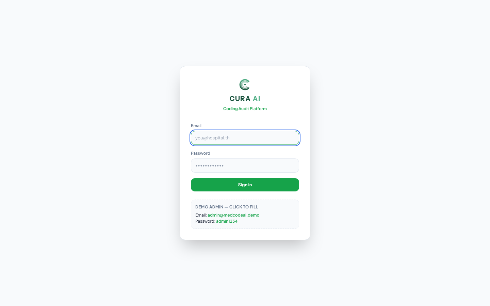 <em>ภาพที่ 1 · หน้าเข้าสู่ระบบ</em>

เปิดเว็บเบราว์เซอร์ไปที่ที่อยู่ของระบบที่ฝ่าย IT แจ้ง (ในชุดสาธิตคือ `http://localhost:8080`)
กรอก **อีเมล** และ **รหัสผ่าน** แล้วกด **Sign in**

- บัญชีทุกบัญชีสร้างโดยผู้ดูแลระบบ ผู้ให้รหัส **สมัครบัญชีเองไม่ได้** หากลืมรหัสผ่านให้ติดต่อผู้ดูแลระบบ
- บัญชี **ผู้ให้รหัส (coder)** จะเข้าสู่หน้าแดชบอร์ด ส่วนบัญชี **ผู้ดูแลระบบ (admin)** จะเข้าสู่หน้าจัดการระบบ (ส่วนที่ 2) และเปิดหน้าให้รหัสไม่ได้
- ระบบจะอยู่ในสถานะเข้าสู่ระบบได้นาน 7 วัน นับจากเข้าสู่ระบบครั้งล่าสุด

| ข้อความที่อาจพบ (แสดงเป็นภาษาอังกฤษ) | ความหมายและวิธีแก้ไข |
|---|---|
| "invalid email or password" | อีเมลหรือรหัสผ่านไม่ถูกต้อง หรือบัญชีถูกปิดใช้งาน ระบบจงใจไม่บอกว่าเป็นกรณีใด |
| "too many failed login attempts — try again later" | กรอกผิด 5 ครั้งติดกัน บัญชีนั้นถูกล็อก 15 นาที รอแล้วลองใหม่ หรือให้ผู้ดูแลระบบตั้งรหัสผ่านใหม่ |

### 1.2 แถบเมนูและหน้าแดชบอร์ด

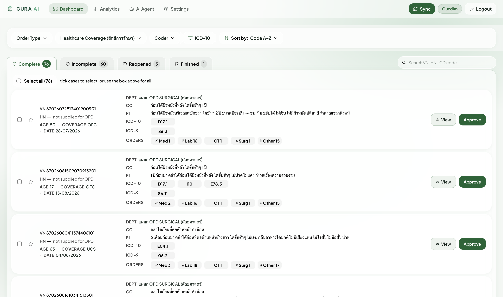 <em>ภาพที่ 2 · แถบเมนูด้านบน</em>

| เมนู | ใช้ทำอะไร |
|---|---|
| **แดชบอร์ด** | รายการเคสที่ต้องให้รหัส — หน้าหลักที่ใช้บ่อยที่สุด |
| **วิเคราะห์ข้อมูล** | ภาพรวมงานให้รหัสของตนเองและของทีม (หัวข้อ 1.10) |
| **AI ผู้ช่วย** | หน้าแชทกับ AI แบบเต็มหน้าจอ (หัวข้อ 1.11) |
| **การตั้งค่า** | ภาษา ธีม และข้อมูลบัญชี (หัวข้อ 1.12) |

มุมขวาบนมีปุ่ม **ซิงค์** ชื่อบัญชีที่เข้าสู่ระบบอยู่ และปุ่ม **Logout**

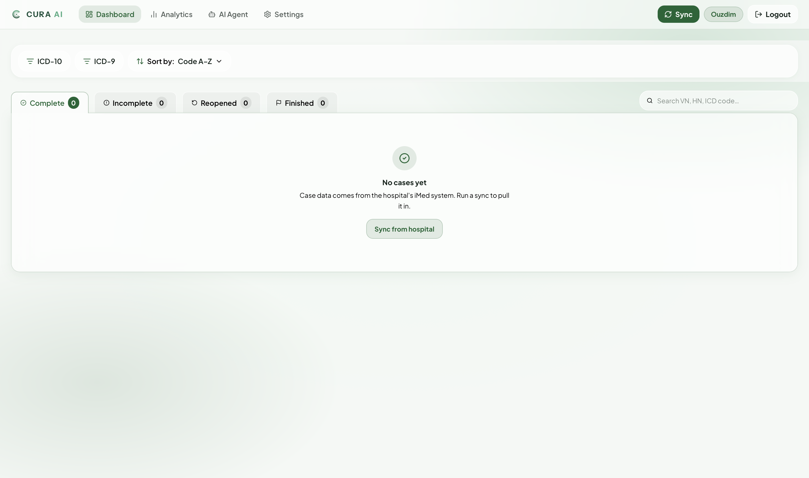 <em>ภาพที่ 3 · แดชบอร์ดก่อนซิงค์ข้อมูล</em>

แดชบอร์ดแบ่งเคสเป็น **4 แท็บ** แต่ละเคสอยู่ได้เพียงแท็บเดียว ตัวเลขข้างชื่อแท็บคือจำนวนเคส

| แท็บ | ความหมาย |
|---|---|
| **สมบูรณ์** | ข้อมูลจากโรงพยาบาล **มีรหัสมาครบทั้ง ICD-10 (การวินิจฉัย) และ ICD-9 (หัตถการ)** แล้ว แต่ยังไม่ได้อนุมัติ — ผู้ให้รหัสตรวจทานรหัสที่มีอยู่ แก้ไขหรือเพิ่มเติม แล้วอนุมัติ |
| **ไม่สมบูรณ์** | ข้อมูลจากโรงพยาบาล **ยังขาดรหัสอย่างน้อยหนึ่งระบบ** (ขาด ICD-10 หรือ ICD-9 หรือขาดทั้งคู่) — ผู้ให้รหัสต้องเติมรหัสที่ขาด |
| **เปิดใหม่** | เคสที่เคยอนุมัติแล้วแต่ถูกเปิดกลับมาแก้ไข รออยู่ที่นี่จนกว่าจะอนุมัติซ้ำ |
| **เสร็จสิ้น** | เคสที่อนุมัติแล้ว และรหัสถูกบันทึกลงระบบโรงพยาบาลแล้ว |

> คำว่า "สมบูรณ์" เป็นเกณฑ์ของระบบนี้ (มีรหัสครบทั้งสองระบบ) **ไม่ใช่มาตรฐานทางคลินิก** และไม่ได้แปลว่ารหัสนั้นถูกต้องแล้ว
> ผู้ให้รหัสยังต้องตรวจทานทุกเคสก่อนอนุมัติ

ถ้ายังไม่เคยซิงค์ ทุกแท็บจะว่างเปล่า ซึ่งเป็นสภาพเริ่มต้นที่ถูกต้อง ให้ซิงค์ตามหัวข้อถัดไป

### 1.3 ซิงค์ข้อมูลจากโรงพยาบาล

ข้อมูลไม่ได้ไหลเข้าระบบเองตลอดเวลา ผู้ให้รหัสต้องกด **ซิงค์** เพื่อดึงการมารับบริการจากระบบของโรงพยาบาล

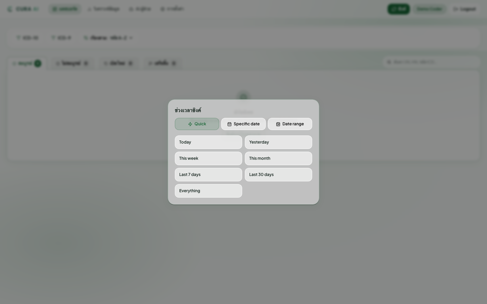 <em>ภาพที่ 4 · หน้าต่างเลือกช่วงเวลาซิงค์</em>

1. กดปุ่ม **ซิงค์** มุมขวาบน (อยู่ทุกหน้า)
2. เลือกช่วงวันที่มารับบริการจากหน้าต่าง **ช่วงเวลาซิงค์** ซึ่งมี 3 แท็บ
   - **Quick** — Today, Yesterday, This week, This month, Last 7 days, Last 30 days หรือ **Everything** (ทั้งหมด)
   - **Specific date** — วันใดวันหนึ่ง
   - **Date range** — ระบุวันเริ่มต้นและวันสิ้นสุดเอง

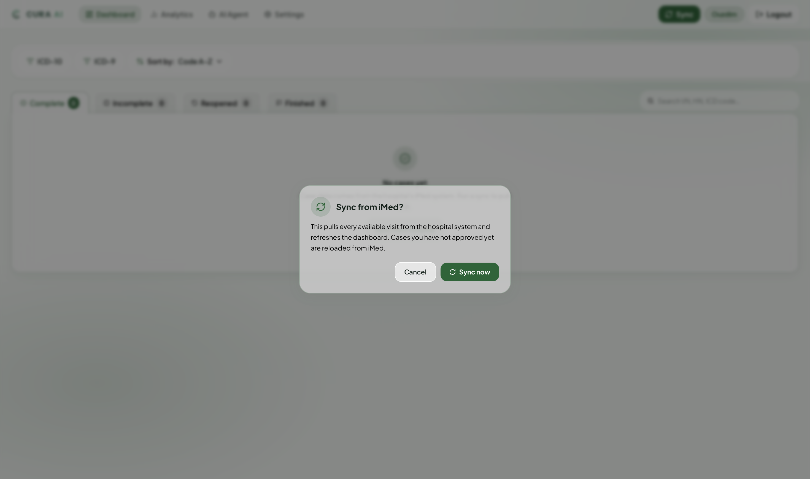 <em>ภาพที่ 5 · หน้าต่างยืนยันการซิงค์ข้อมูลจาก iMed</em>

3. ระบบถาม **"ซิงค์ข้อมูลจาก iMed?"** และแจ้งว่าจะรีเฟรชแดชบอร์ด โดยเคสที่ยังไม่ได้อนุมัติจะถูกโหลดใหม่จาก iMed กด **ซิงค์เลย** เพื่อยืนยัน
4. รอจนปุ่มกลับเป็นปกติ ตัวเลขในแต่ละแท็บจะปรับตามข้อมูลใหม่

 <em>ภาพที่ 6 · แดชบอร์ดหลังซิงค์ — แท็บสมบูรณ์ แต่ละเคสมีรหัส ICD-10 และ ICD-9 จากโรงพยาบาลแล้ว</em>

> **การซิงค์ปลอดภัย ทำซ้ำได้เรื่อย ๆ** เคสใหม่จะถูกนำเข้า เคสที่ยังไม่อนุมัติจะได้ข้อมูลโรงพยาบาลล่าสุด
> โดย **รหัสและการแก้ไขที่ผู้ให้รหัสทำไว้จะไม่หาย** และ **เคสที่อนุมัติแล้วจะไม่ถูกแตะต้องเลย**

แต่ละแถวในรายการแสดงเลข VN, HN (ผู้ป่วยนอกจะแสดง "ไม่มีข้อมูลสำหรับผู้ป่วยนอก" เพราะ iMed ส่ง HN มาเฉพาะผู้ป่วยใน),
อายุ สิทธิการรักษา วันที่มารับบริการ แผนก อาการสำคัญ (CC) ประวัติปัจจุบัน (PI) รหัสที่มีอยู่ และจำนวนคำสั่งแพทย์แยกประเภท

### 1.4 ค้นหา กรอง และติดดาวเคส

 <em>ภาพที่ 7 · แท็บไม่สมบูรณ์ — ป้าย "ขาด 1 รายการ" บอกว่าขาดรหัสอีกหนึ่งระบบ</em>

- ป้าย **"ขาด N รายการ"** ในแท็บไม่สมบูรณ์บอกจำนวนระบบรหัสที่ยังขาด (ICD-10 และ/หรือ ICD-9)
- **ช่องค้นหา** มุมขวา ค้นได้จากเลข VN, HN หรือรหัส ICD
- **แถบตัวกรอง** ด้านบน: ประเภทคำสั่ง, สิทธิการรักษา, ICD-10, ICD-9 และ **เรียงตาม** (เช่น รหัส A–Z)
- **ปุ่มดาว** ที่ต้นแถว ใช้ทำเครื่องหมายว่าเคสนี้สำคัญ **ทุกคนในทีมเห็นดาวเดียวกัน** และเคสที่ติดดาวจะขึ้นไปอยู่บนสุดของแท็บ
  ดาวเป็นของผู้ที่ติดไว้ **เอาออกได้เฉพาะผู้ติดดาว** (ระบบจะแสดง "ติดดาวโดย {ชื่อ} — เอาออกได้เฉพาะผู้ติดดาว")
- ปุ่ม **ตรวจสอบ** หรือ **ดู** ท้ายแถว ใช้เปิดเคส ส่วนปุ่ม **อนุมัติ** ท้ายแถวใช้อนุมัติจากหน้ารายการได้ทันที

### 1.5 หน้ารายละเอียดเคส

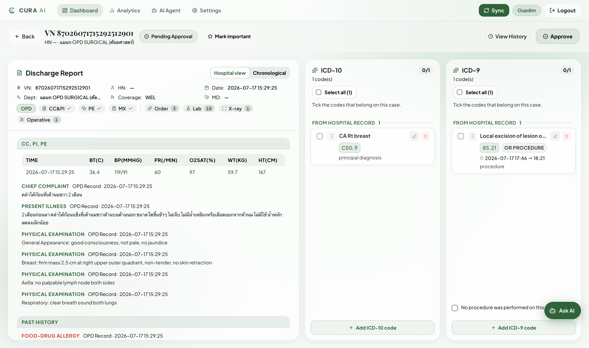 <em>ภาพที่ 8 · หน้ารายละเอียดเคส — เวชระเบียนด้านซ้าย คอลัมน์ ICD-10 และ ICD-9 ด้านขวา</em>

**ส่วนหัว** แสดงเลข VN, HN, แผนก, สถานะเคส (เช่น **รออนุมัติ** หรือ **พร้อมอนุมัติ**), ปุ่ม **ทำเครื่องหมายว่าสำคัญ**,
ปุ่ม **ดูประวัติ** (ประวัติการทำงานของเคสนี้) และปุ่ม **อนุมัติ**

**ด้านซ้าย — Discharge Report** คือเวชระเบียนจากโรงพยาบาล **อ่านได้อย่างเดียว แก้ไขไม่ได้**

- สลับมุมมองได้ 2 แบบ: **มุมมองโรงพยาบาล** (จัดกลุ่มแบบหน้าจอของโรงพยาบาล: CC/PI/PE, ประวัติในอดีต, แล็บ/เอกซเรย์,
  การวินิจฉัย/หัตถการ, คำสั่งแพทย์ ฯลฯ) และ **ตามลำดับเวลา** (เรียงตามเวลาที่บันทึกจริง)
- แถบป้ายด้านบน (CC&PI, PE, MX, Order, Lab, X-ray, Operative) บอกว่าเวชระเบียนนี้มีข้อมูลส่วนใดบ้าง
- ตารางสัญญาณชีพ (อุณหภูมิ ความดัน ชีพจร ออกซิเจน น้ำหนัก ส่วนสูง) และประวัติแพ้ยา/แพ้อาหารแสดงเป็นสีแดง

**ด้านขวา — คอลัมน์ ICD-10 (การวินิจฉัย) และ ICD-9 (หัตถการ)** ตัวเลขมุมขวาบนของคอลัมน์ เช่น **0/1**
คือ "เลือกแล้ว / ทั้งหมด"

### 1.6 อ่านรหัสที่ AI แนะนำ

 <em>ภาพที่ 9 · กลุ่ม "ข้อเสนอแนะจาก AI" พร้อมเปอร์เซ็นต์ความมั่นใจ</em>

เมื่อเปิดเคส ระบบจะให้ AI ค้นคู่มือ ICD ที่โรงพยาบาลอัปโหลดไว้ แล้วเสนอรหัสที่เกี่ยวข้อง รหัสในแต่ละคอลัมน์จัดกลุ่มตามที่มา

| กลุ่ม | ที่มา | มี % หรือไม่ |
|---|---|---|
| **ผู้ให้รหัสเพิ่มเอง** | ผู้ให้รหัสพิมพ์เพิ่ม | ไม่มี |
| **จากเวชระเบียนโรงพยาบาล** | โรงพยาบาลบันทึกไว้แล้ว (ข้อเท็จจริง ไม่ใช่การคาดเดา) | ไม่มี |
| **ข้อเสนอแนะจาก AI** | AI ค้นจากคู่มือ ICD | **มี** |

**ตัวเลข %** คือ **ความมั่นใจของ AI** ว่ารหัสนั้นเกี่ยวข้องกับเวชระเบียน **ไม่ใช่การรับประกันความถูกต้อง**
ส่วนหัวคอลัมน์แสดงจำนวนรหัสและความมั่นใจเฉลี่ยของ AI (เช่น "8 รหัส · ความมั่นใจเฉลี่ยของ AI 84%")

> **ข้อควรระวังจากผลการทดสอบ:** ในการทดสอบกับเคสสมมุติ 42 เคส รหัส ICD-10 ที่ถูกต้องอยู่ในอันดับแรกของคำแนะนำ **0 เคส**
> และอยู่ในรายการคำแนะนำ 3 เคส AI จึง **ยังไม่ควรถูกใช้แทนการอ่านเวชระเบียน** ให้ใช้เป็นเพียงจุดเริ่มต้นในการค้นหา
> (รายละเอียดในรายงานฉบับสมบูรณ์ บทที่ 6)

ครั้งแรกหลังติดตั้งระบบ คำแนะนำอาจใช้เวลาประมาณ 1 นาที เพราะระบบกำลังดาวน์โหลดโมเดล หลังจากนั้นจะเร็วขึ้น

### 1.7 เลือก แก้ไข และเพิ่มรหัส

 <em>ภาพที่ 10 · การติ๊กเลือกรหัสที่ต้องการอนุมัติ</em>

**เมื่อเปิดเคส จะยังไม่มีรหัสใดถูกติ๊กไว้** แม้แต่รหัสที่ AI แนะนำ ให้ **ติ๊กเลือกทีละรหัส** ที่ถูกต้อง
("ติ๊กเลือกรหัสที่ถูกต้องสำหรับเคสนี้") หรือใช้ช่อง **เลือกทั้งหมด (N)** ของคอลัมน์นั้น
รหัสที่ไม่ได้ติ๊ก **ยังอยู่ในเคสให้ดูอ้างอิง แต่จะไม่ถูกส่ง** ไปโรงพยาบาล

- **จัดลำดับ** — ลากที่ไอคอนจับ (⋮⋮) เพื่อเลื่อนขึ้นลงภายในคอลัมน์ ("ลากเพื่อจัดลำดับ — ตำแหน่งคือลำดับความสำคัญของรหัส")
  รหัส ICD-10 ที่ติ๊กไว้บนสุดจะเป็น **การวินิจฉัยหลัก (principal diagnosis)**
- **ไม่มีหัตถการ** — หากตรวจแล้วว่าไม่มีหัตถการ ให้ติ๊ก **"การมารับบริการครั้งนี้ไม่มีหัตถการ"** ใต้คอลัมน์ ICD-9
  เพื่อยืนยันว่าตรวจแล้ว ไม่ใช่ลืมกรอก

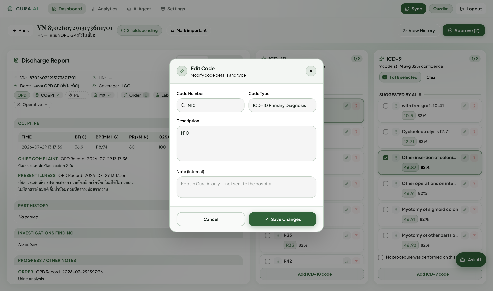 <em>ภาพที่ 11 · หน้าต่างแก้ไขรหัส</em>

- **แก้ไข** — กดไอคอนดินสอบนการ์ดรหัส เปลี่ยนตัวรหัส (ค้นหาจากรหัสหรือคำอธิบาย), ประเภทรหัส
  (ICD-10: การวินิจฉัยหลัก / โรคร่วม / อื่น ๆ / สาเหตุภายนอกของการบาดเจ็บ), คำอธิบาย และ **หมายเหตุภายใน**
  (เก็บในระบบนี้เท่านั้น **ไม่ถูกส่งไปโรงพยาบาล**)
- รหัส **ICD-9 (หัตถการ)** มีช่อง **ประเภทหัตถการ** (เช่น OR Procedure) และ **เวลาเริ่ม/สิ้นสุดหัตถการ** เพิ่มเติม
  ระบบเติมเวลาปัจจุบันให้ก่อน ให้แก้เป็นเวลาจริง เพราะเวลานี้จะถูกส่งไปโรงพยาบาลด้วย

 <em>ภาพที่ 12 · หน้าต่างเพิ่มรหัสใหม่</em>

- **เพิ่มรหัส** — กด **+ เพิ่มรหัส ICD-10** หรือ **+ เพิ่มรหัส ICD-9** ท้ายคอลัมน์ แล้วค้นหารหัส
  รหัสที่เพิ่มเอง **ถูกติ๊กเลือกให้ทันที** เพราะการพิมพ์เพิ่มถือเป็นการยืนยันแล้ว
- **ลบ** — กดไอคอนถังขยะบนการ์ดรหัสที่ยังไม่อนุมัติ แล้วยืนยัน

> **หนึ่งเคสทำงานได้ทีละคน** ขณะเปิดเคสอยู่ ผู้ให้รหัสคนอื่นจะเห็น **"เคสนี้กำลังมีผู้ทำงานอยู่"** และแก้ไขหรืออนุมัติไม่ได้
> เคสปลดล็อกทันทีที่ออกจากหน้า หรือภายใน 90 วินาทีหากปิดเครื่องไปเฉย ๆ

### 1.8 ถาม AI ในหน้าเคส

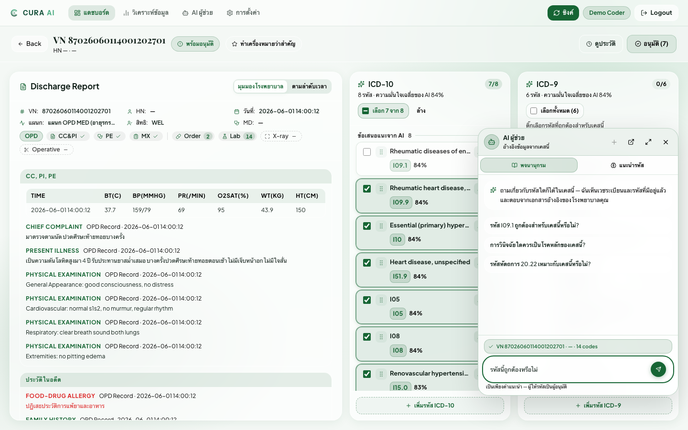 <em>ภาพที่ 13 · แผงถาม AI ในหน้ารายละเอียดเคส</em>

ปุ่ม **ถาม AI** มุมขวาล่างเปิดแผงแชทเพื่อถามเกี่ยวกับรหัสได้ทันที เช่น ความหมายของรหัส หรือรหัสใดควรเป็นการวินิจฉัยหลัก
คำตอบเป็น **คำแนะนำเท่านั้น** ผู้ให้รหัสเป็นผู้อนุมัติขั้นสุดท้ายเสมอ หากคำตอบอ้างถึงรหัสที่ **ไม่พบในเอกสารอ้างอิงที่ค้นได้**
ระบบจะแสดงคำเตือนแยกไว้ อย่าเชื่อรหัสเหล่านั้นโดยไม่ตรวจสอบ

### 1.9 อนุมัติ

ปุ่ม **อนุมัติ** จะกดไม่ได้ (สีจาง) จนกว่าเคสจะมี

- รหัส ICD-10 ที่ติ๊กไว้ **อย่างน้อย 1 รหัส** และ
- รหัส ICD-9 ที่ติ๊กไว้ **อย่างน้อย 1 รหัส** หรือติ๊ก **"การมารับบริการครั้งนี้ไม่มีหัตถการ"**

วางเมาส์บนปุ่มเพื่อดูว่าขาดอะไร เช่น **"เลือกรหัสวินิจฉัย ICD-10 อย่างน้อย 1 รหัสก่อนอนุมัติ"**

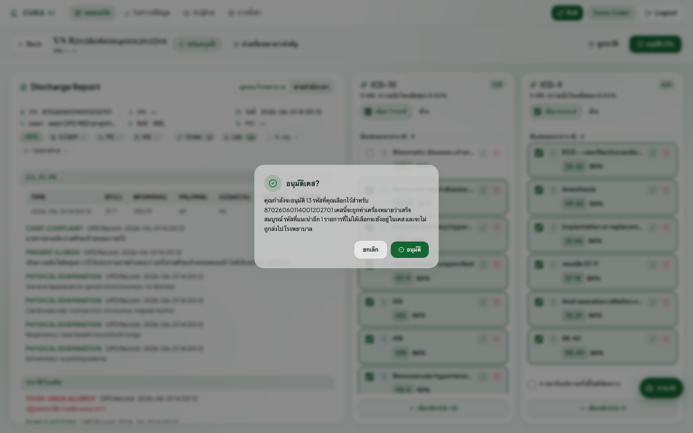 <em>ภาพที่ 14 · หน้าต่างยืนยันการอนุมัติ</em>

1. กด **อนุมัติ** มุมขวาบน
2. หน้าต่าง **"อนุมัติเคส?"** สรุปจำนวนรหัสที่จะอนุมัติ และแจ้งว่า **รหัสที่แนะนำแต่ไม่ได้เลือกจะยังอยู่ในเคส และจะไม่ถูกส่งไปโรงพยาบาล**
3. กด **อนุมัติ** เพื่อยืนยัน หรือ **ยกเลิก**

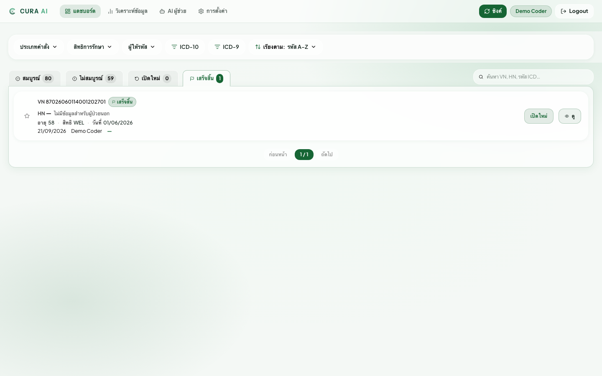 <em>ภาพที่ 15 · แท็บเสร็จสิ้น พร้อมวันที่อนุมัติและผู้ให้รหัส</em>

หลังยืนยัน เคสย้ายไปแท็บ **เสร็จสิ้น** และรหัสที่ติ๊กไว้ถูกบันทึกลงระบบโรงพยาบาล ระบบบันทึก **บัญชีที่เข้าสู่ระบบอยู่**
เป็นผู้อนุมัติเสมอ

**อนุมัติหลายเคสพร้อมกัน** — ในแท็บสมบูรณ์หรือไม่สมบูรณ์ ติ๊กเลือกหลายแถวแล้วกด **อนุมัติที่เลือก (N)**
เคสที่ยังไม่เคยเปิดตรวจ ระบบจะยืนยันเฉพาะ **การวินิจฉัยหลักที่โรงพยาบาลบันทึกไว้** ไม่นำรหัสที่ AI แนะนำไปส่ง
ควรใช้กับเคสที่ตรวจแล้วเท่านั้น

> หากระบบแจ้ง **"ไม่สามารถยืนยันได้ว่าส่งเคส N รายการถึงโรงพยาบาลแล้ว — กรุณาลองใหม่อีกครั้ง"**
> แปลว่าการเชื่อมต่อกับโรงพยาบาลขัดข้องชั่วคราว ให้กดอนุมัติซ้ำ ระบบจะเทียบกับข้อมูลโรงพยาบาลล่าสุดก่อนส่ง **จึงไม่ส่งซ้ำ**

### 1.10 เปิดเคสใหม่

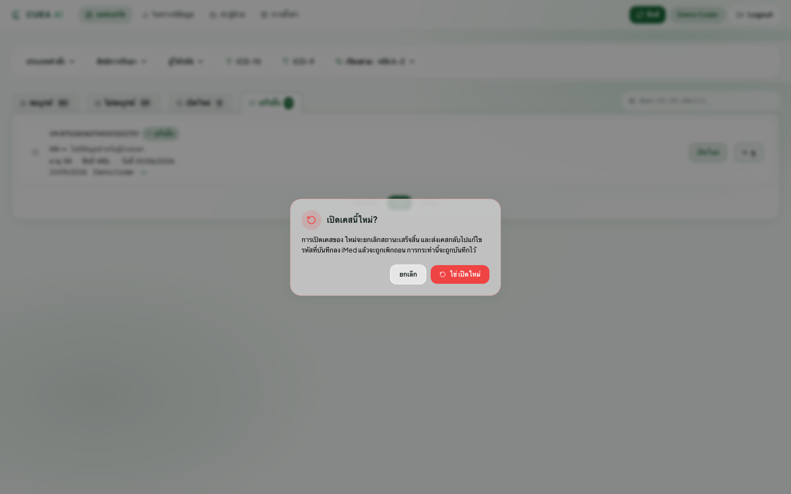 <em>ภาพที่ 16 · ปุ่มเปิดใหม่และหน้าต่างยืนยัน</em>

1. ในแท็บ **เสร็จสิ้น** กด **เปิดใหม่** ที่แถวของเคส (หรือในหน้ารายละเอียดเคส)
2. หน้าต่าง **"เปิดเคสนี้ใหม่?"** แจ้งว่าสถานะเสร็จสิ้นจะถูกยกเลิก **รหัสที่บันทึกลง iMed แล้วจะถูกเพิกถอน** และการกระทำนี้จะถูกบันทึกไว้
3. กด **ใช่ เปิดใหม่** — เคสย้ายไปแท็บ **เปิดใหม่** และ **รหัสที่แก้ไว้เดิมยังอยู่ครบ** แก้ไขแล้วอนุมัติซ้ำได้ทันที

> ผู้ให้รหัส **คนใดก็ได้** เปิดเคสที่อนุมัติแล้วได้ การเปิดใหม่มีผลเฉพาะสถานะการให้รหัส
> **ไม่มีผลต่อผลการรักษาหรือการจำหน่ายที่แพทย์บันทึกไว้**

### 1.11 วิเคราะห์ข้อมูล

 <em>ภาพที่ 17 · หน้าวิเคราะห์ข้อมูล</em>

หน้าภาพรวมของงานให้รหัส (เฉพาะผู้ป่วยนอก) หัวข้อบนหน้านี้เป็นภาษาอังกฤษ ข้อมูลเป็นข้อมูลที่ซิงค์มาจริง
("Live view of the synced hospital data") ไม่ใช่ตัวเลขจำลอง

- **การ์ดสรุป** — Total Cases (เคสทั้งหมด), Not Finished (ยังไม่เสร็จ แยกเป็นสมบูรณ์ / ไม่สมบูรณ์ / เปิดใหม่),
  Finished (อนุมัติแล้ว) และ Finished (%)
- **ปุ่มช่วงเวลา** มุมขวาบน (ค่าเริ่มต้น "All time") — จำกัดเคสตามวันที่มารับบริการ และจำกัดงานของผู้ให้รหัสตามวันที่ลงมือทำ
- **Finished by Coder** — จำนวนเคสที่แต่ละคนอนุมัติ จากบันทึกการตรวจสอบ
- **Cases by Coverage Type** (สัดส่วนสิทธิการรักษา) และ **Top 10 ICD Codes** (รหัสที่พบบ่อยที่สุด)

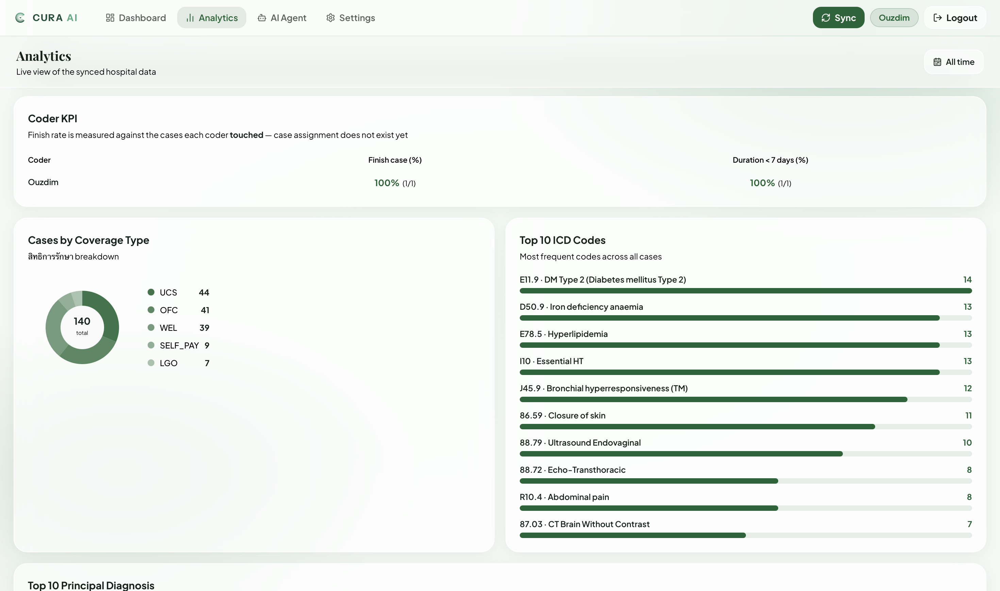 <em>ภาพที่ 18 · ตารางผลงานรายบุคคล (Coder KPI)</em>

**Coder KPI** แสดงผลงานของผู้ให้รหัสแต่ละคน 2 คอลัมน์

- **Finish case (%)** — คำนวณจาก **เคสที่ผู้ให้รหัสคนนั้นเคยลงมือทำ** (ระบบยังไม่มีการมอบหมายงาน)
  จึงไม่ใช่เปอร์เซ็นต์ของงานที่ได้รับมอบหมาย
- **Duration < 7 days (%)** — สัดส่วนเคสที่อนุมัติภายใน 7 วันนับจากซิงค์

### 1.12 AI ผู้ช่วยแบบเต็มหน้าจอ

เมนู **AI ผู้ช่วย** มี 2 โหมด สลับได้ที่ปุ่มมุมขวาบน ด้านซ้ายคือ **ประวัติแชท** (กด + เพื่อเริ่มบทสนทนาใหม่)
ประวัติแชทเป็นของแต่ละบัญชี ผู้อื่นมองไม่เห็น

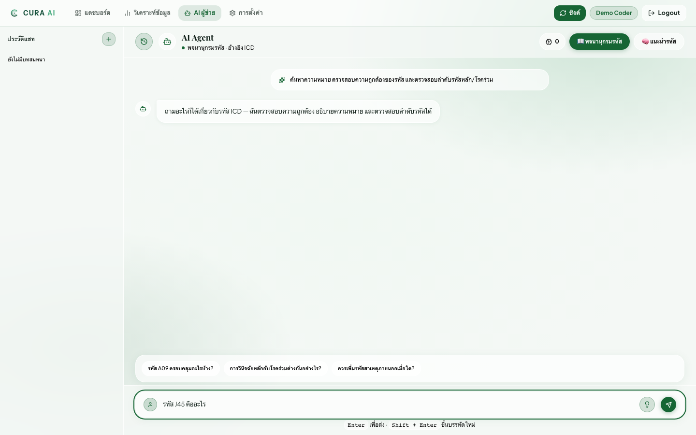 <em>ภาพที่ 19 · AI ผู้ช่วย โหมด 📖 พจนานุกรมรหัส</em>

**📖 พจนานุกรมรหัส** — ถามตอบทั่วไปเกี่ยวกับรหัส ICD ไม่ผูกกับเคสใด เช่น ความหมายของรหัส หรืออาการนี้ควรพิจารณารหัสกลุ่มใด
AI ตอบจากคู่มือที่อัปโหลดไว้พร้อมอ้างอิงแหล่งที่มา และตอบเป็นภาษาเดียวกับคำถาม (ไทยหรืออังกฤษ)

 <em>ภาพที่ 20 · AI ผู้ช่วย โหมด 🧠 แนะนำรหัส ขณะพิมพ์สอนกฎการให้รหัส</em>

**🧠 แนะนำรหัส (Suggest & Learn)** — อธิบายอาการเพื่อขอคำแนะนำรหัส หรือ **สอนกฎการให้รหัส** ที่ทีมใช้จริง
เป็นภาษาไทยหรืออังกฤษ เช่น *ถ้าเจอ CC ว่า "ปวดท้องด้านขวาล่าง" ให้แนะนำ K35.80 เสมอ*

1. พิมพ์กฎแล้วส่ง — AI สรุปกฎเป็นรายการ (สถานการณ์ รหัส และบทบาทของแต่ละรหัส) **ยังไม่บันทึก**
2. ตรวจว่า AI เข้าใจถูกต้อง แล้วกดยืนยัน — กฎจึงถูกบันทึก
3. จากนั้นเมื่อเจอเคสที่ตรงสถานการณ์ รหัสในกฎจะขึ้นเป็นลำดับแรกของคำแนะนำ และรหัสที่กฎสั่ง "ห้ามใช้" จะถูกตัดออก

- ทุกคนเห็นกฎของทุกคน แต่ **แก้ไข ปิดใช้งาน หรือลบได้เฉพาะกฎที่ตนเองสอน** (ผู้ดูแลระบบจัดการได้ทุกกฎ)
- การลบกฎถาวร กู้คืนไม่ได้ ("AI จะหยุดใช้กฎนี้กับคำแนะนำในอนาคต กฎจะถูกลบถาวรและไม่สามารถกู้คืนได้")
- **AI ไม่ได้ถูกฝึกใหม่** กฎเป็นเพียงบันทึกที่ AI อ่านประกอบ ตรวจสอบย้อนกลับได้ทุกข้อว่าใครสอน

### 1.13 การตั้งค่า

 <em>ภาพที่ 21 · หน้าการตั้งค่า ส่วนภาษา</em>

เมนู **การตั้งค่า** → **ภาษา** → เลือก **ไทย** หน้าจอเปลี่ยนภาษาทันทีโดยไม่ต้องเข้าสู่ระบบใหม่ ในหน้านี้ยังเปลี่ยนธีมสี
และดูข้อมูลบัญชีของตนเองได้

ในชุดสาธิตเท่านั้น จะมีส่วน **Demo tools** และปุ่ม **รีเซ็ตเดโม** ซึ่งเปิดเคสที่อนุมัติแล้วทั้งหมดกลับคืน และเพิกถอนรหัสที่บันทึกลง iMed
**ย้อนกลับไม่ได้** และ **ห้ามใช้กับระบบที่มีข้อมูลผู้ป่วยจริงโดยเด็ดขาด** (ระบบจริงปิดปุ่มนี้ไว้ตั้งแต่ติดตั้ง)

> **ก่อนออกจากระบบ** — การกด Logout จะปลดล็อกเคสที่เปิดอยู่ และ **การแก้ไขรหัสที่ยังไม่อนุมัติอาจไม่ถูกเก็บไว้**
> ควรอนุมัติงานที่ทำค้างไว้ก่อนออกจากระบบ

---

## ส่วนที่ 2 · ระบบสำหรับผู้ดูแลระบบ

เข้าสู่ระบบที่หน้าเดียวกับผู้ให้รหัส (ภาพที่ 1) ด้วยบัญชีผู้ดูแลระบบ **หน้าจอส่วนผู้ดูแลระบบเป็นภาษาอังกฤษทั้งหมด**
(ยังไม่มีเมนูเปลี่ยนภาษา) เมนูด้านซ้ายมี 3 รายการ และปุ่ม **Logout** ด้านล่าง

| เมนู | ใช้ทำอะไร |
|---|---|
| **Dashboard** | ภาพรวมระบบ และการตั้งค่าข้อมูลที่แสดงในรายการเคส |
| **Accounts** | สร้าง แก้ไข ปิดใช้งาน และลบบัญชีผู้ให้รหัส |
| **AI Training** | จัดการคู่มือ ICD ที่ AI ใช้ค้นหา |

> บัญชีผู้ดูแลระบบตั้งต้นในชุดสาธิตคือ `admin@medcodeai.demo` / `admin1234`
> **ต้องเปลี่ยนรหัสผ่านก่อนใช้งานจริงทุกครั้ง**

### 2.1 Dashboard

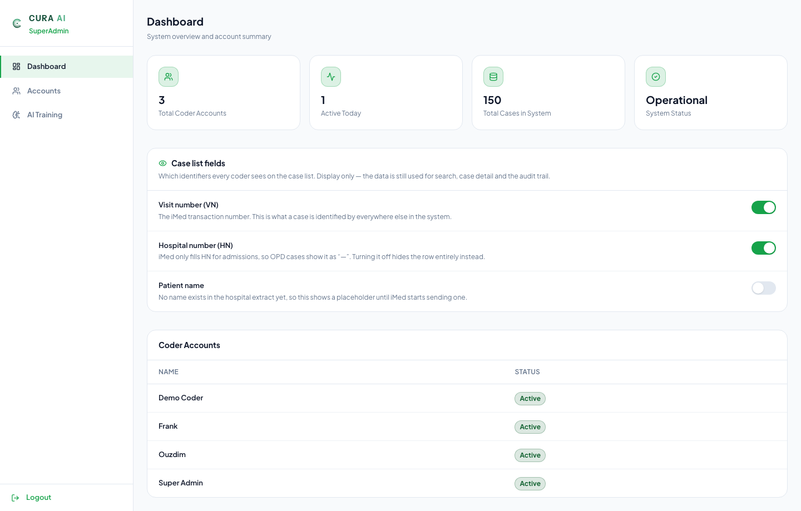 <em>ภาพที่ 22 · Dashboard ของผู้ดูแลระบบ</em>

**การ์ดสรุป 4 ใบ**

| การ์ด | ความหมาย |
|---|---|
| **Total Coder Accounts** | จำนวนบัญชีผู้ให้รหัส (ไม่นับบัญชีผู้ดูแล — ตารางด้านล่างจึงอาจมีชื่อมากกว่าตัวเลขนี้) |
| **Active Today** | บัญชีที่เข้าสู่ระบบวันนี้ |
| **Total Cases in System** | จำนวนเคสทั้งหมดในระบบ รวมผู้ป่วยใน (แดชบอร์ดของผู้ให้รหัสแสดงเฉพาะผู้ป่วยนอก) |
| **System Status** | สถานะระบบ |

**Case list fields** — สวิตช์เลือกว่ารายการเคสของผู้ให้รหัส **ทุกคน** จะแสดงข้อมูลระบุตัวใดบ้าง

| สวิตช์ | ค่าเริ่มต้น | หมายเหตุ |
|---|---|---|
| **Visit number (VN)** | เปิด | เลขการมารับบริการของ iMed ซึ่งใช้ระบุเคสทุกที่ในระบบ |
| **Hospital number (HN)** | เปิด | iMed ส่ง HN มาเฉพาะผู้ป่วยใน ผู้ป่วยนอกจึงแสดง "—" หากปิด แถวนี้จะถูกซ่อนทั้งแถว |
| **Patient name** | ปิด | ข้อมูลจากโรงพยาบาลยังไม่มีชื่อผู้ป่วย เปิดไว้ก็จะแสดงข้อความแทนจนกว่า iMed จะส่งชื่อมา |

> สวิตช์เหล่านี้ **มีผลเฉพาะการแสดงในรายการเคส** ไม่ใช่การจำกัดสิทธิ์เข้าถึงข้อมูล
> ข้อมูลยังใช้ในการค้นหา หน้ารายละเอียดเคส และบันทึกการตรวจสอบตามเดิม และการตั้งค่านี้มีผลกับทุกคนพร้อมกัน

ด้านล่างคือตาราง **Coder Accounts** แสดงชื่อและสถานะของทุกบัญชี

### 2.2 Accounts

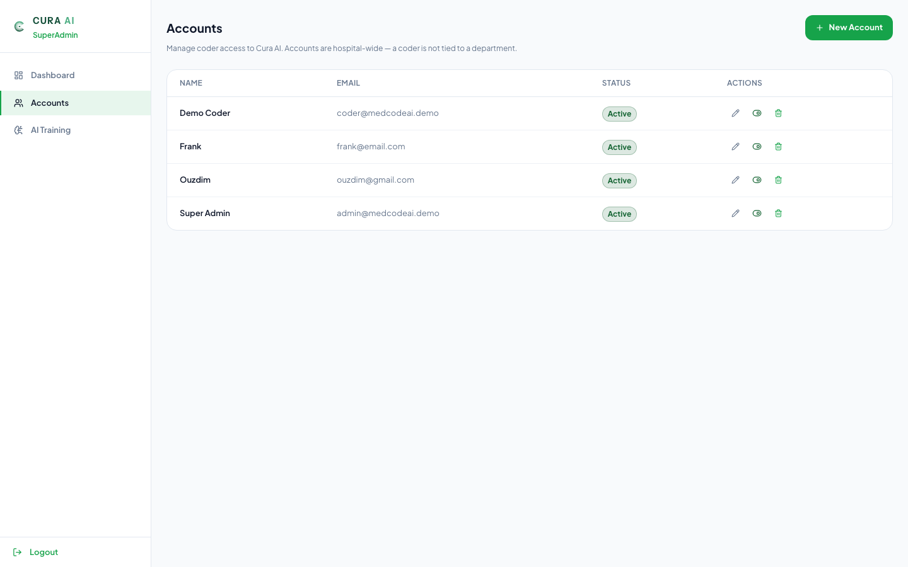 <em>ภาพที่ 23 · หน้า Accounts</em>

ตารางแสดง **NAME, EMAIL, STATUS** และปุ่มใน **ACTIONS** ของแต่ละบัญชี บัญชีใช้ได้ทั้งโรงพยาบาล ไม่ผูกกับแผนก

| ไอคอน | ใช้ทำอะไร |
|---|---|
| ดินสอ | **Edit** — แก้ชื่อ อีเมล หรือตั้งรหัสผ่านใหม่ |
| รูปตา | **Deactivate / Activate** — ปิดหรือเปิดการใช้งาน การปิดจะออกจากระบบให้บัญชีนั้นทันที |
| ถังขยะ | **Delete** — ลบบัญชี มีหน้าต่างยืนยันก่อนลบ |

> **บัญชีที่เคยให้รหัสแล้วลบไม่ได้** เพราะบันทึกการตรวจสอบอ้างถึงบัญชีนั้น ระบบจะให้ **ปิดใช้งาน (Deactivate)** แทน
> เพื่อให้ตรวจสอบย้อนหลังได้เสมอว่าใครอนุมัติรหัสใด

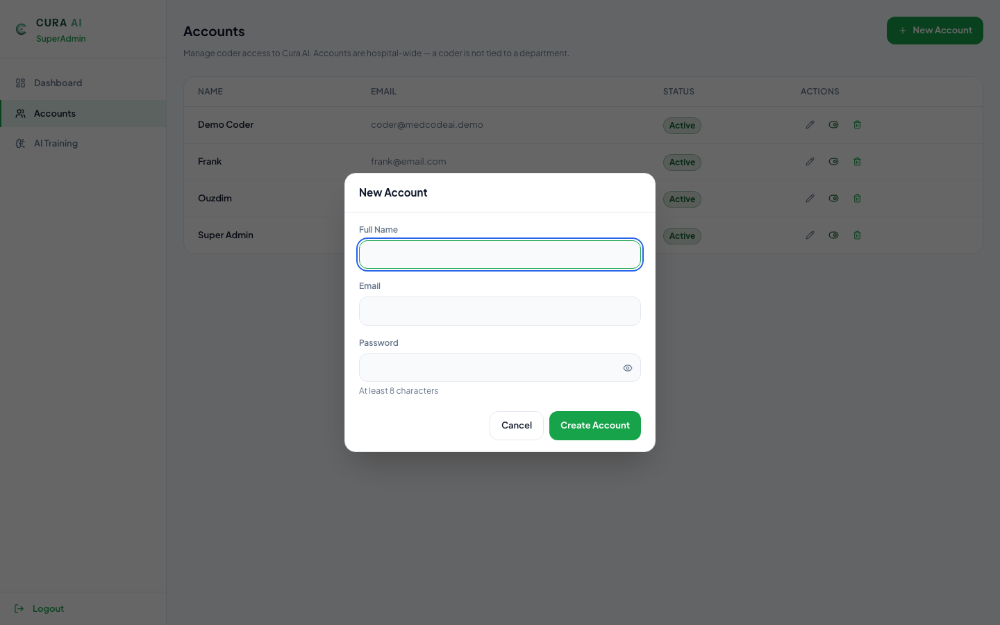 <em>ภาพที่ 24 · หน้าต่าง New Account</em>

กด **+ New Account** กรอก **Full Name**, **Email** และ **Password** (อย่างน้อย 8 ตัวอักษร) แล้วกด **Create Account**
บัญชีที่สร้างจากหน้านี้เป็นบัญชี **ผู้ให้รหัส** แจ้งอีเมลและรหัสผ่านตั้งต้นให้ผู้ใช้ และให้เปลี่ยนรหัสผ่านโดยเร็ว

### 2.3 AI Training

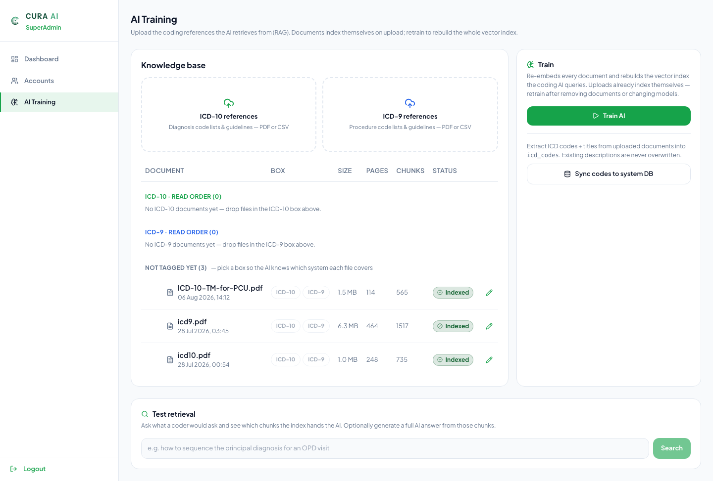 <em>ภาพที่ 25 · หน้า AI Training</em>

หน้าจัดการ **คู่มือ ICD ที่ AI ใช้ค้นหา** คำว่า "Training" ในที่นี้หมายถึง **การทำดัชนีเอกสาร** (แบ่งข้อความ ฝังเวกเตอร์
และเชื่อมโยงความสัมพันธ์) **ไม่ใช่การฝึกโมเดลใหม่**

**Knowledge base**

- ลากไฟล์ PDF หรือ CSV มาวางในกล่อง **ICD-10 references** (รหัสวินิจฉัย) หรือ **ICD-9 references** (รหัสหัตถการ)
  ระบบรับไฟล์ทันทีและทำดัชนีเบื้องหลัง สถานะจะเปลี่ยนจนเป็น **Indexed**
- ไฟล์ต้องมี **ข้อความที่คัดลอกได้** — PDF ที่สแกนเป็นภาพจะถูกปฏิเสธ และไฟล์ต้องไม่เกิน 50 MB
- ตารางแสดงชื่อเอกสาร กล่อง (BOX) ขนาด จำนวนหน้า จำนวนชิ้นข้อความ (CHUNKS) และสถานะ
  กดปุ่ม **ICD-10** หรือ **ICD-9** ในคอลัมน์ BOX เพื่อ **ย้ายเอกสารเข้ากล่อง** และกดไอคอนดินสอเพื่อ **เปลี่ยนชื่อที่แสดง**
  (ไม่ต้องทำดัชนีใหม่)
- **READ ORDER** — ลำดับเอกสารในแต่ละกล่อง เอกสารบนสุดถูกอ่านก่อนและได้คะแนนการค้นหาเพิ่มเล็กน้อย
- **NOT TAGGED YET** — เอกสารที่ยังไม่ได้ระบุกล่อง ยังใช้ค้นได้ทั้งสองระบบรหัส แต่ **ควรย้ายเข้ากล่องที่ถูกต้อง**
  โดยเฉพาะคู่มือ ICD-9 เพราะเลขรูปแบบ ICD-9 ที่ไม่มีชื่อหัตถการอยู่บรรทัดเดียวกัน จะถูกนับเป็นรหัสก็ต่อเมื่อเอกสารอยู่ในกล่อง ICD-9

**Train**

- **Train AI** — ทำดัชนีเอกสารทั้งหมดใหม่ตั้งแต่ต้น ใช้หลังลบเอกสารหรือเปลี่ยนโมเดล ใช้เวลานาน
  ระหว่างนี้คำแนะนำจาก AI อาจไม่ครบ ควรทำนอกเวลางาน
- **Sync codes to system DB** — ดึงรหัสพร้อมชื่อรหัสจากเอกสารที่อัปโหลด ไปเพิ่มในฐานข้อมูลรหัสของระบบ
  **เพิ่มเฉพาะรหัสใหม่และเติมคำอธิบายที่ว่าง ไม่เขียนทับคำอธิบายเดิม** จึงกดซ้ำได้อย่างปลอดภัย

**Test retrieval** — พิมพ์คำถามแบบที่ผู้ให้รหัสจะถาม แล้วกด **Search** เพื่อดูว่าดัชนีส่งข้อความส่วนใดให้ AI
ใช้ตรวจว่าเอกสารที่อัปโหลดใช้ค้นได้จริง

---

## ส่วนที่ 3 · คำถามที่พบบ่อยและการแก้ไขปัญหา

| ปัญหา | สาเหตุและวิธีแก้ไข |
|---|---|
| ไม่มีรหัสที่ AI แนะนำในเคสที่เปิด | ครั้งแรกหลังติดตั้งต้องรอดาวน์โหลดโมเดลประมาณ 1 นาที หรือระบบ AI ขัดข้อง ระบบหลักยังใช้งานได้ พิมพ์รหัสเองได้เลย |
| ปุ่มอนุมัติกดไม่ได้ | ยังไม่ได้ติ๊ก ICD-10 อย่างน้อย 1 รหัส และ ICD-9 อย่างน้อย 1 รหัส (หรือติ๊ก "ไม่มีหัตถการ") วางเมาส์บนปุ่มเพื่อดูว่าขาดอะไร |
| หาเคสไม่เจอ | ตรวจว่าอยู่ถูกแท็บ ล้างคำค้นหาและตัวกรอง แล้วลองซิงค์ใหม่ด้วยช่วงเวลาที่กว้างขึ้นหรือ **Everything** |
| "เคสนี้กำลังมีผู้ทำงานอยู่" | ผู้ให้รหัสอีกคนเปิดเคสอยู่ เคสปลดล็อกทันทีที่เขาออกจากหน้า (หรือภายใน 90 วินาที) กด **กลับสู่แดชบอร์ด** แล้วลองใหม่ |
| เอาดาวออกไม่ได้ | ดาวเป็นของผู้ติดดาว เอาออกได้เฉพาะผู้ติดดาว |
| ลบหรือแก้กฎที่สอนไว้ไม่ได้ | แก้ไขหรือลบได้เฉพาะกฎที่ตนเองสอน ติดต่อผู้สอนหรือผู้ดูแลระบบ |
| "ไม่สามารถยืนยันได้ว่าส่งเคส … ถึงโรงพยาบาลแล้ว" | การเชื่อมต่อกับโรงพยาบาลขัดข้องชั่วคราว กดอนุมัติซ้ำ ระบบไม่ส่งซ้ำ หากยังไม่ได้ให้แจ้งฝ่าย IT |
| ผู้ดูแลระบบเข้าสู่ระบบแล้วไม่เห็นเคส | บัญชีผู้ดูแลเปิดหน้าให้รหัสไม่ได้ ให้ใช้บัญชีผู้ให้รหัส |
| บัญชีถูกล็อกหลังกรอกรหัสผ่านผิด | รอ 15 นาทีแล้วลองใหม่ หรือให้ผู้ดูแลระบบตั้งรหัสผ่านใหม่ |
| AI ผู้ช่วยไม่ตอบ หรือตอบช้ามาก | คำตอบมาจากโมเดลภาษาที่ทำงานในเครื่อง ใช้เวลาหลายสิบวินาที ครั้งแรกอาจหลายนาที ไม่ต้องกดส่งซ้ำ หากไม่ตอบเลยให้แจ้งผู้ดูแลระบบ |
| อัปโหลดคู่มือไม่สำเร็จ | ไฟล์เกิน 50 MB หรือเป็น PDF ที่สแกนเป็นภาพ (ไม่มีข้อความให้คัดลอก) |

---

*เอกสารนี้อ้างอิงจากหน้าจอจริงของระบบ ณ วันที่จัดทำ หากมีการปรับปรุงหน้าจอ ควรปรับคู่มือและถ่ายภาพหน้าจอใหม่ให้ตรงกับเวอร์ชันล่าสุด*
