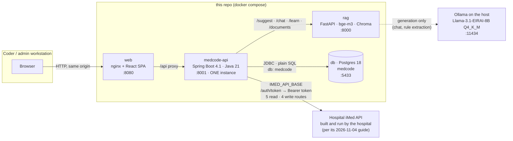
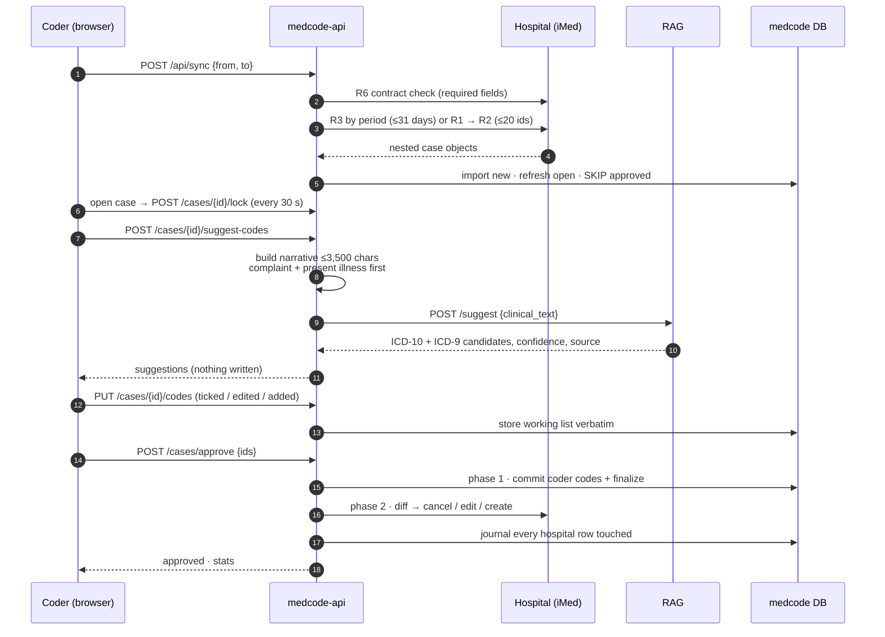
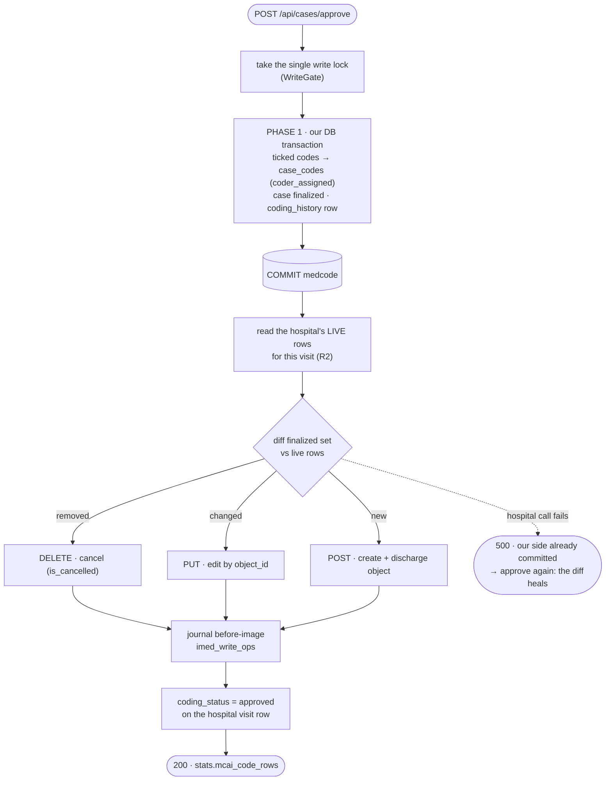
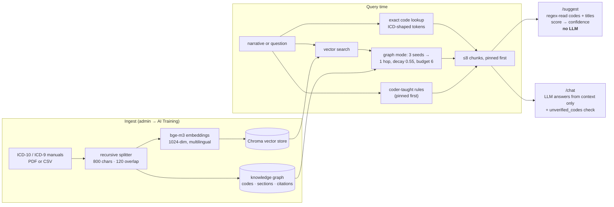
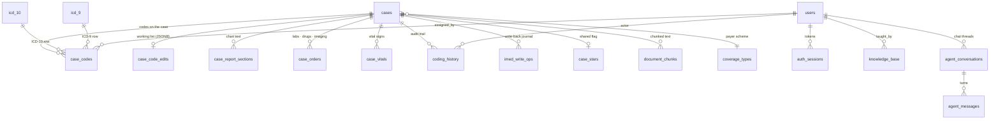

# Architecture

How CURA AI is put together: the runtime topology, the coding flow, the
write-back to the hospital, the AI pipeline and the data model.

The single most important thing to know before reading any of it:

> **The AI suggests. A human coder decides. Only an explicit Approve writes to
> the hospital.** Asking for suggestions writes nothing, and no suggested code
> is ticked until a coder ticks it. The AI service can be switched off and
> coders can still sync, code, approve and reopen.

---

## 1. Runtime topology

The **browser only talks to port 8080**. nginx serves the built UI and proxies
`/api` to `medcode-api`, so every request is same-origin and there is no CORS
to configure. The UI is built with the relative base URL `/api`, so the same
image works in every environment.

**`medcode-api` is the only component that holds a user's token.** It is also
the only one that calls the hospital or the AI service. The AI service has no
authentication of its own and is meant to be reachable only from the backend
(see [Known gaps](#9-known-gaps)).

**The hospital is behind one setting.** The iMed API is built and run by the
hospital, not by this repo. `medcode-api` calls it as described in the
hospital's own API guide for MedCode (4 Nov 2026), including its refusals (20
visits per request, 31 days per window, its 400 rules on writes). Pointing at
a hospital server means setting `IMED_API_BASE`, `IMED_CLIENT_ID` and
`IMED_CLIENT_SECRET`, with no code change. Without it, the app still starts,
but sync, approve and reopen fail.

**Generation runs outside the containers.** Docker on macOS has no GPU
passthrough, so the chat model runs in Ollama on the host. Code suggestions
never touch it (§5).

### The four services

| Service | Folder | Stack | Owns |
|---|---|---|---|
| `web` | `frontend/` | React 19, Vite 8, TypeScript 6, Tailwind 4, axios; served by nginx | Nothing persistent. The token lives in the browser's `localStorage` |
| `medcode-api` | `backend/medcode-api/` | Spring Boot 4.1, Java 21, plain SQL (no JPA), Flyway | The `medcode` database, the API contract, the write lock to the hospital |
| `rag` | `ai/` | FastAPI, sentence-transformers (`BAAI/bge-m3`), Chroma, a knowledge graph (GraphML) | The vector index, the graph, uploaded manuals, coder-taught rules |
| `db` | — | stock `postgres:18` | The `medcode` database, seeded once from a committed dump |

### Ports

| Component | Compose (host) | Inside the network | Native four-terminal setup |
|---|---|---|---|
| Web UI | **8080** | `web:8080` | 5173 (vite dev server) |
| Backend | 8001 | `medcode-api:8001` | 8001 |
| AI service | 8000 | `rag:8000` | 8000 |
| Postgres | **5433** | `db:5432` | 5432 |

Two host ports differ on purpose: 8080 and 5433 avoid the vite dev server and a
native Postgres, so the container stack can run **alongside** the native setup.

---

## 2. The coding flow

One case, from the hospital to the hospital and back.

What each step guarantees:

- **Sync never overwrites coder work.** A new visit is imported. An *open* case
  gets its hospital data refreshed while the coder's codes, saved edits and
  history are kept. An *approved* case is skipped entirely. It is safe to run
  again and again.
- **Suggest writes nothing.** It returns candidates and touches no table.
- **Save is local.** `PUT /codes` stores the coder's working list in `medcode`
  only. The hospital is not touched.
- **Approve is the only write to the hospital**, and it happens only for codes
  the coder ticked. A code left unticked stays visible in the case but is never
  sent.
- **Reopen undoes an approval on both sides** and keeps the coder's edits, so
  re-approving loses nothing.

Visits land in four **mutually exclusive** queues: *complete* (the hospital data
already carried both an ICD-10 and an ICD-9 code), *incomplete* (missing one or
both, grouped as surgery / CT-X-ray / medicine / other), *reopened* and
*finished*. "Complete" is the project's own rule, not a clinical standard.

---

## 3. Approve: a two-phase, diffed write

Four decisions are baked into this shape:

1. **Our commit comes first, then the hospital calls.** If the hospital fails,
   the request returns 500 with our side committed. Approving again is the fix.
   The diff recomputes against the hospital's *live* state rather than
   replaying the failed request, so a retry can never double-write.
2. **Cancel, then edit, then create.** Creating a code before its old row is
   cancelled would trip the hospital's duplicate-code rule (409).
3. **Every touched hospital row is journaled with its before-image.** Reopen
   replays the journal backwards: a created row is cancelled, an edited row is
   restored, and a cancelled row is re-created. The hospital has no un-cancel,
   so the re-created row gets a new id.
4. **The coding status is our own field on the hospital visit row**
   (`coding_status`). It rides on the existing write body and never touches the
   doctor's clinical `dischargestatus`. An early version did overwrite it; that
   was a bug and is fixed.

### Concurrency: one instance, on purpose

| Mechanism | Where it lives | What it stops |
|---|---|---|
| `WriteGate`: one `ReentrantLock` | process memory | Two approvals, reopens or syncs writing the hospital at once |
| `CasesCache`: the dashboard payload | process memory | Rebuilding the four queues on every request. Cleared after sync, approve, reopen, reset and star |
| Case lock: 90 s lease, renewed every 30 s | process memory | Two coders editing the same case. Enforced at the writes (409), not only in the UI |
| Login rate limiter: 5 failures per email → 15 min | process memory | Password guessing |

All four are in memory, so **`medcode-api` must run as exactly one instance**
(`max-instances=1` on Cloud Run). A second copy would split the lock and damage
approvals instead of sharing the load. Uptime comes from fast restarts and
health checks, not from replicas.

---

## 4. What decides what

| Decision | Made by | Never made by |
|---|---|---|
| Which visits exist, and their chart, orders and vitals | The hospital (iMed), through sync | Us. We never invent clinical data; a missing field stays `null` |
| Which codes are *candidates* | The AI service (retrieval over ICD manuals + coder-taught rules) | — |
| Which codes go on the case | **The coder**, by ticking | The AI. Nothing is pre-ticked except codes the coder typed |
| Which ICD-10 is the principal diagnosis | **The coder**: the top ticked ICD-10, or an explicit type label | The AI |
| When codes reach the hospital | **The coder**, by pressing Approve | Sync, suggest, save, or any background job |
| Who is recorded as the coder | The **signed-in account**, from its token | The request body. A body `coder` field is ignored |
| Which coder-taught rule can be edited or deleted | Its **author**, or an admin | Any other coder |

### How the boundary is enforced

| Guard | What it stops |
|---|---|
| `suggest-codes` has no write path | A suggestion reaching `case_codes`, the history or the hospital |
| `selected: false` rows are skipped at approve | An unticked suggestion being written back |
| All-unticked payload → re-confirm the hospital's own principal only | A bulk approve of a never-reviewed case from pushing AI guesses |
| `unverified_codes` in every chat answer | A code the model named that **no retrieved passage contains** being shown as fact |
| Suggest & Learn: extract and save are separate calls | A rule entering the knowledge layer before a human confirms what the AI understood |
| Learned-rule grounding | A code the model proposes that the coder never typed |
| `AuthInterceptor` on every route except login, health and Swagger | Anonymous reads or writes. `/api/admin/**` also needs the `admin` role |

---

## 5. The AI pipeline

**Two very different paths share one index:**

| | `/suggest` (case suggestions) | `/chat` (Agent chat) |
|---|---|---|
| Uses a language model | **No.** Codes are read out of the retrieved manual text by pattern, titles are taken from the same line, and retrieval scores become confidence | Yes: Ollama (EIRAI-8B) or, as a fallback, an in-process 0.5B model |
| How it searches | Once per code system, each against its own manuals, reading only that system's code shape. This stops an ICD-10 page number showing up as an ICD-9 procedure | Graph or plain mode, plus exact code lookup, plus coder rules |
| Latency | **Not measured** (report Ch.6). No generation step; the first call waits for the ~2.3 GB embedding model to download | Documented as tens of seconds on CPU, minutes on the first call (`api-contract.md`). Not measured either |
| Can it invent a code | No: it only returns tokens found in the manuals | It can write one, but every code in the answer is checked against the retrieved text, and unmatched ones are flagged `unverified_codes` |
| Status | Evaluated (report Ch.6): **ICD-10 top-1 0/42, top-8 3/42.** Code lookup works; turning a symptom narrative into a code does not yet | Not scored. The model download is blocked (see Known gaps) |

**Suggest & Learn** is the one place coders shape the AI. A coder types a rule
in Thai or English ("Diabetic patient with AKI: code E11.22 as principal, add
N17.9, do not code N18.9"). The service drafts it as structured data, the coder
confirms, and it is stored and embedded as one chunk in the same index. From
then on, it is pinned above the manuals for matching cases, its codes lead the
suggestion list, and any code it marks `exclude` is removed even if a manual
offered it. **Nothing is fine-tuned.** Every rule is listed, attributed,
mutable by its author and deletable.

"Training" on the admin page means **indexing documents**: chunk, embed and add
to the graph. It does not change model weights.

---

## 6. Sync: reading the hospital

This team first proposed the read contract (R1–R6) to the hospital. The
hospital built five of the six and documented them in its own guide
(4 Nov 2026). R1, the "what changed since T?" poll, was parked. Every call
carries a Bearer token from `POST /auth/token` (Basic client credentials,
300-second tokens, renewed automatically).

| # | Call | Used for |
|---|---|---|
| R2 | `POST /api/v1/cases/sync {visit_ids ≤20}` | Full case objects for those ids |
| R3 | `POST /api/v1/cases/sync-by-period {from, to ≤31 days}` | Full case objects for a visit-date window |
| R4 / R5 | `GET /api/v1/catalog/icd10` · `/icd9` | The hospital's code masters, mirrored into our catalogs |
| R6 | `POST /api/v1/contract/check {required_fields}` | The schema gate: fail before writing anything if a field we depend on is gone |

A case object is one `visit` block plus nine data blocks: `documents`,
`record_results`, `diagnoses`, `procedures`, `drug_orders`, `lab_results`,
`vitals`, `ward_movements` and `billing_items`. Datetimes carry the
hospital's `+07:00`. A windowed sync calls R3 **once per day**, as the guide
recommends; it is the only way new cases arrive. An unwindowed sync re-reads
the open cases medcode already holds through R2, 20 ids per call.

---

## 7. Data model

### `medcode`: our workspace (19 tables, Flyway V1–V9)

| Table | Purpose |
|---|---|
| `cases` | One hospital visit. Hospital-sourced columns plus our workflow state (`case_status`) and our derived buckets (`completeness_status`, `disease_group`, `severity_level`, all project rules, not clinical facts) |
| `case_codes` | One code on a case. Points at **exactly one** of `icd_10` / `icd_9` (check constraint). Carries `code_role`, `source` (`imported_from_imed` or `coder_assigned`) and, on ICD-9 rows, the operation window and type |
| `case_code_edits` | The coder's working list: the last `PUT /codes` body, stored and echoed verbatim. Survives reopen |
| `icd_10`, `icd_9` | The code catalogs, split in two because the systems need different columns |
| `case_report_sections`, `case_orders`, `case_vitals` | The chart: notes by document type × field, orders with the raw hospital row as JSONB, vital signs |
| `coding_history` | One row per coder action (approved, reopened, code assigned), with the signed-in account as actor |
| `imed_write_ops` | Before-image of every hospital row we created, edited or cancelled. What makes reopen reversible |
| `users`, `auth_sessions` | Accounts (BCrypt hashes, `coder` / `admin`) and server-side Bearer sessions (token stored as SHA-256, 7-day TTL) |
| `case_stars`, `app_settings` | The shared "look at this first" flag, and the admin's display switches (show VN / HN / name) |
| `agent_conversations`, `agent_messages` | Agent chat history, per account |
| `knowledge_base` | Legacy table from the original schema, **empty**. Coder-taught rules live in the AI service instead (`RAG/data/learned_notes.json`, embedded into the same index as the manuals) |
| `coverage_types` | Hospital coverage codes → Thai scheme families (UCS, OFC, …) |
| `document_chunks` | Chunked chart text, written at sync. **No reader yet** |

Every case-keyed table has a foreign key to `cases`. Two were missing, because
hand-written Java DDL had created them without one; migration V6 added them.
Since then Flyway files are the only place schema is defined.

### Identity

A case is keyed by the hospital's **visit (transaction) number**. The hospital
extract carries **no patient names**, so `patient` is `null` everywhere; the
admin's "show patient name" switch exists for the day iMed sends one. When
iMed sends no visit datetime, the visit date is decoded from positions 4–15 of
the transaction number.

---

## 8. Configuration switches worth knowing

| Variable | Default in image | In this compose stack | Why |
|---|---|---|---|
| `SWAGGER_ENABLED` | **off** | on | A try-it-out console; never in production |
| `DEMO_TOOLS_ENABLED` | **off** | on | `POST /api/demo/reset` rewrites `medcode` and asks the hospital API to restore its side (only the retired mock did) |
| `ADMIN_BOOTSTRAP_*` | `admin@medcodeai.demo` / `admin1234` | same | Logs a WARN when the default password is used |
| `ALLOWED_ORIGINS` | `*` | `*` | Harmless behind the same-origin proxy; narrow it anywhere shared |
| `LLM_BACKEND` | `transformers` | `ollama` | Chat only. Suggestions do not use it |
| `PREFETCH_EMBED_MODEL` | `0` | `0` | `1` bakes bge-m3 into the image for offline sites |

---

## 9. Known gaps

An honest list, for anyone planning a real deployment.

| Gap | Detail |
|---|---|
| **Narrative-to-code accuracy is low** | ICD-10 top-1 **0/42**, top-8 **3/42** on the synthetic gold set. Looking up a code works (exact match, score 1.0). Turning a symptom narrative into a code does not yet: the retrieved chunks come from what looks like a mis-chunked, index-style region of one manual. The single most actionable finding (report Ch.6) |
| **Agent chat is unverified** | The chat model cannot be pulled: Ollama rejects a redirect from Hugging Face's CDN. `/chat` has not been scored |
| **Single instance only** | The write lock, the cache, the case locks and the login limiter are all in process memory. Scaling out would corrupt approvals |
| **No TLS anywhere in the repos** | nginx listens on plain HTTP 8080. A real site needs a TLS-terminating proxy and a hospital certificate |
| **The AI service has no authentication, and compose publishes it** | Port 8000 is exposed on the host for development. In production only `medcode-api` should reach it |
| **Hospital master-data IDs are placeholders** | Operation type (`GENERAL_OPERATION`) and discharge status (`Coding Approved`) wait for the hospital's real ID lists. The biggest unknown: how a coding write fits the discharge record the hospital requires on every write |
| **A crash between a hospital create and its journal entry** | Leaves hospital rows that reopen cannot attribute. Re-approving heals the codes, but those rows stay unjournaled |
| **Reopen cannot restore original hospital ids** | iMed has no un-cancel, so a re-created row gets a new id |
| **Email + password logins** | Stored safely (BCrypt, lockout, server-side sessions), but a hospital should use its own SSO (SAML or OIDC). See `medcode-api/docs/DEPLOYMENT-PREP.md` |
| **No retention, erasure or consent handling** | Nothing expires data, and there is no data-subject request flow. Needed before any real patient record (report Ch.5) |
| **Tests write through to the hospital API** | medcode-api's suite approves and reopens for real at `IMED_API_BASE`, so it needs a hospital test server, and repeated runs drift that server's data. Against the old mock this caused the one standing failure (90/91) |
| **`document_chunks` has no reader** | Filled at every sync, used by nothing yet |
| **Per-case sync has no UI** | `POST /api/cases/{id}/sync` works, but only bulk sync is wired to a button |
