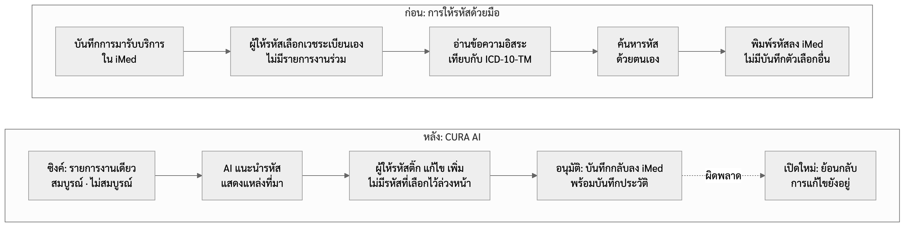
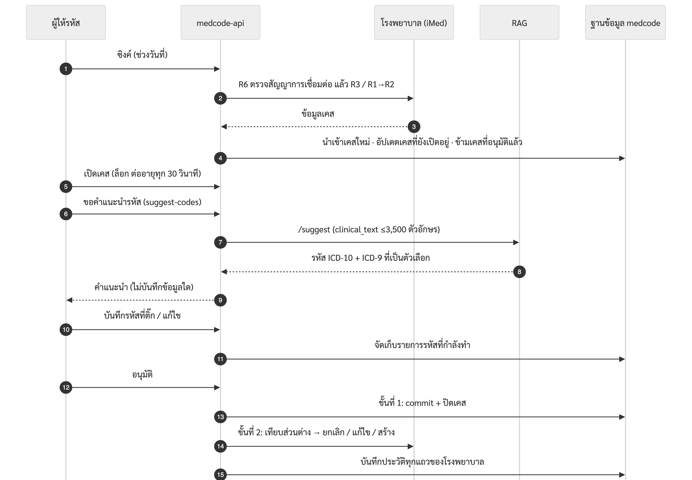
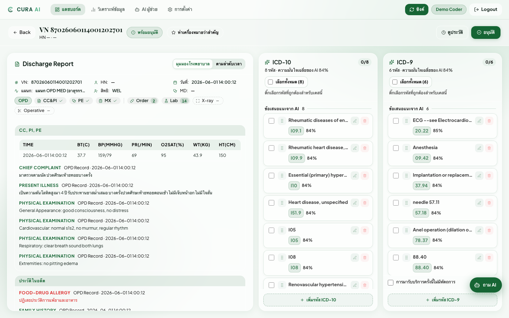

# บทที่ 3 การออกแบบ

ข้อเท็จจริงในบทนี้มาจากเอกสารในรีโพซิทอรีและ Flyway migration ของระบบ ตามแหล่งที่ระบุในเนื้อความ

## 3.1 ขั้นตอนการทำงาน: ก่อนและหลัง

### 3.1.1 ก่อนมีระบบ (ทำด้วยมือ ตามที่อธิบายไว้ในบทที่ 1)

1. บันทึกแพทย์ ผลแล็บ คำสั่งแพทย์ และสัญญาณชีพของแต่ละการมารับบริการ (visit) สะสมอยู่ในระบบ iMed ของโรงพยาบาล
2. ผู้ให้รหัส (coder) ไม่มีแดชบอร์ดบอกว่างานใดต้องให้รหัส ต้องอ่านเวชระเบียนทีละฉบับ แล้วเทียบกับคู่มือ ICD-10-TM ทั้ง 5 เล่มจากความจำหรือเอกสารกระดาษ/PDF
3. ผู้ให้รหัสค้นรหัสเอง ตรวจกับแนวทางการให้รหัส (หัวข้อ 1.2) แล้วบันทึกลงระบบของโรงพยาบาลโดยตรง
4. ไม่มีสัญญาณร่วมว่า "การมารับบริการใดยังขาดรหัส" และไม่มีบันทึกว่าใครแนะนำหรือพิจารณารหัสใด

### 3.1.2 หลังมีระบบ (ระบบนี้)

ระบบนำการมารับบริการออกจากระบบของโรงพยาบาล แนะนำรหัสการวินิจฉัยและหัตถการ ให้ผู้ให้รหัสตรวจสอบและอนุมัติ แล้วส่งรหัสที่อนุมัติกลับเข้าเวชระเบียนของโรงพยาบาล (`medcode-api/docs/PITCH-2MIN.md`) ดังนี้

1. **ซิงค์** (`POST /api/sync`) ดึงการมารับบริการจาก iMed ทั้งหมดหรือตามช่วงวันที่ และปรับแคตตาล็อก ICD-10/ICD-9 ตามรายการหลัก (master list) ของโรงพยาบาล (`medcode-api/docs/api-contract.md`) แต่ละเคสอยู่ในกลุ่มเดียวจาก 4 กลุ่มบนแดชบอร์ด ได้แก่ **สมบูรณ์** (complete: มีรหัสครบทั้งสองระบบแต่ยังไม่อนุมัติ) **ไม่สมบูรณ์** (incomplete: ขาดรหัสการวินิจฉัยและ/หรือหัตถการ แยกตามอายุรกรรม/ศัลยกรรม/CT-เอกซเรย์/อื่น ๆ) **เปิดใหม่** (reopened: มีผู้ยกเลิกการอนุมัติ) และ **เสร็จสิ้น** (finished: อนุมัติแล้ว)
2. **คำแนะนำจาก AI** (`POST /api/cases/{id}/suggest-codes`) ระบบสร้างข้อความบรรยายทางคลินิกจากเวชระเบียน (ไม่เกิน 3,500 ตัวอักษร ให้อาการสำคัญและประวัติการเจ็บป่วยปัจจุบันมาก่อน) แล้วขอรหัสตัวเลือกจากบริการ RAG พร้อมความมั่นใจและเอกสารอ้างอิง การเรียกนี้ **ไม่บันทึกข้อมูลใดเลย** (หัวข้อ 4.3)
3. **การตรวจทานและการเลือกโดยมนุษย์** รหัสตัวเลือกจัดกลุ่มตาม *ที่มา* ได้แก่ ผู้ให้รหัสเพิ่มเอง เวชระเบียนโรงพยาบาล AI แนะนำ และไม่มีการบันทึกไว้ โดยแสดงความมั่นใจ **เฉพาะ** แถวของ AI เพื่อไม่ให้รหัสจากโรงพยาบาลดูเหมือนการคาดเดา (`medcode-api/docs/api-contract.md`) และตั้งแต่ 2026-08-07 ขั้นตอนนี้เป็นแบบ **เลือกก่อน (selection-first)** ไม่มีรหัสใดถูกติ๊กไว้ล่วงหน้า ยกเว้นรหัสที่ผู้ให้รหัสป้อนเอง ผู้ให้รหัสติ๊กรหัสที่ควรอยู่ในเคสเอง (`selected: true`; `medcode-api/CLAUDE.md`)
4. **บันทึกสถานะงาน** (`PUT /api/cases/{id}/codes`) เก็บการแก้ไข *ในฐานข้อมูลของระบบนี้เท่านั้น* ยังไม่แตะระบบของโรงพยาบาล
5. **อนุมัติ** (`POST /api/cases/approve`) เป็นการกระทำเดียวที่บันทึกกลับ (write-back) ลงระบบของโรงพยาบาล ระบบเทียบ (diff) รหัสที่ติ๊กกับแถวปัจจุบันในระบบโรงพยาบาล แล้วสร้าง/แก้ไข/ยกเลิกเท่าที่จำเป็น (หัวข้อ 4.1)
6. **เปิดใหม่** (`POST /api/cases/{id}/reopen`) ย้อนการอนุมัติทั้งสองฝั่ง โดยการแก้ไขของผู้ให้รหัสยังอยู่ ระบบใช้บันทึกประวัติ (journal) ที่เก็บภาพข้อมูลก่อนการเปลี่ยนแปลง (before-image) เพื่อคืนข้อมูลของโรงพยาบาลด้วย (`medcode-api/docs/imed-integration.md`)

 <em>ภาพที่ 3.1 · ขั้นตอนการให้รหัสก่อนและหลังมีระบบนี้</em>

## 3.2 สถาปัตยกรรม: 5 บริการ Postgres 1 ชุด และ AI ที่เป็นทางเลือก

ระบบมี 5 บริการที่สร้างและนำไปใช้งานได้อิสระ และรีโพซิทอรีที่ 6 ซึ่งไม่มีโค้ด ใช้ประกอบบริการทั้งหมดสำหรับการใช้งานในเครื่องและการสาธิต (`medcode-stack/README.md`) ดังภาพที่ 3.2

 <em>ภาพที่ 3.2 · สถาปัตยกรรมระบบ: 5 คอนเทนเนอร์ ระบบของโรงพยาบาลอยู่หลังการตั้งค่าเพียงค่าเดียว และการสร้างข้อความทำงานบนเครื่องโฮสต์</em>

| บริการ | รีโพซิทอรี | หน้าที่ | พอร์ตบนโฮสต์ (compose) |
|---|---|---|---|
| `web` | `audit-chart-frontend` | ส่วนติดต่อผู้ให้รหัส React + TypeScript + Vite ให้บริการโดย nginx ซึ่ง proxy `/api` ไปยังหลังบ้าน (origin เดียว ไม่ต้องใช้ CORS) | 8080 |
| `medcode-api` | `medcode-api` | หลังบ้าน Spring Boot 4.1 / Java 21 เป็นเจ้าของสัญญา API ฐานข้อมูล `medcode` การล็อกการเขียนไปยังโรงพยาบาลจุดเดียว และการซิงค์/อนุมัติ/เปิดใหม่ | 8001 |
| `imed-mock-api` | `imed-mock-api` | แทนระบบ iMed จริง ตามสัญญาฝั่งอ่าน (R1–R6) และฝั่งเขียน (W1–W4, `/api/v1/diagnosis`) ครบทุกฟิลด์ ใช้ฐานข้อมูล `imed` | 8003 |
| `rag` | `RAG` | FastAPI (Python) สำหรับ embedding ฐานข้อมูลเวกเตอร์ และการค้นคืนเพื่อแนะนำรหัส (ไม่ใช้โมเดลภาษา) และ LLM ภายในเครื่องสำหรับแชต Agent | 8000 |
| `db` | — (อิมเมจ `postgres:18`) | Postgres เครื่องเดียวสำหรับ **ทั้ง** `medcode` และ `imed` (แยก schema) ตรงกับรูปแบบใช้งานจริงที่เป็นเป้าหมาย | 5433→5432 |

การตัดสินใจเชิงสถาปัตยกรรมสำคัญ 2 ข้อ

- **RAG เป็นทางเลือกโดยการออกแบบ** ไม่มีบริการใดใน `depends_on` ของไฟล์ compose ที่พึ่งบริการนี้ การโหลดเคส การแก้ไขรหัส การซิงค์ การอนุมัติ และการเปิดใหม่ทำงานได้แม้ปิด RAG มีเพียงรหัสที่ AI แนะนำ แชต Agent และหน้า AI Training ที่ได้รับผลกระทบ (`medcode-stack/README.md`) ผู้ให้รหัสจึงทำงานเสร็จได้เสมอโดยไม่ต้องพึ่ง AI ตามหลักมนุษย์ร่วมตัดสินใจ (human-in-the-loop) ในบทที่ 1
- **`medcode-api` ต้องมีเพียง 1 อินสแตนซ์** การล็อกการเขียน (`WriteGate`) และแคชเคสอยู่ในหน่วยความจำของโปรเซส ไม่ใช่ในฐานข้อมูล การขยายระบบแนวนอนจึงทำให้การอนุมัติเสียหาย (`medcode-api/CLAUDE.md`) นี่คือเพดานการขยายระบบที่ทราบและบันทึกไว้แล้ว (ดูบทที่ 8)

ภาพที่ 3.3 ติดตามเคสหนึ่งเคสตั้งแต่ออกจากโรงพยาบาลจนกลับไป

 <em>ภาพที่ 3.3 · หนึ่งเคสผ่านระบบ: ซิงค์ แนะนำ บันทึก อนุมัติ</em>

แผนภาพการไหลของข้อมูลแบบโต้ตอบที่ละเอียดกว่านี้อยู่ที่ `medcode-api/docs/dataflow.html` ครอบคลุมขอบเขตระบบ การซิงค์ การ commit 2 ระยะของการอนุมัติ การย้อนกลับของการเปิดใหม่ การยืนยันตัวตน และการไหล 4 แบบผ่าน RAG

## 3.3 แบบจำลองข้อมูล

ฐานข้อมูลสองชุดแยกกันโดยตั้งใจ ได้แก่ พื้นที่ทำงานการให้รหัสของระบบนี้ (`medcode`) และข้อมูลสกัด (extract) กับ API ฝั่งเขียนของโรงพยาบาล (`imed`) ข้อมูลของโรงพยาบาลจึงยังเป็นของโรงพยาบาล

### 3.3.1 `medcode` — พื้นที่ทำงานการให้รหัส

Schema ติดตามด้วย Flyway migration (`medcode-api/src/main/resources/db/migrations/V1`–`V9`) ภาพที่ 3.4 แสดงตารางหลัก ส่วนรายการ migration ทั้งหมดอยู่ในภาคผนวก ข

 <em>ภาพที่ 3.4 · ตารางหลักของฐานข้อมูล medcode</em>

- **`cases`** หนึ่งแถวต่อการมารับบริการ ("เคส") เก็บฟิลด์ทางคลินิกจากโรงพยาบาล (แผนก หอผู้ป่วย ความรุนแรง กลุ่มโรค บางฟิลด์เป็น *กลุ่มที่โครงการจัดขึ้นเอง ไม่ใช่ข้อเท็จจริงทางคลินิก* ดู `docs/medical-glossary.md` หัวข้อ 11) และสถานะ `case_status` (`open`, `in_review`, `approved`, `reopened`)
- **`case_codes`** หนึ่งแถวต่อรหัส ชี้ไปยังแคตตาล็อกเพียงตารางเดียว (`icd_10_id` XOR `icd_9_id` บังคับด้วย check constraint ตั้งแต่ 2026-07-28, V3) มี `code_role` (หลัก/รอง/อื่น ๆ/สาเหตุภายนอก/หัตถการ) และ `source` (`imported_from_imed` หรือ `coder_assigned`) แถว ICD-9 มีช่วงเวลาและประเภทหัตถการเพิ่ม (V4, V5) ตามที่ API ฝั่งเขียนของโรงพยาบาลกำหนด
- **`case_code_edits`** รายการรหัสระหว่างทำงาน เก็บเป็น JSON หนึ่งฉบับต่อเคสตามต้นฉบับ รวมถึง `selected` และ `origin` (`manual`/`hospital`/`ai`) ของแต่ละแถว เมื่ออนุมัติ แถวที่ติ๊กจะถูกแปลงเป็น `case_codes`
- **`icd_10`** / **`icd_9`** แคตตาล็อกอ้างอิง แยกเป็น 2 ตาราง (V3) เพราะคาดว่าสองระบบรหัสจะต้องการคอลัมน์ต่างกันมากขึ้น
- **`case_report_sections`**, **`case_orders`**, **`case_vitals`** ตัวเวชระเบียน ได้แก่ บันทึกแพทย์ (ประเภทเอกสาร × ชื่อฟิลด์) คำสั่งแล็บ/ยา/รังสี/ผ่าตัด และสัญญาณชีพ ทั้งหมดมี FK ไปยัง `cases` (V6 เมื่อ 2026-08-20 แก้ปัญหาที่ 2 ตารางเคยถูกสร้างโดยไม่มี FK ด้วยโค้ดที่ข้ามระบบ migration; `medcode-api/CLAUDE.md`)
- **`coding_history`** ร่องรอยการตรวจสอบ (audit trail) หนึ่งแถวต่อการกระทำ (approved/reopened/code_assigned) แสดงเป็นประวัติของเคส และเป็นฐานของข้อกล่าวอ้างในบทที่ 5 และบทที่ 8
- **`imed_write_ops`** (V2) บันทึกประวัติการบันทึกกลับ เก็บภาพข้อมูลก่อนการเปลี่ยนแปลงของทุกแถวในระบบโรงพยาบาลที่ระบบนี้สร้าง แก้ไข หรือยกเลิก ทำให้ `reopen` *ย้อนกลับ* การบันทึกกลับได้ (หัวข้อ 4.1)
- **`users`**, **`auth_sessions`** (V1) บัญชีผู้ให้รหัส/ผู้ดูแลระบบ (รหัสผ่านแฮช BCrypt) และเซสชันโทเค็น Bearer ฝั่งเซิร์ฟเวอร์
- **`case_stars`** (V8), **`app_settings`** (V9) ดาว "ดูเคสนี้ก่อน" ที่ใช้ร่วมกัน และสวิตช์ของผู้ดูแลระบบที่กำหนดว่ารายการเคสแสดงฟิลด์ตัวระบุใด

### 3.3.2 `imed` — ระบบจำลองของโรงพยาบาล

จำลองตารางข้อมูลสกัดของโรงพยาบาล (`medhack_patient`, `medhack_diagnosis_icd10`, `medhack_procedure_icd9`, ตารางแล็บ/ยา/สัญญาณชีพ …) และอ็อบเจกต์ฝั่งเขียนของ "iMed Diagnosis and Medical Discharge API" (`imed-mock-api/src/main/resources/db/migrations/V1__api_v1.sql` เป็นต้นไป) โดยสร้างตามสัญญา API ฉบับ PDF ของโรงพยาบาล **ครบทุกฟิลด์** (`medcode-api/docs/MedCode-AI-iMed-Integration-API-Contract-v1.pdf`) เพื่อให้การเปลี่ยนไปใช้ระบบจริงตั้งใจให้เป็นเพียงการตั้งค่า (`IMED_API_BASE` + โทเค็น) ไม่ใช่การเขียนใหม่ บทที่ 8 พิจารณาว่าข้อกล่าวอ้างนี้มั่นใจได้เพียงใดในปัจจุบัน

### 3.3.3 สิทธิการรักษา / บริบททางการเงิน

`coverage_types` จับคู่รหัสสิทธิดิบของโรงพยาบาล (เช่น `UCS_89_I`) กับกลุ่มสิทธิระดับชาติ ได้แก่ UCS (ประมาณ 72% ของประชากร, สำนักงานหลักประกันสุขภาพแห่งชาติ (สปสช.)) CSMBS/`OFC` (ข้าราชการ ประมาณ 9%) และ SSS (ประกันสังคม ประมาณ 19%) แต่ชุดข้อมูลปัจจุบัน **ไม่มีแถว SSS เลย** ซึ่งระบุไว้เป็นคำถามถึงโรงพยาบาล (`docs/medical-glossary.md` หัวข้อ 8) ตารางนี้จะทำให้หน้าการวิเคราะห์ในเวอร์ชันต่อไปรายงานงานค้าง *แยกตามผู้จ่ายเงิน* ได้ ซึ่งสำคัญต่อเรื่อง DRG/การเบิกจ่ายในบทที่ 1

## 3.4 การออกแบบหน้าจอ

ส่วนติดต่อผู้ให้รหัสแบ่งหนึ่งหน้าจอต่อหนึ่งงาน รองรับภาษาไทยและอังกฤษ (คอนโซลผู้ดูแลระบบเป็นภาษาอังกฤษเท่านั้น) หลักการจากบทที่ 1 คือ การตัดสินใจของผู้ให้รหัสต้องชัดแจ้ง ที่มาของทุกรหัสต้องมองเห็นได้ และสิ่งที่ AI เสนอต้องไม่ดูเหมือนข้อเท็จจริง

| หน้าจอ | สิ่งที่แสดง | หลักการออกแบบ |
|---|---|---|
| รายการเคส (แดชบอร์ด) | 4 แท็บ: สมบูรณ์ ไม่สมบูรณ์ (ป้าย "ขาด N รายการ") เปิดใหม่ เสร็จสิ้น พร้อมการค้นหา ตัวกรอง และดาวร่วม | เคสอยู่ในแท็บเดียว ดาวทุกคนเห็น เอาออกได้เฉพาะผู้ติดดาว |
| หน้าต่างซิงค์ | ช่วงด่วน (Today … Everything) วันที่ หรือช่วงวันที่ แล้วยืนยัน | ไม่แตะเคสที่อนุมัติแล้ว จึงทำซ้ำได้ปลอดภัย |
| รายละเอียดเคส | เวชระเบียน (มุมมองโรงพยาบาลหรือตามลำดับเวลา) สัญญาณชีพ และคอลัมน์ ICD-10 กับ ICD-9 | เวชระเบียนอ่านอย่างเดียว รหัสจัดกลุ่มตามที่มา มีเพียงแถว AI ที่แสดงความมั่นใจ |
| การเลือกรหัส | ช่องติ๊ก "เลือกทั้งหมด" ตัวนับที่เลือก/ทั้งหมด และลากจัดลำดับ | **ไม่มีรหัสใดถูกติ๊กไว้ล่วงหน้า** ICD-10 บนสุดที่ติ๊กคือการวินิจฉัยหลัก อนุมัติได้เมื่อทั้งสองคอลัมน์มีรหัสที่เลือก (หรือติ๊ก "ไม่มีหัตถการ") |
| หน้าต่างอนุมัติและเปิดใหม่ | จำนวนรหัสที่จะบันทึก และแจ้งว่ารหัสที่ไม่ติ๊กยังอยู่ในเคส | ต้องยืนยันและถูกบันทึกไว้ การเปิดใหม่แจ้งชัดว่ารหัสใน iMed จะถูกเพิกถอน |
| AI ผู้ช่วย (AI Agent) | แชตพจนานุกรมรหัส และ Suggest & Learn พร้อมประวัติแชต | คำตอบระบุแหล่งที่มา รหัสที่ไม่พบในข้อความที่ค้นคืนได้จะถูกเตือน |
| คอนโซลผู้ดูแลระบบ | แดชบอร์ด สวิตช์การแสดงผล บัญชีผู้ใช้ และ AI Training | บัญชีที่มีประวัติการให้รหัสลบไม่ได้ ทำได้เพียงปิดใช้งาน |

 <em>ภาพที่ 3.5 · รายละเอียดเคส: เวชระเบียนด้านซ้าย รหัส ICD-10 และ ICD-9 ที่ AI แนะนำพร้อมความมั่นใจด้านขวา โดยไม่มีรหัสใดถูกติ๊กไว้ล่วงหน้า</em>

หน้าจอทั้งหมดของผู้ให้รหัสและผู้ดูแลระบบอยู่ในภาคผนวก ง และคู่มือผู้ใช้ภาษาไทย (`audit-chart-frontend/docs/USER-GUIDE-TH.pdf`)
