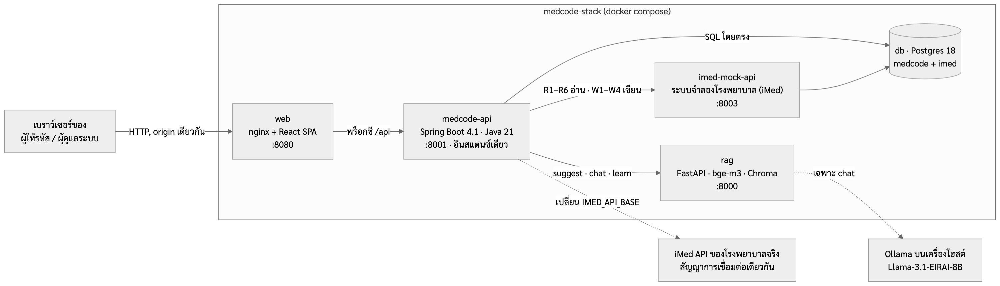
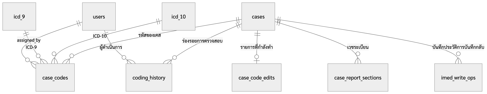

# บทที่ 3 การออกแบบ

ข้อเท็จจริงด้านสถาปัตยกรรมและแบบจำลองข้อมูลในบทนี้มาจากเอกสารประกอบของรีโพซิทอรีและ Flyway migration ของระบบเอง โดยอ้างอิงแหล่งที่มาไว้ในเนื้อความ เพื่อให้ตรวจสอบแต่ละข้อกับโค้ดได้

## 3.1 ขั้นตอนการทำงาน: ก่อนและหลัง

### 3.1.1 ก่อนมีระบบ (ทำด้วยมือ ตามที่อธิบายไว้ในบทที่ 1)

1. เกิดการมารับบริการ (visit) ที่โรงพยาบาล บันทึกของแพทย์ ผลแล็บ คำสั่งแพทย์ และสัญญาณชีพ สะสมอยู่ในระบบ iMed ของโรงพยาบาลเอง
2. เจ้าหน้าที่ให้รหัสโรค (coder) ซึ่งไม่มีแดชบอร์ดบอกว่ามีงานใดต้องให้รหัส ต้องไล่อ่านเวชระเบียน (chart) ทีละฉบับ โดยอ่านบันทึกข้อความอิสระภาษาไทย/อังกฤษ แล้วเทียบกับคู่มือกฎ ICD-10-TM ทั้ง 5 เล่มจากความจำ หรือจากเอกสารอ้างอิงฉบับกระดาษ/PDF
3. ผู้ให้รหัสค้นหารหัสที่เป็นตัวเลือกด้วยตนเอง ตรวจทานกับแนวทางการให้รหัส (หัวข้อ 1.2) แล้วบันทึกรหัสสุดท้ายลงในระบบของโรงพยาบาลโดยตรง
4. ไม่มีสัญญาณที่มีโครงสร้างและใช้ร่วมกันระหว่างผู้ให้รหัสว่า "การมารับบริการใดยังขาดรหัส" และไม่มีบันทึกร่วมว่าใครเป็นผู้แนะนำหรือพิจารณารหัสใดก่อนที่รหัสนั้นจะถูกเลือก

### 3.1.2 หลังมีระบบ (ระบบนี้)

บทนำเสนอความยาว 2 นาทีที่คณะผู้จัดทำเขียนไว้สำหรับคณะกรรมการตัดสินและผู้มีส่วนได้ส่วนเสียของโรงพยาบาลสรุปภาพนี้ไว้ได้ดีว่า *"ระบบนำการมารับบริการของผู้ป่วยออกมาจากระบบของโรงพยาบาล แนะนำรหัสการวินิจฉัยและรหัสหัตถการ ผู้ให้รหัสซึ่งเป็นมนุษย์ตรวจสอบและอนุมัติ แล้วรหัสที่อนุมัติจะถูกส่งกลับเข้าสู่เวชระเบียนของโรงพยาบาลโดยตรง"* (`medcode-api/docs/PITCH-2MIN.md`) ขั้นตอนโดยละเอียดตามที่นำไปปฏิบัติจริงมีดังนี้

1. **ซิงค์** (`POST /api/sync`) ดึงการมารับบริการจากระบบ iMed ของโรงพยาบาลเข้าสู่แดชบอร์ดการให้รหัส โดยจะดึงทั้งหมดหรือเฉพาะช่วงวันที่ที่กำหนดก็ได้ และในขณะเดียวกันก็ปรับปรุงแคตตาล็อกอ้างอิง ICD-10/ICD-9 ให้เป็นปัจจุบันจากรายการหลัก (master list) ของโรงพยาบาลเอง (`medcode-api/docs/api-contract.md`, `POST /api/sync`) การมารับบริการแต่ละรายการจะถูกจัดเข้ากลุ่มใดกลุ่มหนึ่งจาก 4 กลุ่มบนแดชบอร์ดซึ่งไม่ซ้อนทับกัน ได้แก่ **สมบูรณ์** (complete: เข้ามาพร้อมรหัสครบทั้งสองระบบแล้วแต่ยังไม่ได้อนุมัติ) **ไม่สมบูรณ์** (incomplete: ขาดรหัสการวินิจฉัยและ/หรือรหัสหัตถการ จัดกลุ่มตามประเภทงาน ได้แก่ อายุรกรรม/ศัลยกรรม/CT-เอกซเรย์/อื่น ๆ) **เปิดใหม่** (reopened: มีผู้ใช้ยกเลิกการอนุมัติที่ทำไว้ก่อนหน้า) และ **เสร็จสิ้น** (finished: อนุมัติแล้ว)
2. **คำแนะนำจาก AI** (`POST /api/cases/{id}/suggest-codes`) — ผู้ให้รหัสเปิดเคส แล้วระบบสร้างข้อความบรรยายทางคลินิก (clinical narrative) จากส่วนรายงานต่าง ๆ ในเวชระเบียน (จำกัดไม่เกิน 3,500 ตัวอักษร โดยให้อาการสำคัญและประวัติการเจ็บป่วยปัจจุบันมาก่อน) และขอรหัส ICD-10/ICD-9 ที่เป็นตัวเลือกจากบริการ RAG พร้อมคะแนนความมั่นใจและเอกสารต้นทางที่อ้างอิง การเรียกนี้ **ไม่บันทึกข้อมูลใดเลย** — ดูบทที่ 4 หัวข้อ 4.3
3. **การตรวจทานและการเลือกโดยมนุษย์** ผู้ให้รหัสเห็นรหัสตัวเลือกที่จัดกลุ่มตาม *ที่มา* ได้แก่ ผู้ให้รหัสเพิ่มเอง จากเวชระเบียนโรงพยาบาล AI แนะนำ และไม่มีการบันทึกไว้ โดยแสดงเปอร์เซ็นต์ความมั่นใจ **เฉพาะ** แถวที่ AI แนะนำเท่านั้น (เป็นการเปลี่ยนแปลงการออกแบบเมื่อวันที่ 2026-08-07 โดยมีจุดประสงค์เฉพาะเพื่อไม่ให้รหัสที่มาจากโรงพยาบาล ซึ่งไม่จำเป็นต้องมี "ความมั่นใจ" ถูกสับสนกับการคาดเดาเชิงความน่าจะเป็น; `medcode-api/docs/api-contract.md`, ฟิลด์ code-role/origin) ตั้งแต่วันที่ 2026-08-07 ขั้นตอนนี้เป็นแบบ **เลือกก่อน (selection-first)** อย่างชัดเจน กล่าวคือ ไม่มีรหัสใดถูกติ๊กไว้ล่วงหน้า ยกเว้นรหัสที่ผู้ให้รหัสป้อนเอง ผู้ให้รหัสเป็นผู้ติ๊กรหัสที่ควรอยู่ในเคส (`selected: true`) แทนรูปแบบเดิมที่ "แนะนำทุกอย่างไว้ แล้วลบสิ่งที่ผิดออก" (`medcode-api/CLAUDE.md`, หมุดหมาย "Selection-first code review")
4. **บันทึกสถานะงาน** (`PUT /api/cases/{id}/codes`) — เก็บการแก้ไขระหว่างทำงานของผู้ให้รหัสไว้ *ในฐานข้อมูลของระบบนี้เท่านั้น* โดยยังไม่มีการแตะต้องระบบของโรงพยาบาล
5. **อนุมัติ** (`POST /api/cases/approve`) — เป็นการกระทำเดียวที่บันทึกกลับ (write-back) ลงระบบของโรงพยาบาล ระบบเปรียบเทียบความแตกต่าง (diff) ระหว่างรายการรหัสสุดท้ายที่ผู้ให้รหัสติ๊กไว้กับแถวข้อมูลปัจจุบันในระบบของโรงพยาบาล แล้วสั่งสร้าง/แก้ไข/ยกเลิกเท่าที่จำเป็นน้อยที่สุดเพื่อให้ตรงกัน (รายละเอียดกลไกทั้งหมดอยู่ในบทที่ 4 หัวข้อ 4.1)
6. **เปิดใหม่** (`POST /api/cases/{id}/reopen`) ย้อนการอนุมัติทั้งสองฝั่ง โดยการแก้ไขของผู้ให้รหัสยังคงอยู่ มีเพียงสถานะสิ้นสุด/อนุมัติแล้วที่ถูกยกเลิก ระบบใช้บันทึกประวัติ (journal) ที่เก็บภาพข้อมูลก่อนการเปลี่ยนแปลง (before-image) เพื่อคืนข้อมูลของโรงพยาบาลด้วย ไม่ใช่เพียงสำเนาในระบบนี้ (`medcode-api/docs/imed-integration.md`, "Reopen")

 <em>ภาพที่ 3.1 · ขั้นตอนการให้รหัสก่อนและหลังมีระบบนี้</em>

## 3.2 สถาปัตยกรรม: 5 บริการ Postgres 1 ชุด และ AI ที่เป็นทางเลือก

ระบบประกอบด้วย 5 บริการที่สร้างและนำไปใช้งานได้อย่างเป็นอิสระต่อกัน โดยมีรีโพซิทอรีที่ 6 ซึ่งไม่มีโค้ด ทำหน้าที่ประกอบบริการทั้งหมดเข้าด้วยกันสำหรับการใช้งานในเครื่องและการสาธิต (`medcode-stack/README.md`) ภาพที่ 3.2 แสดงการเชื่อมต่อระหว่างบริการเหล่านี้

 <em>ภาพที่ 3.2 · สถาปัตยกรรมระบบ: 5 คอนเทนเนอร์ ระบบของโรงพยาบาลอยู่หลังการตั้งค่าเพียงค่าเดียว และการสร้างข้อความทำงานบนเครื่องโฮสต์</em>

| บริการ | รีโพซิทอรี | หน้าที่ | พอร์ตบนโฮสต์ (compose) |
|---|---|---|---|
| `web` | `audit-chart-frontend` | ส่วนติดต่อผู้ให้รหัสที่พัฒนาด้วย React + TypeScript + Vite สร้างและให้บริการโดย nginx ทำหน้าที่ส่งต่อ (proxy) `/api` ไปยังระบบหลังบ้าน เบราว์เซอร์จึงติดต่อกับต้นทาง (origin) เดียวเท่านั้น (ไม่ต้องใช้ CORS) | 8080 |
| `medcode-api` | `medcode-api` | ระบบหลังบ้าน Spring Boot 4.1 / Java 21 เป็นเจ้าของสัญญาการเชื่อมต่อ API ฐานข้อมูล `medcode` การล็อกการเขียน (write-lock) ไปยังโรงพยาบาลเพียงจุดเดียว และการประสานงานการซิงค์/อนุมัติ/เปิดใหม่ | 8001 |
| `imed-mock-api` | `imed-mock-api` | ทำหน้าที่แทนระบบ iMed จริงของโรงพยาบาล โดยพัฒนาตามสัญญาการเชื่อมต่อฝั่งอ่าน (R1–R6) และฝั่งเขียน (W1–W4, `/api/v1/diagnosis`) ครบทุกฟิลด์ และทำงานกับฐานข้อมูล `imed` ของตนเอง | 8003 |
| `rag` | `RAG` | บริการ FastAPI ภาษา Python สำหรับเวกเตอร์ฝังตัว (embedding) ฐานข้อมูลเวกเตอร์ และการค้นคืน (retrieval) เพื่อแนะนำรหัส (ไม่ใช้โมเดลภาษา) รวมถึงการสร้างข้อความ (generation) ด้วย LLM ภายในเครื่องสำหรับแชต Agent ของผู้ให้รหัส | 8000 |
| `db` | — (อิมเมจ `postgres:18` มาตรฐาน) | เซิร์ฟเวอร์ Postgres เครื่องเดียวที่รองรับฐานข้อมูลแอปพลิเคชัน **ทั้งสอง** คือ `medcode` และ `imed` (แยกกันด้วย schema) ตรงกับรูปแบบการนำไปใช้งานจริงที่เป็นเป้าหมาย | 5433→5432 |

มีการตัดสินใจเชิงสถาปัตยกรรม 2 ข้อที่ควรกล่าวไว้อย่างชัดเจน เนื่องจากส่งผลต่อทุกส่วนที่ตามมา

- **RAG เป็นทางเลือกโดยการออกแบบ** ไม่มีส่วนใดในกราฟ `depends_on` ของไฟล์ compose ที่ต้องพึ่งพาบริการนี้ และส่วนอื่นของแอปพลิเคชัน (การโหลดการมารับบริการ การแก้ไขรหัส การซิงค์ การอนุมัติ การเปิดใหม่) ยังทำงานต่อได้แม้ปิดบริการนี้ไว้ มีเพียงรหัสที่ AI แนะนำ แชต Agent และหน้าการฝึก AI (AI Training) ของผู้ดูแลระบบเท่านั้นที่ได้รับผลกระทบ (`medcode-stack/README.md`, "AI (the RAG service)") ข้อนี้สนับสนุนกรอบแนวคิดด้านความปลอดภัยแบบมนุษย์ร่วมตัดสินใจ (human-in-the-loop) จากบทที่ 1 โดยตรง กล่าวคือ ผู้ให้รหัสสามารถทำงานให้เสร็จได้เสมอโดยไม่ต้องพึ่ง AI
- **`medcode-api` ต้องทำงานเพียง 1 อินสแตนซ์เท่านั้น** การล็อกการเขียน (`WriteGate`) และแคชเคสภายในโปรเซสถูกเก็บไว้ในหน่วยความจำ ไม่ใช่ในฐานข้อมูล การขยายระบบแนวนอน (horizontal scaling) จึงจะทำให้การอนุมัติเสียหายแทนที่จะช่วยกระจายภาระงาน (`medcode-stack/README.md`, "Production is not this file"; `medcode-api/CLAUDE.md`, "Layout conventions") ข้อนี้เป็นเพดานการขยายระบบของการออกแบบปัจจุบันที่ทราบและบันทึกไว้แล้ว ไม่ใช่สิ่งที่มองข้าม — ดูบทที่ 8 ว่าข้อนี้ส่งผลต่อรายการช่องว่างสำหรับการนำไปใช้งานจริงอย่างไร

ภาพที่ 3.3 ติดตามเคสหนึ่งเคสผ่านระบบ ตั้งแต่ออกจากโรงพยาบาลจนกลับไปยังโรงพยาบาล

 <em>ภาพที่ 3.3 · หนึ่งเคสผ่านระบบ: ซิงค์ แนะนำ บันทึก อนุมัติ</em>

ชุดแผนภาพการไหลของข้อมูล (data-flow diagram) แบบโต้ตอบที่ละเอียดกว่านี้ดูแลรักษาไว้ร่วมกับโค้ดที่ `medcode-api/docs/dataflow.html` ได้แก่ ขอบเขตของระบบ ไปป์ไลน์การให้รหัสเคส การซิงค์ การยืนยัน (commit) 2 ระยะของการอนุมัติ การเล่นบันทึกประวัติย้อนกลับของการเปิดใหม่ การยืนยันตัวตน การไหล 4 แบบผ่านบริการ RAG และเมทริกซ์กระบวนการ × ตาราง โดยได้นำ 2 มุมมองจากชุดนี้มาแสดงไว้ในภาคผนวก ข

## 3.3 แบบจำลองข้อมูล

ฐานข้อมูลทั้งสองสะท้อนระบบทั้งสองที่ฐานข้อมูลเป็นตัวแทน ได้แก่ พื้นที่ทำงานการให้รหัสของระบบนี้เอง (`medcode`) และส่วนข้อมูลสกัด (extract) รวมกับ API ฝั่งเขียนของโรงพยาบาล (`imed`) โดยตั้งใจแยกออกจากกัน เพื่อให้ข้อมูลของโรงพยาบาลยังคงเป็นของโรงพยาบาล และสถานะงานของระบบนี้เป็นสิ่งที่ทิ้งได้เมื่อเทียบกับข้อมูลของโรงพยาบาล

### 3.3.1 `medcode` — พื้นที่ทำงานการให้รหัส

วิวัฒนาการของ schema ติดตามด้วย Flyway migration (`medcode-api/src/main/resources/db/migrations/V1`–`V9`) ซึ่งในตัวเองก็เป็นบันทึกการออกแบบที่มีประโยชน์ ภาพที่ 3.4 แสดงตารางหลักของการให้รหัส ส่วนรายการ migration ทั้งหมดอยู่ในภาคผนวก ค

 <em>ภาพที่ 3.4 · ตารางหลักของฐานข้อมูล medcode</em>

- **`cases`** — หนึ่งแถวต่อการมารับบริการหนึ่งครั้งที่โรงพยาบาล ("เคส") เก็บฟิลด์ทางคลินิกที่มาจากโรงพยาบาล (แผนก หอผู้ป่วย ความรุนแรง กลุ่มโรค — หลายฟิลด์ในจำนวนนี้ระบุชัดว่าเป็น *กลุ่มที่โครงการนี้จัดขึ้นเอง ไม่ใช่ข้อเท็จจริงทางคลินิก* ดู `docs/medical-glossary.md` หัวข้อ 11) พร้อมสถานะของขั้นตอนการทำงาน (`case_status` ซึ่งเป็น enum ของ `open`, `in_review`, `approved`, `reopened`)
- **`case_codes`** — หนึ่งแถวต่อรหัสที่กำหนดหนึ่งรหัส ชี้ไปยังตารางแคตตาล็อกหนึ่งในสองตารางเท่านั้น (`icd_10_id` XOR `icd_9_id` บังคับด้วย check constraint ตั้งแต่การแยกแคตตาล็อกเมื่อวันที่ 2026-07-28 — migration V3) มีฟิลด์ `code_role` (การวินิจฉัยหลัก/การวินิจฉัยรอง/อื่น ๆ/สาเหตุภายนอก/หัตถการ) และ `source` (`imported_from_imed` เทียบกับ `coder_assigned`) แถวของ ICD-9 มีช่วงเวลาการทำหัตถการและประเภทหัตถการเพิ่มเติม (migration V4, V5) เนื่องจากรหัสหัตถการแทนสิ่งที่เกิดขึ้นในช่วงเวลาหนึ่ง ซึ่ง API ฝั่งเขียนของโรงพยาบาลกำหนดให้ต้องมี
- **`case_code_edits`** — รายการรหัสระหว่างทำงานของผู้ให้รหัส เก็บเป็นเอกสาร JSON หนึ่งฉบับต่อเคส จัดเก็บและส่งคืนตามต้นฉบับทุกประการ ตารางนี้เป็นที่ที่ UI เก็บเครื่องหมายติ๊ก `selected` และ `origin` (`manual`/`hospital`/`ai`) ของแต่ละแถว ทำให้ส่วนหน้าบ้านเพิ่มฟิลด์ลักษณะนี้ได้โดยไม่ต้องเปลี่ยน schema เมื่ออนุมัติ ระบบจะอ่านตารางนี้และแปลงแถวที่ติ๊กไว้เป็น `case_codes`
- **`icd_10`** / **`icd_9`** — แคตตาล็อกอ้างอิง แยกเป็น 2 ตาราง (V3) โดยเฉพาะเพราะคาดว่าระบบรหัสทั้งสองจะต้องการคอลัมน์ที่แตกต่างกันมากขึ้น แทนที่จะใช้ตารางเดียวร่วมกันซึ่งจะมีค่า null เพิ่มขึ้นเรื่อย ๆ
- **`case_report_sections`**, **`case_orders`**, **`case_vitals`** — ตัวเวชระเบียนเอง ได้แก่ บันทึกของแพทย์แยกตามประเภทเอกสาร × ชื่อฟิลด์ คำสั่งแล็บ/ยา/ภาพถ่ายทางรังสี/ผ่าตัด และค่าสัญญาณชีพ ทั้งหมดมี foreign key ไปยัง `cases` (migration V6 เมื่อวันที่ 2026-08-20 ปิดช่องว่างที่ตาราง 2 ตารางในกลุ่มนี้เคยถูกสร้างขึ้นโดยไม่มี FK ดังกล่าว ด้วยโค้ดที่เขียนขึ้นเองซึ่งข้ามระบบ migration — ดูรายละเอียดเหตุการณ์ทั้งหมดใน `medcode-api/CLAUDE.md` หมุดหมาย "Flyway")
- **`coding_history`** — ร่องรอยการตรวจสอบ (audit trail) หนึ่งแถวต่อการกระทำหนึ่งครั้งของผู้ให้รหัส (approved/reopened/code_assigned) เรียงจากเก่าไปใหม่ แสดงให้ผู้ให้รหัสเห็นเป็นประวัติของเคส และเป็นฐานของข้อกล่าวอ้างเรื่องร่องรอยการตรวจสอบในบทที่ 5 และบทที่ 8
- **`imed_write_ops`** (V2) — บันทึกประวัติการบันทึกกลับ เก็บภาพข้อมูลก่อนการเปลี่ยนแปลงของทุกแถวในระบบโรงพยาบาลที่ระบบนี้เคยสร้าง แก้ไข หรือยกเลิก ซึ่งเป็นสิ่งที่ทำให้ `reopen` สามารถ *ย้อนกลับ* การบันทึกกลับได้ แทนที่จะเพียงลืมว่าเคยเกิดขึ้น (กลไกอยู่ในหัวข้อ 4.1)
- **`users`**, **`auth_sessions`** (V1) — บัญชีผู้ให้รหัส/ผู้ดูแลระบบ (เก็บรหัสผ่านเป็นแฮช BCrypt) และเซสชันโทเค็น Bearer ฝั่งเซิร์ฟเวอร์
- **`case_stars`** (V8), **`app_settings`** (V9) — เครื่องหมาย "ดูเคสนี้ก่อน" ที่ใช้ร่วมกันและผู้ให้รหัสคนใดก็ตั้งได้ และสวิตช์นโยบายการแสดงผลที่ผู้ดูแลระบบตั้งค่าได้ (กำหนดว่ารายการเคสแสดงฟิลด์ตัวระบุใดได้บ้าง)

### 3.3.2 `imed` — ระบบจำลองของโรงพยาบาล

จำลองตารางข้อมูลสกัดจริงของโรงพยาบาล (`medhack_patient`, `medhack_diagnosis_icd10`, `medhack_procedure_icd9`, ตารางคำสั่งแล็บ/ยา/สัญญาณชีพ, …) รวมถึงอ็อบเจกต์ฝั่งเขียนที่ "iMed Diagnosis and Medical Discharge API" ของจริงกำหนดไว้ (`imed-mock-api/src/main/resources/db/migrations/
V1__api_v1.sql` และไฟล์ถัดไป) ระบบจำลอง (mock) นี้ตั้งใจสร้างให้ตรงกับสัญญาการเชื่อมต่อ (contract) API จริงของโรงพยาบาลในรูปแบบ PDF **ครบทุกฟิลด์** (`medcode-api/docs/MedCode-AI-iMed-Integration-API-Contract-v1.pdf`) เพื่อให้การเปลี่ยนจากระบบจำลองนี้ไปใช้ระบบจริงของโรงพยาบาลในสภาพแวดล้อมใช้งานจริงตั้งใจให้เป็นเพียงการเปลี่ยนการตั้งค่า (`IMED_API_BASE` + โทเค็น) ไม่ใช่การเขียนใหม่ — บทที่ 8 กลับมาพิจารณาอีกครั้งว่าข้อกล่าวอ้างนี้มีความมั่นใจเพียงใดในปัจจุบัน

### 3.3.3 สิทธิการรักษา / บริบททางการเงิน

`coverage_types` จับคู่รหัสสิทธิการรักษาดิบของโรงพยาบาล (เช่น `UCS_89_I`) กับกลุ่มสิทธิระดับชาติของประเทศไทย ได้แก่ UCS (ประมาณ 72% ของประชากร, สำนักงานหลักประกันสุขภาพแห่งชาติ (สปสช.)) CSMBS/`OFC` (ข้าราชการ ประมาณ 9%) และ SSS (ประกันสังคมภาคเอกชน ประมาณ 19%) อย่างไรก็ตาม ชุดข้อมูลปัจจุบันบังเอิญ **ไม่มีแถว SSS เลย** ซึ่งคณะผู้จัดทำได้ระบุไว้ว่าเป็นช่องว่างที่ควรสอบถามโรงพยาบาล (`docs/medical-glossary.md`, หัวข้อ 8) ตารางนี้คือสิ่งที่จะทำให้หน้าการวิเคราะห์ในเวอร์ชันต่อไปสามารถรายงานงานค้างของการให้รหัส *แยกตามผู้จ่ายเงิน* ได้ ซึ่งมีความสำคัญเมื่อพิจารณากรอบเรื่อง DRG/การเบิกจ่ายค่ารักษาในบทที่ 1

## 3.4 การออกแบบหน้าจอ

ส่วนติดต่อผู้ให้รหัสแบ่งเป็นหนึ่งหน้าจอต่อหนึ่งงาน ใช้ได้ทั้งภาษาไทยและภาษาอังกฤษ (คอนโซลผู้ดูแลระบบเป็นภาษาอังกฤษเท่านั้น) หลักการออกแบบมาจากบทที่ 1 ได้แก่ การตัดสินใจของผู้ให้รหัสต้องชัดแจ้ง ที่มาของทุกรหัสต้องมองเห็นได้ และสิ่งที่ AI เสนอต้องไม่ดูเหมือนข้อเท็จจริง

| หน้าจอ | สิ่งที่แสดง | หลักการออกแบบ |
|---|---|---|
| รายการเคส (แดชบอร์ด) | 4 แท็บ ได้แก่ สมบูรณ์ ไม่สมบูรณ์ (มีป้าย "ขาด N รายการ") เปิดใหม่ และเสร็จสิ้น พร้อมการค้นหา ตัวกรอง และดาวที่ใช้ร่วมกัน | เคสหนึ่งอยู่ในแท็บเดียวเท่านั้น ดาวมองเห็นได้โดยทุกคนและเอาออกได้เฉพาะผู้ติดดาว |
| หน้าต่างซิงค์ | ช่วงเวลาด่วน (Today … Everything) วันที่เฉพาะ หรือช่วงวันที่ แล้วจึงยืนยัน | การซิงค์ไม่แตะต้องเคสที่อนุมัติแล้ว จึงทำซ้ำได้อย่างปลอดภัย |
| รายละเอียดเคส | เวชระเบียนของโรงพยาบาล (มุมมองโรงพยาบาลหรือมุมมองตามลำดับเวลา) สัญญาณชีพ และคอลัมน์สำหรับ ICD-10 และ ICD-9 อย่างละหนึ่งคอลัมน์ | เวชระเบียนอ่านได้อย่างเดียว รหัสจัดกลุ่มตามที่มา (ผู้ให้รหัส เวชระเบียนโรงพยาบาล AI) และมีเพียงแถวของ AI ที่แสดงเปอร์เซ็นต์ความมั่นใจ |
| การเลือกรหัส | ช่องติ๊กสำหรับแต่ละรหัส "เลือกทั้งหมด" ตัวนับจำนวนที่เลือก/ทั้งหมด และการลากเพื่อจัดลำดับ | **ไม่มีรหัสใดถูกติ๊กไว้ล่วงหน้า** รหัส ICD-10 ที่ติ๊กไว้บนสุดคือการวินิจฉัยหลัก ปุ่มอนุมัติจะกดไม่ได้จนกว่าทั้งสองคอลัมน์จะมีรหัสที่เลือก (หรือติ๊ก "ไม่มีหัตถการ") |
| หน้าต่างอนุมัติและเปิดใหม่ | จำนวนรหัสที่จะถูกบันทึก และแจ้งว่ารหัสที่ไม่ได้ติ๊กจะยังคงอยู่ในเคส | ทั้งสองการกระทำต้องได้รับการยืนยันและถูกบันทึกไว้ หน้าต่างเปิดใหม่แจ้งอย่างชัดเจนว่ารหัสที่บันทึกลง iMed แล้วจะถูกเพิกถอน |
| AI ผู้ช่วย (AI Agent) | แชตพจนานุกรมรหัส และแนะนำรหัส (Suggest & Learn) พร้อมประวัติการแชต | คำตอบระบุแหล่งที่มา รหัสที่ไม่พบในข้อความที่ค้นคืนได้ใด ๆ จะถูกทำเครื่องหมายเตือน |
| คอนโซลผู้ดูแลระบบ | แดชบอร์ดพร้อมสวิตช์การแสดงผล บัญชีผู้ใช้ และ AI Training | บัญชีที่มีประวัติการให้รหัสไม่สามารถลบได้ ทำได้เพียงปิดใช้งาน |

 <em>ภาพที่ 3.5 · รายการเคสหลังซิงค์ (แท็บสมบูรณ์ ส่วนติดต่อภาษาไทย)</em>

 <em>ภาพที่ 3.6 · รายละเอียดเคส: เวชระเบียนด้านซ้าย รหัส ICD-10 และ ICD-9 ที่ AI แนะนำพร้อมความมั่นใจด้านขวา โดยไม่มีรหัสใดถูกติ๊กไว้ล่วงหน้า</em>

ทุกหน้าจอทั้งของผู้ให้รหัสและผู้ดูแลระบบแสดงไว้ในภาคผนวก จ และอธิบายทีละขั้นตอนในคู่มือผู้ใช้ภาษาไทย (`audit-chart-frontend/docs/USER-GUIDE-TH.pdf`)
