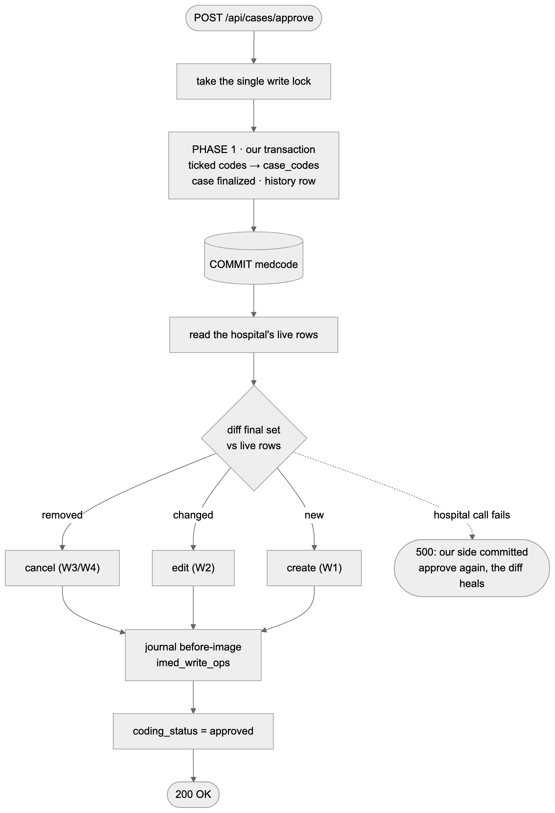
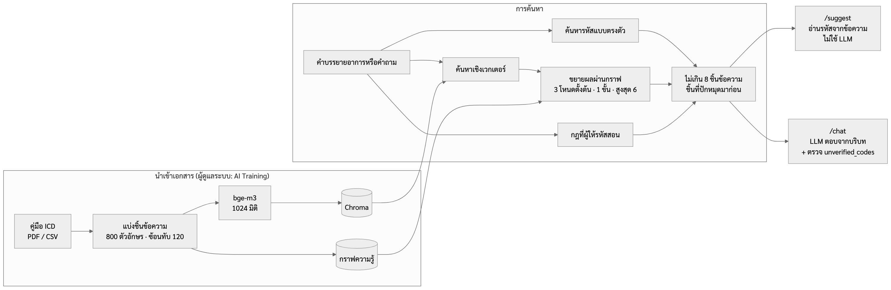

# บทที่ 4 การนำไปปฏิบัติ

โค้ดและพรอมต์ที่ยกมาในบทนี้ตรงตามต้นฉบับใน `RAG/app/core/rag.py`, `chunking.py` และ `config.py`

| องค์ประกอบ | เทคโนโลยี |
|---|---|
| ระบบหลังบ้าน (Backend) | Java 21, Spring Boot 4.1, SQL ล้วนผ่าน JDBC (ไม่ใช้ ORM), Flyway, BCrypt (`spring-security-crypto`) |
| ระบบจำลอง API ของโรงพยาบาล | Java 21, Spring Boot 4.1, SQL ล้วน, Flyway; OpenAPI 3.1 ที่สร้างจากโค้ด |
| ฐานข้อมูล | PostgreSQL 18: `medcode` (ของคณะผู้จัดทำ) และ `imed` (ของโรงพยาบาล) บนเซิร์ฟเวอร์เดียวกัน |
| ส่วนติดต่อผู้ใช้บนเว็บ | React 19, TypeScript 6, Vite 8, Tailwind CSS 4, axios; ให้บริการผ่าน nginx ซึ่งเป็นพร็อกซีสำหรับ `/api` |
| บริการ AI | Python, FastAPI; embedding `BAAI/bge-m3` (1024 มิติ หลายภาษา); vector store Chroma; knowledge graph (GraphML) |
| การสร้างข้อความ | Ollama บนเครื่องโฮสต์ รัน `Llama-3.1-EIRAI-8B` (GGUF 4 บิต); ตัวสำรอง `Qwen2.5-0.5B-Instruct` ภายในโพรเซส |
| การจัดแพ็กเกจ | Docker หนึ่งอิมเมจต่อบริการ; compose ไฟล์เดียวใน `medcode-stack` |
| การทดสอบ | JUnit + MockMvc กับฐานข้อมูลจริง (บริการ Java), pytest (บริการ AI), Apache Bench (ภาระงาน) |

## 4.1 ลำดับการทำงานตั้งแต่ต้นจนจบ: เคสหนึ่งเคสเคลื่อนผ่านระบบอย่างไร

1. **ซิงค์** — `SyncService` ของ `medcode-api` เรียกสัญญาการเชื่อมต่อฝั่งอ่านของโรงพยาบาล (ภายในเครื่องคือ `imed-mock-api` ที่มี R1–R6) เนื่องจาก API ของโรงพยาบาลไม่มี endpoint "ดาวน์โหลดทั้งหมด" การซิงค์แบบกำหนดช่วงเวลาจึงแบ่งเป็นช่วงละไม่เกิน 31 วัน (R3) และแบบไม่กำหนดช่วงจะไล่รายการ id จาก R1 เป็นชุดละไม่เกิน 20 id ผ่าน R2 ตามขีดจำกัดของโรงพยาบาลเอง (ยืนยันด้วยการตอบกลับ `422 too_many_visit_ids` / `422 period_too_long`; `medcode-api/docs/api-contract.md`, `POST /api/sync`) ก่อนทุกครั้งจะมี **การตรวจสอบสัญญาการเชื่อมต่อ R6** กับรายการฟิลด์ที่ระบบพึ่งพา หากฟิลด์ใดหายไป การซิงค์จะล้มเหลวด้วย `500` ที่ระบุชื่อฟิลด์ *ก่อน* เขียนข้อมูลใด ๆ การมารับบริการใหม่จะถูกนำเข้า ที่ยังเปิดอยู่จะได้รับการปรับปรุงฟิลด์จากโรงพยาบาลโดยไม่แตะงานของผู้ให้รหัส ส่วนที่อนุมัติแล้วจะถูกข้าม การซิงค์จึงเขียนทับงานที่อนุมัติแล้วไม่ได้
2. **AI แนะนำรหัส** — `POST /api/cases/{id}/suggest-codes` สร้างข้อความบรรยายทางคลินิก (อาการสำคัญและประวัติปัจจุบันก่อน ไม่เกิน 3,500 ตัวอักษร) แล้วเรียก `/suggest` ของบริการ RAG ผลไม่ถูกบันทึกลงฐานข้อมูล (หัวข้อ 4.3)
3. **ผู้ให้รหัสตรวจสอบและบันทึก** — ผู้ให้รหัสติ๊กเลือก แก้ไข หรือเพิ่มรหัส `PUT /api/cases/{id}/codes` เก็บเป็น JSON array และส่งกลับ **ตามต้นฉบับทุกประการ** หน้าบ้านจึงเพิ่มฟิลด์ (เช่น `origin`, `note`) ได้โดยไม่เปลี่ยนสัญญาการเชื่อมต่อ
4. **อนุมัติ: การเขียนสองระยะแบบเปรียบเทียบความแตกต่าง (diff)** — `POST /api/cases/approve`:
   - ระยะที่ 1: ธุรกรรมของระบบนี้ commit ก่อน รหัสที่บันทึกไว้กลายเป็นแถว `coder_assigned` และเคสถูกปิดงาน
   - ระยะที่ 2 (ใน write-lock เดียวกัน): ชุดรหัสที่ปิดงานแล้วถูก **เปรียบเทียบความแตกต่าง** กับแถวปัจจุบันของโรงพยาบาล รหัสที่ถูกนำออกจะ `DELETE` รหัสที่เปลี่ยนจะ `PUT` ในแถวเดิม (อ้าง id ฝั่งโรงพยาบาล) และรหัสใหม่จะ `POST` ตามลำดับนี้โดยเจตนา เพื่อไม่ให้รหัสใหม่ชนกับแถวที่รอยกเลิก (`medcode-api/docs/imed-integration.md`, การตัดสินใจข้อ 1–2)
   - ทุกแถวของโรงพยาบาลที่ถูกแก้จะถูกบันทึกพร้อมภาพก่อนแก้ไข (before-image) ใน `imed_write_ops` หากการเรียกโรงพยาบาลล้มเหลวหลัง commit ภายใน คำขอจะตอบ 500 **วิธีแก้คืออนุมัติอีกครั้ง** เพราะการเปรียบเทียบคำนวณใหม่จากสถานะจริง ไม่ใช่ส่งคำขอเดิมซ้ำ
   - แถวการมารับบริการฝั่งโรงพยาบาลได้รับเครื่องหมาย `coding_status` (`approved`/ล้างค่า) ผ่านฟิลด์เสริมที่คณะผู้จัดทำเสนอเพิ่มใน write envelope เดิม โดยเจตนา **ไม่** เขียนลง `dischargestatus` ของแพทย์ ซึ่งเวอร์ชันก่อนหน้าเคยเขียนทับโดยผิดพลาด
5. **เปิดใหม่** เล่นย้อน `imed_write_ops` **ในลำดับย้อนกลับ** แถวที่สร้างจะถูกยกเลิก แถวที่ปรับปรุงจะคืนค่าเดิม แถวที่ยกเลิกจะถูกสร้างใหม่ (ได้ id **ใหม่** เพราะ iMed ไม่มีการ "ยกเลิกการยกเลิก" `imed-writeback-as-built.md`, หัวข้อ 5.7) และล้างเครื่องหมายสถานะ การแก้ไขของผู้ให้รหัสยังคงอยู่ การอนุมัติซ้ำจึงไม่ทำให้งานสูญหาย

 <em>ภาพที่ 4.1 · การอนุมัติ: commit ฝั่งระบบของคณะผู้จัดทำก่อน แล้วจึงเปรียบเทียบความแตกต่างกับแถวข้อมูลปัจจุบันของโรงพยาบาล โดยบันทึกประวัติการเขียนทุกครั้ง</em>

## 4.2 ส่วน AI: รายละเอียดของไปป์ไลน์ RAG

ดัชนีชุดเดียวกันให้บริการสองเส้นทาง (ภาพที่ 4.2): `/suggest` อ่านรหัสจากข้อความคู่มือที่ค้นคืนได้โดยไม่ใช้โมเดลภาษา ส่วน `/chat` ให้โมเดลภายในเครื่องตอบจากข้อความที่ค้นคืนได้

 <em>ภาพที่ 4.2 · ไปป์ไลน์ AI: การนำเข้าเอกสาร ช่องทางการค้นคืน และส่วนที่นำผลไปใช้ทั้งสองส่วน</em>

### 4.2.1 การนำเข้าเอกสาร (ingestion) — การแบ่งชิ้นข้อความและการทำดัชนี

เอกสารอ้างอิง (คู่มือ ICD-10 และ ICD-9 ของโรงพยาบาลแบบ PDF และเอกสาร ICD-10-TM ภาษาไทยสำหรับบริการปฐมภูมิ `RAG/data/documents.json`) ถูกแบ่งเป็นชิ้นข้อความ (chunk) ด้วยตัวแบ่งอักขระแบบเวียนเกิดที่ไม่พึ่งไลบรารีภายนอก (`RAG/app/core/chunking.py`) โดยตัดที่ย่อหน้าก่อน แล้วจึงประโยค คำ และจำนวนอักขระ รวมชิ้นเล็กแบบละโมบ (greedy) จนถึงขนาดเป้าหมาย และเพิ่มส่วนท้ายของชิ้นก่อนหน้าเป็นส่วนซ้อนทับ (overlap) ค่าเริ่มต้นคือ **800 อักขระ ซ้อนทับ 120 อักขระ** (`RAG/app/config.py`) แต่ละชิ้นได้ id แบบกำหนดแน่นอน (`"{source}:p{page}-c{i}"`) ที่ใช้ร่วมกันระหว่างฐานข้อมูลเวกเตอร์และกราฟความรู้ ทำให้การค้นคืนแบบกราฟขยายจากผลลัพธ์เวกเตอร์ไปยังชิ้นข้างเคียงได้ (`ingest_pages`)

### 4.2.2 เวกเตอร์ฝังตัวและฐานข้อมูลเวกเตอร์

ชิ้นข้อความถูกแปลงเป็นเวกเตอร์ด้วย **`BAAI/bge-m3`** (sentence-transformer หลายภาษา 1024 มิติ) ซึ่งวางภาษาไทยและอังกฤษในปริภูมิเวกเตอร์เดียวกัน คำถามภาษาไทยจึงค้นคืนข้อความจาก PDF ภาษาอังกฤษได้โดยไม่ต้องแปล (`RAG/README.md`) เวกเตอร์จัดเก็บใน **Chroma** แบบถาวรบนดิสก์ (`RAG/app/core/vectorstore.py`) ดัชนีจึงคงอยู่เมื่อบริการเริ่มใหม่

### 4.2.3 การค้นคืน — สองโหมด พร้อมชั้นการค้นหาแบบตรงตัวและชั้นกฎที่ผู้ให้รหัสสอน

`RAG/app/core/rag.py` มีกลยุทธ์การค้นคืนสองแบบ เลือกได้ในแต่ละคำขอ:

- **`plain`** — การค้นหาความคล้ายคลึงแบบโคไซน์อันดับ k แรก (top-k)
- **`graph`** — การค้นหาเวกเตอร์หาชิ้น *ตั้งต้น* (seed) (`seed_k` ค่าเริ่มต้น 3) แล้วกราฟความรู้ขยายหนึ่งขั้น (hop) ตามรหัสที่ใช้ร่วมกัน ส่วนของเอกสาร การอ้างอิง และลำดับการอ่าน ให้คะแนนชิ้นข้างเคียง `seed_score × hop_decay` (ค่าเริ่มต้น 0.55) จนถึง `graph_budget` (ค่าเริ่มต้น 6 ชิ้น) เพื่อหาข้อความที่เกี่ยวข้องซึ่งการค้นหาความคล้ายคลึงจัดอันดับไว้ต่ำกว่าเกณฑ์เล็กน้อย

ทั้งสองโหมดใช้อีกสองช่องทางเสมอ ทำให้ระบบ *ยึดโยงกับพจนานุกรม*:

- **การค้นหารหัสแบบตรงตัว** หากคำถามมีโทเค็นรูปแบบรหัส ICD (regex ICD-10 `letter + 2 digits [+ decimals]` หรือ ICD-9 `digits.digits`) ชิ้นที่มีรหัสนั้นตามตัวอักษรจะถูกดึงด้วยการจับคู่สตริงย่อยและวาง **ไว้ก่อน** ผลเชิงความหมาย เพราะ *"'what is I33' is a lookup, not a semantic question — embeddings are weak at short code strings"* (`_code_hits`)
- **กฎที่ผู้ให้รหัสสอน ("Suggest & Learn")** ผู้ให้รหัสสอนกฎด้วยภาษาธรรมดา ("ผู้ป่วยเบาหวานที่มีภาวะไตบาดเจ็บเฉียบพลัน: ให้รหัส E11.22 เป็นการวินิจฉัยหลัก เพิ่ม N17.9 และไม่ให้รหัส N18.9") ผ่านสองขั้นแบบสกัดแล้วยืนยัน: `/learn/extract` สร้างร่าง **โดยไม่จัดเก็บสิ่งใด** และต้องยืนยันผ่าน `/learn/notes` ก่อนทำดัชนี กฎที่ตรงกันจะถูกตรึง **เหนือ** ผลเชิงความหมายและผลการค้นหาแบบตรงตัว อ้างอิงเป็น `"Coder note — {author}"` และรหัสที่กฎระบุเป็น `exclude` จะถูกนำออกจากรหัสที่ AI แนะนำแม้ PDF จะเสนอก็ตาม (`RAG/README.md`, "Suggest & Learn") **ไม่มีการปรับแต่งโมเดล (fine-tune)** กลไกนี้ทำงาน ณ เวลาค้นคืน กฎทุกข้อจึงมองเห็นได้ ระบุผู้เขียน แก้ไขและลบได้ (หัวข้อ 4.3)

ผลจากทุกช่องทางถูกจำกัดไม่เกิน 8 ชิ้น (`_MAX_CONTEXT_CHUNKS`) ให้พรอมต์เล็กพอสำหรับ CPU โดยชิ้นที่ถูกตรึงอยู่ลำดับแรก

### 4.2.4 การสร้างข้อความ — พรอมต์และโมเดล

พรอมต์ระบบ (`RAG/app/core/rag.py`, `SYSTEM_PROMPT`) ยกมาทั้งหมด เพราะถ้อยคำนี้คือกลไกการยึดโยงกับแหล่งที่มา (grounding):

> *"You are MedCode, a careful assistant for medical-coding questions.
> Answer ONLY using the provided context. If the context does not contain
> the answer, say you don't know. A context block marked CODER RULE was
> taught by this hospital's own coder: it overrides the general references,
> so follow it and say that it is a coder rule. Be concise — at most about
> 120 words — and cite the source name(s) and page(s) in square brackets.
> Always answer in the same language the question was asked in — English
> questions get English answers, Thai questions get Thai answers..."*

ชิ้นข้อความถูกประกอบเป็นบล็อกบริบทที่มีหมายเลข (ระบุเอกสารและเลขหน้า) ต่อด้วยคำถาม พร้อมคำสั่งให้ตอบเป็นภาษาเดียวกันซ้ำไว้ติดกับคำถาม เพราะ *"Small models follow the context's language over a distant system line — an explicit instruction adjacent to the question is what actually works"* (`_prepare`)

การสร้างข้อความสลับได้สองแบ็กเอนด์ (`RAG/app/config.py`):

- **`ollama`: ที่ชุดระบบใช้อยู่** (`LLM_BACKEND=ollama` ในไฟล์ compose) โมเดล 8B บน Llama-3.1 `hf.co/mradermacher/Llama-3.1-EIRAI-8B-i1-GGUF:Q4_K_M` รันโดย Ollama บนเครื่องโฮสต์ เพราะ Docker บน macOS ไม่รองรับ GPU passthrough (`medcode-stack/README.md`)
- **`transformers`: ตัวสำรองและค่าเริ่มต้นในโค้ด** `Qwen/Qwen2.5-0.5B-Instruct` ทำงานในโพรเซสบน CPU ขนาดเล็ก (≈1 GB) ไม่ต้องใช้โครงสร้างพื้นฐานเพิ่ม แต่ให้ "ผลลัพธ์ที่ด้อยกว่ามาก"

มีเพียงแชทของ Agent และขั้นร่างของ Suggest & Learn ที่ใช้โมเดลนี้ การแนะนำรหัสจึงทำงานได้แม้โมเดลไม่พร้อม ก่อนใช้งานจริงควรประเมินโมเดลที่ปรับสำหรับภาษาไทย เช่น **Typhoon 2** ของ SCB 10X (บน Gemma 3 / Qwen 3) ซึ่งสลับได้ด้วยการตั้งค่าค่าเดียว (`medcode-api/docs/DEPLOYMENT-PREP.md`)

### 4.2.5 กลไกป้องกันด้านการยึดโยงกับแหล่งที่มา: `unverified_codes`

โทเค็นรูปแบบรหัส ICD ทุกตัวในคำตอบของโมเดลจะถูกเทียบกับรหัสในบริบทที่ค้นคืนได้ รหัสที่ **ไม่มีในชิ้นข้อความใดเลย** จะถูกส่งกลับใน `unverified_codes` เป็นคำเตือน ไม่ใช่ข้อเท็จจริง และแสดงให้ผู้ให้รหัสเห็น (`_verify_codes`) นี่คือการนำข้ออ้าง "AI ไม่สามารถแต่งรหัสขึ้นเองได้" (หัวข้อ 1.4) มาใช้จริงด้วยการตรวจสอบแบบกำหนดแน่นอน ไม่ใช่การสั่งให้โมเดลกำกับตัวเอง

## 4.3 มาตรการป้องกัน — การบังคับใช้หลักการ "มนุษย์เป็นผู้อนุมัติเสมอ" ในทางปฏิบัติ

คุณสมบัติด้านความปลอดภัยแต่ละข้อมีกลไกในโค้ดที่ตรวจสอบได้:

- **รหัสที่ AI แนะนำไม่เขียนสิ่งใดลงระบบ** `suggest-codes` ไม่เขียนลง `case_codes` หรือประวัติของผู้ให้รหัส (`medcode-api/docs/api-contract.md`) เส้นทาง *เดียว* ที่บันทึกรหัสคือ `PUT /codes` และเส้นทาง *เดียว* ที่ส่งถึงโรงพยาบาลคือ `POST /approve` ซึ่งแยกต่างหาก ชัดแจ้ง และผ่านการยืนยันตัวตน
- **AI ไม่เลือกรหัสไว้ล่วงหน้า** ตั้งแต่การเปลี่ยนแปลง "เลือกก่อน" (selection-first) วันที่ 2026-08-07 รหัสที่ AI แนะนำไม่ถูกติ๊กโดยค่าเริ่มต้น ผู้ให้รหัสต้องเลือกเองก่อนอนุมัติ (หัวข้อ 3.1.2)
- **ปิด AI ได้โดยแอปพลิเคชันไม่เสียหาย** RAG เป็นส่วนเสริม (หัวข้อ 3.2) การให้รหัสจึงไม่ต้องพึ่ง AI
- **ยึดโยงกับแหล่งที่มา** `unverified_codes` (หัวข้อ 4.2.5) และพรอมต์ "ตอบจากบริบทเท่านั้น" (หัวข้อ 4.2.4) ป้องกันการสร้างรหัสที่ไม่มีอยู่จริง (hallucination)
- **รักษาความเป็นผู้เขียนใน Suggest & Learn** กฎที่สอนแก้ไข ปิดชั่วคราว (mute) หรือลบได้โดยผู้ให้รหัสที่สอนเท่านั้น ผู้ให้รหัสอื่นอ่านได้อย่างเดียว ผู้ดูแลระบบแก้ไขหรือลบได้เพื่อนำกฎที่ผิดออกแม้ผู้สอนลาออกไปแล้ว แต่การแก้ไขไม่โอนความเป็นผู้เขียน กฎยังระบุชื่อผู้ให้รหัสที่สอนไว้เดิม (`medcode-api/CLAUDE.md`)
- **การเขียนทุกครั้งบันทึกประวัติและย้อนกลับได้** `imed_write_ops` (หัวข้อ 4.1) ทำให้เปิดเคสใหม่และคืนสภาพข้อมูลของโรงพยาบาลเองได้
- **ทุกการกระทำระบุตัวผู้กระทำได้** การอนุมัติและการเปิดใหม่ประทับอีเมลของบัญชีที่ยืนยันตัวตน (ไม่ใช้ชื่อที่ไคลเอนต์ส่งมา) และ `coding_history` เก็บร่องรอยของแต่ละเคสตามลำดับเวลา
- **ผู้ให้รหัสหนึ่งคนต่อหนึ่งเคส** การล็อกแบบต่ออายุ 90 วินาทีป้องกันการแก้ไข อนุมัติ หรือเปิดใหม่เคสเดียวกันพร้อมกัน แต่ไม่ปิดกั้นการติดดาว เพราะไม่ใช่การแก้ไข
- **ข้อมูลสาธิตกำหนดแน่นอนและทิ้งได้** สร้างด้วยสคริปต์ที่ใช้ seeded RNG ย้อนกลับได้ผ่าน `POST /api/demo/snapshot` / `POST /api/demo/reset` ซึ่งปิดไว้โดยค่าเริ่มต้นนอกการพัฒนาภายในเครื่อง (`DEMO_TOOLS_ENABLED`) เพราะเป็นการเขียนที่ทำลายข้อมูลเดิม ที่มาของข้อมูลดูบทที่ 5

หลักฐานคือชุดทดสอบอัตโนมัติ (หัวข้อ 6.1: ผ่าน 191 จาก 192 การทดสอบ ครอบคลุมสามบริการ ผลดิบใน `eval-results/`) รวมถึงกรณีขอบ เช่น รหัสที่ไม่ได้ติ๊กยังอยู่ในรายการแต่ไม่ถูกบันทึกกลับ (`CasesApiIntegrationTest.unselectedCodeEditsAreKeptButNotApproved`) ยังไม่มีการทบทวนด้านความมั่นคงปลอดภัยหรือ adversarial robustness โดยเฉพาะ ซึ่งอยู่ในรายการงานก่อนใช้งานจริงในบทที่ 8
