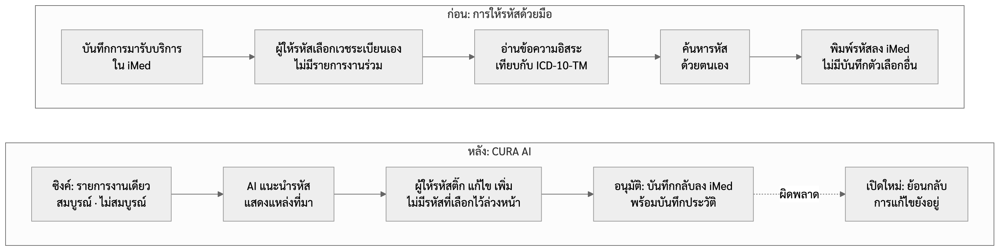
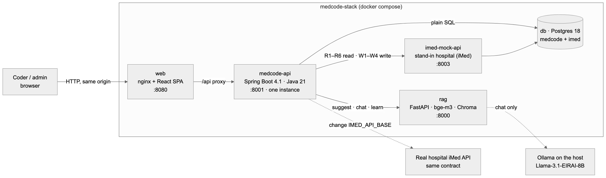
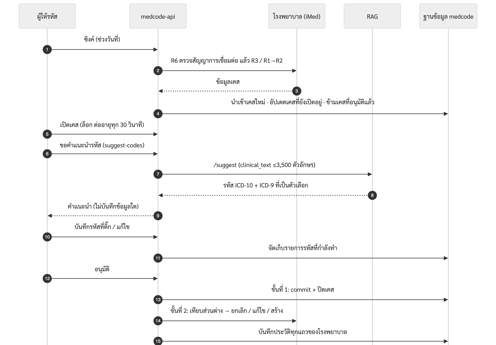
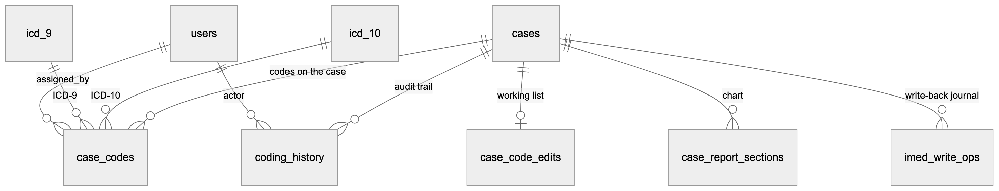
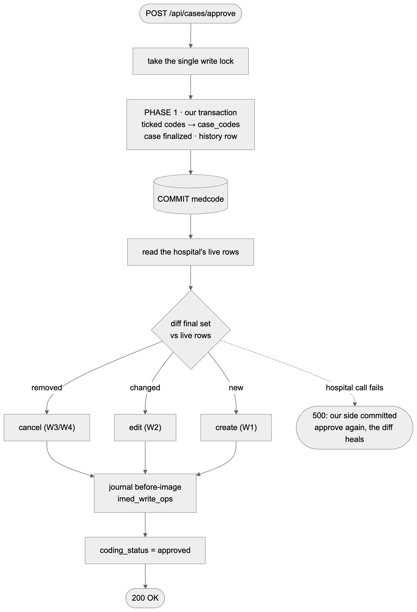
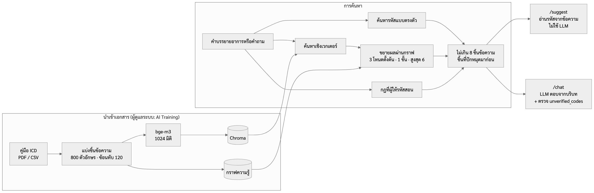

# บทที่ 1 บทนำ

รายงานฉบับนี้นำเสนอระบบ **CURA AI** ซึ่งพัฒนาโดยทีม Suvarna Stack ผลิตภัณฑ์นี้พัฒนาขึ้นภายใต้ชื่อชั่วคราว *MedCode AI* ซึ่งยังคงใช้อยู่ในชื่อคลังโค้ด (repository) บริการ และฐานข้อมูลของระบบ (`medcode-api`, `medcode-stack` และฐานข้อมูล `medcode`) รวมถึงในเอกสารโครงการบางฉบับที่อ้างถึงในรายงานนี้

## 1.1 บริบท: การมารับบริการที่โรงพยาบาลในประเทศไทยกลายเป็นการเบิกจ่ายค่ารักษาได้อย่างไร

การมารับบริการของผู้ป่วยแต่ละครั้งที่โรงพยาบาลพันธมิตรจะก่อให้เกิดเวชระเบียน ได้แก่ บันทึกของแพทย์ (อาการสำคัญ ประวัติการเจ็บป่วยปัจจุบัน การตรวจร่างกาย และการประเมิน) ผลการตรวจทางห้องปฏิบัติการ คำสั่งใช้ยา หัตถการ และสัญญาณชีพ หลังการมารับบริการ **เจ้าหน้าที่ให้รหัสโรค** (medical coder) จะอ่านเวชระเบียนนั้นและกำหนดรหัสมาตรฐาน ได้แก่ ICD-10 สำหรับ *สิ่งที่ผิดปกติ* (การวินิจฉัย) และ ICD-9 / ICD-9-CM สำหรับ *สิ่งที่ได้กระทำ* (หัตถการ) โดยใช้ **ICD-10-TM** ซึ่งเป็นฉบับดัดแปลงระดับชาติของประเทศไทยจากมาตรฐานของ WHO ฉบับนี้เพิ่มเล่มที่ 5 ว่าด้วยกฎการให้รหัส และกลุ่มรหัสเฉพาะของประเทศไทย (เช่น U50–U77 สำหรับการแพทย์แผนดั้งเดิม เป็นต้น) ต่อยอดจากบัญชีจำแนก (tabular list) ของ WHO (medcode-api `docs/medical-glossary.md` หัวข้อ 4–5)

รหัสเหล่านี้ไม่ใช่งานเอกสารที่ทำเพียงเพื่อให้มีเอกสาร สำหรับการดูแลผู้ป่วยใน (IPD) โรงพยาบาลในประเทศไทยได้รับการเบิกจ่ายค่ารักษาตามระบบ **DRG** (กลุ่มวินิจฉัยโรคร่วม; diagnosis-related group) กล่าวคือ รหัสจะจัดการรับผู้ป่วยไว้รักษา (admission) แต่ละครั้งเข้าสู่กลุ่ม แต่ละกลุ่มมีน้ำหนักสัมพัทธ์ (relative weight) และค่าตอบแทนมีค่าประมาณ *น้ำหนัก × อัตราจ่าย* เนื่องจากรหัสมีผลต่อเงินที่โรงพยาบาลได้รับ สำนักงานหลักประกันสุขภาพแห่งชาติ (สปสช.) จึงตรวจสอบเวชระเบียนเทียบกับรหัสที่ส่งเบิก โดยเฝ้าระวังทั้งการให้รหัสต่ำกว่าความเป็นจริง (under-coding) ซึ่งทำให้โรงพยาบาลสูญเสียรายได้ที่ควรได้รับ และ "DRG creep" / การให้รหัสสูงกว่าความเป็นจริง (upcoding) การตรวจสอบของ สปสช. ในปี 2015 ครอบคลุมเวชระเบียนประมาณ 119,000 ฉบับ โดยตรวจการวินิจฉัยหลักในสรุปการจำหน่ายผู้ป่วย (discharge summary) เทียบกับข้อมูลรหัสที่บันทึกไว้ (`docs/medical-glossary.md` หัวข้อ 1 ซึ่งอ้างอิงเอกสารการตรวจสอบของ สปสช. ที่ระบุไว้ในส่วน Sources ของไฟล์ดังกล่าว) ดังนั้น การให้รหัสที่ถูกต้องจึงเป็นทั้งงานด้านการบันทึกเวชระเบียนทางคลินิกและงานด้านการปฏิบัติตามข้อกำหนด ซึ่งส่งผลจริงต่อการเงินและผลการตรวจสอบของโรงพยาบาล

## 1.2 กระบวนการที่ทำด้วยมือซึ่งระบบนี้สร้างขึ้นเพื่อสนับสนุน

ปัจจุบัน การให้รหัสเป็นงานที่มนุษย์ทำด้วยมือทีละเวชระเบียน ภายใต้กฎเกณฑ์ที่เข้มงวด (ICD-10-TM เล่มที่ 5) ซึ่งเครื่องมือที่ออกแบบอย่างง่ายเกินไปมักทำผิดพลาดเป็นประจำ ตัวอย่างกฎที่ทำให้การให้รหัสอย่างถูกต้องเป็นงานที่ยากจริง ไม่ใช่เพียงน่าเบื่อ มีดังนี้ (`docs/medical-glossary.md` หัวข้อ 5)

- การมารับบริการแต่ละครั้งมีการวินิจฉัยหลักได้ **เพียงหนึ่งเดียว** ซึ่งคือการวินิจฉัย *สุดท้าย* ณ เวลาจำหน่ายผู้ป่วย และอาจแตกต่างจากการวินิจฉัยแรกรับ หากมีหลายภาวะที่อาจเป็นการวินิจฉัยหลักได้ ให้เลือกตามความรุนแรงและการใช้ทรัพยากร และให้อ่านจากสรุปการจำหน่ายผู้ป่วยเป็นหลักแทนบันทึกแรกรับ
- โรคร่วม (comorbidity) ภาวะแทรกซ้อน (complication) และ "การวินิจฉัยอื่น" (other diagnosis) เป็นสามสิ่งที่แตกต่างกัน (เกิดขึ้นก่อนหรือหลังรับไว้รักษา และมีความรุนแรงถึงขั้นต้องได้รับการดูแลเพิ่มเติมหรือไม่) ซึ่งผู้ให้รหัสต้องแยกแยะจากบันทึกของแพทย์ที่เป็นข้อความอิสระ
- **ผลการตรวจทางห้องปฏิบัติการไม่ถือเป็นการวินิจฉัยโดยเด็ดขาด** เช่น ค่าเม็ดเลือดขาวที่ผิดปกติไม่สามารถให้รหัสเป็น "การติดเชื้อ" ได้ เว้นแต่บันทึกของแพทย์เองได้สรุปเช่นนั้น
- ไม่สนับสนุนให้ใช้รหัสแบบครอบคลุมกว้าง (catch-all) หรือรหัสที่กำกวม ควรใช้รหัสรวม (combined code) เมื่อมีรหัสดังกล่าว และให้ตัดรหัสอาการออกเมื่อได้ให้รหัสสาเหตุที่แท้จริงแล้ว

กล่าวโดยสรุป ผู้ให้รหัสต้องอ่านข้อความทางคลินิกภาษาไทยและภาษาอังกฤษที่ไม่มีโครงสร้าง ซึ่งมีคำย่อเฉพาะท้องถิ่นจำนวนมาก (`HT`, `DM`, `s/p`, `r/o` และข้อความภาษาไทยที่ปะปนอยู่ ซึ่งรวบรวมไว้ใน `docs/medical-glossary.md` หัวข้อ 10) แล้วนำไปเทียบกับกฎเกณฑ์ระดับชาติจำนวน 5 เล่ม สำหรับการมารับบริการทุกครั้ง ตลอดทั้งวัน นี่คือกระบวนการที่ขั้นตอนการทำงานโดยมี AI ช่วยในโครงการนี้สร้างขึ้นเพื่อเร่งให้เร็วขึ้น ไม่ใช่เพื่อทดแทน: **"การตัดสินว่ารหัสใดควรอยู่ในเวชระเบียนเป็นอำนาจของผู้ให้รหัสที่เป็นมนุษย์และได้รับการรับรอง ภายใต้กฎ [ของ ICD-10-TM]... ระบบนี้ทำหน้าที่จัดเก็บ ตรวจสอบ และส่งต่อการตัดสินใจของผู้ให้รหัส"** (`docs/medical-glossary.md` หัวข้อ 1 หมายเหตุขอบเขตตอนต้น)

## 1.3 งานค้างที่แท้จริงอยู่ที่ใด

คำศัพท์ที่ใช้บนแดชบอร์ดของระบบเองช่วยให้เห็นขนาดของปัญหาเป็นรูปธรรมแทนที่จะเป็นนามธรรม การมารับบริการแต่ละครั้งเข้ามาจากระบบ iMed ของโรงพยาบาลพร้อมเอกสารทางคลินิก แต่บ่อยครั้งไม่มีรหัสครบชุด ในชุดข้อมูลสาธิตที่เตรียมไว้ล่วงหน้า (seeded demo dataset) ซึ่งจัดรูปแบบตามข้อมูลที่ดึงออกมาจริงของโรงพยาบาล การซิงค์หนึ่งครั้งจะโหลด **การมารับบริการของผู้ป่วยนอก 140 รายการ ในจำนวนนี้ 60 รายการ "ไม่สมบูรณ์"** คือขาดรหัสการวินิจฉัย ICD-10 ขาดรหัสหัตถการ ICD-9 หรือขาดทั้งสองอย่าง และ 80 รายการ "สมบูรณ์" (นับจากระบบที่กำลังทำงานอยู่ เมื่อวันที่ 23 กันยายน 2026) อภิธานศัพท์ของโครงการระบุชัดเจนว่า "สมบูรณ์" ในที่นี้หมายความเพียงว่าข้อมูลของโรงพยาบาลเองมีรหัสทั้งสองระบบอยู่แล้ว ณ เวลาที่ซิงค์ และ **ไม่ได้** หมายความว่ามนุษย์ได้ตรวจทานรหัสแล้ว (`docs/medical-glossary.md` หัวข้อ 11)

งานค้างที่ไม่สมบูรณ์ยังถูกแบ่งกลุ่มย่อยตามประเภทของงานที่เป็นเหตุของการมารับบริการ ได้แก่ อายุรกรรม ศัลยกรรม CT/X-ray และอื่น ๆ เนื่องจากผู้ให้รหัสที่คัดแยกลำดับความสำคัญของรายการงานจำเป็นต้องทราบว่าเคสใดต้องใช้ความเชี่ยวชาญด้านใด (`medcode-api/docs/api-contract.md`, `incompleteGroups`) การแบ่งกลุ่มนี้มีขึ้นก็เพราะก่อนมีระบบนี้ ไม่มีที่ใดที่ผู้ให้รหัส (หรือหัวหน้างานให้รหัส) จะมองเห็นคิวงานที่ยังไม่ได้ให้รหัสทั้งหมดได้ในที่เดียว โดยจัดกลุ่มตามประเภทงาน ครอบคลุมการมารับบริการของผู้ป่วยนอก (OPD) ทั้งโรงพยาบาล

รายงานฉบับนี้ตั้งใจ **ไม่ระบุขนาดงานค้างจริง ระยะเวลาดำเนินการ หรือจำนวนผู้ให้รหัส** ของโรงพยาบาลพันธมิตร เนื่องจากยังไม่มีค่าใดในจำนวนนี้ที่วัดจากข้อมูลจริงในสภาพแวดล้อมใช้งานจริง มีเพียงการวัดจากชุดข้อมูลสาธิตที่เป็นข้อมูลสมมุติ และการกุตัวเลขเหล่านี้ขึ้นเองจะบั่นทอนความน่าเชื่อถือของตัวเลขทุกตัวที่วัดได้ในบทที่ 6 และบทที่ 7 การวัดค่าเหล่านี้ต้องใช้ข้อมูลการมารับบริการที่โรงพยาบาลเคยให้รหัสไว้ในอดีต ซึ่งตรงกับรายการ "Proving the AI is accurate enough" (การพิสูจน์ว่า AI มีความแม่นยำเพียงพอ) ใน `medcode-api/docs/DEPLOYMENT-PREP.md` หัวข้อ 2

## 1.4 เหตุใดจึงเป็นการสนับสนุนการตัดสินใจ ไม่ใช่การทำงานอัตโนมัติ

เอกสารประกอบเรื่องความพร้อมสำหรับการนำไปใช้งานจริงของคณะผู้จัดทำระบุชัดเจนว่า คุณค่าหลักของผลิตภัณฑ์คือ **การช่วยเหลือ ไม่ใช่การทดแทน**: *"มนุษย์เป็นผู้อนุมัติทุกรหัส AI ทำหน้าที่เพียงแนะนำ และไม่เคยเขียนข้อมูลลงระบบของโรงพยาบาลด้วยตนเอง ... AI ไม่สามารถกุรหัสขึ้นเองได้ AI ไม่เขียนรหัสจากจินตนาการ แต่ค้นหาในคู่มือการให้รหัส นำรหัสที่ปรากฏอยู่ในคู่มือจริงมาใช้ และแสดงข้อความที่พบรหัสเหล่านั้น"* (`medcode-api/docs/DEPLOYMENT-PREP.md` ส่วน "Safety") ข้อความนี้ไม่ใช่เพียงถ้อยคำบนหน้าจอโดยบังเอิญ แต่ถูกบังคับใช้ไว้ในสัญญาการเชื่อมต่อ API โดยตรง กล่าวคือ `POST /api/cases/{caseId}/suggest-codes` ระบุไว้ในเอกสารว่าไม่เขียนข้อมูลใด ๆ เลย (`medcode-api/docs/api-contract.md`) และช่องทางเดียวที่มีผลต่อฐานข้อมูลของโรงพยาบาลคือการเรียก `POST /api/cases/approve` ซึ่งแยกต่างหากและต้องเรียกอย่างชัดแจ้ง โดยบัญชีผู้ใช้ที่เป็นมนุษย์ซึ่งเข้าสู่ระบบแล้วและถูกบันทึกเพื่อการตรวจสอบ

เหตุผลที่การเลือกออกแบบเช่นนี้มีความสำคัญต่อ *การนิยามปัญหา* ไม่ใช่เพียงต่อการนำไปปฏิบัติ คือ การให้รหัสตาม ICD-10-TM มีกฎ "ห้ามแปลงผลการตรวจทางห้องปฏิบัติการเป็นการวินิจฉัย" และการใช้วิจารณญาณอีกหลายประการที่โมเดลไม่สามารถตรวจสอบเทียบกับความจริง (ground truth) ได้ด้วยตนเอง (หัวข้อ 1.2 ข้างต้น) เครื่องมือที่ให้รหัสอัตโนมัติโดยไม่แจ้งให้ทราบย่อมเสี่ยงต่อความล้มเหลวในรูปแบบ DRG creep / การให้รหัสต่ำกว่าความเป็นจริง ซึ่ง สปสช. ตรวจสอบอยู่แล้ว (หัวข้อ 1.1) ดังนั้น ปัญหาที่โครงการนี้แก้ไขจึงแคบกว่าและมีเหตุผลรองรับได้ดีกว่า "การให้รหัสทางการแพทย์แบบอัตโนมัติ" กล่าวคือ **"มอบจุดเริ่มต้นที่เร็วกว่าและยึดโยงกับแหล่งที่มาได้ดีกว่าให้แก่ผู้ให้รหัส และทำให้การตัดสินใจอนุมัติหรือปฏิเสธเป็นไปอย่างรวดเร็ว ตรวจสอบได้ และย้อนกลับได้"**

## 1.5 ขอบเขตของผลงานในปัจจุบัน

ข้อจำกัดด้านขอบเขต 2 ประการที่ต้องระบุอย่างตรงไปตรงมา เนื่องจากมีผลต่อเนื้อหาทั้งหมดที่ตามมาในรายงานนี้

- **ปัจจุบันรองรับเฉพาะ OPD** แดชบอร์ดของผู้ให้รหัส (`GET /api/cases`) แสดงเฉพาะการมารับบริการของผู้ป่วยนอกเท่านั้น (`encountertype = '0'`) ส่วนการรับไว้รักษาแบบ IPD จำนวน 10 รายการในชุดข้อมูลสาธิตถูกตั้งใจไม่นำมาแสดง (`imed-mock-api/DEMO-SETUP.md`) ทั้งนี้ DRG ซึ่งเป็นกลไกการเบิกจ่ายค่ารักษาที่มีผลกระทบสูงที่สุดตามที่อธิบายในหัวข้อ 1.1 ใช้กับการรับไว้รักษาแบบ IPD ดังนั้น ผลกระทบทางการเงินของแดชบอร์ดในปัจจุบันจึงแคบกว่าที่กรอบการตรวจสอบ DRG ข้างต้นสื่อให้เข้าใจ นี่คือขอบเขตที่มีอยู่จริง ไม่ใช่ความบกพร่องที่จะปกปิดไว้
- **เป็นระบบที่สร้างขึ้นในงานแฮกกาธอน (hackathon) และทำงานบนข้อมูลสาธิตที่เป็นข้อมูลสมมุติ** ทุกเคสที่ผู้ให้รหัสตรวจทานในรุ่นปัจจุบันสร้างขึ้นโดย `imed-mock-api/scripts/generate_demo_data.py` ไม่ได้ดึงมาจากระบบ iMed ที่ใช้งานจริงของโรงพยาบาล (ดูบทที่ 5 สำหรับที่มาของข้อมูลโดยละเอียดและคำแถลงความโปร่งใส) ปัญหาที่อธิบายข้างต้นเป็นปัญหาจริง โดยอ้างอิงจากกฎเกณฑ์การให้รหัสจริง สัญญาการเชื่อมต่อ API จริง และคำศัพท์ในขั้นตอนการทำงานจริงของโรงพยาบาล ตามที่บันทึกไว้ในเอกสารต่าง ๆ ของโครงการ แต่การสาธิต *แนวทางแก้ไข* ยังไม่เคยดำเนินการกับเวชระเบียนผู้ป่วยจริง

## 1.6 วัตถุประสงค์

ผลงานนี้มีเป้าหมายเพื่อสร้างระบบ และทดสอบระบบในภาพรวม โดยระบบดังกล่าว

1. **รวบรวมงานค้างการให้รหัสไว้ในรายการงานเดียว** ดึงข้อมูลการมารับบริการของผู้ป่วยนอกจากระบบ iMed ของโรงพยาบาล และแสดงว่ารายการใดยังขาดรหัสการวินิจฉัย ICD-10 หรือรหัสหัตถการ ICD-9
2. **แนะนำรหัสที่ยึดโยงกับคู่มือการให้รหัส** เสนอรหัส ICD-10 และ ICD-9 ที่เป็นตัวเลือกจากเวชระเบียนแต่ละฉบับ โดยนำมาจากเอกสารอ้างอิง ICD ที่อัปโหลดไว้ พร้อมแสดงแหล่งที่มา
3. **ให้ผู้ให้รหัสเป็นผู้ตัดสินใจ** ไม่มีข้อมูลใดถูกส่งถึงโรงพยาบาลหากไม่มีการอนุมัติที่ชัดแจ้งและผ่านการยืนยันตัวตน การอนุมัติทุกครั้งระบุตัวผู้อนุมัติได้และสามารถย้อนกลับได้
4. **บันทึกรหัสที่อนุมัติแล้วกลับลงในระเบียนของโรงพยาบาลเอง** ผ่าน API ของโรงพยาบาล ไม่ใช่ฐานข้อมูลแยกต่างหาก
5. **เก็บข้อมูลผู้ป่วยไว้ภายในโรงพยาบาล** การค้นคืน (retrieval) และการสร้างข้อความ (generation) ทำงานบนโมเดลภายในเครื่อง โดยไม่มีบริการ AI บนคลาวด์เข้ามาเกี่ยวข้อง
6. **บรรลุระดับ TRL 4** ระบบได้รับการทดสอบตั้งแต่ต้นจนจบ (end to end) บนข้อมูลที่ใกล้เคียงความเป็นจริง พร้อมผลการวัดที่เป็นตัวเลข

บทที่ 7 ประเมินผลลัพธ์เทียบกับวัตถุประสงค์ทั้ง 6 ข้อนี้

## 1.7 วิธีดำเนินงานและระยะเวลา

การดำเนินงานเริ่มตั้งแต่วันที่ 21 กรกฎาคม ถึง 23 กันยายน 2026 ครอบคลุมคลังโค้ด 5 แห่ง (รวม 283 commit ตาม `git log`) หลักไมล์ที่ระบุวันที่ด้านล่างนำมาจากบันทึกความก้าวหน้าของโครงการ (`medcode-api/CLAUDE.md`) และประวัติ commit

| วันที่ (2026) | หลักไมล์ |
|---|---|
| 21–22 ก.ค. | สร้างระบบส่วนหลัง (backend) ใหม่ด้วย Spring Boot จัดทำเอกสารสัญญาการเชื่อมต่อ API และแยกฝั่งโรงพยาบาลออกเป็นบริการจำลองและฐานข้อมูลของตนเอง |
| 23–24 ก.ค. | การซิงค์จากโรงพยาบาล การเข้าสู่ระบบและบัญชีผู้ใช้ของเจ้าหน้าที่ และสร้างการบันทึกกลับใหม่บน "iMed Diagnosis and Medical Discharge API" ของจริงของโรงพยาบาล |
| 26–27 ก.ค. | เริ่มพัฒนาบริการ AI (RAG) และเชื่อมต่อส่วนติดต่อผู้ใช้บนเว็บ (web UI) ใหม่สำหรับผู้ให้รหัสเข้ากับระบบส่วนหลัง |
| 28 ก.ค. – 7 ส.ค. | แยกแคตตาล็อก ช่วงเวลาของหัตถการ มุมมองเวชระเบียนแบบโรงพยาบาล การปรับปรุงด้านการเข้าถึง (accessibility) การตรวจทานรหัสแบบเลือกก่อน (selection-first) และสถานะการให้รหัสบนระเบียนของโรงพยาบาล |
| 15–17 ส.ค. | แชต Agent แบบสตรีม (streaming) พร้อมกลไกป้องกันด้านการยึดโยงกับแหล่งที่มา (grounding guard) และบรรจุบริการทั้ง 5 บริการลงในคอนเทนเนอร์ภายใน compose stack เดียว |
| 19–20 ส.ค. | จัดทำสัญญาการอ่านข้อมูล (R1–R6) สำหรับโรงพยาบาลและสร้างระบบจำลองตามสัญญา ปรับฐานชุดทดสอบใหม่ และกำหนดให้ Flyway เป็นแหล่งเดียวของ schema |
| 22–26 ส.ค. | กฎที่ผู้ให้รหัสสอนพร้อมการกำหนดความเป็นเจ้าของ การติดดาวเคสที่ใช้ร่วมกัน และตัวกรองในหน้าวิเคราะห์ข้อมูล |
| 21 ก.ย. | รอบการประเมินผล: ชุดทดสอบ การทดสอบภาระงาน ความแม่นยำของ AI และภาพหน้าจอ |
| 23 ก.ย. | จัดทำเอกสารและรายงานฉบับสมบูรณ์ |

# บทที่ 2 งานที่เกี่ยวข้องและเทคโนโลยีที่เลือกนำมาใช้

แหล่งอ้างอิงทุกแหล่งในบทนี้ได้รับการสืบค้นและตรวจสอบเมื่อวันที่ 18 กันยายน 2026 คำอธิบายผลิตภัณฑ์ของผู้จำหน่ายในหัวข้อ 2.1 นำมาจากเอกสารผลิตภัณฑ์ ซึ่งเป็นสื่อทางการตลาดและได้รับการพิจารณาในฐานะดังกล่าว

## 2.1 การให้รหัสโดยใช้คอมพิวเตอร์ช่วย (CAC): แนวทางที่ใช้กันอยู่เดิม

ระบบโรงพยาบาลขนาดใหญ่ โดยเฉพาะในตลาดสหรัฐอเมริกา ใช้ซอฟต์แวร์ **การให้รหัสโดยใช้คอมพิวเตอร์ช่วย (computer-assisted coding: CAC)** อยู่แล้ว ซอฟต์แวร์ดังกล่าวเป็นกลไกที่อาศัยกฎและการประมวลผลภาษาธรรมชาติ (NLP) ในการอ่านเวชระเบียนและแนะนำรหัสให้เจ้าหน้าที่ให้รหัสโรคซึ่งเป็นมนุษย์ยอมรับหรือปฏิเสธ ตัวอย่างผลิตภัณฑ์เชิงพาณิชย์ที่เป็นที่รู้จัก 2 รายการ ได้แก่

- **Solventum (เดิมคือ 3M) 360 Encompass** — แพลตฟอร์มแบบบูรณาการที่รวม CAC การปรับปรุงคุณภาพการบันทึกเวชระเบียนทางคลินิก (clinical documentation improvement: CDI) และการให้รหัส/การตรวจสอบไว้ด้วยกัน ผลิตภัณฑ์นี้ผสาน "3M CRS" (กลไกสนับสนุนการตัดสินใจสำหรับการให้รหัสโดยใช้คอมพิวเตอร์ช่วย) เข้ากับขั้นตอนการทำงานด้านการให้รหัสระดับมืออาชีพและด้านความถูกต้องของรายได้ (revenue integrity) โดยแนะนำรหัสจากเอกสารของผู้ป่วยโดยอัตโนมัติเพื่อให้ผู้ให้รหัสตรวจทานและดำเนินการให้เสร็จสมบูรณ์
  — *3M/Solventum, "360 Encompass Computer-Assisted Coding (CAC)"*, เอกสารผลิตภัณฑ์, เข้าถึงเมื่อ 2026-09-18.
  [https://www.solventum.com/en-us/home/health-information-technology/solutions/360-encompass-cac/](https://www.solventum.com/en-us/home/health-information-technology/solutions/360-encompass-cac/)
- **3M M\*Modal CDI Engage** — เครื่องมือปรับปรุงคุณภาพการบันทึกเวชระเบียนทางคลินิกที่ทำงานบนคลาวด์และขับเคลื่อนด้วย AI ซึ่งบูรณาการเข้ากับขั้นตอนการทำงาน CAC/CDI ของ 3M ช่วยให้แพทย์บันทึกเอกสารอย่างมีโครงสร้างขณะเขียน จึงลดความกำกวมที่ผู้ให้รหัสในขั้นตอนถัดไปต้องแก้ไข
  — *3M/M*Modal, "3M and M*Modal launch new AI-powered CDI tool"*, Healthcare IT News, เข้าถึงเมื่อ 2026-09-18.
  [https://www.healthcareitnews.com/news/3m-and-mmodal-launch-new-ai-powered-cdi-tool](https://www.healthcareitnews.com/news/3m-and-mmodal-launch-new-ai-powered-cdi-tool)

ผลิตภัณฑ์เหล่านี้มีความสมบูรณ์และอยู่ในระดับองค์กร และที่สำคัญอย่างยิ่งต่อประเด็นด้านสถาปัตยกรรมในหัวข้อ 2.3 คือ ผลิตภัณฑ์เหล่านี้สร้างขึ้นโดยยึด **ระบบรหัสของสหรัฐอเมริกา (ICD-10-CM, CPT)** **การนำไปใช้งานจริงบนคลาวด์หรือภายในองค์กร (on-prem) ขนาดใหญ่** และ **สิทธิ์การใช้งานเชิงพาณิชย์แบบคิดตามจำนวนผู้ใช้ / ตามจำนวนสถานพยาบาล** เอกสารสาธารณะที่พบไม่มีฉบับใดกล่าวถึง ICD-10-TM (ฉบับดัดแปลงระดับชาติของประเทศไทย) บันทึกทางคลินิกภาษาไทย หรือคำศัพท์ของระบบหลักประกันสุขภาพระดับชาติของไทยที่ `medical-glossary.md` ของโครงการนี้บันทึกไว้ (UCS/CSMBS/SSS) ผลิตภัณฑ์เหล่านี้เป็นระบบที่ใช้งานจริงซึ่งใกล้เคียงที่สุดกับ "การให้รหัสโดยมี AI ช่วยพร้อมขั้นตอนการอนุมัติโดยมนุษย์" ซึ่งเป็นการตัดสินใจหลักด้านการออกแบบของโครงการนี้เช่นกัน (บทที่ 1 หัวข้อ 1.4) แต่ไม่สามารถนำมาใช้กับโรงพยาบาลในประเทศไทยได้ทันที เนื่องจากคำศัพท์ การใช้ภาษาปะปนกัน และข้อจำกัดด้านการติดตั้งภายในองค์กรและถิ่นที่อยู่ของข้อมูล (data residency) (หัวข้อ 2.3)

## 2.2 RAG สำหรับการให้รหัส ICD แบบอัตโนมัติ / แบบช่วยเหลือ: งานวิจัยทางวิชาการในช่วงล่าสุด

การสร้างข้อความเสริมด้วยการค้นคืน (retrieval-augmented generation: RAG) คือการค้นคืน (retrieval) ข้อความอ้างอิงที่เกี่ยวข้องก่อนให้โมเดลภาษาตอบ ปัจจุบันมีสายงานวิจัยล่าสุดที่ดำเนินอยู่อย่างต่อเนื่องซึ่งประยุกต์ใช้ RAG กับการให้รหัส ICD โดยเฉพาะ และเกี่ยวข้องโดยตรงกับสถาปัตยกรรมของโครงการนี้ (บทที่ 4) ดังนี้

- Deppe et al., **"Retrieval-Augmented Generation for ICD-10 Coding in German Clinical Texts – A Technical Case Report"** (2025) ออกแบบและประเมินไปป์ไลน์ (pipeline) แบบกึ่งอัตโนมัติที่กำหนดรหัส ICD-10 จากข้อความทางคลินิกภาษาเยอรมันที่ไม่มีโครงสร้าง โดยผสานการค้นคืนจากคลังเอกสารอ้างอิงการให้รหัสเข้ากับการให้เหตุผลเชิงสร้างข้อความ (generative reasoning) งานนี้เป็นระบบที่ตีพิมพ์แล้วซึ่งมีสถาปัตยกรรมใกล้เคียงกับบริการ RAG ของโครงการนี้มากที่สุด (ค้นคืนข้อความอ้างอิง → LLM ตอบจากบริบทที่ค้นคืนมาเท่านั้น)
  [https://journals.sagepub.com/doi/10.3233/SHTI251397](https://journals.sagepub.com/doi/10.3233/SHTI251397)
- Klang et al., **"Assessing Retrieval-Augmented Large Language Model Performance in Emergency Department ICD-10-CM Coding Compared to Human Coders"** (2024), PMC / SSRN เปรียบเทียบการให้รหัสด้วย LLM ที่เสริมด้วย RAG กับรหัส ICD-10-CM ที่ผู้ให้บริการทางการแพทย์กำหนดไว้ บนเวชระเบียนจริงของแผนกฉุกเฉิน ผลปรากฏว่าผู้ตรวจทานที่เป็นมนุษย์เลือกรหัสที่ได้จาก AI ช่วยมากกว่ารหัสของผู้ให้บริการเองในกรณีที่เปรียบเทียบส่วนใหญ่ (447 ต่อ 277, p < 0.001) นี่คือหลักฐานที่ตีพิมพ์แล้วซึ่งหนักแน่นที่สุดเท่าที่พบว่า การให้รหัสโดยมี RAG ช่วยสามารถมีคุณภาพเทียบเท่าหรือสูงกว่าเกณฑ์อ้างอิงของการให้รหัสโดยมนุษย์บนข้อมูลทางคลินิกจริงได้ และเป็นการเปรียบเทียบโดยตรงกับการให้รหัสในอดีตของโรงพยาบาลในลักษณะเดียวกับที่คณะผู้จัดทำระบุว่าเป็นการวัดผลเพียงรายการเดียวที่ยังขาดอยู่ก่อนการนำไปใช้งานจริง (`DEPLOYMENT-PREP.md` หัวข้อ 2 "Proving the AI is accurate enough" — ดูบทที่ 8)
  [https://pmc.ncbi.nlm.nih.gov/articles/PMC11527068/](https://pmc.ncbi.nlm.nih.gov/articles/PMC11527068/)
- **"Retrieval-Augmented Generation in Biomedicine: A Survey of Technologies, Datasets, and Clinical Applications"** (2025), arXiv งานสำรวจวรรณกรรมในวงกว้างซึ่งระบุว่าคุณค่าหลักของ RAG สำหรับการใช้งานทางคลินิก ได้แก่ การยึดโยงการสร้างข้อความ (generation) กับข้อความต้นฉบับที่ค้นคืนมาและตรวจสอบได้ แทนการพึ่งพาความจำเชิงพารามิเตอร์ (parametric memory) ของโมเดล เหมาะสมเป็นพิเศษกับงานทางคลินิกที่มีความเสี่ยงสูงและอ่อนไหวต่อการตรวจสอบ นี่คือเหตุผลเชิงสถาปัตยกรรมโดยทั่วไปที่บริการ RAG ของโครงการนี้นำมาใช้โดยตรง กล่าวคือ พรอมต์ระบบ (system prompt) ใน `RAG/app/core/rag.py` สั่งให้โมเดล "Answer ONLY using the provided context... If the context does not contain the answer, say you don't know," และการตรวจสอบการยึดโยงกับแหล่งที่มา (grounding) ที่แยกต่างหาก (`_verify_codes`) จะทำเครื่องหมายรหัสใดก็ตามที่คำตอบของโมเดลกล่าวถึงแต่ไม่ปรากฏในชิ้นข้อความ (chunk) ที่ค้นคืนมา ให้เป็น `unverified_codes` ก่อนที่จะถึงมือผู้ให้รหัส
  [https://arxiv.org/pdf/2505.01146](https://arxiv.org/pdf/2505.01146)
- **"To RAG, or Not to RAG? A Comparative Evaluation of Retrieval-Augmented Generation for ICD Coding of German Tumor Diagnoses"** (2026), medRxiv ประเมิน LLM แบบเปิดเผยน้ำหนัก (open-weight) ที่ใช้พรอมต์แบบ RAG (Llama 3.1 8B, Llama 3.3 70B) เทียบกับ LLM พื้นฐานที่ไม่ใช้ RAG สำหรับการให้รหัส ICD-10 / ICD-O-3 และพบว่าการใช้พรอมต์แบบ RAG ช่วยเพิ่มประสิทธิภาพของโมเดลพื้นฐานได้อย่างมาก ซึ่งเป็นหลักฐานโดยตรงที่สนับสนุนการเลือกของโครงการนี้ในการใช้โมเดลภายในเครื่องขนาดเล็ก (โมเดลรุ่นย่อยของ Llama-3.1 ขนาด 8B ผ่าน Ollama ในระบบที่นำไปใช้งาน โดยมีโมเดลขนาด 0.5B ที่ทำงานภายในโปรเซสเดียวกันเป็นตัวสำรอง ดูบทที่ 4) *ร่วมกับ* การค้นคืน แทนการใช้โมเดลที่ใหญ่กว่าเพียงอย่างเดียว
  [https://www.medrxiv.org/content/10.64898/2026.05.27.26353695v1.full](https://www.medrxiv.org/content/10.64898/2026.05.27.26353695v1.full)
- **RuCCoD: "Towards Automated ICD Coding in Russian"** (2025), arXiv อีกระบบหนึ่งสำหรับการให้รหัส ICD ในภาษาที่ไม่ใช่ภาษาอังกฤษ ซึ่งผสานการค้นคืนจากฐานข้อมูลรหัสที่มีโครงสร้างเข้ากับขั้นตอนการจัดอันดับใหม่ (reranking) ด้วย LLM งานนี้เป็นหลักฐานว่ารูปแบบการใช้ RAG สำหรับการให้รหัส ICD สามารถขยายผลไปใช้นอกเหนือจากภาษาอังกฤษ/ภาษาเยอรมัน ไปสู่รหัสฉบับดัดแปลงระดับชาติอื่น ๆ ได้ ซึ่งเป็นการขยายผลแบบเดียวกับที่โครงการนี้พยายามทำสำหรับภาษาไทย/ICD-10-TM
  [https://arxiv.org/pdf/2502.21263](https://arxiv.org/pdf/2502.21263)

จากแหล่งอ้างอิงทั้ง 5 แหล่ง รูปแบบที่ตีพิมพ์มีความสอดคล้องกัน คือ **RAG ให้ผลดีกว่า LLM ที่ใช้เพียงลำพังในการให้รหัส ICD และการให้รหัสโดยมี RAG ช่วยสามารถเข้าใกล้หรือสูงกว่าเกณฑ์อ้างอิงของผู้ให้รหัสที่เป็นมนุษย์ได้ในกลุ่มตัวอย่างบางกลุ่ม** แต่ทุกการศึกษาประเมินโดยอิงกับภาษา รหัสฉบับดัดแปลง และข้อมูลของระบบสุขภาพ *เฉพาะแห่ง* และไม่มีแหล่งอ้างอิงใดที่พบซึ่งประเมินด้วยข้อมูลภาษาไทยหรือ ICD-10-TM ชุดข้อมูลสาธิตและดัชนี RAG ของโครงการนี้ (ICD-10, ICD-9 และเอกสาร PDF อ้างอิง ICD-10-TM สำหรับ PCU — ดู `RAG/data/documents.json`) สร้างขึ้นเพื่อเริ่มต้นปิดช่องว่างนี้โดยตรง การวัดความแม่นยำครั้งแรกของระบบนี้ ซึ่งวัดบนข้อมูลสมมุติเท่านั้น รายงานไว้ในบทที่ 6 (หัวข้อ 6.3) และยังไม่มีการวัดเทียบกับการให้รหัสจริงของโรงพยาบาล

## 2.3 เหตุใดจึงใช้ชุดเทคโนโลยี RAG ภายในเครื่องแทน API ของ LLM บนคลาวด์

คณะผู้จัดทำเลือกใช้ไปป์ไลน์ที่ทำงาน **ภายในเครื่องทั้งหมด** ประกอบด้วยเวกเตอร์ฝังตัว (embedding) จาก `BAAI/bge-m3` ฐานข้อมูลเวกเตอร์ Chroma ที่จัดเก็บถาวรบนดิสก์ และ LLM ภายในเครื่องขนาดเล็ก (โมเดล Llama-3.1 ขนาด 8B ที่ให้บริการโดยเซิร์ฟเวอร์ Ollama ซึ่งทำงานโดยตรงบนเครื่องแม่ข่าย (host-native) ในระบบที่นำไปใช้งาน หรือ `Qwen/Qwen2.5-0.5B-Instruct` ที่ทำงานภายในโปรเซสเดียวกันเป็นตัวสำรอง) แทนการเรียกใช้ API ของ LLM บนคลาวด์ (OpenAI, Anthropic, Google เป็นต้น) นี่คือการตัดสินใจด้านสถาปัตยกรรมที่มีเหตุผลรองรับ 3 ประการ ไม่ใช่การตั้งสมมุติฐานเอาเอง

**1. ถิ่นที่อยู่ของข้อมูลและกฎหมายไทย** ข้อความในเวชระเบียนผู้ป่วย ได้แก่ อาการสำคัญ คำบรรยายประวัติการเจ็บป่วยปัจจุบัน และผลการตรวจทางห้องปฏิบัติการ เป็น "ข้อมูลส่วนบุคคลที่มีความอ่อนไหว" ซึ่งพระราชบัญญัติคุ้มครองข้อมูลส่วนบุคคล พ.ศ. 2562 (PDPA) ของประเทศไทยควบคุมเข้มงวดที่สุด (บทที่ 5 อธิบายประเด็นนี้โดยละเอียด) รายการตรวจสอบก่อนนำไปใช้งานจริงของคณะผู้จัดทำได้ศึกษาประเด็นนี้โดยตรงแล้ว และพบว่าหน่วยงานกำกับดูแลด้านข้อมูลของประเทศไทย (PDPC) กำลังร่างแนวปฏิบัติเฉพาะด้านสุขภาพ และการส่งข้อมูลไปยังเซิร์ฟเวอร์นอกประเทศไทยมีข้อจำกัดทางกฎหมาย เอกสารฉบับเดียวกันระบุว่า Google Cloud เปิดภูมิภาค (region) กรุงเทพฯ สำหรับงานประมวลผลในเดือนมกราคม 2026 แต่ **ภูมิภาคดังกล่าวไม่มี GPU** ดังนั้น การเรียกใช้ LLM บนคลาวด์ที่เร่งความเร็วด้วย GPU สำหรับงานนี้ย่อมต้องออกไปนอกประเทศไทยโดยปริยาย (`medcode-api/docs/DEPLOYMENT-PREP.md` หัวข้อ 3 "Where it runs — and the catch" ซึ่งอ้างอิงประกาศเปิดตัวภูมิภาคกรุงเทพฯ ของ Google Cloud และการรับฟังความคิดเห็นของ PDPC เรื่องการโอนข้อมูลข้ามพรมแดน โดยทั้งสองแหล่งได้รับการตรวจสอบซ้ำแล้วว่าเป็นแหล่งข้อมูลจริงในบทที่ 5) โมเดลภายในเครื่องช่วยหลีกเลี่ยงประเด็นนี้ได้ทั้งหมด เนื่องจากไม่มีข้อมูลใดออกนอกเครือข่ายของโรงพยาบาล
**2. ลักษณะของต้นทุน** API ของ LLM บนคลาวด์คิดค่าบริการตามจำนวนโทเค็นและจำนวนคำขอไปอย่างไม่มีกำหนด ส่วนโมเดลภายในเครื่อง เมื่อดาวน์โหลดแล้ว (ไฟล์โมเดลขนาดไม่กี่กิกะไบต์ ได้แก่ ประมาณ 2.3 GB สำหรับโมเดลเวกเตอร์ฝังตัว bge-m3 รวมกับโมเดลสร้างข้อความ) จะไม่มีค่าใช้จ่ายต่อคำแนะนำแต่ละครั้ง เอกสารนำเสนอผลงานของคณะผู้จัดทำระบุว่านี่เป็นคุณสมบัติที่ตั้งใจออกแบบไว้: *"ไม่มีค่าธรรมเนียมต่อรหัส ไม่มีค่าธรรมเนียมต่อผู้ใช้ ไม่มีค่าบริการคลาวด์หากทำงานภายในโรงพยาบาล... ต้นทุนไม่เพิ่มขึ้นแม้โรงพยาบาลจะให้รหัสมากขึ้น"* (`DEPLOYMENT-PREP.md` ส่วน "What it costs") สำหรับโรงพยาบาลรัฐที่ดำเนินงานด้วยงบประมาณจากสำนักงานหลักประกันสุขภาพแห่งชาติ (สปสช.) (บทที่ 1 หัวข้อ 1.1) งานที่มีต้นทุน AI เพิ่มขึ้นตามจำนวนผู้ป่วยย่อมโน้มน้าวให้ยอมรับได้ยากกว่าการซื้อ GPU ครั้งเดียวในราคาคงที่อย่างมาก
**3. ความพร้อมใช้งานและความเป็นอิสระจากผู้ให้บริการ** ในสถาปัตยกรรมนี้ RAG ถูกออกแบบอย่างชัดเจนให้เป็นบริการ **ทางเลือก** (optional) กล่าวคือ ส่วนอื่นของระบบยังทำงานได้แม้ปิดบริการนี้ (บทที่ 4 หัวข้อ 4.3) แต่การพึ่งพา API บนคลาวด์จะเพิ่มรูปแบบความล้มเหลวจากภายนอก ได้แก่ เครือข่ายหรือความพร้อมให้บริการของผู้ให้บริการ เข้ามาในขั้นตอนการทำงานที่คณะผู้จัดทำต้องการให้ลดระดับการทำงานลงอย่างนุ่มนวล (degrade gracefully) แทนการล้มเหลวทั้งหมด หากความช่วยเหลือจาก AI ไม่พร้อมใช้งาน

ข้อแลกเปลี่ยนที่คณะผู้จัดทำเลือกอย่างชัดแจ้ง คือ **ยอมแลกคุณภาพการค้นคืนและขีดความสามารถของโมเดล เพื่อให้ได้การควบคุมข้อมูลและต้นทุนที่คาดการณ์ได้** โมเดลขนาด 0.5B–8B ที่ติดตั้งภายในเครื่องมีขีดความสามารถด้อยกว่าโมเดลระดับแนวหน้า (frontier) บนคลาวด์อย่างเห็นได้ชัด แนวทางบรรเทาที่ซอร์สโค้ดของระบบนำมาใช้ คือการพึ่งพาการยึดโยงกับแหล่งที่มาจากการค้นคืนให้มากขึ้น (การตรวจสอบ `unverified_codes` คำสั่ง "ตอบจากบริบทเท่านั้น" ในพรอมต์ระบบ และชั้นกฎ "แนะนำรหัส (Suggest & Learn)" ที่ผู้ให้รหัสสอน ซึ่งทั้งหมดอธิบายรายละเอียดไว้ในบทที่ 4) แทนการเพิ่มขนาดโมเดล ซึ่งสอดคล้องกับข้อค้นพบข้างต้นที่ว่า "การใช้พรอมต์แบบ RAG ช่วยเพิ่มประสิทธิภาพของ LLM พื้นฐานได้อย่างมาก" (การศึกษาเปรียบเทียบด้านการวินิจฉัยเนื้องอกในภาษาเยอรมัน)

## 2.4 สิ่งที่งานที่เกี่ยวข้องซึ่งได้ทบทวนไม่ได้ครอบคลุม — ช่องว่างที่โครงการนี้มุ่งเป้า

เมื่อสังเคราะห์เนื้อหาจากหัวข้อ 2.1–2.3 พบช่องว่าง 3 ประการในงานก่อนหน้าที่ได้ทบทวน ซึ่งเป็นจุดที่โครงการนี้วางตำแหน่งไว้ ดังนี้

1. **ไม่พบผลิตภัณฑ์หรืองานวิจัยที่ตีพิมพ์ด้านการให้รหัสโดยมีเครื่องมือช่วยที่รองรับภาษาไทยและ ICD-10-TM** ผลิตภัณฑ์ CAC และบทความด้าน RAG สำหรับ ICD ทุกรายการที่พบมุ่งเป้าไปที่ระบบรหัสภาษาอังกฤษ ภาษาเยอรมัน หรือภาษารัสเซีย
2. **CAC เชิงพาณิชย์ (หัวข้อ 2.1) ให้ความสำคัญกับคลาวด์/ระดับองค์กรเป็นหลัก** ในขณะที่รูปแบบการนำไปใช้งานจริงที่โครงการนี้มุ่งเป้า (บทที่ 3) ซึ่งทำงานภายในเครื่อง ทำงานแบบออฟไลน์ได้ และใช้ GPU ไม่เกิน 1 ตัว เป็นจุดดำเนินงานที่แตกต่างออกไป โดยมุ่งเป้าไปที่โรงพยาบาลรัฐที่มีทรัพยากรจำกัด แทนที่จะเป็นระบบสุขภาพเอกชนขนาดใหญ่
3. **งานวิจัยด้าน RAG สำหรับการให้รหัสที่ตีพิมพ์แล้ว (หัวข้อ 2.2) วัดผลแบบย้อนหลังเทียบกับเวชระเบียนที่ให้รหัสไว้แล้ว** (เช่น การเปรียบเทียบ ICD-10-CM ในแผนกฉุกเฉิน) ไม่มีงานใดที่นำไปใช้งานจริงในรูปแบบเครื่องมือสำหรับผู้ให้รหัสที่ทำงานจริงแบบมนุษย์ร่วมตัดสินใจ (human-in-the-loop) พร้อมการบันทึกกลับลงระบบสารสนเทศโรงพยาบาลจริงที่ย้อนกลับได้ ซึ่งบทที่ 4 อธิบายว่าเป็นสิ่งที่โครงการนี้ได้สร้างขึ้น (อนุมัติ/เปิดใหม่ บันทึกประวัติเพื่อการตรวจสอบ และการบันทึกกลับตามส่วนต่าง (diff)) การวัดผลในส่วนที่เสริมกัน คือการให้คะแนนรหัสที่ระบบนี้แนะนำเทียบกับการให้รหัสในอดีตของโรงพยาบาลพันธมิตร โดยใช้วิธีการของ Klang et al. ยังไม่ได้ดำเนินการ เนื่องจากต้องใช้ข้อมูลจริงของโรงพยาบาล (บทที่ 8)

# บทที่ 3 การออกแบบ

ข้อเท็จจริงด้านสถาปัตยกรรมและแบบจำลองข้อมูลในบทนี้มาจากเอกสารประกอบของรีโพซิทอรีและ Flyway migration ของระบบเอง โดยอ้างอิงแหล่งที่มาไว้ในเนื้อความ เพื่อให้ตรวจสอบแต่ละข้อกับโค้ดได้

## 3.1 ขั้นตอนการทำงาน: ก่อนและหลัง

### 3.1.1 ก่อนมีระบบ (ทำด้วยมือ ตามที่อธิบายไว้ในบทที่ 1)

1. เกิดการมารับบริการ (visit) ที่โรงพยาบาล บันทึกของแพทย์ ผลแล็บ คำสั่งแพทย์ และสัญญาณชีพ สะสมอยู่ในระบบ iMed ของโรงพยาบาลเอง
2. เจ้าหน้าที่ให้รหัสโรค (coder) ซึ่งไม่มีแดชบอร์ดบอกว่ามีงานใดต้องให้รหัส ต้องไล่อ่านเวชระเบียน (chart) ทีละฉบับ โดยอ่านบันทึกข้อความอิสระภาษาไทย/อังกฤษ แล้วเทียบกับคู่มือกฎ ICD-10-TM ทั้ง 5 เล่มจากความจำ หรือจากเอกสารอ้างอิงฉบับกระดาษ/PDF
3. ผู้ให้รหัสค้นหารหัสที่เป็นตัวเลือกด้วยตนเอง ตรวจทานกับแนวทางการให้รหัส (หัวข้อ 1.2) แล้วบันทึกรหัสสุดท้ายลงในระบบของโรงพยาบาลโดยตรง
4. ไม่มีสัญญาณที่มีโครงสร้างและใช้ร่วมกันระหว่างผู้ให้รหัสว่า "การมารับบริการใดยังขาดรหัส" และไม่มีบันทึกร่วมว่าใครเป็นผู้แนะนำหรือพิจารณารหัสใดก่อนที่รหัสนั้นจะถูกเลือก

### 3.1.2 หลังมีระบบ (ระบบนี้)

บทนำเสนอความยาว 2 นาทีที่คณะผู้จัดทำเขียนไว้สำหรับคณะกรรมการตัดสินและผู้มีส่วนได้ส่วนเสียของโรงพยาบาลสรุปภาพนี้ไว้ได้ดีว่า *"ระบบนำการมารับบริการของผู้ป่วยออกมาจากระบบของโรงพยาบาล แนะนำรหัสการวินิจฉัยและรหัสหัตถการ ผู้ให้รหัสซึ่งเป็นมนุษย์ตรวจสอบและอนุมัติ แล้วรหัสที่อนุมัติจะถูกส่งกลับเข้าสู่เวชระเบียนของโรงพยาบาลโดยตรง"* (`medcode-api/docs/PITCH-2MIN.md`) ขั้นตอนโดยละเอียดตามที่นำไปปฏิบัติจริงมีดังนี้

1. **ซิงค์** (`POST /api/sync`) ดึงการมารับบริการจากระบบ iMed ของโรงพยาบาลเข้าสู่แดชบอร์ดการให้รหัส โดยจะดึงทั้งหมดหรือเฉพาะช่วงวันที่ที่กำหนดก็ได้ และในขณะเดียวกันก็ปรับปรุงแคตตาล็อกอ้างอิง ICD-10/ICD-9 ให้เป็นปัจจุบันจากรายการหลัก (master list) ของโรงพยาบาลเอง (`medcode-api/docs/api-contract.md`, `POST /api/sync`) การมารับบริการแต่ละรายการจะถูกจัดเข้ากลุ่มใดกลุ่มหนึ่งจาก 4 กลุ่มบนแดชบอร์ดซึ่งไม่ซ้อนทับกัน ได้แก่ **สมบูรณ์** (complete: เข้ามาพร้อมรหัสครบทั้งสองระบบแล้วแต่ยังไม่ได้อนุมัติ) **ไม่สมบูรณ์** (incomplete: ขาดรหัสการวินิจฉัยและ/หรือรหัสหัตถการ จัดกลุ่มตามประเภทงาน ได้แก่ อายุรกรรม/ศัลยกรรม/CT-เอกซเรย์/อื่น ๆ) **เปิดใหม่** (reopened: มีผู้ใช้ยกเลิกการอนุมัติที่ทำไว้ก่อนหน้า) และ **เสร็จสิ้น** (finished: อนุมัติแล้ว)
2. **คำแนะนำจาก AI** (`POST /api/cases/{id}/suggest-codes`) — ผู้ให้รหัสเปิดเคส แล้วระบบสร้างข้อความบรรยายทางคลินิก (clinical narrative) จากส่วนรายงานต่าง ๆ ในเวชระเบียน (จำกัดไม่เกิน 3,500 ตัวอักษร โดยให้อาการสำคัญและประวัติการเจ็บป่วยปัจจุบันมาก่อน) และขอรหัส ICD-10/ICD-9 ที่เป็นตัวเลือกจากบริการ RAG พร้อมคะแนนความมั่นใจและเอกสารต้นทางที่อ้างอิง การเรียกนี้ **ไม่บันทึกข้อมูลใดเลย** — ดูบทที่ 4 หัวข้อ 4.3
3. **การตรวจทานและการเลือกโดยมนุษย์** ผู้ให้รหัสเห็นรหัสตัวเลือกที่จัดกลุ่มตาม *ที่มา* ได้แก่ ผู้ให้รหัสเพิ่มเอง จากเวชระเบียนโรงพยาบาล AI แนะนำ และไม่มีการบันทึกไว้ โดยแสดงเปอร์เซ็นต์ความมั่นใจ **เฉพาะ** แถวที่ AI แนะนำเท่านั้น (เป็นการเปลี่ยนแปลงการออกแบบเมื่อวันที่ 2026-08-07 โดยมีจุดประสงค์เฉพาะเพื่อไม่ให้รหัสที่มาจากโรงพยาบาล ซึ่งไม่จำเป็นต้องมี "ความมั่นใจ" ถูกสับสนกับการคาดเดาเชิงความน่าจะเป็น; `medcode-api/docs/api-contract.md`, ฟิลด์ code-role/origin) ตั้งแต่วันที่ 2026-08-07 ขั้นตอนนี้เป็นแบบ **เลือกก่อน (selection-first)** อย่างชัดเจน กล่าวคือ ไม่มีรหัสใดถูกติ๊กไว้ล่วงหน้า ยกเว้นรหัสที่ผู้ให้รหัสป้อนเอง ผู้ให้รหัสเป็นผู้ติ๊กรหัสที่ควรอยู่ในเคส (`selected: true`) แทนรูปแบบเดิมที่ "แนะนำทุกอย่างไว้ แล้วลบสิ่งที่ผิดออก" (`medcode-api/CLAUDE.md`, หมุดหมาย "Selection-first code review")
4. **บันทึกสถานะงาน** (`PUT /api/cases/{id}/codes`) — เก็บการแก้ไขระหว่างทำงานของผู้ให้รหัสไว้ *ในฐานข้อมูลของระบบนี้เท่านั้น* โดยยังไม่มีการแตะต้องระบบของโรงพยาบาล
5. **อนุมัติ** (`POST /api/cases/approve`) — เป็นการกระทำเดียวที่บันทึกกลับ (write-back) ลงระบบของโรงพยาบาล ระบบเปรียบเทียบความแตกต่าง (diff) ระหว่างรายการรหัสสุดท้ายที่ผู้ให้รหัสติ๊กไว้กับแถวข้อมูลปัจจุบันในระบบของโรงพยาบาล แล้วสั่งสร้าง/แก้ไข/ยกเลิกเท่าที่จำเป็นน้อยที่สุดเพื่อให้ตรงกัน (รายละเอียดกลไกทั้งหมดอยู่ในบทที่ 4 หัวข้อ 4.1)
6. **เปิดใหม่** (`POST /api/cases/{id}/reopen`) ย้อนการอนุมัติทั้งสองฝั่ง โดยการแก้ไขของผู้ให้รหัสยังคงอยู่ มีเพียงสถานะสิ้นสุด/อนุมัติแล้วที่ถูกยกเลิก ระบบใช้บันทึกประวัติ (journal) ที่เก็บภาพข้อมูลก่อนการเปลี่ยนแปลง (before-image) เพื่อคืนข้อมูลของโรงพยาบาลด้วย ไม่ใช่เพียงสำเนาในระบบนี้ (`medcode-api/docs/imed-integration.md`, "Reopen")

 <em>ภาพที่ 3.1 · ขั้นตอนการให้รหัสก่อนและหลังมีระบบนี้</em>

## 3.2 สถาปัตยกรรม: 5 บริการ Postgres 1 ชุด และ AI ที่เป็นทางเลือก

ระบบประกอบด้วย 5 บริการที่สร้างและนำไปใช้งานได้อย่างเป็นอิสระต่อกัน โดยมีรีโพซิทอรีที่ 6 ซึ่งไม่มีโค้ด ทำหน้าที่ประกอบบริการทั้งหมดเข้าด้วยกันสำหรับการใช้งานในเครื่องและการสาธิต (`medcode-stack/README.md`) ภาพที่ 3.2 แสดงการเชื่อมต่อระหว่างบริการเหล่านี้

 <em>ภาพที่ 3.2 · สถาปัตยกรรมระบบ: 5 คอนเทนเนอร์ ระบบของโรงพยาบาลอยู่หลังการตั้งค่าเพียงค่าเดียว และการสร้างข้อความทำงานบนเครื่องโฮสต์</em>

| บริการ | รีโพซิทอรี | หน้าที่ | พอร์ตบนโฮสต์ (compose) |
|---|---|---|---|
| `web` | `audit-chart-frontend` | ส่วนติดต่อผู้ให้รหัสที่พัฒนาด้วย React + TypeScript + Vite สร้างและให้บริการโดย nginx ทำหน้าที่ส่งต่อ (proxy) `/api` ไปยังระบบหลังบ้าน เบราว์เซอร์จึงติดต่อกับต้นทาง (origin) เดียวเท่านั้น (ไม่ต้องใช้ CORS) | 8080 |
| `medcode-api` | `medcode-api` | ระบบหลังบ้าน Spring Boot 4.1 / Java 21 เป็นเจ้าของสัญญาการเชื่อมต่อ API ฐานข้อมูล `medcode` การล็อกการเขียน (write-lock) ไปยังโรงพยาบาลเพียงจุดเดียว และการประสานงานการซิงค์/อนุมัติ/เปิดใหม่ | 8001 |
| `imed-mock-api` | `imed-mock-api` | ทำหน้าที่แทนระบบ iMed จริงของโรงพยาบาล โดยพัฒนาตามสัญญาการเชื่อมต่อฝั่งอ่าน (R1–R6) และฝั่งเขียน (W1–W4, `/api/v1/diagnosis`) ครบทุกฟิลด์ และทำงานกับฐานข้อมูล `imed` ของตนเอง | 8003 |
| `rag` | `RAG` | บริการ FastAPI ภาษา Python สำหรับเวกเตอร์ฝังตัว (embedding) ฐานข้อมูลเวกเตอร์ และการค้นคืน (retrieval) เพื่อแนะนำรหัส (ไม่ใช้โมเดลภาษา) รวมถึงการสร้างข้อความ (generation) ด้วย LLM ภายในเครื่องสำหรับแชต Agent ของผู้ให้รหัส | 8000 |
| `db` | — (อิมเมจ `postgres:18` มาตรฐาน) | เซิร์ฟเวอร์ Postgres เครื่องเดียวที่รองรับฐานข้อมูลแอปพลิเคชัน **ทั้งสอง** คือ `medcode` และ `imed` (แยกกันด้วย schema) ตรงกับรูปแบบการนำไปใช้งานจริงที่เป็นเป้าหมาย | 5433→5432 |

มีการตัดสินใจเชิงสถาปัตยกรรม 2 ข้อที่ควรกล่าวไว้อย่างชัดเจน เนื่องจากส่งผลต่อทุกส่วนที่ตามมา

- **RAG เป็นทางเลือกโดยการออกแบบ** ไม่มีส่วนใดในกราฟ `depends_on` ของไฟล์ compose ที่ต้องพึ่งพาบริการนี้ และส่วนอื่นของแอปพลิเคชัน (การโหลดการมารับบริการ การแก้ไขรหัส การซิงค์ การอนุมัติ การเปิดใหม่) ยังทำงานต่อได้แม้ปิดบริการนี้ไว้ มีเพียงรหัสที่ AI แนะนำ แชต Agent และหน้าการฝึก AI (AI Training) ของผู้ดูแลระบบเท่านั้นที่ได้รับผลกระทบ (`medcode-stack/README.md`, "AI (the RAG service)") ข้อนี้สนับสนุนกรอบแนวคิดด้านความปลอดภัยแบบมนุษย์ร่วมตัดสินใจ (human-in-the-loop) จากบทที่ 1 โดยตรง กล่าวคือ ผู้ให้รหัสสามารถทำงานให้เสร็จได้เสมอโดยไม่ต้องพึ่ง AI
- **`medcode-api` ต้องทำงานเพียง 1 อินสแตนซ์เท่านั้น** การล็อกการเขียน (`WriteGate`) และแคชเคสภายในโปรเซสถูกเก็บไว้ในหน่วยความจำ ไม่ใช่ในฐานข้อมูล การขยายระบบแนวนอน (horizontal scaling) จึงจะทำให้การอนุมัติเสียหายแทนที่จะช่วยกระจายภาระงาน (`medcode-stack/README.md`, "Production is not this file"; `medcode-api/CLAUDE.md`, "Layout conventions") ข้อนี้เป็นเพดานการขยายระบบของการออกแบบปัจจุบันที่ทราบและบันทึกไว้แล้ว ไม่ใช่สิ่งที่มองข้าม — ดูบทที่ 8 ว่าข้อนี้ส่งผลต่อรายการช่องว่างสำหรับการนำไปใช้งานจริงอย่างไร

ภาพที่ 3.3 ติดตามเคสหนึ่งเคสผ่านระบบ ตั้งแต่ออกจากโรงพยาบาลจนกลับไปยังโรงพยาบาล

 <em>ภาพที่ 3.3 · หนึ่งเคสผ่านระบบ: ซิงค์ แนะนำ บันทึก อนุมัติ</em>

ชุดแผนภาพการไหลของข้อมูล (data-flow diagram) แบบโต้ตอบที่ละเอียดกว่านี้ดูแลรักษาไว้ร่วมกับโค้ดที่ `medcode-api/docs/dataflow.html` ได้แก่ ขอบเขตของระบบ ไปป์ไลน์การให้รหัสเคส การซิงค์ การยืนยัน (commit) 2 ระยะของการอนุมัติ การเล่นบันทึกประวัติย้อนกลับของการเปิดใหม่ การยืนยันตัวตน การไหล 4 แบบผ่านบริการ RAG และเมทริกซ์กระบวนการ × ตาราง

## 3.3 แบบจำลองข้อมูล

ฐานข้อมูลทั้งสองสะท้อนระบบทั้งสองที่ฐานข้อมูลเป็นตัวแทน ได้แก่ พื้นที่ทำงานการให้รหัสของระบบนี้เอง (`medcode`) และส่วนข้อมูลสกัด (extract) รวมกับ API ฝั่งเขียนของโรงพยาบาล (`imed`) โดยตั้งใจแยกออกจากกัน เพื่อให้ข้อมูลของโรงพยาบาลยังคงเป็นของโรงพยาบาล และสถานะงานของระบบนี้เป็นสิ่งที่ทิ้งได้เมื่อเทียบกับข้อมูลของโรงพยาบาล

### 3.3.1 `medcode` — พื้นที่ทำงานการให้รหัส

วิวัฒนาการของ schema ติดตามด้วย Flyway migration (`medcode-api/src/main/resources/db/migrations/V1`–`V9`) ซึ่งในตัวเองก็เป็นบันทึกการออกแบบที่มีประโยชน์ ภาพที่ 3.4 แสดงตารางหลักของการให้รหัส ส่วนรายการ migration ทั้งหมดอยู่ในภาคผนวก ข

 <em>ภาพที่ 3.4 · ตารางหลักของฐานข้อมูล medcode</em>

- **`cases`** — หนึ่งแถวต่อการมารับบริการหนึ่งครั้งที่โรงพยาบาล ("เคส") เก็บฟิลด์ทางคลินิกที่มาจากโรงพยาบาล (แผนก หอผู้ป่วย ความรุนแรง กลุ่มโรค — หลายฟิลด์ในจำนวนนี้ระบุชัดว่าเป็น *กลุ่มที่โครงการนี้จัดขึ้นเอง ไม่ใช่ข้อเท็จจริงทางคลินิก* ดู `docs/medical-glossary.md` หัวข้อ 11) พร้อมสถานะของขั้นตอนการทำงาน (`case_status` ซึ่งเป็น enum ของ `open`, `in_review`, `approved`, `reopened`)
- **`case_codes`** — หนึ่งแถวต่อรหัสที่กำหนดหนึ่งรหัส ชี้ไปยังตารางแคตตาล็อกหนึ่งในสองตารางเท่านั้น (`icd_10_id` XOR `icd_9_id` บังคับด้วย check constraint ตั้งแต่การแยกแคตตาล็อกเมื่อวันที่ 2026-07-28 — migration V3) มีฟิลด์ `code_role` (การวินิจฉัยหลัก/การวินิจฉัยรอง/อื่น ๆ/สาเหตุภายนอก/หัตถการ) และ `source` (`imported_from_imed` เทียบกับ `coder_assigned`) แถวของ ICD-9 มีช่วงเวลาการทำหัตถการและประเภทหัตถการเพิ่มเติม (migration V4, V5) เนื่องจากรหัสหัตถการแทนสิ่งที่เกิดขึ้นในช่วงเวลาหนึ่ง ซึ่ง API ฝั่งเขียนของโรงพยาบาลกำหนดให้ต้องมี
- **`case_code_edits`** — รายการรหัสระหว่างทำงานของผู้ให้รหัส เก็บเป็นเอกสาร JSON หนึ่งฉบับต่อเคส จัดเก็บและส่งคืนตามต้นฉบับทุกประการ ตารางนี้เป็นที่ที่ UI เก็บเครื่องหมายติ๊ก `selected` และ `origin` (`manual`/`hospital`/`ai`) ของแต่ละแถว ทำให้ส่วนหน้าบ้านเพิ่มฟิลด์ลักษณะนี้ได้โดยไม่ต้องเปลี่ยน schema เมื่ออนุมัติ ระบบจะอ่านตารางนี้และแปลงแถวที่ติ๊กไว้เป็น `case_codes`
- **`icd_10`** / **`icd_9`** — แคตตาล็อกอ้างอิง แยกเป็น 2 ตาราง (V3) โดยเฉพาะเพราะคาดว่าระบบรหัสทั้งสองจะต้องการคอลัมน์ที่แตกต่างกันมากขึ้น แทนที่จะใช้ตารางเดียวร่วมกันซึ่งจะมีค่า null เพิ่มขึ้นเรื่อย ๆ
- **`case_report_sections`**, **`case_orders`**, **`case_vitals`** — ตัวเวชระเบียนเอง ได้แก่ บันทึกของแพทย์แยกตามประเภทเอกสาร × ชื่อฟิลด์ คำสั่งแล็บ/ยา/ภาพถ่ายทางรังสี/ผ่าตัด และค่าสัญญาณชีพ ทั้งหมดมี foreign key ไปยัง `cases` (migration V6 เมื่อวันที่ 2026-08-20 ปิดช่องว่างที่ตาราง 2 ตารางในกลุ่มนี้เคยถูกสร้างขึ้นโดยไม่มี FK ดังกล่าว ด้วยโค้ดที่เขียนขึ้นเองซึ่งข้ามระบบ migration — ดูรายละเอียดเหตุการณ์ทั้งหมดใน `medcode-api/CLAUDE.md` หมุดหมาย "Flyway")
- **`coding_history`** — ร่องรอยการตรวจสอบ (audit trail) หนึ่งแถวต่อการกระทำหนึ่งครั้งของผู้ให้รหัส (approved/reopened/code_assigned) เรียงจากเก่าไปใหม่ แสดงให้ผู้ให้รหัสเห็นเป็นประวัติของเคส และเป็นฐานของข้อกล่าวอ้างเรื่องร่องรอยการตรวจสอบในบทที่ 5 และบทที่ 8
- **`imed_write_ops`** (V2) — บันทึกประวัติการบันทึกกลับ เก็บภาพข้อมูลก่อนการเปลี่ยนแปลงของทุกแถวในระบบโรงพยาบาลที่ระบบนี้เคยสร้าง แก้ไข หรือยกเลิก ซึ่งเป็นสิ่งที่ทำให้ `reopen` สามารถ *ย้อนกลับ* การบันทึกกลับได้ แทนที่จะเพียงลืมว่าเคยเกิดขึ้น (กลไกอยู่ในหัวข้อ 4.1)
- **`users`**, **`auth_sessions`** (V1) — บัญชีผู้ให้รหัส/ผู้ดูแลระบบ (เก็บรหัสผ่านเป็นแฮช BCrypt) และเซสชันโทเค็น Bearer ฝั่งเซิร์ฟเวอร์
- **`case_stars`** (V8), **`app_settings`** (V9) — เครื่องหมาย "ดูเคสนี้ก่อน" ที่ใช้ร่วมกันและผู้ให้รหัสคนใดก็ตั้งได้ และสวิตช์นโยบายการแสดงผลที่ผู้ดูแลระบบตั้งค่าได้ (กำหนดว่ารายการเคสแสดงฟิลด์ตัวระบุใดได้บ้าง)

### 3.3.2 `imed` — ระบบจำลองของโรงพยาบาล

จำลองตารางข้อมูลสกัดจริงของโรงพยาบาล (`medhack_patient`, `medhack_diagnosis_icd10`, `medhack_procedure_icd9`, ตารางคำสั่งแล็บ/ยา/สัญญาณชีพ, …) รวมถึงอ็อบเจกต์ฝั่งเขียนที่ "iMed Diagnosis and Medical Discharge API" ของจริงกำหนดไว้ (`imed-mock-api/src/main/resources/db/migrations/
V1__api_v1.sql` และไฟล์ถัดไป) ระบบจำลอง (mock) นี้ตั้งใจสร้างให้ตรงกับสัญญาการเชื่อมต่อ (contract) API จริงของโรงพยาบาลในรูปแบบ PDF **ครบทุกฟิลด์** (`medcode-api/docs/MedCode-AI-iMed-Integration-API-Contract-v1.pdf`) เพื่อให้การเปลี่ยนจากระบบจำลองนี้ไปใช้ระบบจริงของโรงพยาบาลในสภาพแวดล้อมใช้งานจริงตั้งใจให้เป็นเพียงการเปลี่ยนการตั้งค่า (`IMED_API_BASE` + โทเค็น) ไม่ใช่การเขียนใหม่ — บทที่ 8 กลับมาพิจารณาอีกครั้งว่าข้อกล่าวอ้างนี้มีความมั่นใจเพียงใดในปัจจุบัน

### 3.3.3 สิทธิการรักษา / บริบททางการเงิน

`coverage_types` จับคู่รหัสสิทธิการรักษาดิบของโรงพยาบาล (เช่น `UCS_89_I`) กับกลุ่มสิทธิระดับชาติของประเทศไทย ได้แก่ UCS (ประมาณ 72% ของประชากร, สำนักงานหลักประกันสุขภาพแห่งชาติ (สปสช.)) CSMBS/`OFC` (ข้าราชการ ประมาณ 9%) และ SSS (ประกันสังคมภาคเอกชน ประมาณ 19%) อย่างไรก็ตาม ชุดข้อมูลปัจจุบันบังเอิญ **ไม่มีแถว SSS เลย** ซึ่งคณะผู้จัดทำได้ระบุไว้ว่าเป็นช่องว่างที่ควรสอบถามโรงพยาบาล (`docs/medical-glossary.md`, หัวข้อ 8) ตารางนี้คือสิ่งที่จะทำให้หน้าการวิเคราะห์ในเวอร์ชันต่อไปสามารถรายงานงานค้างของการให้รหัส *แยกตามผู้จ่ายเงิน* ได้ ซึ่งมีความสำคัญเมื่อพิจารณากรอบเรื่อง DRG/การเบิกจ่ายค่ารักษาในบทที่ 1

## 3.4 การออกแบบหน้าจอ

ส่วนติดต่อผู้ให้รหัสแบ่งเป็นหนึ่งหน้าจอต่อหนึ่งงาน ใช้ได้ทั้งภาษาไทยและภาษาอังกฤษ (คอนโซลผู้ดูแลระบบเป็นภาษาอังกฤษเท่านั้น) หลักการออกแบบมาจากบทที่ 1 ได้แก่ การตัดสินใจของผู้ให้รหัสต้องชัดแจ้ง ที่มาของทุกรหัสต้องมองเห็นได้ และสิ่งที่ AI เสนอต้องไม่ดูเหมือนข้อเท็จจริง

| หน้าจอ | สิ่งที่แสดง | หลักการออกแบบ |
|---|---|---|
| รายการเคส (แดชบอร์ด) | 4 แท็บ ได้แก่ สมบูรณ์ ไม่สมบูรณ์ (มีป้าย "ขาด N รายการ") เปิดใหม่ และเสร็จสิ้น พร้อมการค้นหา ตัวกรอง และดาวที่ใช้ร่วมกัน | เคสหนึ่งอยู่ในแท็บเดียวเท่านั้น ดาวมองเห็นได้โดยทุกคนและเอาออกได้เฉพาะผู้ติดดาว |
| หน้าต่างซิงค์ | ช่วงเวลาด่วน (Today … Everything) วันที่เฉพาะ หรือช่วงวันที่ แล้วจึงยืนยัน | การซิงค์ไม่แตะต้องเคสที่อนุมัติแล้ว จึงทำซ้ำได้อย่างปลอดภัย |
| รายละเอียดเคส | เวชระเบียนของโรงพยาบาล (มุมมองโรงพยาบาลหรือมุมมองตามลำดับเวลา) สัญญาณชีพ และคอลัมน์สำหรับ ICD-10 และ ICD-9 อย่างละหนึ่งคอลัมน์ | เวชระเบียนอ่านได้อย่างเดียว รหัสจัดกลุ่มตามที่มา (ผู้ให้รหัส เวชระเบียนโรงพยาบาล AI) และมีเพียงแถวของ AI ที่แสดงเปอร์เซ็นต์ความมั่นใจ |
| การเลือกรหัส | ช่องติ๊กสำหรับแต่ละรหัส "เลือกทั้งหมด" ตัวนับจำนวนที่เลือก/ทั้งหมด และการลากเพื่อจัดลำดับ | **ไม่มีรหัสใดถูกติ๊กไว้ล่วงหน้า** รหัส ICD-10 ที่ติ๊กไว้บนสุดคือการวินิจฉัยหลัก ปุ่มอนุมัติจะกดไม่ได้จนกว่าทั้งสองคอลัมน์จะมีรหัสที่เลือก (หรือติ๊ก "ไม่มีหัตถการ") |
| หน้าต่างอนุมัติและเปิดใหม่ | จำนวนรหัสที่จะถูกบันทึก และแจ้งว่ารหัสที่ไม่ได้ติ๊กจะยังคงอยู่ในเคส | ทั้งสองการกระทำต้องได้รับการยืนยันและถูกบันทึกไว้ หน้าต่างเปิดใหม่แจ้งอย่างชัดเจนว่ารหัสที่บันทึกลง iMed แล้วจะถูกเพิกถอน |
| AI ผู้ช่วย (AI Agent) | แชตพจนานุกรมรหัส และแนะนำรหัส (Suggest & Learn) พร้อมประวัติการแชต | คำตอบระบุแหล่งที่มา รหัสที่ไม่พบในข้อความที่ค้นคืนได้ใด ๆ จะถูกทำเครื่องหมายเตือน |
| คอนโซลผู้ดูแลระบบ | แดชบอร์ดพร้อมสวิตช์การแสดงผล บัญชีผู้ใช้ และ AI Training | บัญชีที่มีประวัติการให้รหัสไม่สามารถลบได้ ทำได้เพียงปิดใช้งาน |

 <em>ภาพที่ 3.5 · รายละเอียดเคส: เวชระเบียนด้านซ้าย รหัส ICD-10 และ ICD-9 ที่ AI แนะนำพร้อมความมั่นใจด้านขวา โดยไม่มีรหัสใดถูกติ๊กไว้ล่วงหน้า</em>

ทุกหน้าจอทั้งของผู้ให้รหัสและผู้ดูแลระบบแสดงไว้ในภาคผนวก ง และอธิบายทีละขั้นตอนในคู่มือผู้ใช้ภาษาไทย (`audit-chart-frontend/docs/USER-GUIDE-TH.pdf`)

# บทที่ 4 การนำไปปฏิบัติ

รายละเอียดของไปป์ไลน์ (pipeline) การสร้างข้อความเสริมด้วยการค้นคืน (RAG) ในบทนี้นำมาจาก `RAG/app/core/rag.py`, `chunking.py` และ `config.py` โดยตรง โค้ดและพรอมต์ (prompt) ที่ยกมาอ้างตรงตามต้นฉบับทุกประการ จึงสามารถตรวจสอบเทียบกับซอร์สโค้ดได้

| องค์ประกอบ | เทคโนโลยี |
|---|---|
| ระบบหลังบ้าน (Backend) | Java 21, Spring Boot 4.1, SQL ล้วนผ่าน JDBC (ไม่ใช้ ORM), migration ด้วย Flyway, BCrypt (`spring-security-crypto`) |
| ระบบจำลอง API ของโรงพยาบาล | Java 21, Spring Boot 4.1, SQL ล้วน, Flyway; OpenAPI 3.1 ที่สร้างจากโค้ดขณะทำงานจริง |
| ฐานข้อมูล | PostgreSQL 18: `medcode` (ของคณะผู้จัดทำ) และ `imed` (ของโรงพยาบาล) บนเซิร์ฟเวอร์เดียวกัน |
| ส่วนติดต่อผู้ใช้บนเว็บ | React 19, TypeScript 6, Vite 8, Tailwind CSS 4, axios; build เพียงครั้งเดียวแล้วให้บริการผ่าน nginx ซึ่งทำหน้าที่เป็นพร็อกซีสำหรับ `/api` |
| บริการ AI | Python, FastAPI; เวกเตอร์ฝังตัว (embedding) `BAAI/bge-m3` (1024 มิติ รองรับหลายภาษา); ฐานข้อมูลเวกเตอร์ (vector store) Chroma; กราฟความรู้ (knowledge graph) (GraphML) |
| การสร้างข้อความ (generation) | Ollama บนเครื่องโฮสต์ ซึ่งรัน `Llama-3.1-EIRAI-8B` (GGUF แบบ 4 บิต); `Qwen2.5-0.5B-Instruct` ที่ทำงานภายในโพรเซสเป็นตัวสำรอง |
| การจัดแพ็กเกจ | Docker; หนึ่งอิมเมจต่อหนึ่งบริการ; ไฟล์ compose ไฟล์เดียวใน `medcode-stack` |
| การทดสอบ | JUnit + MockMvc กับฐานข้อมูลจริง (ทั้งสองบริการ Java), pytest (บริการ AI), Apache Bench (การทดสอบภาระงาน) |

## 4.1 ลำดับการทำงานตั้งแต่ต้นจนจบ: เคสหนึ่งเคสเคลื่อนผ่านระบบอย่างไร

1. **ซิงค์** — `SyncService` ของ `medcode-api` เรียกใช้สัญญาการเชื่อมต่อฝั่งอ่านของโรงพยาบาล (ในสภาพแวดล้อมภายในเครื่อง คือ `imed-mock-api` ซึ่งพัฒนา endpoint ฝั่งอ่าน R1–R6 ไว้) เนื่องจาก API ของโรงพยาบาลเองไม่มี endpoint สำหรับ "ดาวน์โหลดทั้งหมด" การซิงค์แบบกำหนดช่วงเวลาจึงแบ่งเป็นช่วงละไม่เกิน 31 วัน (R3) และการซิงค์แบบไม่กำหนดช่วงเวลาจะไล่ตามรายการ id ทั้งหมดจาก R1 เป็นชุดละไม่เกิน 20 id ผ่าน R2 ซึ่งเป็นขีดจำกัดที่สัญญาการเชื่อมต่อของโรงพยาบาลบังคับใช้เอง (`medcode-api/docs/api-contract.md`, `POST /api/sync`; ยืนยันจากการทำงานจริงด้วยการตอบกลับ `422 too_many_visit_ids` / `422 period_too_long` ของ `imed-mock-api`, `medcode-api/CLAUDE.md`, milestone "New iMed read contract") ก่อนการทำงานทุกครั้งจะมี **การตรวจสอบสัญญาการเชื่อมต่อ R6** ซึ่งเป็นรายการฟิลด์คงที่ที่ระบบหลังบ้านนี้พึ่งพาจริง หากโรงพยาบาลหยุดให้บริการฟิลด์ใด การซิงค์ทั้งหมดจะล้มเหลวพร้อมรหัส `500` ที่ระบุชื่อฟิลด์นั้น *ก่อน* ที่จะมีการเขียนข้อมูลใด ๆ ลงในระบบภายใน การมารับบริการใหม่จะถูกนำเข้า การมารับบริการที่ยังเปิดอยู่จะได้รับการปรับปรุงฟิลด์ที่มาจากโรงพยาบาลโดยไม่แตะต้องงานของเจ้าหน้าที่ให้รหัสโรค (ผู้ให้รหัส) ส่วนการมารับบริการที่ปิดงานแล้ว (อนุมัติแล้ว) จะถูกข้ามไปทั้งหมด การซิงค์จึงไม่สามารถเขียนทับงานที่ผู้ให้รหัสอนุมัติแล้วโดยไม่มีผู้ใดทราบได้
2. **AI แนะนำรหัส** — `POST /api/cases/{id}/suggest-codes` สร้างข้อความบรรยายทางคลินิก (โดยเรียงอาการสำคัญและประวัติการเจ็บป่วยปัจจุบันไว้ก่อน และจำกัดความยาวไม่เกิน 3,500 ตัวอักษร) แล้วเรียก endpoint `/suggest` ของบริการ RAG ผลตอบกลับไม่ถูกบันทึกลงฐานข้อมูลเลย ดูหัวข้อ 4.3
3. **ผู้ให้รหัสตรวจสอบและบันทึก** — ผู้ให้รหัสติ๊กเลือก แก้ไข หรือเพิ่มรหัสบนหน้าจอ `PUT /api/cases/{id}/codes` บันทึกข้อมูลนี้เป็น JSON array ธรรมดา ซึ่งถูกจัดเก็บและส่งกลับ **ตามต้นฉบับทุกประการ** ส่วนหน้าบ้านจึงเพิ่มฟิลด์ใหม่ (เช่น `origin` หรือ `note`) ได้โดยไม่ต้องเปลี่ยนสัญญาการเชื่อมต่อของระบบหลังบ้าน (`medcode-api/docs/api-contract.md`)
4. **อนุมัติ: การเขียนสองระยะแบบเปรียบเทียบความแตกต่าง (diff)** — `POST /api/cases/approve`:
   - ระยะที่ 1: ธุรกรรมฐานข้อมูลของระบบนี้เองจะ commit ก่อน การแก้ไขที่ผู้ให้รหัสบันทึกไว้จะกลายเป็นแถวรหัส `coder_assigned` จริง และเคสจะถูกทำเครื่องหมายว่าปิดงานแล้ว
   - ระยะที่ 2 (ยังอยู่ภายใน write-lock เดียวกัน): ชุดรหัสที่ปิดงานแล้วจะถูก **เปรียบเทียบความแตกต่าง** กับแถวข้อมูลปัจจุบันของโรงพยาบาลเอง รหัสที่ถูกนำออกจะถูกยกเลิก (`DELETE`) รหัสที่เปลี่ยนแปลงจะถูกแก้ไขในแถวเดิม (`PUT` โดยอ้างอิง id ของแถวฝั่งโรงพยาบาล) และรหัสใหม่จะถูกสร้าง (`POST`) ตามลำดับนี้ (ยกเลิก → ปรับปรุง → สร้าง) โดยเจตนา เพื่อไม่ให้รหัสที่กำลังสร้างชนกับแถวที่ยังอยู่ในคิวรอยกเลิก (`medcode-api/docs/imed-integration.md`, การตัดสินใจข้อ 1–2; `imed-writeback-as-built.md`, หัวข้อ 4)
   - แถวข้อมูลของโรงพยาบาลทุกแถวที่ถูกแก้ไขจะถูกบันทึกประวัติพร้อมภาพข้อมูลก่อนแก้ไข (before-image) ไว้ใน `imed_write_ops` หากการเรียกไปยังโรงพยาบาลล้มเหลวหลังจาก commit ฝั่งภายในแล้ว คำขอจะตอบกลับด้วย 500 โดยที่ฝั่งภายในได้ commit ไปแล้ว **วิธีแก้คืออนุมัติอีกครั้ง** เพราะการเปรียบเทียบจะคำนวณใหม่จากสถานะปัจจุบันจริง แทนที่จะส่งคำขอที่ล้มเหลวซ้ำ (`medcode-api/docs/api-contract.md`, `POST /api/cases/approve`)
   - แถวของการมารับบริการฝั่งโรงพยาบาลยังได้รับเครื่องหมาย `coding_status` (`approved`/ล้างค่า) ผ่านฟิลด์เสริมที่คณะผู้จัดทำเสนอและเพิ่มเข้าไปในโครงสร้างข้อมูลสำหรับการเขียน (write envelope) ที่โรงพยาบาลมีอยู่เดิม โดยเจตนา **ไม่** เขียนลงในฟิลด์ `dischargestatus` ของแพทย์ ซึ่งฟีเจอร์นี้ในเวอร์ชันก่อนหน้าเคยเขียนทับโดยผิดพลาด (`medcode-api/docs/imed-integration.md`, ส่วน "Coding status")
5. **เปิดใหม่** จะเล่นย้อนบันทึกประวัติ `imed_write_ops` **ในลำดับย้อนกลับ** แถวที่ถูกสร้างจะถูกยกเลิก แถวที่ถูกปรับปรุงจะถูกคืนค่าเป็นค่าก่อนการอนุมัติ แถวที่ถูกยกเลิกจะถูกสร้างขึ้นใหม่ (โดยได้ id ฝั่งโรงพยาบาล **ใหม่** เนื่องจาก iMed ไม่มีการ "ยกเลิกการยกเลิก" ซึ่งเป็นข้อจำกัดจริงที่มีการบันทึกไว้ `imed-writeback-as-built.md`, หัวข้อ 5.7) และล้างเครื่องหมายสถานะการให้รหัส การแก้ไขที่ผู้ให้รหัสบันทึกไว้ยังคงอยู่ การอนุมัติซ้ำจึงไม่ทำให้งานสูญหาย

 <em>ภาพที่ 4.1 · การอนุมัติ: commit ฝั่งระบบของคณะผู้จัดทำก่อน แล้วจึงเปรียบเทียบความแตกต่างกับแถวข้อมูลปัจจุบันของโรงพยาบาล โดยบันทึกประวัติการเขียนทุกครั้ง</em>

## 4.2 ส่วน AI: รายละเอียดของไปป์ไลน์ RAG

ภาพที่ 4.2 สรุปภาพรวมของไปป์ไลน์ ดัชนีชุดเดียวกันให้บริการสองเส้นทางที่แตกต่างกันมาก `/suggest` อ่านรหัสโดยตรงจากข้อความในคู่มือที่ค้นคืนได้โดยไม่ใช้โมเดลภาษา ขณะที่ `/chat` ให้โมเดลภายในเครื่องตอบจากข้อความที่ค้นคืนได้

 <em>ภาพที่ 4.2 · ไปป์ไลน์ AI: การนำเข้าเอกสาร ช่องทางการค้นคืน และส่วนที่นำผลไปใช้ทั้งสองส่วน</em>

### 4.2.1 การนำเข้าเอกสาร (ingestion) — การแบ่งชิ้นข้อความและการทำดัชนี

เอกสารอ้างอิง (คู่มือ ICD-10 และ ICD-9 ของโรงพยาบาลในรูปแบบ PDF รวมถึงเอกสารอ้างอิง ICD-10-TM ภาษาไทยสำหรับบริการปฐมภูมิ `RAG/data/documents.json`) ถูกแบ่งเป็นชิ้นข้อความ (chunk) ด้วยตัวแบ่งอักขระแบบเวียนเกิด (recursive character splitter) ขนาดเล็กที่ไม่พึ่งพาไลบรารีภายนอก (`RAG/app/core/chunking.py`) ตัวแบ่งนี้พยายามตัดที่ขอบเขตย่อหน้าก่อน จากนั้นจึงเป็นประโยค คำ และจำนวนอักขระตายตัวตามลำดับ รวมชิ้นส่วนขนาดเล็กเข้าด้วยกันแบบละโมบ (greedy) จนถึงขนาดเป้าหมาย และเพิ่มส่วนท้ายของชิ้นข้อความก่อนหน้าเป็นส่วนซ้อนทับ (overlap) ให้กับชิ้นข้อความใหม่แต่ละชิ้น เพื่อไม่ให้บริบทสูญหายที่รอยต่อระหว่างชิ้นข้อความ ค่าเริ่มต้นคือ **ชิ้นข้อความขนาด 800 อักขระ ซ้อนทับ 120 อักขระ** (`RAG/app/config.py`) ซึ่งทั้งสองค่าปรับได้ผ่านตัวแปรสภาพแวดล้อม ชิ้นข้อความแต่ละชิ้นได้รับ id แบบกำหนดแน่นอน (deterministic) (`"{source}:p{page}-c{i}"`) ซึ่งใช้ร่วมกันระหว่างฐานข้อมูลเวกเตอร์และกราฟความรู้ที่สร้างคู่ขนานกัน อัตลักษณ์ร่วมนี้เองที่ทำให้การค้นคืน (retrieval) แบบอิงกราฟ (อธิบายด้านล่าง) ขยายจากผลลัพธ์ที่พบด้วยเวกเตอร์ไปยังชิ้นข้อความข้างเคียงได้ (`RAG/app/core/rag.py`, `ingest_pages`)

### 4.2.2 เวกเตอร์ฝังตัวและฐานข้อมูลเวกเตอร์

ชิ้นข้อความถูกแปลงเป็นเวกเตอร์ฝังตัวด้วย **`BAAI/bge-m3`** (โมเดล sentence-transformer หลายภาษา ขนาด 1024 มิติ) ซึ่งเลือกใช้โดยเฉพาะเพราะรองรับภาษาไทยและภาษาอังกฤษในปริภูมิเวกเตอร์ (embedding space) เดียวกัน ผู้ให้รหัสสามารถถามคำถามเป็นภาษาไทยแล้วค้นคืนข้อความจากเอกสาร PDF อ้างอิงภาษาอังกฤษได้ หรือในทางกลับกัน โดยไม่ต้องผ่านขั้นตอนการแปล (`RAG/README.md`: *"เวกเตอร์ฝังตัวรองรับหลายภาษา การค้นคืนภาษาไทยจึงใช้ได้กับเอกสารภาษาอังกฤษ"* ซึ่งระบุไว้ใน `medcode-api/docs/api-contract.md` สำหรับ endpoint แชทของ Agent ด้วย) เวกเตอร์ถูกจัดเก็บใน **Chroma** ซึ่งเป็นฐานข้อมูลเวกเตอร์แบบถาวรบนดิสก์ (`RAG/app/core/vectorstore.py`) ดัชนีจึงคงอยู่แม้บริการจะเริ่มทำงานใหม่ โดยไม่ต้องสร้างเวกเตอร์ฝังตัวของเอกสารทุกฉบับใหม่

### 4.2.3 การค้นคืน — สองโหมด พร้อมชั้นการค้นหาแบบตรงตัวและชั้นกฎที่ผู้ให้รหัสสอน

`RAG/app/core/rag.py` พัฒนากลยุทธ์การค้นคืนไว้สองแบบ ซึ่งเลือกได้ในแต่ละคำขอ:

- **`plain`** — การค้นหาความคล้ายคลึงแบบโคไซน์ (cosine similarity) อันดับ k แรก (top-k) แบบดั้งเดิมในฐานข้อมูลเวกเตอร์
- **`graph`** — การค้นหาด้วยเวกเตอร์จะพบชิ้นข้อความ *ตั้งต้น* (seed) จำนวนไม่มาก (`seed_k` ค่าเริ่มต้น 3) จากนั้นกราฟความรู้จะขยายออกไปหนึ่งขั้น (hop) ตามรหัสที่ใช้ร่วมกัน ส่วนของเอกสาร การอ้างอิง และลำดับการอ่าน โดยให้คะแนนชิ้นข้อความข้างเคียงเท่ากับ `seed_score × hop_decay` (ค่าการลดทอนเริ่มต้น 0.55) จนถึงขีดจำกัด `graph_budget` ที่กำหนดไว้ (ค่าเริ่มต้น 6 ชิ้นข้อความ) วิธีนี้มุ่งให้พบข้อความที่เกี่ยวข้องทางคลินิกซึ่งการค้นหาด้วยความคล้ายคลึงเพียงอย่างเดียวอาจจัดอันดับไว้ต่ำกว่าเกณฑ์ตัดเพียงเล็กน้อย (เช่น รหัสสองรหัสที่ปรากฏคู่กันเสมอในการอ้างอิงไขว้ภายในคู่มือ)

ไม่ว่าจะใช้โหมดใด ระบบจะใช้ช่องทางการค้นคืนเพิ่มเติมอีกสองช่องทางเสมอ และช่องทางเหล่านี้คือสิ่งที่ทำให้ระบบเป็นเครื่องมือค้นหาที่ *ยึดโยงกับพจนานุกรม* แทนที่จะเป็นโมเดลแชทแบบอิสระ:

- **การค้นหารหัสแบบตรงตัว** หากคำถามระบุโทเค็นที่มีรูปแบบเป็นรหัส ICD (ตรงกับ regex ของรูปแบบ ICD-10 `letter + 2 digits [+ decimals]` หรือรูปแบบ ICD-9 `digits.digits`) ชิ้นข้อความที่มีรหัสนั้นอยู่ตามตัวอักษรจะถูกดึงมาด้วยการจับคู่สตริงย่อย (substring match) และวาง **ไว้ก่อน** ผลลัพธ์เชิงความหมาย เพราะตามคำอธิบายในโค้ดเอง *"'what is I33' is a lookup, not a semantic question — embeddings are weak at short code strings"* (`RAG/app/core/rag.py`, `_code_hits`)
- **กฎที่ผู้ให้รหัสสอน ("Suggest & Learn")** ผู้ให้รหัสสามารถสอนกฎด้วยภาษาธรรมดา ("ผู้ป่วยเบาหวานที่มีภาวะไตบาดเจ็บเฉียบพลัน: ให้รหัส E11.22 เป็นการวินิจฉัยหลัก เพิ่ม N17.9 และไม่ให้รหัส N18.9") ผ่านขั้นตอนสองขั้นแบบสกัดแล้วยืนยัน (`/learn/extract` สร้างร่าง **โดยไม่จัดเก็บสิ่งใดเลย** ผู้ให้รหัสต้องยืนยันแยกต่างหากผ่าน `/learn/notes` ก่อนที่กฎจะถูกแปลงเป็นเวกเตอร์ฝังตัวและทำดัชนี) เมื่อจัดเก็บแล้ว กฎที่ตรงกันจะถูกตรึงไว้ **เหนือ** ทั้งผลลัพธ์เชิงความหมายและผลการค้นหารหัสแบบตรงตัว สำหรับคำถามหรือคำแนะนำใด ๆ ในอนาคตที่ตรงกับสถานการณ์ของกฎนั้น โดยอ้างอิงเป็น `"Coder note —
  {author}"` และรหัสใดที่กฎระบุเป็น `exclude` จะถูกนำออกจากรหัสที่ AI แนะนำ แม้ว่าเอกสาร PDF อ้างอิงจะเสนอรหัสนั้นก็ตาม (`RAG/README.md`, "Suggest & Learn"; `medcode-api/docs/
  api-contract.md`, `/api/agent/learn/**`) ประเด็นสำคัญคือ **ไม่มีการปรับแต่งโมเดล (fine-tune) ใด ๆ** กลไกนี้เป็นชั้นที่ทำงาน ณ เวลาค้นคืน กฎทุกข้อจึงยังแสดงอยู่ในรายการ ระบุผู้เขียน แก้ไขได้เฉพาะผู้เขียน (หรือผู้ดูแลระบบ) และลบได้ ซึ่งเป็นร่องรอยการตรวจสอบ (audit trail) ที่โรงพยาบาลต้องการสำหรับสิ่งใดก็ตามที่มีอิทธิพลต่อการแนะนำรหัส

ผลลัพธ์จากทุกช่องทางถูกจำกัดรวมไม่เกิน 8 ชิ้นข้อความ (`_MAX_CONTEXT_CHUNKS`) เพื่อให้พรอมต์มีขนาดเล็กพอสำหรับเวลาตอบสนองภายใต้งบประมาณการประมวลผลบน CPU และถูกจัดลำดับใหม่ให้ชิ้นข้อความที่ถูกตรึง (จากการค้นหาแบบตรงตัว / กฎที่ผู้ให้รหัสสอน) ปรากฏเป็นอันดับแรกในบริบทที่โมเดลอ่านจริง

### 4.2.4 การสร้างข้อความ — พรอมต์และโมเดล

พรอมต์ระบบ (system prompt) ที่ส่งไปพร้อมทุกคำขอ (`RAG/app/core/rag.py`, `SYSTEM_PROMPT`) ยกมาทั้งหมดดังนี้ เพราะถ้อยคำที่ตรงตามต้นฉบับนี้เองคือกลไกการยึดโยงกับแหล่งที่มา (grounding):

> *"You are MedCode, a careful assistant for medical-coding questions.
> Answer ONLY using the provided context. If the context does not contain
> the answer, say you don't know. A context block marked CODER RULE was
> taught by this hospital's own coder: it overrides the general references,
> so follow it and say that it is a coder rule. Be concise — at most about
> 120 words — and cite the source name(s) and page(s) in square brackets.
> Always answer in the same language the question was asked in — English
> questions get English answers, Thai questions get Thai answers..."*

ชิ้นข้อความที่ค้นคืนได้จะถูกประกอบเป็นบล็อกบริบทที่มีหมายเลขกำกับ (แต่ละชิ้นระบุชื่อเอกสารต้นทางและเลขหน้า) และต่อท้ายคำถามของผู้ใช้ พร้อมคำสั่งให้ตอบเป็นภาษาเดียวกันอย่างชัดแจ้งซ้ำอีกครั้งไว้ติดกับตัวคำถาม ความเห็นในโค้ด (code comment) อธิบายเหตุผลไว้ว่า *"Small models follow the context's language over a distant system line — an explicit instruction adjacent to the question is what actually works"* (`RAG/app/core/rag.py`, `_prepare`) นี่คือการปรับแต่งที่เป็นรูปธรรมและมีการบันทึกไว้ ซึ่งทำขึ้น **เพราะ** โมเดลภายในเครื่องที่ใช้เป็นค่าเริ่มต้นมีขนาดเล็ก ดูรายละเอียดด้านล่าง

ส่วนการสร้างข้อความสามารถสลับใช้ได้ระหว่างแบ็กเอนด์สองแบบ (`RAG/app/config.py`, `RAG/README.md`):

- **`ollama`: แบ็กเอนด์ที่ชุดระบบซึ่งติดตั้งใช้งานใช้อยู่** (`LLM_BACKEND=ollama` ในไฟล์ compose) โมเดลขนาด 8B ที่สร้างบนพื้นฐาน Llama-3.1 คือ `hf.co/mradermacher/Llama-3.1-EIRAI-8B-i1-GGUF:Q4_K_M` ให้บริการโดยโพรเซส Ollama ที่ทำงานบนเครื่องโฮสต์โดยตรง เพราะ Docker บน macOS ไม่รองรับการส่งผ่าน GPU (GPU passthrough) และโมเดล 8B ที่รันภายในคอนเทนเนอร์จะช้ากว่ามาก (`medcode-stack/README.md`, "AI (the RAG service)")
- **`transformers`: ตัวสำรอง และเป็นค่าเริ่มต้นในระดับโค้ด** เมื่อไม่ได้กำหนดแบ็กเอนด์ใด `Qwen/Qwen2.5-0.5B-Instruct` ทำงานภายในโพรเซสบน CPU มีขนาดเล็กมาก (≈1 GB) และไม่ต้องใช้โครงสร้างพื้นฐานเพิ่มเติม แต่มีการบันทึกไว้ว่าให้ "ผลลัพธ์ที่ด้อยกว่ามาก" (`medcode-stack/README.md`)

มีเพียงแชทของ Agent และขั้นตอนการร่างของ Suggest & Learn เท่านั้นที่ใช้โมเดลนี้ การแนะนำรหัสไม่ได้ใช้ จึงยังทำงานต่อได้เมื่อโมเดลไม่พร้อมใช้งาน บันทึกการนำไปใช้งานจริงของคณะผู้จัดทำยังระบุทางเลือกที่ปรับแต่งสำหรับภาษาไทยซึ่งควรประเมินก่อนเปิดใช้งานจริง ได้แก่ โมเดลตระกูล **Typhoon 2** ของ SCB 10X ซึ่งสร้างบน Gemma 3 / Qwen 3 โดยเป็นการสลับด้วยการตั้งค่าเพียงค่าเดียว ไม่ใช่การสร้างระบบใหม่ (`medcode-api/docs/DEPLOYMENT-PREP.md`, หมายเหตุท้ายเอกสาร)

### 4.2.5 กลไกป้องกันด้านการยึดโยงกับแหล่งที่มา: `unverified_codes`

หลังการสร้างข้อความ โทเค็นทุกตัวที่มีรูปแบบเป็นรหัส ICD ในคำตอบของโมเดลจะถูกเปรียบเทียบกับโทเค็นรูปแบบรหัส ICD ทุกตัวที่ปรากฏในบริบทที่ค้นคืนได้ รหัสใดที่โมเดลกล่าวถึงแต่ **ไม่มีชิ้นข้อความที่ค้นคืนได้ชิ้นใดมีอยู่จริง** จะถูกรวบรวมไว้ในรายการรหัสที่ไม่ผ่านการตรวจสอบ `unverified_codes` และส่งกลับไปยังผู้เรียกในฐานะคำเตือน โดยไม่นำเสนอเป็นข้อเท็จจริงเลย (`RAG/app/core/rag.py`, `_verify_codes`; แสดงให้ผู้ให้รหัสเห็นบนหน้าจอตาม `medcode-api/docs/api-contract.md`, `/api/agent/chat`) นี่คือการนำข้ออ้างด้านความปลอดภัยที่ว่า "AI ไม่สามารถแต่งรหัสขึ้นเองได้" ในเอกสารนำเสนอของคณะผู้จัดทำ (บทที่ 1 หัวข้อ 1.4) มาใช้งานอย่างเป็นรูปธรรม ข้ออ้างนี้ไม่ได้อาศัยการสั่งให้โมเดลกำกับดูแลตัวเอง แต่เป็นการตรวจสอบแยกต่างหากแบบกำหนดแน่นอน

## 4.3 มาตรการป้องกัน — การบังคับใช้หลักการ "มนุษย์เป็นผู้อนุมัติเสมอ" ในทางปฏิบัติ

คุณสมบัติด้านความปลอดภัยที่ระบบนี้กล่าวอ้างไม่ใช่เพียงเป้าหมายที่ตั้งไว้ แต่ละข้อสอดคล้องกับกลไกเฉพาะในโค้ดที่ตรวจสอบได้:

- **รหัสที่ AI แนะนำไม่เขียนสิ่งใดลงระบบ** `POST /api/cases/{id}/suggest-codes` มีการระบุไว้ชัดเจนว่าไม่เขียนลงทั้ง `case_codes` และประวัติของผู้ให้รหัส (`medcode-api/docs/api-contract.md`) เส้นทาง *เดียว* ที่บันทึกรหัสอย่างถาวรคือการบันทึกผ่าน `PUT /codes` ของผู้ให้รหัสเอง และเส้นทาง *เดียว* ที่ส่งข้อมูลถึงโรงพยาบาลคือ `POST /approve` ซึ่งเป็นการกระทำที่แยกต่างหาก ชัดแจ้ง และผ่านการยืนยันตัวตน
- **AI ไม่เลือกรหัสใดไว้ล่วงหน้า** นับตั้งแต่การเปลี่ยนแปลงแบบ "เลือกก่อน" (selection-first) เมื่อวันที่ 2026-08-07 รหัสที่ AI แนะนำจะไม่ถูกติ๊กเลือกโดยค่าเริ่มต้น ผู้ให้รหัสต้องเลือกรหัสนั้นเองก่อนจึงจะอนุมัติได้ (หัวข้อ 3.1.2)
- **ปิด AI ได้โดยไม่ทำให้แอปพลิเคชันเสียหาย** RAG เป็นส่วนเสริมโดยการออกแบบ (บทที่ 3 หัวข้อ 3.2) ข้อนี้เป็นทั้งมาตรการป้องกันและทางเลือกด้านสถาปัตยกรรม เพราะหมายความว่าโรงพยาบาลจะไม่ตกอยู่ในสถานการณ์ที่ต้องไว้วางใจ AI เพื่อให้กระบวนการให้รหัสยังคงดำเนินต่อไปได้เลย
- **ยึดโยงกับแหล่งที่มา ไม่ใช่การแต่งขึ้น** การตรวจสอบ `unverified_codes` (หัวข้อ 4.2.5) และพรอมต์ระบบที่กำหนดให้ "ตอบจากบริบทเท่านั้น" (หัวข้อ 4.2.4) คือกลไกที่ป้องกันไม่ให้โมเดลสร้างรหัสที่ดูน่าเชื่อถือแต่ไม่มีอยู่จริงขึ้นมาเอง (hallucination)
- **รักษาความเป็นผู้เขียนของมนุษย์ใน Suggest & Learn** กฎที่ถูกสอนสามารถแก้ไข ปิดการใช้งานชั่วคราว (mute) หรือลบได้โดยผู้ให้รหัสที่สอนกฎนั้นเท่านั้น ผู้ให้รหัสคนอื่นทำได้เพียงอ่าน ผู้ดูแลระบบแก้ไขหรือลบได้เพื่อให้นำกฎที่ผิดออกได้แม้ผู้สอนจะลาออกไปแล้ว แต่การแก้ไขไม่โอนความเป็นผู้เขียน กฎยังระบุชื่อผู้ให้รหัสที่สอนไว้เดิม (`medcode-api/CLAUDE.md`, "Learned rules belong to the coder who taught them") ซึ่งมีความสำคัญเพราะกฎมีผลกำหนดทิศทางของรหัสที่ AI แนะนำในอนาคตโดยตรง
- **การเขียนทุกครั้งถูกบันทึกประวัติและย้อนกลับได้** ตาราง `imed_write_ops` (หัวข้อ 4.1) ทำให้การอนุมัติไม่ใช่ทางเดินทางเดียว ผู้ให้รหัสสามารถเปิดเคสนั้นใหม่ได้ และข้อมูลของโรงพยาบาลเองจะถูกคืนสภาพ ไม่ใช่เพียงสำเนาภายในของระบบนี้
- **การกระทำทุกครั้งของผู้ให้รหัสระบุตัวผู้กระทำได้** การอนุมัติและการเปิดใหม่จะประทับอีเมลของบัญชีที่ผ่านการยืนยันตัวตนเป็นผู้ให้รหัสที่ดำเนินการ (ไม่ใช้ชื่อที่ฝั่งไคลเอนต์ส่งมาเลย) และ `coding_history` เก็บร่องรอยการตรวจสอบของแต่ละเคสเรียงจากเก่าไปใหม่ (`medcode-api/docs/api-contract.md`, "Authentication" / "Actor stamping")
- **ผู้ให้รหัสหนึ่งคนต่อหนึ่งเคสในแต่ละช่วงเวลา** การล็อกเคสแบบต่ออายุได้ 90 วินาทีป้องกันไม่ให้ผู้ให้รหัสสองคนแก้ไข อนุมัติ หรือเปิดใหม่เคสเดียวกันพร้อมกัน แต่โดยเจตนาจะ *ไม่* ปิดกั้นการติดดาวที่ใช้ร่วมกัน เพราะการทำเครื่องหมายเคสเพื่อให้ได้รับความสนใจไม่ใช่การแก้ไข (`medcode-api/docs/api-contract.md`, `POST /api/cases/{id}/lock`)
- **ข้อมูลสาธิตที่กำหนดแน่นอนและทิ้งได้** ชุดข้อมูลสาธิตสร้างขึ้นด้วยสคริปต์ที่ใช้ตัวสร้างเลขสุ่มแบบกำหนดค่าเริ่มต้น (seeded RNG) และย้อนกลับได้ทั้งหมดผ่านคู่คำสั่ง snapshot/reset (`POST /api/demo/snapshot` / `POST /api/demo/reset`) ซึ่งทั้งสองถูกปิดไว้โดยค่าเริ่มต้นนอกสภาพแวดล้อมการพัฒนาภายในเครื่อง (`DEMO_TOOLS_ENABLED`) เพราะเป็นการเขียนข้อมูลจำนวนมากที่ทำลายข้อมูลเดิม (`medcode-api/docs/api-contract.md`) ดูบทที่ 5 สำหรับการอภิปรายเรื่องที่มาของข้อมูลโดยละเอียด

หลักฐานที่สนับสนุนมาตรการป้องกันเหล่านี้คือชุดทดสอบอัตโนมัติ (บทที่ 6 หัวข้อ 6.1: ผ่าน 191 จาก 192 การทดสอบ ครอบคลุมทั้งสามบริการ โดยมีผลลัพธ์ดิบอยู่ใน `eval-results/`) กรณีขอบ (edge case) บางกรณีได้รับการทดสอบไว้ในชุดทดสอบดังกล่าว เช่น รหัสที่ไม่ได้ติ๊กเลือกยังคงอยู่ในรายการรหัสที่กำลังดำเนินการ แต่จะไม่ถูกบันทึกกลับ (`CasesApiIntegrationTest.unselectedCodeEditsAreKeptButNotApproved`) ยังไม่มีการทบทวนด้านความมั่นคงปลอดภัยหรือความทนทานต่อการโจมตี (adversarial robustness) โดยเฉพาะ ซึ่งงานนี้จัดอยู่ในรายการสำหรับการนำไปใช้งานจริงในบทที่ 8

# บทที่ 5 ข้อมูลและพระราชบัญญัติคุ้มครองข้อมูลส่วนบุคคล

ข้อกล่าวอ้างว่า "ไม่มีการส่งข้อมูลขึ้นคลาวด์" ในบทนี้ได้รับการตรวจสอบกับโค้ดจริงมิได้เป็นเพียงการสันนิษฐาน (หัวข้อ 5.3) ข้อกำหนดตาม พ.ร.บ.คุ้มครองข้อมูลส่วนบุคคล (PDPA)
สรุปจากแหล่งข้อมูลที่เผยแพร่แล้วซึ่งสืบค้นระหว่างวันที่ 18–20 กันยายน 2026 และอ้างอิงไว้ในเนื้อหาประเด็นด้านการปฏิบัติตามกฎหมายที่ยังไม่ได้ข้อยุติทุกประเด็นระบุไว้ตรงไปตรงมาว่ายังเปิดอยู่แทนที่จะกล่าวข้ามไป

## 5.1 ข้อมูลที่ระบบสาธิตนี้ใช้จริง: ข้อมูลสมมุติเท่านั้น

**ทุกเคสที่เจ้าหน้าที่ให้รหัสโรคสามารถเปิดดูในระบบนี้ได้ในปัจจุบันเป็นข้อมูลสมมุติ (synthetic data) ทั้งหมด**ไม่มีผู้ป่วยจริงเกี่ยวข้องกับการพัฒนาหรือการสาธิตโครงการนี้เลยข้อนี้มิใช่ข้อสงวนที่ซ่อนอยู่ใน README แต่เป็นการออกแบบที่ระบุไว้อย่างชัดแจ้งในสคริปต์เพียงตัวเดียวที่รับผิดชอบชุดข้อมูลสาธิต คือ
`imed-mock-api/scripts/generate_demo_data.py`:

> *"สคริปต์นี้เป็นแหล่งที่มาเพียงแหล่งเดียวเท่านั้นของข้อมูลจำนวนมากดังกล่าว สคริปต์ทำงานแบบกำหนดผลได้แน่นอน
> (ใช้ค่า seed ของตัวสร้างเลขสุ่มแบบคงที่) การรันซ้ำจึงได้แถวข้อมูลที่เหมือนเดิมทุกไบต์ และสคริปต์
> เป็นแบบ idempotent กล่าวคือ จะลบทุกอย่างที่เคยสร้างไว้ก่อนหน้าออกทั้งหมดก่อนสร้างใหม่"*

ข้อเท็จจริงสำคัญเกี่ยวกับวิธีสร้างชุดข้อมูลสมมุติ ซึ่งนำมาจาก docstring และโค้ดของสคริปต์โดยตรง
(`imed-mock-api/scripts/
generate_demo_data.py`) มีดังนี้

- **ใช้ค่า seed สุ่มแบบคงที่ (`20260821`)** — การรันสคริปต์เดียวกันสองครั้งให้ข้อมูลที่เหมือนกันทุกไบต์ ซึ่งทำให้การสาธิตทำซ้ำได้และตรวจสอบได้
  (ผู้ตรวจสามารถสร้างชุดข้อมูลเดียวกันทุกประการขึ้นใหม่จากสคริปต์เดียวกัน)
- **ขยายข้อมูลตั้งต้นขนาดเล็กที่เขียนขึ้นเอง (21 การมารับบริการ) เป็น 150 การมารับบริการ ได้แก่ ผู้ป่วยนอก (OPD)
  140 รายการ และการรับเป็นผู้ป่วยใน (IPD) 10 รายการ** โดยมีจุดประสงค์เพื่อทดสอบข้อจำกัดการแบ่งหน้าของโรงพยาบาลเอง (สัญญาการเชื่อมต่อฝั่งการอ่านข้อมูลปฏิเสธคำขอที่มีหมายเลขการมารับบริการเกิน 20 รายการหรือช่วงเวลาเกิน 31 วันต่อคำขอ — บทที่ 4 หัวข้อ 4.1) และเพื่อแสดงสถานะการให้รหัสทั้งสามสถานะเคียงกันในขนาดที่สมจริง
- **คำศัพท์ทางคลินิกคัดลอกมาจากแหล่งข้อมูลจริง มิได้แต่งขึ้นเอง**: docstring ของสคริปต์ระบุว่าได้นำชื่อแผนก/หอผู้ป่วย ประเภทเอกสาร และกฎการให้รหัส ICD-10-TM ที่ต้องปฏิบัติตาม
  (การวินิจฉัยหลักมีได้เพียงหนึ่งรายการเท่านั้น งานประจำ เช่น การทำแผลหรือการฉีดยา
  *ไม่* ต้องให้รหัส) มาจาก `docs/medical-glossary.md` และไฟล์ PDF สัญญาการเชื่อมต่อ API
  จริงของโรงพยาบาลโดยตรง รหัส ICD ที่ใช้ได้รับการตรวจสอบกับแค็ตตาล็อก `icd_10`/`icd_9`
  จริงก่อนนำไปใช้ และค่าผลตรวจทางห้องปฏิบัติการถูกกำหนดให้สอดคล้องกับการวินิจฉัยหลักของแต่ละสถานการณ์โดยเจตนา "เพราะทั้งผู้ให้รหัสและ AI ต่างอ่านชุดผลตรวจนี้เป็นหลักฐาน"
  กล่าวคือ เวชระเบียนสมมุติได้รับการออกแบบให้ *สอดคล้องกันทางคลินิกภายในตัวเอง*
  มิใช่เป็นเพียงแถวข้อมูลที่ถูกต้องตามโครงสร้างเท่านั้น
- **ไม่มีชื่อผู้ป่วยอยู่ในส่วนใดของแบบจำลองข้อมูลเลย** ข้อนี้มิใช่ขั้นตอนการปกปิดข้อมูล
  (redaction) ที่ใช้กับข้อมูลจริง แต่เป็นเพราะข้อมูลที่ส่งออก (extract) จากโรงพยาบาลไม่เคยส่งออกฟิลด์ชื่อผู้ป่วยตั้งแต่แรก และสัญญาการเชื่อมต่อ API ระบุว่า `patient` มีค่าเป็น `null` เสมอพร้อมหมายเหตุว่า *"ไม่มีแหล่งข้อมูลชื่อผู้ป่วยจริง"* (`medcode-api/docs/api-contract.md`
  ตารางฟิลด์ `CaseCard`) ตัวระบุผู้ป่วยเพียงตัวเดียวที่มีอยู่คือ **HN**
  (เลขประจำตัวผู้ป่วยของโรงพยาบาล) ซึ่งอภิธานศัพท์อธิบายว่าเป็น *"รหัสประจำตัวถาวรของผู้ป่วยที่โรงพยาบาลนี้... ไม่ใช่เลขประจำตัวประชาชน"* (`docs/medical-glossary.md` หัวข้อ 3)
  และแม้แต่ฟิลด์ดังกล่าวก็มีค่าเป็น `null` ในทุกแถวของแดชบอร์ดผู้ป่วยนอกในปัจจุบันเนื่องจากข้อมูลส่งออกผู้ป่วยนอกที่แดชบอร์ดของระบบนี้อ่านไม่มีฟิลด์นี้
  (`api-contract.md` หมายเหตุของฟิลด์ `hn`)

**การวางกรอบอย่างตรงไปตรงมาสำหรับรายงานนี้:** ข้อนี้เป็นจุดแข็งสำหรับผลงานในการแข่งขันแฮกกาธอน
(ยังไม่มีความเสี่ยงด้าน PDPA ที่เกิดขึ้นจริง และยังไม่มีประเด็นเรื่องความยินยอม)
และในขณะเดียวกันก็เป็นเหตุผลที่ไม่มีส่วนใดในบทที่ 1, 6, 7 หรือ 8 สามารถอ้างอิงตัวเลขความแม่นยำ ปริมาณงานที่ประมวลผลได้ (throughput) หรือความพึงพอใจของผู้ใช้ที่เป็นของจริงได้ตัวเลขเหล่านี้ทุกตัวต้องมาจากข้อมูลจริงของโรงพยาบาลหรือการทดลองใช้งานจริงซึ่งยังไม่เกิดขึ้นทั้งสองอย่าง (บทที่ 8 จัดให้ประเด็นนี้เป็นรายการแรกในรายการช่องว่างก่อนการนำไปใช้งานจริง)

## 5.2 สิ่งที่เปลี่ยนไปเมื่อนำไปใช้งานจริง: การทำข้อมูลให้ไม่สามารถระบุตัวบุคคลได้ ความยินยอม และ PDPA

การเปลี่ยนจากข้อมูลสาธิตสมมุติไปใช้เวชระเบียนผู้ป่วยจริงมิใช่เพียงการเปลี่ยนการตั้งค่าแต่ทำให้ต้องอยู่ภายใต้ **พระราชบัญญัติคุ้มครองข้อมูลส่วนบุคคล พ.ศ. 2562 (PDPA)**
ซึ่งเป็นกฎหมายคุ้มครองข้อมูลส่วนบุคคลฉบับครอบคลุมของประเทศไทย (ตราขึ้นในปี ค.ศ. 2019
และมีผลใช้บังคับทั้งฉบับตั้งแต่วันที่ 1 มิถุนายน ค.ศ. 2022) ข้อกำหนดด้านล่างสรุปจากแนวปฏิบัติที่เผยแพร่อยู่ในปัจจุบัน (สืบค้นเมื่อ 2026-09-18) โดยยังไม่มีข้อใดได้รับการตรวจสอบเทียบกับการออกแบบของระบบนี้โดยเฉพาะโดยผู้ตรวจสอบด้านการปฏิบัติตามกฎหมายที่มีคุณสมบัติเหมาะสม
— ดูหัวข้อ 5.5

- **ข้อมูลสุขภาพเป็น "ข้อมูลส่วนบุคคลที่มีความอ่อนไหว" ซึ่งต้องอาศัยฐานทางกฎหมายที่เข้มงวดกว่าข้อมูลส่วนบุคคลทั่วไป** มาตรา 26 ของ พ.ร.บ.คุ้มครองข้อมูลส่วนบุคคลกำหนดให้ข้อมูลสุขภาพ เช่นเดียวกับข้อมูลชีวภาพและข้อมูลพันธุกรรม เป็นข้อมูลส่วนบุคคลที่มีความอ่อนไหวโดยทั่วไป การประมวลผลข้อมูลประเภทนี้ต้องได้รับความยินยอมโดยชัดแจ้ง (explicit consent) **หรือ**ต้องเข้าข้อยกเว้นที่แคบกว่า ได้แก่ ความจำเป็นเพื่อวัตถุประสงค์ทางการแพทย์ การสาธารณสุขหรือการวิจัยทางวิทยาศาสตร์ โดยแต่ละกรณีต้องมีมาตรการคุ้มครองที่เหมาะสม เช่นการเก็บรวบรวมข้อมูลเท่าที่จำเป็น (data minimization) การควบคุมการเข้าถึงและมาตรการรักษาความมั่นคงปลอดภัย การพิจารณาว่าการใช้งานตามที่ระบบนี้มุ่งหมาย
  (งานให้รหัสภายในโรงพยาบาล) เข้าฐานทางกฎหมายใด เป็นการวินิจฉัยทางกฎหมายของที่ปรึกษากฎหมายหรือเจ้าหน้าที่คุ้มครองข้อมูลส่วนบุคคล (DPO) ของโรงพยาบาลรายงานนี้ไม่ได้วินิจฉัยประเด็นดังกล่าว (หัวข้อ 5.5 ข้อ 2)
  — *Tilleke & Gibbins, "Thailand Issues Guidelines on PDPA Consent and
  Notification Requirements"*, สืบค้นเมื่อ 2026-09-20.
  [https://www.tilleke.com/insights/thailand-issues-guidelines-on-pdpa-consent-and-notification-requirements/](https://www.tilleke.com/insights/thailand-issues-guidelines-on-pdpa-consent-and-notification-requirements/)
- **สิทธิของเจ้าของข้อมูลส่วนบุคคล**: สิทธิในการเข้าถึง การแก้ไขให้ถูกต้อง การลบและการโอนย้ายข้อมูล ต้องได้รับการปฏิบัติตามทั้งหมดสำหรับข้อมูลของผู้ป่วยจริงกลไก "การลบ" ของระบบนี้ในปัจจุบัน (หัวข้อ 5.4) ไม่เป็นไปตามข้อกำหนดนี้ เนื่องจากเป็นการคืนค่าข้อมูลสาธิตกลับสู่สถานะตั้งต้น (baseline) ที่ใช้ร่วมกัน มิได้ลบข้อมูลของบุคคลใดบุคคลหนึ่งแบบเจาะจง
  — *Tilleke & Gibbins, "Thailand's Public Consultation on Proposed PDPA
  Guidelines: Key Updates"*, สืบค้นเมื่อ 2026-09-20.
  [https://www.tilleke.com/insights/thailands-public-consultation-on-proposed-pdpa-guidelines-key-updates/45/](https://www.tilleke.com/insights/thailands-public-consultation-on-proposed-pdpa-guidelines-key-updates/45/)
- **การเก็บรวบรวมข้อมูลเท่าที่จำเป็น** การออกแบบในปัจจุบันเป็นไปในทิศทางนี้อยู่แล้วโดยบังเอิญจากลักษณะข้อมูลส่งออกของโรงพยาบาลเอง (ไม่มีการส่งชื่อผู้ป่วยหรือเลขประจำตัวประชาชนเลย
  — หัวข้อ 5.1) แต่สำหรับสภาพแวดล้อมใช้งานจริง ประเด็นนี้ต้องเป็นนโยบายที่กำหนดขึ้นโดยเจตนาและผ่านการทบทวนแล้ว มิใช่ผลพลอยได้จากสิ่งที่ข้อมูลส่งออกผู้ป่วยนอกของโรงพยาบาลบังเอิญไม่ได้ส่งมาในปัจจุบัน
- **ข้อจำกัดด้านระยะเวลาการเก็บรักษา** โครงการนี้ยังไม่ได้กำหนดระยะเวลาการเก็บรักษาข้อมูลไว้ในส่วนใดเลย รายการตรวจสอบสำหรับการนำไปใช้งานจริงของคณะผู้จัดทำเองระบุไว้อย่างตรงไปตรงมาแล้วว่า *"ระยะเวลาที่เราเก็บบันทึกการอนุมัติ... เราจัดเก็บข้อมูลนี้แต่ไม่มีกฎใดระบุว่าต้องเก็บไว้นานเท่าใด นโยบายเวชระเบียนของท่านเป็นผู้กำหนด และเราจะปฏิบัติตาม"*
  (`medcode-api/docs/DEPLOYMENT-PREP.md` หัวข้อ 2) ประเด็นนี้ยังเปิดอยู่ยังไม่ได้รับการแก้ไข
- **ข้อจำกัดการส่งหรือโอนข้อมูลไปยังต่างประเทศ** ข้อมูลส่วนบุคคลจะส่งออกนอกประเทศไทยได้เฉพาะไปยังประเทศหรือเขตอำนาจที่มีมาตรฐานการคุ้มครองข้อมูลส่วนบุคคลที่เพียงพอหรือภายใต้มาตรการคุ้มครองหรือความยินยอมเฉพาะเท่านั้น ข้อนี้ส่งผลโดยตรงต่อการตัดสินใจเลือกสถาปัตยกรรม RAG แบบภายในเครื่องในบทที่ 2 หัวข้อ 2.3 และบันทึกการนำไปใช้งานจริงของคณะผู้จัดทำอ้างถึงว่าหน่วยงานกำกับดูแลด้านข้อมูลส่วนบุคคลของไทย (PDPC)
  ได้เผยแพร่ร่างแนวปฏิบัติเฉพาะด้านสุขภาพ และได้ชี้ประเด็นนี้โดยตรงสำหรับโรงพยาบาลที่กำลังพิจารณาใช้ทรัพยากรประมวลผล AI บนคลาวด์ที่ตั้งอยู่นอกประเทศ
  (`medcode-api/docs/DEPLOYMENT-PREP.md` ส่วน "Sources checked" ซึ่งอ้างถึงการรับฟังความคิดเห็นของ PDPC ต่อแนวปฏิบัติการคุ้มครองข้อมูลส่วนบุคคลด้านสุขภาพ)
  — *HLC / Chambers, "Thailand PDPC Consults on First Healthcare-Specific
  Data Protection Guideline"*, สืบค้นผ่านแหล่งอ้างอิงใน `DEPLOYMENT-PREP.md`,
  2026.
  [https://www.hlc.com/en/publications/thailand-pdpc-consults-on-first-healthcarespecific-data-protection-guideline](https://www.hlc.com/en/publications/thailand-pdpc-consults-on-first-healthcarespecific-data-protection-guideline)
- **การแจ้งเหตุการละเมิดข้อมูลและแนวทางการบังคับใช้กฎหมาย** แนวปฏิบัติในปัจจุบันระบุกรอบเวลาอันสั้นในการแจ้งหน่วยงานกำกับดูแลภายหลังทราบเหตุการละเมิดข้อมูลส่วนบุคคลและโทษปรับทางปกครองที่อาจสูงถึงหลักล้านบาทสำหรับการฝ่าฝืนร้ายแรง แนวปฏิบัติที่เผยแพร่ในปี 2026 ยังระบุ **ภาคบริการสุขภาพ** อย่างชัดเจนว่าเป็นหนึ่งในภาคส่วนที่ PDPC ให้ความสำคัญเป็นลำดับต้นในการตรวจสอบในปีนี้
  — *pacmap.dev, "Thailand Personal Data Protection Act (PDPA) — Enhanced
  Enforcement Phase"*, สืบค้นเมื่อ 2026-09-18.
  [https://pacmap.dev/regulation/th-pdpa-enforcement-2026](https://pacmap.dev/regulation/th-pdpa-enforcement-2026)
  ; *Chambers and Partners, "Data Protection & Privacy 2026 - Thailand"*,
  สืบค้นเมื่อ 2026-09-18.
  [https://practiceguides.chambers.com/practice-guides/data-protection-privacy-2026/thailand/trends-and-developments](https://practiceguides.chambers.com/practice-guides/data-protection-privacy-2026/thailand/trends-and-developments)
  แหล่งข้อมูลเหล่านี้เป็นแหล่งข้อมูลทุติยภูมิ รายงานนี้จึงจงใจไม่ระบุกำหนดเวลาการแจ้งเหตุหรือจำนวนค่าปรับที่เฉพาะเจาะจง ตัวบทกฎหมายและที่ปรึกษากฎหมายของโรงพยาบาลเป็นผู้มีอำนาจชี้ขาดตัวเลขเหล่านั้น
- **การแต่งตั้งเจ้าหน้าที่คุ้มครองข้อมูลส่วนบุคคล (DPO)** ตาม PDPA องค์กรที่ประมวลผลข้อมูลส่วนบุคคลในปริมาณมาก โดยเฉพาะข้อมูลประเภทที่มีความอ่อนไหว เช่น ข้อมูลสุขภาพโดยทั่วไปจำเป็นต้องแต่งตั้งเจ้าหน้าที่คุ้มครองข้อมูลส่วนบุคคลโดยเฉพาะ
  — *Tilleke & Gibbins, "Thailand's New Draft Guidance on Data Protection
  Officers"*, สืบค้นเมื่อ 2026-09-20.
  [https://www.tilleke.com/insights/thailands-new-draft-guidance-on-data-protection-officers/](https://www.tilleke.com/insights/thailands-new-draft-guidance-on-data-protection-officers/)
  การที่โรงพยาบาลพันธมิตรมี DPO ที่จะครอบคลุมการไหลของข้อมูลของระบบนี้อยู่แล้วหรือไม่เป็นคำถามด้านธรรมาภิบาลของโรงพยาบาลที่ทีมพัฒนาระบบไม่สามารถตอบได้จึงระบุไว้เป็นประเด็นเปิดในหัวข้อ 5.5

## 5.3 วิธีการจัดเก็บข้อมูลในปัจจุบัน และสิ่งที่ได้รับการตรวจสอบแล้ว (มิใช่การสันนิษฐาน)

ข้อกล่าวอ้างว่าในการออกแบบปัจจุบันไม่มีข้อมูลเวชระเบียนผู้ป่วยออกนอกโครงสร้างพื้นฐานของโรงพยาบาลเอง ได้รับการ **ตรวจสอบกับโค้ด** มิใช่เพียงยืนยันตามที่เขียนไว้ใน README:

- **ฐานข้อมูล** คอนเทนเนอร์ `postgres:18` หนึ่งตัวเก็บฐานข้อมูลของแอปพลิเคชันทั้งสอง
  (`medcode`, `imed`) ซึ่งตรงกับรูปแบบที่ตั้งใจไว้สำหรับสภาพแวดล้อมใช้งานจริง ดังที่ระบุว่า
  "เซิร์ฟเวอร์ Postgres เครื่องเดียวเก็บฐานข้อมูลทั้งสอง... ตรงกับแผนการนำไปใช้งานบน GCP"
  (`medcode-stack/README.md` ส่วน "The database")
- **ดัชนีเวกเตอร์ของ RAG และโมเดลสร้างข้อความทำงานภายในเครื่อง** ฐานข้อมูลเวกเตอร์
  (Chroma) เป็นที่เก็บข้อมูลถาวรบนดิสก์ภายใน data volume ของบริการ `rag` เอง
  (`RAG/app/config.py` และ volume `ragdata` ใน `medcode-stack/README.md`)
  การสร้างข้อความ (generation) ทำงานได้ทั้งแบบภายในโพรเซสทั้งหมด (`transformers` บน CPU)
  หรือผ่าน **Ollama ที่รันบนเครื่องโฮสต์เอง** ซึ่งเลือกใช้แทนการตั้งค่าภายในคอนเทนเนอร์หรือบนคลาวด์ด้วยเหตุผลด้านความหน่วง (latency) และ GPU (บทที่ 4 หัวข้อ 4.2.4)
  มิใช่ด้วยเหตุผลด้านความเป็นส่วนตัว แต่คุณสมบัติด้านความเป็นส่วนตัวก็เป็นผลที่ตามมาจากการตัดสินใจเดียวกันนี้ กล่าวคือ ไม่มีส่วนใดของการสร้างข้อความที่ข้ามขอบเขตเครือข่ายของโรงพยาบาลออกไป
- **การค้นหาโดยตรงในโค้ดเพื่อหาการเรียก API ของบริการ AI บนคลาวด์ภายนอก (OpenAI,
  Anthropic, Google, AWS Bedrock, Azure OpenAI) ใน `RAG/app`,
  `medcode-api/src/main` และ `audit-chart-frontend/src` ไม่พบการเรียกใช้ใดเลย**การอ้างถึง "OpenAI" ที่มีอยู่ในโค้ดมีเพียง doc-comment สองแห่งซึ่งระบุว่ารูปแบบบทบาทของข้อความแชท (`role: "user"/"assistant"`) มีโครงสร้างเดียวกับที่ API ของ OpenAI
  ทำให้แพร่หลาย มิใช่การเรียกใช้บริการใดของ OpenAI จริง (`RAG/app/models/schemas.py:70`,
  `audit-chart-frontend/src/features/agent/types/agent.types.ts:71`)

ข้อมูลที่บริการ AI ได้รับจริงได้รับการตรวจสอบด้วยวิธีเดียวกัน ใน `CaseSuggestService`
และ `AgentController` ของ `medcode-api`:

| การเรียกใช้ | ส่งไปยังบริการ AI | ไม่ได้ส่ง |
|---|---|---|
| คำแนะนำรหัส | ข้อความในส่วนรายงานของเวชระเบียน โดยเรียงอาการสำคัญและประวัติการเจ็บป่วยปัจจุบันไว้ก่อน จำกัดไม่เกิน 3,500 ตัวอักษร | หมายเลขการมารับบริการ, เลขประจำตัวผู้ป่วยของโรงพยาบาล, รหัสเคส, บัญชีผู้ใช้ |
| แชทกับ AI ผู้ช่วย | คำถามของผู้ให้รหัสและบทสนทนาก่อนหน้า | รหัสเคส, ตัวระบุผู้ป่วย, โทเค็นบัญชีผู้ใช้ |
| กฎการให้รหัสที่สอน | ข้อความของกฎ พร้อมชื่อและรหัสบัญชีของผู้ให้รหัสที่สอน (เพื่อตรวจสอบผู้สร้างกฎ) | ข้อมูลผู้ป่วย |

ข้อสงวนประการหนึ่งที่ต้องระบุอย่างตรงไปตรงมา คือ ข้อความในเวชระเบียนถูกส่งไปตามที่บันทึกไว้หากบุคลากรทางคลินิกพิมพ์ตัวระบุตัวบุคคลไว้ในบันทึก ข้อมูลนั้นจะไปถึงบริการ AI โดยไม่ถูกลบออกแม้จะยังอยู่บนเครื่องภายใน แต่ก็ไม่ได้ผ่านการกรอง

**สิ่งที่การตรวจสอบนี้ *ไม่ได้* ครอบคลุม**: การรับส่งข้อมูลขาออกจากเครือข่าย (network egress)
ในระดับโครงสร้างพื้นฐาน/ไฟร์วอลล์ (การตรวจสอบนี้เป็นการตรวจซอร์สโค้ด มิใช่การติดตามการรับส่งข้อมูลบนเครือข่ายขณะระบบทำงาน) และการตั้งค่าสภาพแวดล้อมใช้งานจริงในอนาคตที่อาจเพิ่มการพึ่งพาบริการคลาวด์ซึ่งระบบสาธิตปัจจุบันไม่มี การทบทวนด้าน PDPA
สำหรับการนำไปใช้งานจริง (หัวข้อ 5.5) ควรตรวจสอบข้อกล่าวอ้างนี้ซ้ำกับโครงสร้างพื้นฐานของสภาพแวดล้อมใช้งานจริง มิใช่อาศัยเพียงการอ่านซอร์สโค้ดในรายงานนี้

## 5.4 วิธีการกำจัดข้อมูลในปัจจุบัน — และเหตุใดจึงไม่เทียบเท่ากับ "การลบ" ตาม PDPA

กลไก "การลบ" เพียงอย่างเดียวที่มีอยู่ในปัจจุบันคือ **`POST /api/demo/reset`**
ซึ่งคืนค่าฐานข้อมูลทั้ง `medcode` และ `imed` กลับสู่สถานะตั้งต้นที่บันทึกสแนปช็อต (snapshot)
ไว้ก่อนหน้า โดยล้างข้อมูลและเติมข้อมูลกลับในทุกตารางที่อยู่ในสถานะตั้งต้น
(`medcode-api/docs/api-contract.md`, `POST /api/demo/reset`) ผู้ใช้เข้าถึงกลไกนี้จากหน้าจอของผู้ให้รหัสผ่าน **การตั้งค่า → รีเซ็ตเดโม**
(`imed-mock-api/DEMO-SETUP.md` ขั้นตอนที่ 6) กลไกนี้ถูกปิดไว้โดยค่าเริ่มต้นนอกสภาพแวดล้อมการพัฒนาภายในเครื่อง (`DEMO_TOOLS_ENABLED` ถูกบังคับเป็น `false` ในการ build
คอนเทนเนอร์) เนื่องจากเป็นการเขียนข้อมูลจำนวนมากที่ทำลายข้อมูลเดิม ซึ่งต้องยืนยันตัวตนแม้เมื่อเปิดใช้งานแล้ว

**กลไกนี้เป็นเพียงเครื่องมืออำนวยความสะดวกสำหรับการสาธิต มิใช่กลไกการลบข้อมูลที่เป็นไปตาม PDPA**
และรายงานนี้ระบุช่องว่างดังกล่าวอย่างชัดแจ้ง แทนที่จะสื่อเป็นนัยว่าการรีเซ็ต "จัดการ"
การกำจัดข้อมูลได้แล้ว:

- กลไกนี้คืนค่า **ทุกอย่าง** กลับสู่สถานะตั้งต้นที่ใช้ร่วมกัน ไม่มีวิธีลบข้อมูลของผู้ป่วยรายใดรายหนึ่งโดยเฉพาะโดยคงข้อมูลส่วนอื่นของฐานข้อมูลไว้ ซึ่งเป็นสิ่งที่คำขอลบข้อมูลจากเจ้าของข้อมูลส่วนบุคคลจริงต้องการ
- กลไกนี้เป็น *การรีเซ็ตกลับสู่สแนปช็อต* มิใช่ *การลบ* ตัวสแนปช็อตเองยังคงเก็บข้อมูลที่ใช้สร้างสแนปช็อตนั้นไว้ "การลบ" ด้วยการรีเซ็ตจึงไม่ได้ลดข้อมูลที่ถูกเก็บรักษาไว้ในแหล่งต้นทางใด ๆ (ข้อมูลสำรอง ตัว schema ของสแนปช็อตเอง และประวัติการตรวจสอบที่บันทึกไว้ในบันทึกประวัติ)
- ไม่มีตรรกะเกี่ยวกับระยะเวลาการเก็บรักษาอยู่ในส่วนใดของ schema (หัวข้อ 5.2)
  ปัจจุบันไม่มีสิ่งใดลบเคสโดยอัตโนมัติเมื่อครบ N วัน/ปี

## 5.5 ช่องว่างที่ระบุไว้อย่างชัดแจ้ง: ยังไม่มีการทบทวนการปฏิบัติตาม PDPA

**ประเด็นนี้ระบุไว้อย่างตรงไปตรงมาเพราะเป็นช่องว่างที่มีอยู่จริงในปัจจุบัน มิใช่เพียงพิธีการ:**
ระบบนี้ยังไม่ได้ผ่านการทบทวนการปฏิบัติตาม PDPA สำหรับการใช้งานจริง การประเมินผลกระทบด้านการคุ้มครองข้อมูลส่วนบุคคล (Data Protection Impact Assessment: DPIA)
หรือการรับรองทางกฎหมายใด ๆ รายการตรวจสอบความพร้อมสำหรับการใช้งานจริงของคณะผู้จัดทำเองก็ได้ข้อสรุปเดียวกันนี้โดยอิสระ: *"เอกสารด้านการคุ้มครองข้อมูล ได้แก่ ข้อตกลงการประมวลผลข้อมูลบันทึกรายการข้อมูลที่เราจัดการ และการประเมินผลกระทบสำหรับส่วนที่เป็น AI
หน่วยงานกำกับดูแลด้านข้อมูลส่วนบุคคลของไทยได้เผยแพร่ร่างแนวปฏิบัติสำหรับโรงพยาบาลในปีนี้ร่างนี้ไม่ได้เพิ่มกฎใหม่ แต่แสดงให้เห็นว่าโรงพยาบาลจะถูกตรวจสอบอย่างไรการดำเนินการตั้งแต่ตอนนี้มีต้นทุนต่ำกว่าการแก้ไขภายหลัง"*
(`medcode-api/docs/DEPLOYMENT-PREP.md` หัวข้อ 2 ติดป้าย `🟡 [say]` ซึ่งหมายถึงการตัดสินใจที่โรงพยาบาลต้องเป็นผู้ขับเคลื่อน มิใช่ทีมพัฒนาระบบ)

กล่าวโดยเจาะจง ก่อนที่ระบบนี้จะประมวลผลข้อมูลผู้ป่วยจริงใด ๆ จะต้องดำเนินการต่อไปนี้ซึ่งปัจจุบันยังไม่ได้ดำเนินการ (ยกไปรวมไว้ในรายการช่องว่างก่อนการนำไปใช้งานจริงในบทที่ 8
โดยไม่ได้ทำซ้ำไว้ที่นี่ทั้งหมด):

1. การประเมินผลกระทบด้านการคุ้มครองข้อมูลส่วนบุคคลที่ครอบคลุมเส้นทางการแนะนำรหัสโดย AI
   โดยเฉพาะ (เนื่องจากเกี่ยวข้องกับการประมวลผลข้อมูลสุขภาพซึ่งเป็นข้อมูลส่วนบุคคลที่มีความอ่อนไหวโดยอัตโนมัติ แม้จะมีขั้นตอนการอนุมัติโดยมนุษย์กำกับอยู่ก็ตาม)
2. การกำหนดฐานทางกฎหมายในการประมวลผลให้ชัดเจนและจัดทำเป็นเอกสาร (ความยินยอมหรือข้อยกเว้นข้อใดข้อหนึ่งเพื่อวัตถุประสงค์ทางการแพทย์ — หัวข้อ 5.2)
3. ข้อตกลงการประมวลผลข้อมูลส่วนบุคคลระหว่างโรงพยาบาล (ในฐานะผู้ควบคุมข้อมูลส่วนบุคคล)
   กับผู้ดำเนินการหรือผู้ให้บริการโฮสต์ระบบนี้ (ในฐานะผู้ประมวลผลข้อมูลส่วนบุคคลหากเป็นนิติบุคคลต่างกัน)
4. นโยบายการเก็บรักษาและการลบข้อมูลที่กำหนดไว้ชัดเจนและเป็นไปตาม PDPA เพื่อแทนที่กลไกการรีเซ็ตสำหรับการสาธิต (หัวข้อ 5.4) ด้วยความสามารถในการจัดการข้อมูลรายระเบียนที่ใช้งานได้จริง
5. การยืนยันการรับรองจาก DPO ของโรงพยาบาลเอง และเนื่องจากระบบนี้จัดเก็บร่องรอยการตรวจสอบ
   (audit trail) ว่า *ใคร* ให้รหัส *อะไร* และประทับบัญชีของผู้ให้รหัสแต่ละคนไว้จึงต้องทบทวนด้วยว่าข้อมูลการระบุผู้ให้รหัสนี้เอง (บทที่ 4 หัวข้อ 4.3) จำเป็นต้องมีนโยบายการเก็บรักษา/การเข้าถึงของตนเองในฐานะข้อมูลของพนักงาน แยกจากข้อมูลผู้ป่วยที่ข้อมูลนี้ผูกอยู่หรือไม่

**รายงานนี้ไม่ได้กล่าวอ้างตัวเลข กำหนดเวลา หรือสถานะการปฏิบัติตามกฎหมายใด ๆ**สำหรับรายการทั้งห้าข้างต้น ทุกรายการยังเปิดอยู่ และได้ระบุซ้ำในสถานะดังกล่าวไว้ในบทที่ 8

# บทที่ 6 การทดสอบและการประเมินผล

ตัวเลขทุกตัวในบทนี้สืบย้อนได้ถึงไฟล์ใน `eval-results/` (ผลลัพธ์ดิบ พร้อมคำสั่งสำหรับทำซ้ำ)
หรือถึงสไลด์นำเสนอผลงาน (pitch deck) ของคณะผู้จัดทำเอง (`Cura AI.pdf` จัดทำโดย
Suvarna) โดยระบุแหล่งอ้างอิงไว้อย่างชัดเจน ณ จุดที่ใช้ ไม่มีตัวเลขใดในบทนี้ที่ประมาณการหรือสร้างขึ้นเพื่อรายงานนี้

## 6.1 ชุดทดสอบอัตโนมัติ

| ชุดทดสอบ | ผลลัพธ์ | ผลลัพธ์ดิบ |
|---|---|---|
| `medcode-api` JUnit (`./mvnw test`) | **ผ่าน 90/91** ล้มเหลว 1 รายการ (ดูด้านล่าง) | `medcode-api-test-output-rerun-with-imed-live.txt` |
| `imed-mock-api` JUnit (`./mvnw test`) | **ผ่าน 19/19** | `imed-mock-api-test-output.txt` |
| RAG `pytest tests/` | **ผ่าน 82/82** | `rag-test-output.txt` |
| `audit-chart-frontend` | ไม่มีไฟล์ทดสอบใน repository | — |

**รวม: การทดสอบอัตโนมัติผ่าน 191/192 รายการ (99.5%)**

คณะผู้จัดทำรันชุดทดสอบของ `medcode-api` สองครั้งโดยเจตนา ครั้งแรกโดยไม่ได้เริ่มการทำงานของ `imed-mock-api` (การทดสอบ 12 รายการเกิดข้อผิดพลาด "iMed API not reachable"
ซึ่งเป็นผลจากบริการที่ต้องพึ่งพายังไม่ได้เริ่มทำงาน มิใช่ข้อบกพร่อง) และครั้งที่สองขณะที่บริการดังกล่าวทำงานอยู่จริง (การทดสอบ 11 จาก 12 รายการดังกล่าวผ่าน) ความล้มเหลวที่เหลืออยู่เพียงรายการเดียว คือ
`CasesApiIntegrationTest.approveThenReopenRoundTripsAndInvalidatesCache`
เป็นช่องว่างด้านการแยกการทดสอบ (test isolation) กล่าวคือ การทดสอบนี้เรียกโพรเซส
`imed-mock-api` ที่ทำงานอยู่จริง ซึ่งการเขียนข้อมูลจะไปลงในฐานข้อมูล `imed` บน Postgres
ภายในเครื่องจริง และไม่ถูกย้อนกลับ (roll back) โดย transaction ของการทดสอบใน Spring
ดังนั้นการรันชุดทดสอบสองครั้งกับอินสแตนซ์ระบบจำลองโรงพยาบาลที่ทำงานต่อเนื่องเป็นเวลานานจึงทำให้มีแถวข้อมูลสะสมซึ่งการทดสอบไม่ได้คาดไว้ รายละเอียดสาเหตุที่แท้จริงทั้งหมดอยู่ใน
`eval-results/SUMMARY.md`

## 6.2 การทดสอบประสิทธิภาพ / การทดสอบภาระงาน

ใช้ Apache Bench (`ab`) ทดสอบกับ `medcode-api` ที่รันภายในเครื่อง (localhost
อินสแตนซ์เดียว ไม่มีความหน่วงของเครือข่าย ผลที่ได้จึงเป็นค่าฐานของขีดความสามารถในระดับโค้ดมิใช่ค่าประมาณบนเครือข่ายของสภาพแวดล้อมใช้งานจริง):

| Endpoint | ภาระงาน | ปริมาณงานที่รองรับ (throughput) | p50 / p95 / p99 | ความล้มเหลว |
|---|---|---|---|---|
| `GET /api/health` | 500 req, c=10 | 13,266 req/s | 1 / 1 / 2 ms | 0/500 |
| `GET /api/cases` (ยืนยันตัวตนแล้ว) | 300 req, c=10 | 3,426 req/s | 2 / 5 / 7 ms | 0/300 |
| `GET /api/cases` (ทดสอบภาวะหนัก) | 2,000 req, c=50 | 6,569 req/s | 7 / 19 / 28 ms | 0/2,000 |

ไม่มีคำขอที่ล้มเหลวเลยในทุกระดับภาระงานที่ทดสอบ รวมถึงที่ผู้ใช้พร้อมกัน 50 รายความหน่วง (latency) เพิ่มขึ้นโดยประมาณเป็นเชิงเส้นตามจำนวนผู้ใช้พร้อมกัน และไม่พบจุดที่ประสิทธิภาพลดลงอย่างฉับพลันในช่วงที่ทดสอบ **สิ่งที่ไม่ได้วัด:** ความหน่วงของการแนะนำรหัสด้วย RAG (ขั้นตอนที่ช้าที่สุดในลำดับการทำงานจริงของเจ้าหน้าที่ให้รหัสโรค) และการแย่งชิงการเขียนข้อมูลพร้อมกัน (ผู้ให้รหัสหลายคนอนุมัติ/แก้ไขในเวลาเดียวกัน) ซึ่งทั้งสองรายการระบุไว้เป็นช่องว่างในหัวข้อ 6.4 ผลลัพธ์ดิบและขั้นตอนการทำซ้ำอยู่ที่ `eval-results/perf/`

## 6.3 ความแม่นยำของรหัสที่ AI แนะนำ (การประเมินการค้นคืน)

ข้อมูลอ้างอิงที่ถูกต้อง (ground truth): สถานการณ์ทางคลินิก 42 สถานการณ์จาก `imed-mock-api/scripts/generate_demo_data.py`
แต่ละสถานการณ์กำหนดรหัส ICD-10 (และในบางสถานการณ์มีรหัส ICD-9) ที่ตั้งใจไว้ทางคลินิกไว้ตายตัวในโค้ด คู่กับข้อความบันทึกเวชระเบียนภาษาไทยที่ใช้สร้างการมารับบริการสาธิตนั้นข้อความบันทึกของแต่ละสถานการณ์ถูกส่งไปยัง `POST /suggest` ของ RAG (เฉพาะการค้นคืน
(retrieval) โดยไม่เรียกใช้ LLM) แล้วบันทึกว่ารหัสที่ถูกต้องปรากฏในผลตอบกลับหรือไม่และอยู่ในอันดับใด

| ตัวชี้วัด | ผลลัพธ์ |
|---|---|
| ความแม่นยำอันดับแรก (top-1) ของ ICD-10 | 0/42 (0.0%) |
| ICD-10 ภายใน 8 อันดับแรก (top-8) (อยู่ตำแหน่งใดก็ได้ในรายการที่แนะนำ) | 3/42 (7.1%) |
| ICD-9 อันดับแรก (จาก 23 สถานการณ์ที่เกี่ยวข้อง) | 0/23 (0.0%) |
| ICD-9 ภายใน 8 อันดับแรก | 1/23 (4.3%) |

**ตัวเลขนี้จำเป็นต้องมีคำอธิบายสาเหตุที่แท้จริงประกอบจึงจะเป็นประโยชน์ มิใช่เพียงยกมาอ้างอิง**การตรวจสอบติดตามด้วยตนเองยืนยันว่าการค้นคืนโดยทั่วไป *ไม่ได้* ทำงานผิดพลาด การสอบถาม
`POST /retrieve` ด้วย `"J00 common cold"` ได้ชิ้นข้อความ (chunk) อ้างอิงที่ถูกต้องตรงกันพอดีกลับมา โดยมี `score: 1.0` (`via: "exact match: J00"`) แต่ *คำบรรยายอาการจริง*
ของการมารับบริการเดียวกัน ("ไข้ต่ำ ๆ น้ำมูกใส จาม เจ็บคอ ไอแห้ง เป็นมา 3 วัน"
โดยไม่ระบุรหัสหรือชื่อการวินิจฉัย) กลับได้รหัสที่ไม่เกี่ยวข้อง ซึ่งดึงมาจากส่วนที่มีลักษณะเป็นดัชนีของเอกสาร PDF อ้างอิงฉบับหนึ่งที่ดูเหมือนจะถูกแบ่งชิ้นข้อความผิดพลาด**ช่องว่างนี้เกิดเฉพาะกับการค้นคืนแบบคำบรรยายอาการ → รหัสการวินิจฉัยซึ่งเป็นกรณีการใช้งานจริงของผู้ให้รหัส มิใช่การค้นคืนเพื่อค้นหารหัสโดยทั่วไป**ข้อค้นพบนี้เป็นข้อค้นพบทางวิศวกรรมที่นำไปปฏิบัติต่อได้มากที่สุดในการประเมินครั้งนี้รายงานฉบับเต็ม: `eval-results/rag-accuracy-SUMMARY.md` ข้อมูลดิบรายเคส:
`eval-results/rag-accuracy-raw.json`

ข้อสงวน: ชุดข้อมูลอ้างอิง (gold set) นี้เป็นข้อมูลสมมุติที่สร้างจากแม่แบบ (เขียนโดยคณะผู้จัดทำซึ่งเป็นผู้สร้างคลังเอกสารสำหรับการค้นคืนด้วย จึงอาจมีคำศัพท์ทับซ้อนกันได้ในทั้งสองทิศทาง)
การประเมินนี้ทดสอบ `/suggest` (เฉพาะการค้นคืน) มิใช่เส้นทางการให้เหตุผลด้วย LLM
แบบเต็มผ่าน `/chat` ที่ผู้ให้รหัสเห็นในแอปพลิเคชันในปัจจุบัน และไม่สามารถใช้แทนการให้คะแนนเทียบกับข้อมูลการให้รหัสในอดีตของโรงพยาบาลจริงได้

## 6.4 สิ่งที่ไม่ได้ทดสอบ

- การเปรียบเทียบเวลาการให้รหัสด้วยมือกับการให้รหัสโดยมี AI ช่วย และการเปรียบเทียบกับการมารับบริการที่โรงพยาบาลเคยให้รหัสไว้ในอดีต — **อยู่นอกขอบเขตของผลงานที่ส่งครั้งนี้**เนื่องจากไม่มีข้อมูลด้านเวลาหรือปริมาณงานให้รหัสจากโรงพยาบาลพันธมิตรทันเวลาและคณะผู้จัดทำพิจารณาว่าการอนุมานจากตัวอย่างการจับเวลาภายในเพียง 1–5 เคส
  (แหล่งที่มา: `Cura AI.pdf`) มีแนวโน้มจะทำให้เข้าใจผิดมากกว่าให้ข้อมูลที่เป็นประโยชน์ภายใต้กำหนดส่งนี้ จึงตัดออกแทนที่จะนำเสนอเป็นหลักฐาน ดูการอ้างอิงงานของ
  Klang et al. ในบทที่ 2 สำหรับระเบียบวิธีที่การเปรียบเทียบจริงจำเป็นต้องใช้
- การแย่งชิงการเขียนข้อมูลเมื่อผู้ให้รหัสหลายคนทำงานพร้อมกัน (อนุมัติ/แก้ไขในเวลาเดียวกัน)
- ความหน่วงของการแนะนำรหัสด้วย RAG ภายใต้ภาระงาน
- ข้อเสนอแนะอย่างเป็นระบบจากบุคลากร/ผู้ให้รหัส — **อยู่นอกขอบเขตของผลงานที่ส่งครั้งนี้**เนื่องจากไม่มีผู้ให้รหัสจริงที่พร้อมทดลองใช้เครื่องมือเก็บข้อเสนอแนะก่อนกำหนดส่ง
- การทดลองใช้งานเพื่อประเมินความสามารถในการใช้งานของส่วนติดต่อผู้ใช้ (UI) กับผู้ใช้ที่ไม่ได้อยู่ในคณะผู้จัดทำ (มีภาพหน้าจอแล้ว — ภาคผนวก ง — แต่ยังไม่มีการสังเกตผู้ใช้ภายนอกขณะใช้งานระบบ)
- **ไม่ได้ให้คะแนน `/chat` (เส้นทางการให้เหตุผลด้วย LLM แบบเต็มที่ผู้ให้รหัสเห็นในเมนู
  AI ผู้ช่วย) แยกต่างหาก** มีเพียง `/suggest` (เฉพาะการค้นคืน) ที่ได้รับการประเมิน
  (หัวข้อ 6.3) ประเด็นนี้อยู่นอกขอบเขตของผลงานที่ส่งครั้งนี้ เนื่องจากไม่สามารถดาวน์โหลด (pull)
  โมเดลสร้างข้อความ (`Llama-3.1-EIRAI-8B` ผ่าน Ollama) ได้ในระหว่างรอบการประเมินนี้
  (ไคลเอนต์ของ Ollama ปฏิเสธการเปลี่ยนเส้นทาง (redirect) ข้ามโฮสต์จาก CDN ของ
  Hugging Face ทุกครั้งที่ลองใหม่) และ `/chat` ใช้ชั้นการค้นคืนเดียวกับที่ทดสอบแล้วในหัวข้อ 6.3 คณะผู้จัดทำจึงพิจารณาว่าการแก้ไขเส้นทางการดาวน์โหลดดังกล่าวภายใต้ความกดดันของกำหนดส่งไม่คุ้มกับเวลาที่ใช้ เมื่อเทียบกับข้อมูลใหม่เพียงเล็กน้อยที่น่าจะได้รับ

## 6.5 สรุปกรณีทดสอบ

| # | กรณีทดสอบ | ผลลัพธ์ |
|---|---|---|
| 1 | ความถูกต้องของ `medcode-api` (91 กรณี: การยืนยันตัวตน, CRUD ของเคส, การซิงค์, การอนุมัติ/เปิดใหม่, ผู้ดูแลระบบ, เอกสาร) | ผ่าน 90 / ปัญหาด้านการแยกการทดสอบที่ทราบแล้ว 1 รายการ |
| 2 | ความถูกต้องของ `imed-mock-api` (19 กรณี: การอ่านข้อมูลการมารับบริการ, การอ่านแค็ตตาล็อก, การบันทึกกลับ, การขจัดข้อมูลซ้ำ) | ผ่าน 19/19 |
| 3 | ความถูกต้องของบริการ RAG (82 กรณี: การแบ่งชิ้นข้อความ, กล่องคำแนะนำ, การเรียนรู้/การสอนกฎ, การกำหนดเส้นทาง API) | ผ่าน 82/82 |
| 4 | ภาระงานของ `medcode-api`: endpoint health, 500 req @ c=10 | ล้มเหลว 0 รายการ |
| 5 | ภาระงานของ `medcode-api`: endpoint cases, 300 req @ c=10 | ล้มเหลว 0 รายการ |
| 6 | การทดสอบภาวะหนักของ `medcode-api`: endpoint cases, 2,000 req @ c=50 | ล้มเหลว 0 รายการ |
| 7 | ความแม่นยำของ AI: 42 สถานการณ์, ICD-10 อันดับแรก (top-1) | 0/42 — ระบุสาเหตุที่แท้จริงแล้ว (หัวข้อ 6.3) |
| 8 | ความแม่นยำของ AI: 42 สถานการณ์, ICD-10 ภายใน 8 อันดับแรก (top-8) | 3/42 |

# บทที่ 7 ผลลัพธ์

ข้อสรุปด้านล่างประเมินเทียบกับขอบเขตที่บทที่ 1 กำหนดไว้จริงสำหรับผลงานนี้ ได้แก่ เฉพาะผู้ป่วยนอก (OPD) ข้อมูลสาธิตที่เป็นข้อมูลสมมุติ และ TRL 4 — "ทดสอบทั้งระบบ บนข้อมูลที่สมจริง พร้อมตัวเลขที่วัดได้" — ไม่ใช่การทดลองใช้นำร่องในสภาพแวดล้อมใช้งานจริง ตัวเลขทุกตัวสืบย้อนไปยังบทที่ 6 / `eval-results/` ได้

## 7.1 ระบบทำงานได้ครบทั้งกระบวนการหรือไม่

**ได้ สำหรับขั้นตอนสาธิตของผู้ป่วยนอก** ซิงค์ → รหัสที่ AI แนะนำ → เจ้าหน้าที่ให้รหัสโรคตรวจทาน/แก้ไข → อนุมัติ → บันทึกกลับ (write-back) ลงระบบจำลองของโรงพยาบาล และการรีเซ็ต ทั้งหมดทำงานได้ (หัวข้อ 6.1: การทดสอบอัตโนมัติผ่าน 191/192 รายการ รายการที่ล้มเหลวเป็นปัญหาที่โครงสร้างของการทดสอบเอง ไม่ใช่ฟีเจอร์ที่เสีย — ดูหัวข้อ 6.1) ระบบรองรับภาระงานพร้อมกันได้โดยไม่มีความล้มเหลวเลยที่ผู้ใช้พร้อมกัน 50 ราย (หัวข้อ 6.2)

## 7.2 AI มีประโยชน์ต่อการให้รหัสจริงหรือไม่ จากผลการทดสอบ

**ยังไม่มีประโยชน์ จากหลักฐานที่รวบรวมได้** ความแม่นยำอันดับแรก (top-1) ของ ICD-10 บนสถานการณ์ที่มีคำตอบอ้างอิง (ground truth) 42 สถานการณ์อยู่ที่ 0% (หัวข้อ 6.3) นี่เป็นข้อค้นพบที่แท้จริงและเฉพาะเจาะจง การค้นคืน (retrieval) ทำได้ดีเมื่อคำค้นระบุรหัสไว้แล้ว (คะแนน 1.0 ในการค้นหาแบบตรงตัว) แต่ในปัจจุบันยังไม่สามารถเชื่อมโยงข้อความบรรยายอาการตามธรรมชาติ ซึ่งเป็นรูปแบบข้อมูลนำเข้าที่ผู้ให้รหัสมีอยู่จริง ไปยังรหัสการวินิจฉัยที่ถูกต้องได้ ผลในทางปฏิบัติคือ **ด้วยการทำดัชนีและการแบ่งชิ้นข้อความ (chunking) ในปัจจุบัน คุณภาพของคำแนะนำจาก RAG ยังไม่น่าเชื่อถือพอที่จะไว้วางใจได้เมื่อข้อมูลนำเข้ามีเพียงอาการ** ซึ่งเป็นสถานการณ์ที่ผู้ให้รหัสเผชิญอยู่จริง ข้อนี้ควรกล่าวอย่างตรงไปตรงมาแทนที่จะทำให้ดูเบาลง เพราะเป็นสิ่งที่มีประโยชน์ที่สุดเพียงข้อเดียวที่การประเมินนี้ค้นพบ คือเป้าหมายที่เฉพาะเจาะจงและแก้ไขได้ (การแบ่งชิ้นข้อความ/การค้นคืนบนข้อความบรรยาย) แทนที่จะเป็นข้อสรุปคลุมเครือว่า "ต้องพัฒนาเพิ่มเติม"

## 7.3 ระบบรองรับภาระงานได้หรือไม่

**ได้ ภายในขอบเขตที่ทดสอบ** ไม่มีคำขอที่ล้มเหลวเลยที่ผู้ใช้พร้อมกันสูงสุด 50 ราย / 2,000 คำขอ ต่อ endpoint แดชบอร์ดที่ต้องยืนยันตัวตนของ `medcode-api` (หัวข้อ 6.2) สิ่งที่ยังไม่ได้ทดสอบ ได้แก่ เวลาตอบสนองของคำแนะนำจาก RAG ภายใต้ภาระงาน และการแย่งกันเขียนพร้อมกัน (ผู้ให้รหัส 2 คนแก้ไข/อนุมัติในเวลาเดียวกัน) ซึ่งทั้งสองเป็นช่องว่างจริงเมื่อพิจารณาเจตนาของการออกแบบที่รองรับผู้ให้รหัสหลายคน (บทที่ 3)

## 7.4 ผลลัพธ์เทียบกับวัตถุประสงค์ (บทที่ 1 หัวข้อ 1.6)

| # | วัตถุประสงค์ | ผลลัพธ์ | หลักฐาน |
|---|---|---|---|
| 1 | รายการงานเดียวที่แสดงว่าการมารับบริการใดยังขาดรหัส | **บรรลุ** | การซิงค์โหลดการมารับบริการของผู้ป่วยนอก 140 รายการเข้าสู่คิว 4 คิวที่ไม่ซ้อนทับกัน (สมบูรณ์ 80 รายการ ไม่สมบูรณ์ 60 รายการ) และครอบคลุมโดยชุดทดสอบอัตโนมัติ (หัวข้อ 6.1) |
| 2 | คำแนะนำรหัสที่ยึดโยงกับคู่มือ พร้อมแสดงแหล่งที่มา | **บรรลุบางส่วน** | ทุกคำแนะนำมาจากข้อความในคู่มือที่ค้นคืนได้พร้อมระบุแหล่งที่มา และไม่มีสิ่งใดถูกแต่งขึ้น แต่ความแม่นยำอันดับแรกของ ICD-10 อยู่ที่ 0/42 และภายใน 8 อันดับแรก (top-8) อยู่ที่ 3/42 บนข้อความบรรยายอาการ (หัวข้อ 6.3 และหัวข้อ 7.2) |
| 3 | ผู้ให้รหัสยังคงเป็นผู้ตัดสินใจ | **บรรลุ** | การแนะนำไม่บันทึกข้อมูลใด ไม่มีรหัสใดถูกติ๊กไว้ล่วงหน้า การอนุมัติต้องทำอย่างชัดแจ้งและระบุเป็นของบัญชีที่เข้าสู่ระบบอยู่ และการเปิดใหม่ย้อนการอนุมัติได้ (บทที่ 4 หัวข้อ 4.3; การทดสอบในหัวข้อ 6.1) |
| 4 | รหัสที่อนุมัติถูกบันทึกกลับลงเวชระเบียนของโรงพยาบาล | **บรรลุเมื่อเทียบกับระบบจำลอง** | การเขียนแบบอิงผลต่าง (diff) ผ่านสัญญาการเชื่อมต่อ API ของโรงพยาบาลเอง โดยทุกแถวถูกบันทึกในบันทึกประวัติ ทดสอบกับระบบจำลองที่ตรงตามสัญญาการเชื่อมต่อแล้ว แต่ **ยังไม่ได้** ทดสอบกับ iMed จริง (บทที่ 8) |
| 5 | ข้อมูลผู้ป่วยอยู่ภายในโรงพยาบาล | **บรรลุโดยการออกแบบ** | ไม่มีการเรียกใช้บริการ AI บนคลาวด์ในโค้ด (บทที่ 5 หัวข้อ 5.3) การค้นคืนและการสร้างข้อความทำงานภายในเครื่อง ยังไม่ได้ตรวจยืนยันในระดับเครือข่าย |
| 6 | TRL 4: ทดสอบทั้งระบบ พร้อมผลที่วัดได้ | **บรรลุ** | การทดสอบอัตโนมัติ 191/192 รายการ การทดสอบภาระงานที่ล้มเหลว 0 ครั้งที่ผู้ใช้พร้อมกันสูงสุด 50 ราย และค่าฐาน (baseline) ความแม่นยำของ AI ที่วัดได้ (บทที่ 6) |

นอกเหนือจากวัตถุประสงค์ทั้ง 6 ข้อ มี 2 เรื่องที่ **ไม่ได้** ประเมินในการส่งผลงานครั้งนี้ ได้แก่ ระบบเร็วกว่าการให้รหัสด้วยมือหรือไม่ และบุคลากรให้คะแนนระบบอย่างไร (บทที่ 6 หัวข้อ 6.4) นอกจากนี้ ระบบยังไม่ได้รับการตรวจสอบความถูกต้องกับข้อมูลจริงของโรงพยาบาลหรือกับผู้ให้รหัสจริง การทดสอบทุกครั้งใช้ข้อมูลสมมุติและสมาชิกของคณะผู้จัดทำ (บทที่ 1 หัวข้อ 1.5 และบทที่ 5)

นี่คือผลลัพธ์ระดับ TRL 4 ในความหมายที่ตรงไปตรงมาตามที่โจทย์กำหนด กล่าวคือ ระบบได้รับการทดสอบทั้งระบบ บนข้อมูลที่สมจริง (แม้จะเป็นข้อมูลสมมุติ) พร้อมตัวเลขที่วัดได้ ซึ่งบางส่วนเป็นข่าวดี (ความถูกต้องของการทำงาน และขีดความสามารถเผื่อในการรองรับภาระงาน) และมีหนึ่งส่วนที่เป็นปัญหาจริงและเฉพาะเจาะจง (ความแม่นยำของการค้นคืนจากข้อความบรรยายไปสู่รหัส) ซึ่งทีมที่จะพัฒนาโครงการนี้ต่อควรถือเป็นสิ่งถัดไปที่ต้องแก้ไข ไม่ใช่ปกปิดไว้

# บทที่ 8 บทสรุป

บทนี้จัดโครงสร้างเป็นสองรายการ ได้แก่ สิ่งที่สามารถกล่าวอ้างได้ในปัจจุบัน และสิ่งที่ยังคงเหลืออยู่จริง ตามด้วยบทเรียนที่คณะผู้จัดทำได้รับ และค่าใช้จ่ายในการดำเนินงานระบบ

## 8.1 สิ่งที่พัฒนาแล้ว และสิ่งที่การสาธิตพิสูจน์ได้จริง

ข้อความต่อไปนี้สามารถกล่าวได้ในฐานะข้อเท็จจริง เนื่องจากได้รับการพิสูจน์ด้วยโค้ดที่ทำงานได้จริงและชุดทดสอบอัตโนมัติ (automated test suite) ซึ่งผ่านการทดสอบ 191 จาก 192 รายการ (บทที่ 6 หัวข้อ 6.1 โดยผลลัพธ์ดิบอยู่ใน `eval-results/`) มิใช่เพียงความคาดหวัง

- **มีกระบวนการให้รหัสแบบมนุษย์ร่วมตัดสินใจ (human-in-the-loop) ที่สมบูรณ์และทำงานได้จริง** ตั้งแต่การดึงข้อมูลการมารับบริการออกจากระบบของโรงพยาบาล ผ่านการแนะนำรหัสโดยมี AI ช่วย การตรวจทานและแก้ไขโดยเจ้าหน้าที่ให้รหัสโรค ไปจนถึงการบันทึกกลับ (write-back) ลงฐานข้อมูลของโรงพยาบาลเอง ซึ่งตรวจสอบย้อนหลังได้และย้อนกลับได้ โดยบริการทั้ง 5 บริการทำงานร่วมกันด้วยคำสั่ง `docker compose up` เพียงคำสั่งเดียว (`medcode-stack/README.md`)
- **การบันทึกกลับมิใช่กลไกที่ใช้ได้เฉพาะกับระบบจำลอง** ส่วนนี้พัฒนาขึ้นโดยยึดตามเอกสาร PDF สัญญาการเชื่อมต่อ API ฉบับจริงของโรงพยาบาลทีละฟิลด์ และมีการบันทึกเนื้อหาคำขอและคำตอบ (request/response body) ไว้ตรงตามที่โค้ดส่งออกจริงทุกประการ (`medcode-api/docs/imed-writeback-as-built.md`) ช่องว่างที่เหลือก่อนนำไปใช้ในสภาพแวดล้อมใช้งานจริงคือการเปลี่ยน base URL และโทเคน รวมถึงคำถามที่ยังค้างอยู่กับโรงพยาบาลในหัวข้อ 8.2 มิใช่การเขียนระบบใหม่
- **แนวทางความปลอดภัยของการใช้ AI ช่วยเหลือถูกบังคับใช้ในระดับโค้ด มิใช่เพียงในระดับนโยบาย**: คำแนะนำไม่บันทึกข้อมูลใด ๆ ไม่มีรายการใดถูกเลือกไว้ล่วงหน้า การสร้างข้อความ (generation) ยึดโยงกับข้อความอ้างอิงที่ได้จากการค้นคืน (retrieval) โดยมีการตรวจสอบ `unverified_codes` อย่างชัดแจ้ง และสามารถปิดชั้น AI ทั้งหมดได้โดยไม่ทำให้ขั้นตอนการทำงานส่วนอื่นเสียหาย (บทที่ 4 หัวข้อ 4.3)
- **ชุดข้อมูลสาธิตระบุสถานะของตนเองอย่างตรงไปตรงมา**: เป็นข้อมูลที่สร้างแบบกำหนดผลได้แน่นอน (deterministic) เป็นข้อมูลสมมุติ (synthetic data) มีเอกสารกำกับ และย้อนกลับได้ (บทที่ 5) ไม่มีส่วนใดของการสาธิตที่แสร้งว่าเป็นข้อมูลผู้ป่วยจริงหรือเป็นการวัดความแม่นยำจริง
- **เส้นทางสู่การนำไปใช้งานจริงได้รับการบันทึกเป็นลายลักษณ์อักษรแล้ว** `medcode-api/docs/DEPLOYMENT-PREP.md` เป็นรายการตรวจสอบ 28 รายการที่แยกสิ่งที่คณะผู้จัดทำควบคุมได้ออกจากสิ่งที่มีเพียงโรงพยาบาลเท่านั้นที่ตัดสินใจได้ รวมถึงช่องว่างที่ใหญ่ที่สุด 2 ประการที่รายงานฉบับนี้ระบุไว้เช่นกัน ได้แก่ การยังไม่มีการดำเนินการด้านการปฏิบัติตามพระราชบัญญัติคุ้มครองข้อมูลส่วนบุคคล พ.ศ. 2562 (PDPA) และการยังไม่มีการเปรียบเทียบความแม่นยำกับข้อมูลที่ให้รหัสแล้วจริง

**สิ่งที่การสาธิต *ไม่ได้* พิสูจน์** ซึ่งขอกล่าวอย่างตรงไปตรงมาในระดับเดียวกัน ได้แก่ การสาธิตไม่ได้พิสูจน์ว่ารหัสที่ AI แนะนำมีความแม่นยำทางคลินิกเมื่อใช้กับเวชระเบียนจริง (การวัดความแม่นยำเพียงรายการเดียวที่มีอยู่ทำบนข้อมูลสมมุติ และผลที่ได้ยังอ่อน ตามบทที่ 6 หัวข้อ 6.3 และยังไม่มีการเปรียบเทียบกับข้อมูลที่โรงพยาบาลให้รหัสไว้จริง) ไม่ได้พิสูจน์ว่าระบบมีประสิทธิภาพในระดับที่ยอมรับได้ภายใต้ปริมาณงานจริงของโรงพยาบาล (การทดสอบภาระงาน (load test) ดำเนินการบนเครื่องเดียวโดยทดสอบกับเส้นทางการอ่านข้อมูล (read path) และยังไม่ได้ทดสอบการเขียนข้อมูลพร้อมกันโดยผู้ให้รหัสหลายคน ตามบทที่ 6 หัวข้อ 6.2) และไม่ได้พิสูจน์ว่าสัญญาการเชื่อมต่อของการบันทึกกลับตรงกับพฤติกรรม *ที่แท้จริง* ของระบบโรงพยาบาลในสภาพแวดล้อมใช้งานจริง เนื่องจากดังที่เอกสารของคณะผู้จัดทำเองระบุไว้อย่างชัดเจนว่า **"MedCode AI ไม่เคยเรียกใช้เซิร์ฟเวอร์ iMed จริงเลย"** (`medcode-api/docs/imed-writeback-as-built.md` หมายเหตุสถานะในตอนต้นเอกสาร) รูปแบบคำตอบทุกแบบที่ระบบนี้เขียนโค้ดรองรับ ล้วนเป็นสิ่งที่ระบบจำลองซึ่งสร้างขึ้นจากเอกสาร PDF ของโรงพยาบาลส่งกลับมา มิใช่สิ่งที่สังเกตได้จากสภาพแวดล้อมใช้งานจริง

## 8.2 สิ่งที่จำเป็นสำหรับการนำไปใช้งานจริง: รายการสิ่งที่ยังขาด

รายการนี้ตั้งใจจัดให้สอดคล้องกับโครงสร้างที่คณะผู้จัดทำได้จัดทำไว้แล้วใน `medcode-api/docs/DEPLOYMENT-PREP.md` (28 รายการ โดยแต่ละรายการระบุผู้รับผิดชอบ) แทนการคิดระบบการจำแนกขึ้นใหม่ เนื่องจากการนำบัญชีรายการที่จัดทำไว้อย่างตรงไปตรงมานั้นมาใช้ซ้ำมีความน่าเชื่อถือมากกว่าการกล่าวซ้ำด้วยถ้อยคำอื่น โดยจัดกลุ่มตามประเด็นได้ดังนี้

**1. ข้อมูลของโรงพยาบาลและคำถามทางเทคนิคที่ยังค้างอยู่ซึ่งใหญ่ที่สุด** การใช้งานในสภาพแวดล้อมใช้งานจริงต้องอาศัยรายการรหัสอ้างอิง (ID) จริงของโรงพยาบาล (ประเภทการมารับบริการ ประเภทการวินิจฉัย ประเภทหัตถการ และสถานะการจำหน่าย ซึ่งปัจจุบันระบบนี้ใช้ค่าตัวยึดตำแหน่ง (placeholder) ที่ปลอดภัยแทน) แหล่งป้อนข้อมูลจริงสำหรับข้อมูล 11 ประเภทที่ระบบนี้อ่าน (ปัจจุบันยังไม่มีสิ่งใดส่งข้อมูลดังกล่าวเข้ามาโดยอัตโนมัติ การซิงค์ดำเนินการกับระบบจำลอง) และประเด็นที่ยังไม่ทราบคำตอบซึ่งใหญ่ที่สุดเพียงประเด็นเดียวในการเชื่อมต่อทั้งหมด คือ **การอนุมัติการให้รหัสซึ่งเกิดขึ้น *หลังจาก* ผู้ป่วยได้รับการจำหน่ายแล้ว จะสอดคล้องกับข้อกำหนดของโรงพยาบาลที่ให้การเขียนข้อมูลทุกครั้งต้องมีข้อมูลการจำหน่ายอย่างไร** (`medcode-api/docs/imed-integration.md` คำถามที่ยังค้างอยู่ข้อที่ 3) ประเด็นนี้มิใช่รายละเอียดเล็กน้อยในการพัฒนา และจนกว่าจะได้คำตอบ ฟิลด์ในออบเจกต์ข้อมูลการจำหน่าย (discharge object) ของการบันทึกกลับจะยังคงเป็นค่าตัวยึดตำแหน่งที่ไม่ใช่ข้อมูลทางคลินิกโดยเจตนา

**2. การยืนยันตัวตนและการควบคุมการเข้าถึง** ปัจจุบันผู้ให้รหัสเข้าสู่ระบบด้วยอีเมลและรหัสผ่านที่ระบบนี้จัดการเอง การใช้งานจริงจำเป็นต้องเชื่อมต่อกับระบบยืนยันตัวตนของโรงพยาบาลเอง (SAML หรือ OIDC — Entra ID, AD FS, Google Workspace หรือ Keycloak ขึ้นอยู่กับระบบที่โรงพยาบาลใช้งานอยู่แล้ว) เพื่อให้สิทธิ์การเข้าถึงถูกเพิกถอนภายในชั่วโมงเดียวกับที่พนักงานออกจากงาน แทนที่จะขึ้นอยู่กับว่ามีผู้ใดจำได้ที่จะแจ้งระบบนี้หรือไม่ (`DEPLOYMENT-PREP.md` หัวข้อ 1)

**3. โครงสร้างพื้นฐาน** เซิร์ฟเวอร์ทั่วไป 2 เครื่องและ GPU 1 ตัว (ขนาด 24 GB กำหนดไว้เพื่อเผื่อทรัพยากร มิใช่ขั้นต่ำที่บังคับ การ์ดขนาด 16 GB ก็ใช้งานได้ และระบบยังทำงานได้แม้ไม่มี GPU เลยแต่จะช้ากว่า เนื่องจาก AI เป็นส่วนที่ไม่บังคับตามการออกแบบ) ต้องใช้ PostgreSQL รุ่น 18.6 ขึ้นไปโดยเฉพาะ (รุ่น 15–17 จะล้มเหลวระหว่างการโหลดข้อมูลของระบบนี้) และต้องมีการตัดสินใจว่า GPU จะตั้งอยู่ภายในโรงพยาบาลทางกายภาพหรือไม่ ซึ่งเป็นผลโดยตรงจากประเด็นการโอนข้อมูลข้ามพรมแดนตาม PDPA ในบทที่ 5 (`DEPLOYMENT-PREP.md` หัวข้อ 3)

**4. การตรวจสอบการปฏิบัติตาม PDPA อย่างแท้จริง** ประเด็นนี้กล่าวซ้ำจากบทที่ 5 หัวข้อ 5.5 เนื่องจากควรอยู่ในรายการนี้ด้วย มิใช่อยู่เฉพาะในบทว่าด้วยข้อมูล ได้แก่ การประเมินผลกระทบด้านการคุ้มครองข้อมูลส่วนบุคคล (Data Protection Impact Assessment) ฐานทางกฎหมายที่ได้รับการกำหนดแล้ว ข้อตกลงการประมวลผลข้อมูล (data processing agreement) นโยบายการเก็บรักษาและการลบข้อมูลที่แท้จริง (รายระเบียน) เพื่อแทนที่การรีเซ็ตข้อมูลสาธิตในปัจจุบัน และการลงนามรับรองจากเจ้าหน้าที่คุ้มครองข้อมูลส่วนบุคคล (DPO) ของโรงพยาบาล **ยังไม่มีสิ่งใดในรายการเหล่านี้เลย**

**5. การตรวจสอบความแม่นยำเทียบกับข้อมูลที่ให้รหัสแล้วจริง** การวัดผลเพียงรายการเดียวที่รายงานฉบับนี้ตั้งใจไม่ดำเนินการในส่วนใดเลย (บทที่ 6 และ 7) คือ การให้ AI ของระบบนี้แนะนำรหัสสำหรับชุดการมารับบริการที่ผู้ให้รหัสของโรงพยาบาลได้ให้รหัสไว้แล้ว แล้วนำมาเปรียบเทียบกัน ซึ่งเป็นระเบียบวิธีเดียวกับที่งานวิจัยในแผนกฉุกเฉินของ Klang et al. ใช้ (บทที่ 2 หัวข้อ 2.2) และเป็นการเปรียบเทียบที่รายการตรวจสอบของคณะผู้จัดทำเองระบุว่าเป็น *"รายการเดียวที่ชี้ขาดว่าผลิตภัณฑ์มีประโยชน์จริงหรือไม่"* (`DEPLOYMENT-PREP.md` หัวข้อ 2) การดำเนินการนี้ต้องอาศัยให้โรงพยาบาลแบ่งปันข้อมูลการมารับบริการในอดีตที่ให้รหัสแล้วและผ่านการทำข้อมูลให้ไม่สามารถระบุตัวบุคคลได้ ซึ่งไม่สามารถสร้างขึ้นจากข้อมูลสมมุติได้

**6. การศึกษาเพื่อตรวจสอบความถูกต้องโดยบุคลากรทางคลินิก/ผู้ให้รหัสจริง และการนำร่องขนาดเล็ก** นอกเหนือจากการเปรียบเทียบความแม่นยำย้อนหลัง (ข้อ 5) แผนการเปิดใช้งาน 5 ขั้นตอนของคณะผู้จัดทำกำหนดให้มีการตรวจสอบเป็นลำดับขั้น ได้แก่ สภาพแวดล้อมทดสอบก่อนใช้งานจริง (staging environment) ที่ผู้ให้รหัสจริงเข้าสู่ระบบและเปิดเคส จากนั้นเป็นการบันทึกกลับจริง 1 ครั้งที่โรงพยาบาลสามารถตรวจสอบได้ภายในระบบ iMed ของตนเอง จากนั้นหัวหน้าผู้ให้รหัสและทีมความมั่นคงปลอดภัยของโรงพยาบาลลงนามรับรองทั้งสองฝ่าย แล้วจึงเป็นการนำร่องโดยทีมเดียวเป็นเวลา 1 สัปดาห์ ควบคู่ไปกับกระบวนการที่ทำด้วยมือแบบเดิม ก่อนการขยายการใช้งานในวงกว้าง (`DEPLOYMENT-PREP.md` "The 5 steps to the first real patient") ขั้นตอนทั้ง 5 นี้ยังไม่ได้เริ่มดำเนินการเลย

**7. การทดสอบภาระงานและการทำงานพร้อมกันในระดับจริง** ระบบส่วนหลัง (backend) ของระบบนี้ถูกจำกัดโดยสถาปัตยกรรมให้ทำงานแบบ **อินสแตนซ์เดียว (single instance)** เนื่องจากการล็อกการเขียนและแคชของเคสอยู่ในหน่วยความจำของโปรเซส มิใช่ในฐานข้อมูล (บทที่ 3 หัวข้อ 3.2) ซึ่งเป็นการออกแบบที่ใช้งานได้ และถึงขั้นมีหลักการรองรับ สำหรับการนำไปใช้งานในระดับโรงพยาบาล แต่ยังไม่เคยผ่านการทดสอบภาระงานกับปริมาณการมารับบริการจริงของโรงพยาบาล หรือกับจำนวนผู้ให้รหัสที่ใช้งานพร้อมกันในระดับที่สมจริง ส่วนคำถามว่าอินสแตนซ์เดียวจะเพียงพอจริงหรือไม่สำหรับปริมาณเคสจริงของโรงพยาบาลพันธมิตรนั้น ยังไม่ได้รับการพิสูจน์

**8. การยืนยันข้อมูลหลัก (master data) และการจับคู่ฟิลด์จากโรงพยาบาล** `medcode-api/docs/imed-integration.md` ระบุคำถามที่ยังค้างอยู่สำหรับโรงพยาบาลจำนวน 17 ข้อ นอกเหนือจากคำถามเรื่องการผูกโยงกับข้อมูลการจำหน่ายในข้อ 1 ซึ่งรวมถึงคำถามว่าเลขธุรกรรม (transaction number) ในข้อมูลที่สกัดออกมารับประกันได้หรือไม่ว่าเป็นตัวระบุเดียวกับที่ API สำหรับการเขียนข้อมูลคาดหวัง แถวที่ถูกยกเลิกหรือซ้ำซ้อนมีพฤติกรรมอย่างไร และฟิลด์หลายรายการที่ต้องมีเพื่อให้ส่วนติดต่อผู้ใช้เทียบเท่ากับระบบของโรงพยาบาล (ชื่อแพทย์ คลินิก และสัญลักษณ์โรคเรื้อรัง) ซึ่งหน้าจอผู้ให้รหัสของโรงพยาบาลแสดงอยู่ แต่ระบบนี้ยังไม่สามารถแสดงได้ในปัจจุบัน เนื่องจากยังไม่มีการยืนยันแหล่งข้อมูลสำหรับฟิลด์เหล่านั้น **คณะผู้จัดทำจัดการประเด็นเหล่านี้อย่างถูกต้องในฐานะคำถามที่ต้องสอบถาม มิใช่ช่องว่างที่จะเดาเอาเอง** โดยคณะผู้จัดทำปฏิเสธอย่างชัดเจนที่จะสร้างข้อมูลทางคลินิกแบบตัวยึดตำแหน่งขึ้นเองสำหรับประเด็นใดก็ตามในกลุ่มนี้ ซึ่งเป็นการตัดสินใจที่ถูกต้องสำหรับระบบที่เขียนข้อมูลลงเวชระเบียนจริง แต่ก็หมายความว่ารายการสิ่งที่ยังไม่ทราบนี้เป็นการพึ่งพาทีมไอทีของโรงพยาบาลที่ยังไม่ได้รับการแก้ไขอย่างแท้จริง มิใช่งานที่ทีมพัฒนาระบบจะปิดได้โดยลำพัง

## 8.3 บทเรียนที่ได้รับ

- **การวัดผลพบสิ่งที่การตรวจทานมองข้ามไป** การตรวจทานโค้ด (code review) ไม่เคยตรวจพบว่าข้อความบรรยายอาการ (symptom narrative) ค้นคืนหน้าคู่มือที่ไม่ถูกต้อง แต่การทดสอบความแม่นยำ 42 เคสตรวจพบได้ภายในบ่ายวันเดียว และเปลี่ยนความกังวลที่คลุมเครือให้กลายเป็นเป้าหมายที่ชัดเจน คือ การแบ่งชิ้นข้อความ (chunking) และการค้นคืนสำหรับข้อความเชิงบรรยาย (บทที่ 6 หัวข้อ 6.3)
- **ข้อมูลต้นฉบับสองชุดย่อมคลาดเคลื่อนจากกัน** ครั้งหนึ่งการเปลี่ยนแปลงโครงสร้างฐานข้อมูล (schema) เคยถูกเก็บไว้ทั้งในโค้ด Java และในไฟล์ SQL ที่ไม่มีสิ่งใดเรียกใช้ ทั้งสองชุดจึงแตกต่างกันจนตาราง 2 ตารางสูญเสียคีย์นอก (foreign key) การย้ายไปใช้ Flyway เป็นแหล่งนิยามเพียงแหล่งเดียวช่วยแก้ปัญหานี้ได้ บทเรียนเดียวกันนี้ยังกำหนดแนวทางของ API ด้วย โดยปัจจุบันมีการทดสอบที่ทำให้การ build ล้มเหลวทุกครั้งที่รายการ endpoint ในเอกสารและโค้ดไม่ตรงกัน ไม่ว่าในทิศทางใด
- **การทดสอบที่แตะต้องข้อมูลร่วมจำเป็นต้องมีข้อมูลสำหรับการทดสอบ (fixture) ของตนเอง** การทดสอบการเขียนข้อมูลในระยะแรกได้อนุมัติและเปิดใหม่การมารับบริการที่การทดสอบอื่นอ่านอยู่ และยกเลิกหัตถการที่เป็นข้อมูลเริ่มต้น (seed) จริงในโรงพยาบาลจำลองโดยไม่มีการแจ้งเตือน การแยกข้อมูลสำหรับการทดสอบออกเป็นการมารับบริการแบบ "ใช้แล้วทิ้ง" และแบบ "อ่านอย่างเดียว" ทำให้ชุดทดสอบให้ผลซ้ำได้
- **การกำหนดให้ AI เป็นส่วนที่ไม่บังคับช่วยให้โครงการเป็นไปตามกำหนดเวลา** เนื่องจากการให้รหัส การอนุมัติ และการบันทึกกลับไม่เคยพึ่งพาบริการ AI ปัญหาที่โมเดลแชตใช้งานไม่ได้ (บทที่ 6 หัวข้อ 6.4) จึงทำให้เสียไปเพียงฟีเจอร์เดียว มิใช่ทั้งผลิตภัณฑ์

## 8.4 ค่าใช้จ่ายในการดำเนินงาน

`HARDWARE_SPEC.md` ประเมินราคาสำหรับการนำร่องจากราคาที่เผยแพร่สาธารณะ (กันยายน 2026 แปลงค่าที่อัตราประมาณ 33 บาทต่อดอลลาร์สหรัฐ ก่อนภาษีมูลค่าเพิ่มและส่วนเพิ่มราคาของผู้จัดจำหน่าย ไม่ใช่ใบเสนอราคาจากผู้ขาย)

| สถานการณ์ | ค่าใช้จ่ายครั้งเดียวโดยประมาณ (บาท) |
|---|---|
| ขั้นต่ำ: ใช้เซิร์ฟเวอร์ว่างที่มีอยู่ของโรงพยาบาล GPU ขนาด 16 GB 1 ตัว และ NAS ขนาดเล็ก | ~120,000–140,000 |
| แนะนำ: เซิร์ฟเวอร์แอปพลิเคชันและเซิร์ฟเวอร์ฐานข้อมูลใหม่ GPU ขนาด 24 GB 1 ตัว และ NAS แบบสำรองซ้ำซ้อน (redundant) | ~360,000–440,000 |

ตัวซอฟต์แวร์เองไม่มีค่าธรรมเนียมต่อรหัส ต่อผู้ใช้ หรือค่าบริการคลาวด์ เนื่องจากโมเดลเป็นแบบเปิดและทำงานบนการ์ดของโรงพยาบาลเอง ค่าใช้จ่ายในการดำเนินงานจึงไม่เพิ่มขึ้นตามปริมาณการให้รหัส (`DEPLOYMENT-PREP.md` "What it costs") ค่าไฟฟ้า พื้นที่จัดเก็บข้อมูลสำรอง และเวลาของบุคลากรในการปรับปรุงระบบเป็นค่าใช้จ่ายที่เกิดขึ้นประจำ ซึ่งไม่ได้ประเมินราคาไว้ในที่นี้ ปัจจัยนำเข้าหลายประการ (จำนวนผู้ให้รหัส ปริมาณการมารับบริการ และทางเลือกในการติดตั้งระบบ) เป็นคำถามที่ยังค้างอยู่ซึ่งมีเพียงโรงพยาบาลเท่านั้นที่ตอบได้ โดยระบุไว้ใน `HARDWARE_SPEC.md` หัวข้อ 7

## 8.5 สรุป

งานด้านวิศวกรรมเสร็จสมบูรณ์เป็นส่วนใหญ่แล้ว และผ่านการทดสอบกับระบบจำลองที่เลียนแบบการเชื่อมต่อจริงอย่างเที่ยงตรง ผู้ให้รหัสสามารถซิงค์การมารับบริการจากโรงพยาบาล รับคำแนะนำที่ยึดโยงกับคู่มือการให้รหัส ตัดสินใจ อนุมัติ และเห็นรหัสถูกบันทึกลงในระเบียนของโรงพยาบาลเอง โดยการเขียนข้อมูลทุกครั้งมีการบันทึกประวัติและย้อนกลับได้ คุณภาพของรหัสที่ AI แนะนำสำหรับข้อความบรรยายอาการยังไม่ดีพอที่จะพึ่งพาได้ และเป็นสิ่งแรกที่ต้องแก้ไข งานอื่นทั้งหมดบนเส้นทางสู่การใช้งานในโรงพยาบาลจริงส่วนใหญ่เป็นงานที่ไม่ใช่งานวิศวกรรม ได้แก่ การตรวจสอบด้านกฎหมายและการปฏิบัติตามข้อกำหนด การประสานงานกับฝ่ายไอทีของโรงพยาบาล ฮาร์ดแวร์ และการศึกษาเพื่อตรวจสอบความถูกต้องด้วยข้อมูลที่ให้รหัสแล้วจริง ซึ่งสอดคล้องกับกรอบที่คณะผู้จัดทำวางไว้เอง: *"หากจะใช้งานในโรงพยาบาลจริง ยังต้องมีอีก 3 สิ่ง และไม่มีสิ่งใดเป็นโค้ดเลย"* (`medcode-api/docs/DEPLOYMENT-PREP.md` ส่วน TLDR)

# บรรณานุกรม

แหล่งข้อมูลทั้งหมดสืบค้นระหว่างวันที่ 18 ถึง 20 กันยายน 2026 ในกรณีที่แหล่งข้อมูลไม่ระบุผู้แต่งหรือวันที่ จะไม่มีการระบุขึ้นเอง ("n.d." = ไม่ระบุวันที่)

::: refs

3M / Solventum. (n.d.). *360 Encompass computer-assisted coding (CAC)*
[Product literature]. https://www.solventum.com/en-us/home/health-information-technology/solutions/360-encompass-cac/

Chambers and Partners. (2026). *Data protection & privacy 2026 — Thailand:
Trends and developments*. https://practiceguides.chambers.com/practice-guides/data-protection-privacy-2026/thailand/trends-and-developments

Deppe et al. (2025). Retrieval-augmented generation for ICD-10 coding in
German clinical texts — a technical case report. *Studies in Health
Technology and Informatics*. https://journals.sagepub.com/doi/10.3233/SHTI251397

Google Cloud. (2026, January 21). *Google Cloud launches new cloud region in
Thailand*. https://www.googlecloudpresscorner.com/2026-01-21-Google-Cloud-Launches-New-Cloud-Region-in-Thailand,-Bolstering-its-Commitment-to-Advancing-the-Countrys-AI-Driven-Digital-Economy

Google Cloud. (n.d.). *GPU regions and zones*.
https://docs.cloud.google.com/compute/docs/gpus/gpu-regions-zones

Healthcare IT News. (n.d.). *3M and M\*Modal launch new AI-powered CDI tool*.
https://www.healthcareitnews.com/news/3m-and-mmodal-launch-new-ai-powered-cdi-tool

HLC. (2026). *Thailand PDPC consults on first healthcare-specific data
protection guideline*. https://www.hlc.com/en/publications/thailand-pdpc-consults-on-first-healthcarespecific-data-protection-guideline

Klang et al. (2024). Assessing retrieval-augmented large language model
performance in emergency department ICD-10-CM coding compared to human
coders. *PubMed Central*. https://pmc.ncbi.nlm.nih.gov/articles/PMC11527068/

pacmap.dev. (2026). *Thailand Personal Data Protection Act (PDPA) —
enhanced enforcement phase*. https://pacmap.dev/regulation/th-pdpa-enforcement-2026

*Personal Data Protection Act, B.E. 2562* (2019). Kingdom of Thailand.

*Retrieval-augmented generation in biomedicine: A survey of technologies,
datasets, and clinical applications*. (2025). arXiv:2505.01146.
https://arxiv.org/pdf/2505.01146

*RuCCoD: Towards automated ICD coding in Russian*. (2025). arXiv:2502.21263.
https://arxiv.org/pdf/2502.21263

Tilleke & Gibbins. (n.d.). *Thailand issues guidelines on PDPA consent and
notification requirements*. https://www.tilleke.com/insights/thailand-issues-guidelines-on-pdpa-consent-and-notification-requirements/

Tilleke & Gibbins. (n.d.). *Thailand's new draft guidance on data protection
officers*. https://www.tilleke.com/insights/thailands-new-draft-guidance-on-data-protection-officers/

Tilleke & Gibbins. (n.d.). *Thailand's public consultation on proposed PDPA
guidelines: Key updates*. https://www.tilleke.com/insights/thailands-public-consultation-on-proposed-pdpa-guidelines-key-updates/45/

*To RAG, or not to RAG? A comparative evaluation of retrieval-augmented
generation for ICD coding of German tumor diagnoses*. (2026). medRxiv.
https://www.medrxiv.org/content/10.64898/2026.05.27.26353695v1.full

:::

# ภาคผนวก

| ภาคผนวก | เนื้อหา |
|---|---|
| ก — เอกสารอ้างอิง API | ดัชนี endpoint ของระบบส่วนหลัง (backend) รูปแบบการยืนยันตัวตน และสัญญาการเชื่อมต่อกับโรงพยาบาล เอกสารอ้างอิงฉบับเต็มอยู่ใน `medcode-stack/docs/api-reference.md` |
| ข — โครงสร้างฐานข้อมูล | migration ของ Flyway ทุกรายการของฐานข้อมูลทั้งสอง และอภิธานศัพท์ภาษาที่เข้าใจง่าย |
| ค — กรณีทดสอบและหลักฐาน | ชุดทดสอบอัตโนมัติและขอบเขตที่แต่ละชุดครอบคลุม ผลลัพธ์ดิบอยู่ใน `eval-results/` |
| ง — ภาพหน้าจอ | ทุกหน้าจอของระบบขณะทำงาน ทั้งฝั่งผู้ให้รหัสและผู้ดูแลระบบ |

ภาคผนวกแต่ละส่วนสรุปเนื้อหาจากเอกสารต้นทาง และระบุเอกสารดังกล่าวด้วยพาธ (path) ส่วนเอกสารฉบับเต็มยังคงอยู่ในคลังโค้ด (repository) ซึ่งมีการจัดการเวอร์ชันร่วมกับโค้ด แผนภาพสถาปัตยกรรมและการไหลของข้อมูล รายการตรวจสอบความพร้อมสำหรับการใช้งานจริง และที่มาของข้อมูลสมมุติ อยู่ใน `medcode-stack/docs/architecture.md`, `medcode-api/docs/dataflow.html`, `medcode-api/docs/DEPLOYMENT-PREP.md` และ `imed-mock-api/DEMO-SETUP.md` ตามลำดับ

# ภาคผนวก ก เอกสารอ้างอิง API

สัญญาการเชื่อมต่อ API ฉบับที่ใช้เป็นหลักอ้างอิงจัดเก็บอยู่ในชุดซอร์สโค้ด และไม่ได้คัดลอกซ้ำไว้ในที่นี้ —
ไฟล์ `medcode-api/docs/api-contract.md` (1,018 บรรทัด) ได้รับการดูแลปรับปรุงด้วยมือ และส่วนหัวของไฟล์ระบุว่าเป็น
"แหล่งข้อมูลอ้างอิงหลัก" โดยจะตรวจสอบให้สอดคล้องกับ
`CasesApiIntegrationTest` ใน commit เดียวกันทุกครั้งที่รูปแบบของผลตอบกลับ (response)
เปลี่ยนแปลง การคัดลอกสัญญาดังกล่าวมาไว้ในภาคผนวกนี้จะทำให้มีเอกสาร 2 ชุดที่ค่อย ๆ ไม่ตรงกันภาคผนวกนี้จึงทำหน้าที่เป็นดัชนีของเอกสารดังกล่าวแทน

## ดัชนี endpoint (33 endpoint)

| Endpoint | หน้าที่ |
|---|---|
| `GET /api/health`, `GET /api/healthz` | ตรวจสอบว่าบริการยังทำงานอยู่ (liveness probe) |
| `GET /api/cases` | ข้อมูลสำหรับหน้าแดชบอร์ด (4 กลุ่ม: สมบูรณ์/ไม่สมบูรณ์/เปิดใหม่/เสร็จสิ้น) |
| `GET /api/cases/{caseId}` | รายละเอียดเคส (เวชระเบียนและรหัส) |
| `PUT /api/cases/{caseId}/codes` | บันทึกรายการรหัสที่เจ้าหน้าที่ให้รหัสโรคกำลังดำเนินการอยู่ |
| `POST /api/cases/approve` | อนุมัติรหัส และบันทึกกลับลง iMed |
| `POST /api/cases/{caseId}/reopen` | เปิดเคสที่เสร็จสิ้นแล้วใหม่ |
| `POST /api/cases/{caseId}/lock`, `DELETE .../lock` | การล็อกเคสให้ผู้ให้รหัสทำงานได้ครั้งละ 1 คนต่อเคส |
| `POST /api/cases/{caseId}/star`, `DELETE .../star` | ติดดาวเพื่อทำเครื่องหมายว่าเคสสำคัญ |
| `POST /api/demo/snapshot`, `POST /api/demo/reset` | บันทึกสถานะตั้งต้นของชุดสาธิต (snapshot)/คืนค่ากลับสู่สถานะตั้งต้น |
| `POST /api/sync` | ดึงข้อมูลเคสจากโรงพยาบาล (ตามช่วงเวลาที่กำหนด) |
| `POST /api/cases/{caseId}/sync` | ซิงค์เคสเดียว |
| `POST /api/cases/{caseId}/suggest-codes` | คำแนะนำรหัสด้วย RAG |
| `GET /api/icd-codes` | ค้นหาจากแคตตาล็อกรหัส ICD ขณะพิมพ์ (typeahead) |
| `GET /api/case-field-settings`, `PUT /api/admin/case-field-settings` | กำหนดว่ารายการเคสแสดงฟิลด์ตัวระบุ (identifier) ใดบ้าง |
| `GET /api/analytics` | ข้อมูลสำหรับหน้าวิเคราะห์ข้อมูล |
| `POST /api/auth/login`, `POST /api/auth/logout`, `GET /api/auth/me` | การยืนยันตัวตน |
| `GET/POST/PUT/DELETE /api/admin/accounts...` | การจัดการบัญชีผู้ใช้ (ผู้ดูแลระบบ) |
| `GET /api/admin/dashboard` | การ์ดข้อมูลบนหน้า Dashboard ของผู้ดูแลระบบ |
| `/api/admin/knowledge/**` | หน้า AI Training / พร็อกซีไปยังบริการ RAG (ผู้ดูแลระบบ) |
| `/api/agent/chat`, `/api/agent/chat/stream` | แชทกับ AI ผู้ช่วยของผู้ให้รหัส (Coder AI Agent) (+ แบบสตรีม) |
| `/api/agent/learn/**` | Suggest & Learn (กฎการให้รหัสที่ผู้ให้รหัสสอน) |

รูปแบบคำขอ/ผลตอบกลับฉบับเต็ม รหัสข้อผิดพลาด และแบบจำลองการยืนยันตัวตน อยู่ใน
`medcode-api/docs/api-contract.md`

## เอกสารประกอบ (ทั้งหมดอยู่ใน `medcode-api/docs/`)

| ไฟล์ | รายละเอียด |
|---|---|
| `api-contract.md` | สัญญาการเชื่อมต่อฉบับเต็ม — endpoint รูปแบบข้อมูล ข้อผิดพลาด และการยืนยันตัวตน (แหล่งข้อมูลอ้างอิงหลัก) |
| `types.ts` | ชนิดข้อมูล TypeScript ที่สะท้อนรูปแบบผลตอบกลับทุกแบบ เพื่อให้กำหนดชนิดข้อมูลได้ตรงกันทุกประการ |
| `MedCode-AI-iMed-Integration-API-Contract-v1.pdf` | สัญญาการเชื่อมต่อที่คณะผู้จัดทำเขียนและส่ง*ถึง*โรงพยาบาล สำหรับฝั่งการอ่านข้อมูล R1–R6 |
| `imed-integration.md` | การออกแบบการเชื่อมต่อ และคำถาม 17 ข้อที่ยังค้างอยู่กับโรงพยาบาล |
| `imed-writeback-as-built.md` | เนื้อหาคำขอ/ผลตอบกลับจริงแบบตรงกันทุกไบต์ พร้อมระบุความคลาดเคลื่อนระหว่าง "สิ่งที่สร้างจริงกับข้อกำหนด" ไว้อย่างชัดเจน |

# ภาคผนวก ข โครงสร้างฐานข้อมูล

โครงสร้างฐานข้อมูล (schema) กำหนดไว้ในรูปของ migration ของ Flyway
ซึ่งทำหน้าที่เป็นบันทึกการเปลี่ยนแปลงที่ระบุวันที่ไปในตัว วิธีนี้เชื่อถือได้มากกว่าแผนภาพ ERD ที่ปรับปรุงด้วยมือ เนื่องจากเป็นสิ่งที่ถูกรันจริงระบบมีฐานข้อมูล 2 ฐาน ได้แก่ `medcode` (ข้อมูลของระบบนี้เอง) และ
`imed` (ระบบจำลองของโรงพยาบาล ซึ่งใช้แทนระบบ iMed จริง)

## ฐานข้อมูล `medcode` — `medcode-api/src/main/resources/db/migrations/`

| Migration | สิ่งที่เพิ่มเข้ามา |
|---|---|
| `V1__add_password_hash.sql` | รองรับการยืนยันตัวตนบนโครงสร้างข้อมูลตั้งต้น (seed schema) ที่ตรึงไว้ |
| `V2__imed_write_ops.sql` | บันทึกประวัติการบันทึกกลับลงระบบโรงพยาบาล สำหรับใช้ย้อนกลับ (revert) |
| `V3__split_icd_codes.sql` | แยกแคตตาล็อก `icd_codes` ที่เดิมเป็นตารางเดียวออกเป็น `icd_10` + `icd_9` |
| `V4__case_code_operation_times.sql` | ช่วงเวลาการทำหัตถการ (operation) ใน `case_codes` |
| `V5__operation_type_and_case_vitals.sql` | องค์ประกอบ 2 รายการบนหน้าจอระบบของโรงพยาบาล ที่โรงพยาบาลขอให้นำมาไว้ใน medcode ด้วย |
| `V6__case_child_foreign_keys.sql` | คีย์นอก (foreign key) 2 รายการที่ DDL ซึ่งเขียนด้วยมือทำตกหล่นไป |
| `V7__agent_chat_history.sql` | ประวัติแชทของ AI ผู้ช่วย (AI Agent) |
| `V8__case_stars.sql` | สถานะ "ติดดาว" ของเคส |
| `V9__app_settings.sql` | ตารางการตั้งค่าระดับทั้งแอปพลิเคชัน |

## ฐานข้อมูล `imed` (ระบบจำลองของโรงพยาบาล) — `imed-mock-api/src/main/resources/db/migrations/`

| Migration | สิ่งที่เพิ่มเข้ามา |
|---|---|
| `V1__api_v1.sql` | DDL ที่ส่วนการเขียนข้อมูลของ `/api/v1` ต้องใช้เพิ่มเติมจากชุดข้อมูลสกัด (extract) ที่ตรึงไว้ |
| `V2__icd_catalog.sql` | แคตตาล็อกอ้างอิงรหัส ICD ของโรงพยาบาล (ตารางข้อมูลหลักรหัส) |
| `V3__updated_at.sql` | คอลัมน์ `updated_at` ซึ่งใช้รองรับตัวกรองการซิงค์ `changed_since` |
| `V4__precoded_demo_visits.sql` | ข้อมูลสาธิต: การมารับบริการตั้งต้น (seed) 5 รายการ ซึ่งมีรหัสอยู่แล้วตั้งแต่แรกในทั้งสองระบบ |
| `V5__coding_status.sql` | คอลัมน์ `coding_status` บนแถวข้อมูลการมารับบริการ |
| `V6__icd_catalog_data.sql` | แถวข้อมูลจริงของแคตตาล็อก ICD-10 / ICD-9 (ข้อมูลหลักรหัส) |

## เอกสารประกอบฉบับภาษาเข้าใจง่าย

`medcode-api/docs/medical-glossary.md` (381 บรรทัด) อธิบายความหมายในโลกจริงของทุกตาราง/คอลัมน์พร้อมระบุแหล่งที่มา และระบุชัดเจนว่าฟิลด์ใดเป็นสิ่งที่โครงการคิดขึ้นเอง และฟิลด์ใดเป็นข้อมูลจริงของโรงพยาบาลประกอบด้วยหัวข้อต่อไปนี้:

1. งานที่ซอฟต์แวร์นี้สนับสนุน
2. บุคคล (บทบาท)
3. "เคส" — การมารับบริการของผู้ป่วย 1 ครั้ง
4. รหัส (ICD-10, ICD-9)
5. คู่มือกฎการให้รหัสของไทย (ICD-10-TM)
6. เวชระเบียน — ประเภทของบันทึกและส่วนต่าง ๆ
7. คำสั่งการรักษา (orders) — สิ่งที่ทำและสิ่งที่ให้แก่ผู้ป่วย
8. ผู้จ่ายเงิน — สิทธิการรักษาพยาบาลของไทย
9. แผนกและหอผู้ป่วย (ไทย → อังกฤษ)
10. คำย่อที่ปรากฏในข้อความบันทึก
11. **คำศัพท์ที่เป็นกฎของคณะผู้จัดทำเอง ไม่ใช่ทางการแพทย์** — ดัชนี "สิ่งที่คณะผู้จัดทำคิดขึ้นเอง" ที่เปิดเผยอย่างตรงไปตรงมา
12. คำศัพท์ฝั่งโรงพยาบาล (iMed)

หากต้องการตรวจสอบว่าส่วนใดในโครงสร้างฐานข้อมูลนี้เป็นข้อเท็จจริงของโรงพยาบาล/ทางคลินิกจริงและส่วนใดเป็นการตัดสินใจออกแบบของโครงการ ควรอ่านหัวข้อ 11 เป็นอันดับแรก

# ภาคผนวก ค กรณีทดสอบ / หลักฐานการทดสอบอัตโนมัติ

หลักฐานการทดสอบความถูกต้องของการทำงานที่รองรับบทที่ 6 หัวข้อ 6.1
ทั้งนี้ บทที่ 6 แยกการทดสอบความถูกต้องเหล่านี้ออกจากการประเมินความแม่นยำและประสิทธิภาพ โดย
`medcode-stack/eval-results/SUMMARY.md` บันทึกตัวเลขทุกค่าพร้อมไฟล์ผลลัพธ์ดิบ (raw output)
ที่เป็นที่มา

## ชุดทดสอบอัตโนมัติ

| ชุดทดสอบ | ผลลัพธ์ | ผลลัพธ์ดิบ |
|---|---|---|
| `imed-mock-api` — `ImedMockApiIntegrationTest` | **ผ่าน 19/19** — ครอบคลุมสัญญาการเชื่อมต่อ REST ของระบบจำลองโรงพยาบาล (การอ่านข้อมูลการมารับบริการ การอ่านแคตตาล็อก ICD การบันทึกกลับข้อมูลการวินิจฉัย/การจำหน่ายผู้ป่วย และการตัดคำขอซ้ำด้วย request-id) | `eval-results/imed-mock-api-test-output.txt` |
| `medcode-api` — ชุดทดสอบทั้งหมด | **ผ่าน 90/91 และมี 1 รายการที่ระบุเป็นข้อสังเกต** (ดูด้านล่าง) | `eval-results/medcode-api-test-output-rerun-with-imed-live.txt` (1,748 บรรทัด) |
| `RAG` — `pytest tests/` | **ผ่าน 82/82** | `eval-results/rag-test-output.txt` |

**การทดสอบ medcode-api ที่ไม่ผ่านเพียงรายการเดียว**
(`CasesApiIntegrationTest.approveThenReopenRoundTripsAndInvalidatesCache`) เป็น**ช่องว่างด้านการแยกสภาพแวดล้อมการทดสอบ (test isolation) เมื่อพึ่งพาบริการที่ทำงานอยู่นอกโพรเซส**ไม่ใช่ข้อบกพร่องของแอปพลิเคชันที่ได้รับการยืนยันแล้ว กล่าวคือ การทดสอบนี้เรียกโพรเซส `imed-mock-api`
ที่กำลังทำงานอยู่จริง ซึ่งข้อมูลที่เขียนจะลงไปยัง Postgres ภายในเครื่องจริง และไม่ถูกย้อนกลับ (roll back)
โดยทรานแซกชันของการทดสอบ Spring การรันชุดทดสอบ 2 ครั้งกับระบบจำลองโรงพยาบาลที่ทำงานต่อเนื่องเป็นเวลานานจึงทำให้มีแถวข้อมูลสะสมเกินกว่าที่การทดสอบคาดไว้ ประเด็นนี้ได้ระบุไว้อย่างตรงไปตรงมาในบทที่ 6/บทที่ 8
ว่าเป็นสิ่งที่ไปป์ไลน์ CI จริงต้องแก้ไข (รีเซ็ตฐานข้อมูลของระบบจำลองโรงพยาบาลระหว่างการรันแต่ละครั้งหรือตรวจสอบค่าผลต่างแทนจำนวนสัมบูรณ์) — รายละเอียดการวิเคราะห์สาเหตุที่แท้จริงฉบับเต็มอยู่ใน
`eval-results/SUMMARY.md`

## รายละเอียดชุดทดสอบของ RAG (`RAG/tests/`)

| ไฟล์ | สิ่งที่ครอบคลุม |
|---|---|
| `test_suggest_boxes.py` | คอลัมน์ ICD-10/ICD-9 แต่ละคอลัมน์แสดงเฉพาะรหัสจากกล่องอัปโหลดของตนเองเท่านั้น |
| `test_suggest_notes.py` | คำแนะนำรหัสสำหรับเคสเป็นไปตามกฎที่เจ้าหน้าที่ให้รหัสโรคสอนไว้ |
| `test_learn.py` | Suggest & Learn: การสกัดกฎ การจำแนกประเภท การจัดเก็บ และการจับคู่ (ไม่ใช้เวกเตอร์ฝังตัว (embedding)/LLM — ใช้ตัวแทนจำลอง (stub) แทน) |
| `test_chunking.py` | ตัวแบ่งชิ้นข้อความ (chunker) ของเอกสาร ทดสอบระดับหน่วย (unit) โดยไม่ต้องพึ่งพาโมเดลขนาดใหญ่ |
| `test_api.py` | การทดสอบเบื้องต้น (smoke test) ของ API ผ่าน TestClient ของ FastAPI (ไม่รวม `/chat` และเส้นทางที่ใช้เวกเตอร์ฝังตัว — หนักเกินไปสำหรับการทดสอบเบื้องต้น) |
| `test_graphstore.py` | กราฟความรู้ ใช้ networkx ล้วน ไม่เกี่ยวข้องกับโมเดลใด ๆ |

## ประวัติการพัฒนา

ส่วน "Progress" ของ `medcode-api/CLAUDE.md` เป็นบันทึกการเปลี่ยนแปลงทางวิศวกรรมที่ระบุวันที่ซึ่งจัดทำต่อเนื่องตลอดการพัฒนา — นำเสนอเป็นหลักฐานของการส่งมอบแบบทำซ้ำเป็นรอบและผ่านการทดสอบ
(มีการจับคู่ commit กับการรันทดสอบ) แทนที่จะเป็นการพัฒนาครั้งใหญ่ครั้งเดียว (big-bang)
ในกรณีที่ประเด็นนี้มีผลต่อการพิจารณาระดับ TRL-4 ในบทที่ 6

## ส่วนที่แตกต่างจากหลักฐานของบทที่ 6

ภาคผนวกนี้ครอบคลุม**เฉพาะความถูกต้องของการทำงาน** — กล่าวคือ โค้ดทำงานตามที่ควรจะเป็นในเชิงโครงสร้างหรือไม่ซึ่งไม่ใช่หลักฐานประเภทเดียวกับ:

- **การทดสอบประสิทธิภาพ/การทดสอบภาระงาน** (ผลจาก Apache Bench, `eval-results/perf/`) —
  บทที่ 6
- **ความแม่นยำของผลลัพธ์จาก AI** (ICD-10 ในอันดับแรก/ภายใน 8 อันดับแรก หรือ top-1/top-8 เมื่อทดสอบกับ `/suggest`) —
  บทที่ 6/บทที่ 7, `eval-results/rag-accuracy-SUMMARY.md` +
  `rag-accuracy-raw.json`
- **ความคิดเห็นของบุคลากร** — ตัดออกจากการส่งครั้งนี้ ดู `appendices-outline.md`

การเหมารวมว่า "การทดสอบผ่าน" หมายถึง "AI มีความแม่นยำ" หรือ "ผู้ให้รหัสพึงพอใจ"
คือข้อผิดพลาดที่บทที่ 6 เขียนขึ้นเพื่อหลีกเลี่ยงโดยตรง — ดูการวางกรอบของบทดังกล่าว

# ภาคผนวก ง ภาพหน้าจอ

ภาพหน้าจอ (screenshot) ทั้งหมดถ่ายเมื่อวันที่ 21 และ 23 กันยายน 2026 จากระบบที่ทำงานจริง (`docker compose up`)
โดยใช้ข้อมูลสาธิตที่เป็นข้อมูลสมมุติเท่านั้น หน้าจอของเจ้าหน้าที่ให้รหัสโรคแสดงเป็นภาษาไทย ส่วนหน้าจัดการของผู้ดูแลระบบมีเฉพาะภาษาอังกฤษคู่มือการใช้งานภาษาไทย (`audit-chart-frontend/docs/USER-GUIDE-TH.pdf`)
อธิบายการใช้งานแต่ละหน้าจอทีละขั้นตอน

<figure class="shot"><figcaption>ง.1 · หน้าเข้าสู่ระบบ</figcaption></figure><figure class="shot"><figcaption>ง.2 · แถบเมนูด้านบนหลังเข้าสู่ระบบ (หน้าจอภาษาไทย)</figcaption></figure>

<figure class="shot"><figcaption>ง.3 · รายการเคสก่อนการซิงค์ครั้งแรก</figcaption></figure><figure class="shot"><figcaption>ง.4 · หน้าต่างเลือกช่วงเวลาซิงค์: Quick / Specific date / Date range</figcaption></figure>

<figure class="shot"><figcaption>ง.5 · หน้าต่างยืนยันการซิงค์</figcaption></figure><figure class="shot"><figcaption>ง.6 · รายการเคสหลังซิงค์ แท็บสมบูรณ์</figcaption></figure>

<figure class="shot"><figcaption>ง.7 · แท็บไม่สมบูรณ์พร้อมป้าย “ขาด N รายการ”</figcaption></figure><figure class="shot"><figcaption>ง.8 · หน้ารายละเอียดเคส: เวชระเบียนและคอลัมน์รหัสสองคอลัมน์</figcaption></figure>

<figure class="shot"><figcaption>ง.9 · รหัสที่ AI แนะนำพร้อมค่าความมั่นใจ ไม่มีรหัสใดถูกติ๊กไว้ล่วงหน้า</figcaption></figure><figure class="shot"><figcaption>ง.10 · รหัสที่ติ๊กเลือกเพื่ออนุมัติ</figcaption></figure>

<figure class="shot"><figcaption>ง.11 · หน้าต่างแก้ไขรหัส</figcaption></figure><figure class="shot"><figcaption>ง.12 · หน้าต่างเพิ่มรหัสพร้อมการค้นหารหัส ICD</figcaption></figure>

<figure class="shot"><figcaption>ง.13 · แผงถาม AI ในหน้าเคส</figcaption></figure><figure class="shot"><figcaption>ง.14 · หน้าต่างยืนยันการอนุมัติ</figcaption></figure>

<figure class="shot"><figcaption>ง.15 · แท็บเสร็จสิ้น: วันที่อนุมัติและผู้ให้รหัส</figcaption></figure><figure class="shot"><figcaption>ง.16 · หน้าต่างยืนยันการเปิดใหม่</figcaption></figure>

<figure class="shot"><figcaption>ง.17 · วิเคราะห์ข้อมูล: การ์ดสรุป</figcaption></figure><figure class="shot"><figcaption>ง.18 · วิเคราะห์ข้อมูล: Coder KPI</figcaption></figure>

<figure class="shot"><figcaption>ง.19 · AI ผู้ช่วย: พจนานุกรมรหัส</figcaption></figure><figure class="shot"><figcaption>ง.20 · AI ผู้ช่วย: แนะนำรหัส (Suggest & Learn) ขณะสอนกฎการให้รหัส</figcaption></figure>

<figure class="shot"><figcaption>ง.21 · การตั้งค่า: ภาษา</figcaption></figure><figure class="shot"><figcaption>ง.22 · Dashboard ของผู้ดูแลระบบพร้อมสวิตช์เลือกข้อมูลที่แสดงในรายการเคส</figcaption></figure>

<figure class="shot"><figcaption>ง.23 · ผู้ดูแลระบบ: หน้า Accounts</figcaption></figure><figure class="shot"><figcaption>ง.24 · ผู้ดูแลระบบ: หน้าต่างสร้างบัญชีใหม่</figcaption></figure>

<figure class="shot"><figcaption>ง.25 · ผู้ดูแลระบบ: หน้า AI Training (ฐานความรู้)</figcaption></figure>

